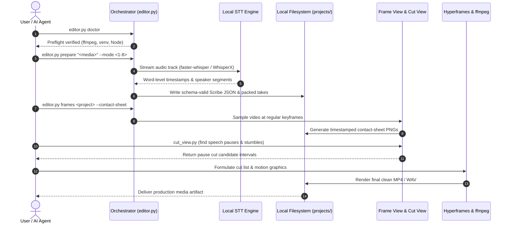

<p align="center"></p>

<p align="center">
  <a href="https://github.com/ellmos-ai/ai-media-editor"></a>
  <a href="https://github.com/ellmos-ai/ai-media-editor/actions/workflows/ci.yml"></a>
  <a href="https://github.com/ellmos-ai/ai-media-editor"></a>
  <a href="https://python.org"></a>
  <a href="https://github.com/ellmos-ai/ai-media-editor"></a>
  <a href="https://github.com/ellmos-ai/ai-media-editor"></a>
  <a href="https://github.com/ellmos-ai/ai-media-editor"></a>
  <a href="https://github.com/ellmos-ai/ai-media-editor/blob/main/SECURITY.md"></a>
  <a href="https://github.com/astral-sh/ruff"></a>
  <a href="https://github.com/ellmos-ai"></a>
  <a href="https://github.com/open-bricks"></a>
  <a href="llms.txt"></a>
  <a href="THIRD_PARTY_LICENSES.txt"></a>
  <a href="NOTICE"></a>
  <a href="https://github.com/ellmos-ai/ai-media-editor"></a>
  <a href="LICENSE"></a>
</p>

<p align="center"><a href="README.md">English</a> · <a href="README_de.md">Deutsch</a> · <a href="README_es.md">Español</a> · <a href="README_fr.md">Français</a> · <a href="README_zh.md">简体中文</a> · <a href="README_ja.md">日本語</a> · <a href="README_ru.md">Русский</a> · <a href="README_hi.md">हिन्दी</a> · <strong>العربية</strong></p>

# ai-media-editor — محرر وسائط محلي بالذكاء الاصطناعي (فيديو · صوت · بودكاست)

> [!NOTE]
> **تكامل أصيل مع الذكاء الاصطناعي/الوكلاء:** صُمم `ai-media-editor` خصيصاً لوكلاء البرمجة المستقلين (Claude Code وGemini/Antigravity وCodex). يوفر إعداداً حتمياً للمشاريع، وإنشاء مخطط Scribe JSON، ولوحات معاينة للإطارات ذات طوابع زمنية، كي تتمكن نماذج LLM من فحص الوسائط بصرياً وتحريرها محلياً من دون الاعتماد على خدمات SaaS خارجية.

### تنقّل سريع

| # | القسم | الوصف |
|---|---|---|
| 01 | [القدرات الأساسية](#key-capabilities) | قدرات المنسّق الأساسية، وتوجيه STT المحلي، ومجموعة أدوات الوكلاء |
| 02 | [مخطط البنية المرئية](#architecture-flowchart) | مخطط طوبولوجيا النظام ذي الطبقات الخمس من استقبال الوسائط الخام إلى التصدير الحتمي |
| 03 | [تسلسل دورة التنفيذ من البداية إلى النهاية](#end-to-end-execution-lifecycle-sequence) | مخطط تسلسلي يوضح الفحص المسبق وSTT ولوحات معاينة الإطارات وتنفيذ القص |
| 04 | [الشخصيات المستهدفة وقابلية الاكتشاف](#marketing--target-personas) | 4 ملفات أساسية للمستخدمين (`[PERSONA-01]`–`[PERSONA-04]`) واستعلامات SEO عالية القصد |
| 05 | [مصفوفة مقارنة البدائل](#comparative-matrix-vs-alternatives) | مصفوفة ميزات من 10 أبعاد مقارنةً بخدمات السحابة وNLE الثقيلة وCLI المباشر وواجهات API المستضافة |
| 06 | [حالات الاستخدام الإنتاجية الثماني](#the-8-usecases) | مصفوفة شاملة لسير عمل الصوت والفيديو والمواد التوضيحية والإعلانات |
| 07 | [البدء والإعداد](#getting-started--setup) | المتطلبات المسبقة وإعداد `<TOOLS_ROOT>` وتهيئة البيئة |
| 08 | [مرجع CLI والأوامر](#cli-reference--commands) | أوامر CLI خطوة بخطوة لـ `doctor` و`modes` و`prepare` و`frames` |
| 09 | [الرسوم المتحركة وتوليد الموسيقى](#motion-graphics--music-synthesis) | تنسيق Hyperframes وتأليف موسيقى دون اتصال من موجات NumPy وفقاً للقصة |
| 10 | [الحوكمة وثوابت وقت التشغيل](#governance--runtime-invariants) | 10 ثوابت موثقة لوقت التشغيل، ضمن نطاق وضع التشغيل المحدد (`INV-LOCAL-01` إلى `INV-SLA-10`) |
| 11 | [اتفاقية مستوى خدمة الأمان والخصوصية](#security--privacy-sla) | الوضع المحلي افتراضياً مع STT اختياري عبر SSH، واستجابة أولية خلال 48 ساعة وفرز خلال 5 أيام |
| 12 | [المشاريع الشقيقة ومصفوفة النظام البيئي](#sibling-projects--ecosystem-matrix) | 16 أداة مترابطة ضمن `ellmos-ai` و`dev-bricks` و`file-bricks` و`open-bricks` |
| 13 | [بوابات الجودة والاختبار](#quality-gates--testing) | مجموعة اختبارات آلية، وفحص Ruff، وcompileall، وإخفاء نوافذ وحدة التحكم |
| 14 | [السياق القابل للقراءة آلياً (`llms.txt`)](#machine-readable-context-llmstxt) | بيان لزواحف LLM وكلمات مفتاحية لفهرسة البحث وقواعد استيعاب الوكلاء للسياق |
| 15 | [بنية المستودع](#repository-structure) | تصنيف تفصيلي للمجلدات عبر الشيفرة والأدوات وSTT والاختبارات والمشاريع |
| 16 | [سجل التغييرات والإصدارات](#changelog--releases) | سجل الإصدارات ومحطاتها وتحديثات قابلية الاكتشاف في Pfad B |
| 17 | [SBOM من المستوى 1 وتراخيص الجهات الخارجية](#third-party-licenses--transparency) | قائمة تراخيص الجهات الخارجية وضمان RunAsInvoker وSBOM من المستوى 1 |
| 18 | [إشعار قانوني وحدود المسؤولية](#statutory-notice--liability-limitation) | ترخيص MIT وإشعار § 521 BGB بشأن Gefälligkeitsrecht وحدود المسؤولية |
| 19 | [المشروع الشقيق: `clip-storyboard-director`](#19-sister-project-clip-storyboard-director) | جانب المخرج من ثنائي المخرج/المونتير، مضمّن كتبعية اختيارية مثبتة الإصدار |

---

<a id="sec-01"></a><a id="key-capabilities"></a><a id="1-key-capabilities"></a><a id="hauptfunktionen"></a><a id="1-hauptfunktionen"></a>
## 1. القدرات الأساسية

استخدم وكيل برمجة بالذكاء الاصطناعي (مثل Claude Code أو Gemini أو Codex) كمحرر فيديو/بودكاست — مع **التفريغ المحلي بدلاً من ElevenLabs Scribe**. يتولى المنسّق (`editor.py`) الإعداد الحتمي (توجيه العمل إلى محرك STT/الحوسبة الأنسب، وإنشاء Scribe JSON مطابق للمخطط، وتجميع المقاطع المسجّلة)؛ أما القص الإبداعي والرسوم المتحركة وتركيب الوسائط فيتولاها الوكيل.

مجموعة من ثلاث أدوات:
- **video-use** — يحرر استناداً إلى نصوص مفرغة على مستوى الكلمات (ويزيل فترات الصمت والتلعثم).
- **Hyperframes** — يحول HTML/CSS/JS إلى رسوم متحركة ورسوم موشن بصيغة MP4.
- مهارة **`frontend-design`** — تنشئ الرسوم المتحركة وأصول العلامة التجارية.

… مع **استبدال تفريغ ElevenLabs Scribe** بمحركات محلية. الإعداد الافتراضي للمحادثات هو **faster-whisper** مع إسناد المتحدثين بواسطة LLM قائم على النص؛ أما **WhisperX** فهو محرك اختياري للتقسيم الصوتي للمتحدثين. تتم الحوسبة محلياً افتراضياً، مع خيار **الاستضافة البعيدة أولاً ثم الرجوع إلى المحلي**. يكتب البديل حقول Scribe نفسها التي يستخدمها `video-use`، لذا تعمل الأدوات اللاحقة دون تعديل.

---

<a id="sec-02"></a><a id="visual-architecture-flowchart"></a><a id="architecture-flowchart"></a><a id="systemarchitektur-ablaufdiagramm"></a><a id="2-visual-architecture-flowchart"></a><a id="2-systemarchitektur-ablaufdiagramm"></a>
## 2. مخطط البنية المرئية

```mermaid
flowchart TB
    subgraph Intake ["Layer 1: Input Channels & Media Intake"]
        V["Raw Video Recording (.mp4/.mov)"]
        A["Raw Audio Recording (.wav/.m4a)"]
        S["Storyline JSON (Narrative & Emotion)"]
    end

    subgraph Preflight ["Layer 2: Orchestrator & Preflight Inspection"]
        DOC["editor.py doctor<br/>Environment & Tooling Verification"]
        MODES["editor.py modes<br/>8 Specialized Media Use Cases"]
        PREP["editor.py prepare<br/>Project Staging & Metadata Contract"]
    end

    subgraph Engines ["Layer 3: Processing & Synthesis Engines"]
        FW["faster-whisper / WhisperX<br/>100% Local STT & Word Alignment"]
        DIAR["ai_media_editor/stt/diarize_llm.py<br/>Text-based Multi-Speaker Diarization"]
        MUSIC["ai_media_editor/tools/compose_music.py<br/>Procedural NumPy Waveform Synthesis"]
        HF["Hyperframes & hide-windows.cjs<br/>HTML/CSS/JS -> MP4 Motion Graphics"]
    end

    subgraph Agentic ["Layer 4: Agentic Interaction Layer"]
        SCRIBE["Scribe JSON Schema<br/>Word-level Timing for video-use"]
        FRAMES["ai_media_editor/tools/frame_view.py<br/>Timestamped Contact-Sheets"]
        CUTS["ai_media_editor/tools/cut_view.py<br/>Pause & Inflection Cut Candidates"]
        LLM["AI Coding Agent<br/>(Claude Code / Gemini / Codex)"]
    end

    subgraph Export ["Layer 5: Deterministic Export & Artefacts"]
        OUT_V["Rendered Master Video (.mp4)"]
        OUT_A["Clean Speaker-Separated Audio (.wav)"]
        OUT_M["Standard MIDI File (.mid) & Score"]
    end

    Intake --> Preflight
    Preflight --> Engines
    Engines --> Agentic
    Agentic --> Export
```



---

<a id="sec-03"></a><a id="end-to-end-execution-lifecycle-sequence"></a><a id="end-to-end-ausführungs-sequenz"></a><a id="3-end-to-end-execution-lifecycle-sequence"></a>
## 3. تسلسل دورة التنفيذ من البداية إلى النهاية



---

<a id="sec-04"></a><a id="target-personas--discoverability"></a><a id="marketing--target-personas"></a><a id="zielgruppen--auffindbarkeit"></a><a id="marketing--zielgruppen"></a><a id="4-target-personas--discoverability"></a>
## 4. الشخصيات المستهدفة وقابلية الاكتشاف

يعالج `ai-media-editor` أهم عوائق سير العمل في أتمتة الوسائط الحديثة بالذكاء الاصطناعي عبر أربع فئات متميزة:

### [PERSONA-01] مطورو وكلاء البرمجة المستقلين ومهندسو الأسراب
- **الملف:** مهندسو برمجيات يصممون تدفقات عمل متعددة الوكلاء (Claude Code وGemini/Antigravity وCodex CLI وKimi Code) لإنتاج الوسائط المستقل.
- **المشكلة:** تفرض خدمات STT السحابية الاحتكارية حدوداً لمعدلات طلبات API، وتتطلب أتمتة متصفح هشة، وتعرّض الوسائط السرية غير المنشورة لمورّدين خارجيين.
- **الحل:** تنسيق عبر CLI فقط، وإنشاء حتمي لمخطط Scribe JSON، ومرشحات قص عند الصمت، ولوحات معاينة للإطارات ذات طوابع زمنية يمكن لنماذج LLM متعددة الوسائط استيعابها مباشرة.
- **استعلام عالي القصد:** `"agent driven video editor with local transcription"`

### [PERSONA-02] صناع البودكاست ومنشئو المحتوى المعتمدون على المحلي أولاً
- **الملف:** صناع بودكاست مستقلون ومحاورون ومنشئو محتوى يديرون إصدارات أسبوعية للصوت والفيديو.
- **المشكلة:** تكاليف الاشتراك الشهري الباهظة لخدمات تحرير SaaS السحابية (Descript وRiverside)، وبطء رفع التسجيلات التي يتجاوز حجمها عدة غيغابايت.
- **الحل:** تفريغ faster-whisper في الوضع المحلي، ومسارات صوت منفصلة للمتحدثين، واقتطاع الصمت آلياً، وإنشاء فيديو غلاف متحرك إجرائياً. لا يفرض الكود إبقاء تحميل النماذج دون اتصال.
- **استعلام عالي القصد:** `"local first podcast editing AI agent workflow"`

### [PERSONA-03] مهندسو فيديو الذكاء الاصطناعي والرسوم المتحركة
- **الملف:** مطورو الواجهة الأمامية ومصممو الحركة الذين يؤتمتون أصول الفيديو المرئية ذات العلامة التجارية.
- **المشكلة:** تفتقر برامج NLE التقليدية (Premiere وAfter Effects) إلى واجهات برمجية واضحة ولا تستطيع تصيير الرسوم المتحركة مباشرةً من رموز تصميم CSS/HTML.
- **الحل:** يحول تكامل Hyperframes المباشر مكونات HTML/CSS/JavaScript إلى رسوم متحركة بصيغة MP4 بمعدل 60 إطاراً/ثانية، مع منع وميض نافذة وحدة التحكم في Windows.
- **استعلام عالي القصد:** `"Hyperframes motion graphics podcast editor"`

### [PERSONA-04] مسؤولو أمن الوسائط والامتثال في المؤسسات
- **الملف:** مسؤولو الامتثال وأمن المعلومات في القطاعات الخاضعة للتنظيم (الرعاية الصحية والقانون والمصارف).
- **المشكلة:** قد تمنع السياسات التنظيمية أو المتطلبات التعاقدية إرسال التسجيلات الاحتكارية إلى مزودي التفريغ المستضاف.
- **الحل:** STT المحلي هو الوضع الافتراضي؛ وعند اختيار `compute.prefer=mac` تُرسل نسخة كاملة من ملف الوسائط المُدخل إلى مضيف SSH المُعدّ. ينبغي أن يتوافق الوضع المحدد مع متطلبات المؤسسة للتعامل مع البيانات. كما أن تنفيذ `RunAsInvoker` دون امتيازات (`INV-RUNAS-02`)، وSBOM من المستوى 1، واتفاقية الاستجابة الرسمية للثغرات خلال 48 ساعة موثقة أيضاً.
- **استعلام عالي القصد:** `"zero egress video transcription and cutting"`

---

<a id="sec-05"></a><a id="comparative-matrix-vs-alternatives"></a><a id="comparative-matrix--alternatives"></a><a id="vergleichsmatrix-gegenueber-alternativen"></a><a id="5-comparative-matrix-vs-alternatives"></a>
## 5. مصفوفة مقارنة البدائل

تقارن المصفوفة التالية ذات الأبعاد العشرة `ai-media-editor` بالأساليب القديمة والمنافسة، باستخدام ثوابت وقت التشغيل الموثقة ضمن نطاق وضع التشغيل المحدد:

| البُعد والثابت | ai-media-editor | SaaS سحابي (Descript / ElevenLabs) | برامج NLE تجارية (Premiere / DaVinci) | CLI / Shell مباشر (FFmpeg) | واجهات API مستضافة (Whisper API / Google STT) |
|---|:---:|:---:|:---:|:---:|:---:|
| **1. المحلي أولاً وتدفق البيانات بحسب الوضع (`INV-LOCAL-01`)** | :white_check_mark: محلي افتراضياً؛ STT عبر SSH اختياري | :x: رفع إلزامي إلى السحابة | :warning: محلي (قياس استخدام احتكاري) | :white_check_mark: محلي دون اتصال 100% | :x: معالجة سحابية خارجية |
| **2. وضع مستخدم دون امتيازات (`INV-RUNAS-02`)** | :white_check_mark: `RunAsInvoker` قياسي | :warning: متصفح / تطبيق مساعد | :warning: مُثبّت / خدمة بصلاحيات إدارية | :white_check_mark: صلاحيات المستخدم العادي | :white_check_mark: مستوى عميل API |
| **3. حماية المصدر دون إتلاف (`INV-PREV-03`)** | :white_check_mark: يحافظ `prepare` على الإدخال الأصلي | :warning: تكرار الوسائط في السحابة | :white_check_mark: مشاريع غير إتلافية | :warning: سهولة الكتابة فوق الملفات بالخطأ | :white_check_mark: الحفاظ على وسائط الإدخال |
| **4. التوليد الحتمي (`INV-DETERM-04`)** | :white_check_mark: Scribe JSON ومقطوعة موسيقية ببذرة ثابتة | :x: تغيّر احتمالي في نتائج السحابة | :warning: حالة مشروع معقدة | :warning: مخرجات غير منظمة | :x: زمن استجابة غير حتمي |
| **5. التحقق من اسم المشروع (`INV-BOUNDARY-05`)** | :white_check_mark: فحص نصّي للاسم؛ ليس سياجاً لنظام الملفات | :warning: حاوية سحابية مستضافة | :warning: نظام ملفات اعتباطي | :x: لا يوجد تحقق من المسار | :white_check_mark: حدّ المستأجر السحابي |
| **6. منع وميض النوافذ (`INV-SUBPROC-06`)** | :white_check_mark: تحميل مسبق لـ `windowsHide` | :heavy_minus_sign: لا ينطبق (واجهة ويب) | :heavy_minus_sign: لا ينطبق (واجهة سطح مكتب) | :x: ومضات مزعجة لوحدة التحكم | :heavy_minus_sign: لا ينطبق (طلبات HTTP) |
| **7. دعم الأنظمة المتعددة (`INV-PARITY-07`)** | :white_check_mark: Windows وLinux وmacOS مع مسارات خاصة بكل نظام | :warning: يعتمد على المتصفح | :x: ميزات خاصة بنظام التشغيل | :white_check_mark: POSIX / Windows | :white_check_mark: HTTP متعدد المنصات |
| **8. التزامن متعدد الوكلاء (`INV-SYNC-08`)** | :white_check_mark: انضباط الأقفال ونظافة Git | :x: جلسة SaaS لمستخدم واحد | :x: أقفال مشروع لمحرر واحد | :warning: تعارضات التزامن | :warning: اختناقات حدود المعدل |
| **9. قابلية القراءة للوكلاء وLLM (`INV-DOCS-09`)** | :white_check_mark: Scribe JSON ولوحات معاينة الإطارات و`llms.txt` | :x: ملفات ثنائية مغلقة / DOM HTML | :x: ملفات مشروع ثنائية معقدة | :warning: نص خام عبر stdout/stderr | :warning: نصوص مفرغة فقط |
| **10. اتفاقية خدمة أمنية منسقة (`INV-SLA-10`)** | :white_check_mark: استجابة خلال 48 ساعة / فرز خلال 5 أيام | :warning: طابور دعم المؤسسات | :warning: تحديثات تجارية ربع سنوية | :heavy_minus_sign: سكربتات غير مُصانة | :warning: اتفاقية مستوى الخدمة السحابية القياسية |

تحليل التسويق التفصيلي وكلمات البحث وسجل الاكتشاف: [`MARKETING-LOG.txt`](MARKETING-LOG.txt).

---

<a id="sec-06"></a><a id="the-8-production-usecases"></a><a id="the-8-usecases"></a><a id="die-8-anwendungsfälle"></a><a id="6-the-8-production-usecases"></a>
## 6. حالات الاستخدام الإنتاجية الثماني

| # | الإدخال | المتحدثون | الإخراج | سير العمل المعتاد |
|---|---|---|---|---|
| 1 | صوت | 1 | بودكاست صوتي محرر | تنظيف كلام متحدث واحد واقتطاع فترات الصمت |
| 2 | صوت | متعددون | بودكاست صوتي مفصول حسب المتحدث | تنظيف حوار متعدد المسارات مع تحديد المتحدثين |
| 3 | فيديو (صوت + صورة) | 1 | فيديو محرر + رسوم متحركة | قص فيديو لشخص يتحدث أمام الكاميرا مع عناوين سفلية آلية من Hyperframes |
| 4 | فيديو (صوت + صورة) | متعددون | فيديو + رسوم متحركة + تتبع المتحدثين | فيديو مقابلة متعددة المتحدثين مع بطاقات ديناميكية لهم |
| 5 | فيديو → صوت فقط | 1/متعدد | بودكاست صوتي (حذف الفيديو) | استخراج بودكاست صوتي نقي من لقطات الفيديو |
| 6 | صوت | 1/متعدد | فيديو توضيحي مولّد بالكامل | مسار صوتي مع مشاهد رسوم متحركة بتنسيق من الذكاء الاصطناعي |
| 7 | صوت | 1 | صوت + غلاف متحرك | مسار بودكاست ضمن حلقة متحركة لأسطوانة/موجة صوتية |
| 8 | صوت/موجز | 1 | مقطع إعلاني (15–60 s, 16:9 + 9:16) | مصنع سريع لمقاطع قصيرة عبر Hyperframes |

للحصول على أدلة كاملة خطوة بخطوة لكل وضع، راجع [`docs/USECASES.md`](docs/USECASES.md).

---

<a id="sec-07"></a><a id="getting-started--setup"></a><a id="erste-schritte--einrichtung"></a><a id="7-getting-started--setup"></a>
## 7. البدء والإعداد

1. **أنشئ الإعدادات:** انسخ `config/settings.example.json` إلى `config/settings.json` واضبط خيارات الحوسبة المحلية (`local`/`mac`) والمحركات و`paths.*`. عيّن `paths.venv_python` إلى ملف Python التنفيذي في نظام التشغيل هذا؛ تُستخدم القيمة المضبوطة مباشرةً. مسار `.venv/Scripts/python.exe` في المثال خاص بـ Windows؛ وتستخدم بيئات POSIX عادةً `.venv/bin/python`.
2. **مجلد الأدوات (`<TOOLS_ROOT>`):** يحدد `paths.tools_root` في `settings.json` جذر الأدوات الثقيلة (`video-use` وffmpeg وNode ≥ 22). **لا** تضعه داخل مجلد تتم مزامنته سحابياً.
3. **المتطلبات الخارجية:**
   - **محلياً:** `ffmpeg` و`Node.js >= 22` (لـ Hyperframes) وبيئة Python افتراضية بإصدار 3.10–3.13.
   - **مضيف بعيد اختياري:** faster-whisper وWhisperX على جهاز بعيد يمكن الوصول إليه عبر SSH.
   - **رمز HuggingFace:** مطلوب فقط عند ضبط `engines.multi_speaker` على `whisperx`.
4. **اختياري: التثبيت كحزمة.** يؤدي التثبيت باستخدام `pip install -e .` أو الخيار `-e ".[storyboard]"` إلى تسجيل سكربت سطر الأوامر
   `ai-media-editor`؛ ويُثبّت الخيار الثاني أيضاً [`clip-storyboard-director`](#19-sister-project-clip-storyboard-director).
   وهذا السكربت يعادل تشغيل `python editor.py` أدناه.

---

<a id="sec-08"></a><a id="cli-reference--commands"></a><a id="cli-referenz--befehle"></a><a id="8-cli-reference--commands"></a>
## 8. مرجع CLI والأوامر

```bash
# Set Python venv path
VENV="<TOOLS_ROOT>/.venv/Scripts/python.exe"

# 1. Environment & toolchain verification
PYTHONIOENCODING=utf-8 "$VENV" editor.py doctor

# 2. Display supported operational use cases
PYTHONIOENCODING=utf-8 "$VENV" editor.py modes

# 3. Prepare a media project (deterministic transcription + take packing)
PYTHONIOENCODING=utf-8 "$VENV" editor.py prepare "/path/to/recording.mp4" --mode 3 --project my-video

# 4. Generate timestamped frame contact-sheets for visual LLM inspection
PYTHONIOENCODING=utf-8 "$VENV" editor.py frames my-video --contact-sheet

# 5. Extract detailed frame interval
PYTHONIOENCODING=utf-8 "$VENV" editor.py frames my-video --from 30 --to 45 --step 0.25
```

---

<a id="sec-09"></a><a id="motion-graphics--music-synthesis"></a><a id="motion-graphics--musiksynthese"></a><a id="9-motion-graphics--music-synthesis"></a>
## 9. الرسوم المتحركة وتوليد الموسيقى

### تأليف موسيقي متزامن مع الفيديو دون اتصال (`compose_music.py`)
تؤلف `ai_media_editor.tools.compose_music` موسيقى خلفية تتبع قصة الفيديو — محلياً بنسبة 100% ومن دون أي خدمات سحابية.
الإدخال هو **ملف JSON للقصة** يحدد أقساماً ذات نوافذ زمنية دقيقة ومشاعر ومستويات شدة:

```bash
# Compose music from storyline JSON
python -m ai_media_editor.tools.compose_music docs/examples/storyline-roshambo.json -o projects/<name>/assets/score

# Generate storyline template
python -m ai_media_editor.tools.compose_music --init

# Run deterministic synthesis selftest
python -m ai_media_editor.tools.compose_music --selftest
```

المخرجات: WAV ستيريو + MP3 + `<name>.notes.json` + `<name>.mid` (ملف MIDI قياسي من النوع 1).

### تصدير MIDI والتصيير عالي الدقة
يتيح تصدير MIDI التصيير دون فقدان عبر soundfonts احترافية:
- **المسار A — SoundFont (محلي ومجاني):** FluidSynth (`winget install FluidSynth`) مع GeneralUser GS / MuseScore_General:
  `fluidsynth -ni soundfont.sf2 out.mid -F out.wav -r 44100`
- **المسار B — مكتبات أوركسترالية:** VSCO 2 Community Edition أو Salamander Grand Piano.

### تجميع حلقات متعددة المقاطع وضمان الجودة وتوليد الأجواء الصوتية (`make_loop.py` و`qa_clips.py` و`atmo.py` و`synth.py` و`fx.js`)
إضافةً إلى ذلك، توفر `ai_media_editor.tools`، المنقولة من خط إنتاج Halloween Window Projection (`T-20261025-256694132`)، أدوات قابلة لإعادة الاستخدام لحلقات المشاهد وتصميم الصوت إجرائياً:
- **`ai_media_editor.tools.make_loop`**: يصل مقاطع المشهد المُصيّرة (`<sid>.mp4`) مع فترات توقف سوداء قابلة للضبط (`loop.json` أو `--pause`) ومسار صوت AAC اختياري بتردد 48 kHz (`--audio`):
  `python -m ai_media_editor.tools.make_loop docs/examples/loop-halloween.json renders/ -o loop.mp4 [--pause 8] [--audio atmo.wav]`
- **`ai_media_editor.tools.qa_clips`**: يتحقق من المقاطع المُصيّرة عبر `ffprobe`، ويقيس إضاءة أول إطار وآخره (للتحقق من مستوى السواد)، ويستخرج إطارات البداية والمنتصف والنهاية والذروة، وينشئ لوحة معاينة للإطارات باستخدام `xstack` (`qa.json` و`VORSCHAU_kontaktbogen.jpg`):
  `python -m ai_media_editor.tools.qa_clips renders/ qa_out/`
- **`ai_media_editor.tools.synth` و`ai_media_editor.tools.atmo`**: توليد إجرائي للآلات الموسيقية والأجواء الصوتية باستخدام NumPy/SciPy بتردد 48 kHz (`chip_pulse` و`marimba` و`glock` و`pizz` و`flute` و`fm_brass` و`fm_bell` و`make_ir`)، ومولّد للمشاهد الصوتية القابلة للتكرار وفق شبكة المشاهد، مع معالجة نهائية تكرارية للصوت وضبط الجهارة وفق EBU R128 (`-16 LUFS-I`) والذروة الحقيقية (`<= -3.5 dBTP`):
  `python -m ai_media_editor.tools.atmo docs/examples/loop-halloween.json -o atmo.wav [--pause 8]`
- **`ai_media_editor/tools/fx.js` (`window.HFX`)**: مساعدات حتمية وآمنة عند التنقل في الخط الزمني لمشاهد HyperFrames، ومنها `HFX.ft` (غلاف GSAP `fromTo` يفرض `immediateRender: false` لإبقاء التأثيرات مخفية قبل بدء tween) و`HFX.drive` و`HFX.rng` (mulberry32) و`HFX.noise1` و`HFX.key` و`HFX.bump` و`HFX.path` و`HFX.spider` و`HFX.bat`.

---

<a id="sec-10"></a><a id="governance--runtime-invariants"></a><a id="governance---laufzeit-invarianten"></a><a id="10-governance--runtime-invariants"></a>
## 10. الحوكمة وثوابت وقت التشغيل

توثق البنية 10 ثوابت لوقت التشغيل؛ ويتوقف السلوك على وضع التشغيل المحدد:

| معرّف الثابت | مجال التشغيل | الضمان وقاعدة الإنفاذ | آلية التحقق |
|---|---|---|---|
| `INV-LOCAL-01` | الخصوصية وخروج البيانات | **محلي أولاً افتراضياً**: عند `compute.prefer=local` يعمل STT على هذا الجهاز؛ ولا يفرض الكود إبقاء تحميل النماذج دون اتصال. عند `compute.prefer=mac` تُرسل نسخة كاملة من ملف الوسائط المُدخل إلى مضيف SSH المُعدّ، ويُرسل رمز HF المُعدّ أيضاً. تُجرى محاولة للتنظيف عن بُعد داخل كتلة `finally`، لكن لا يُتحقق من نجاحها. | `tests/test_core.py` و`editor.py` و`ai_media_editor/stt/mac_remote.py` |
| `INV-RUNAS-02` | الامتيازات والعزل | **وضع مستخدم عادي دون امتيازات (`RunAsInvoker`)**: لا تتطلب المكونات صلاحيات إدارية أو رفعاً للامتيازات. | تشغيل جميع السكربتات بحساب مستخدم عادي |
| `INV-PREV-03` | التخزين وعدم التغيير | **معالجة غير إتلافية للإدخال**: يترك `prepare` الإدخال الأصلي دون تغيير وينسخه إلى `projects/<name>/`. قد يستخدم الصوت المؤقت مجلد النظام المؤقت؛ كما يستخدم الوضع البعيد مجلد العمل المُعدّ على SSH. | فحوصات العزل في `tests/test_core.py` |
| `INV-DETERM-04` | قابلية إعادة الإنتاج | **توليد حتمي واستقرار المخطط**: بذرة ثابتة للصوت المُولّد إجرائياً والتزام صارم بمخطط Scribe JSON. | `tests/test_compose_music.py` و`ai_media_editor/stt/scribe_schema.py` |
| `INV-BOUNDARY-05` | التحقق من اسم المشروع | **فحوص نصية لأسماء المشاريع**: تُفحص أسماء المشاريع بوصفها مكونات مسار مفردة؛ وهذا ليس عزلًا لنظام الملفات. | `test_project_names_cannot_escape_projects` |
| `INV-SUBPROC-06` | تنقية العمليات | **دورة حياة نظيفة ومنع وميض النوافذ**: تمنع الأغلفة المحمّلة مسبقاً وميض وحدة التحكم على Windows. | `ai_media_editor/tools/hf.cmd` و`ai_media_editor/tools/hide-windows.cjs` |
| `INV-PARITY-07` | دعم أنظمة تشغيل متعددة | **دعم متعدد المنصات**: تُضبط المسارات والملفات التنفيذية لنظام التشغيل المستخدم؛ راجع مصفوفة CI للأنظمة التي خضعت للاختبار. | مصفوفة CI متعددة الأنظمة في GitHub Actions |
| `INV-SYNC-08` | التزامن والأقفال | **انضباط المزامنة السحابية وأقفال الوكلاء المتعددين**: تُستبعد الأدوات الثقيلة والمشاريع من تعارضات المزامنة السحابية. | قواعد تصفية التعارضات والأقفال في `.gitignore` |
| `INV-DOCS-09` | سهولة الوصول والاكتشاف | **جاهزية LLM متعدد الوسائط وتكافؤ ثنائي اللغة**: لوحات معاينة للإطارات لنماذج LLM ذات القدرة على الرؤية؛ وتكافؤ كامل لوثائق EN/DE. | اختبارات العقود البرمجية في `llms.txt` و`README.md` و`README_de.md` |
| `INV-SLA-10` | الأمن والاستجابة للحوادث | **استجابة أمنية خلال 48 ساعة وفرز خلال 5 أيام**: الإبلاغ الرسمي عن الثغرات عبر GitHub Advisories ورسائل البريد إلى المشرفين. | `SECURITY.md` و`test_security_policy_bilingual_parity` |

---

<a id="sec-11"></a><a id="security--privacy-sla"></a><a id="sicherheit--datenschutz-sla"></a><a id="11-security--privacy-sla"></a>
## 11. اتفاقية مستوى خدمة الأمان والخصوصية

- **المعالجة المحلية أولاً**: STT المحلي هو الوضع الافتراضي، لكن الكود لا يفرض إبقاء تحميل النماذج دون اتصال. عند `compute.prefer=mac` تُرسل نسخة كاملة من ملف الوسائط المُدخل إلى مضيف SSH المُعدّ؛ كما يُرسل رمز HF المُعدّ.
- **التعامل مع الوسائط الحساسة**: يترك `prepare` التسجيل الأصلي في مسار الإدخال دون تغيير، وينسخه إلى `projects/<name>/`. قد يُخزن الصوت المؤقت في مجلد النظام المؤقت. ويخزن الوضع البعيد نسخة عمل في `workdir` المُعدّ على SSH؛ وتُجرى محاولة للتنظيف داخل كتلة `finally`، لكن لا يُتحقق من نجاحها.
- **التزام الاستجابة للثغرات:**
  - **اتفاقية الاستجابة الأولية:** تأكيد استلام تقارير الثغرات المقدمة خلال 48 ساعة.
  - **اتفاقية الفرز الفني:** خلال 5 أيام عمل مع تقييم مستوى الخطورة.
  - **قناة الإبلاغ:** [GitHub Security Advisories](https://github.com/ellmos-ai/ai-media-editor/security/advisories) أو مباشرةً عبر البريد إلى `security@open-bricks.org` و`security@ellmos.ai` و`support@lukasgeiger.com` و`lukas@open-bricks.org`.
  - للتفاصيل الكاملة، راجع [`SECURITY.md`](SECURITY.md).

---

<a id="sec-12"></a><a id="sibling-projects--ecosystem-matrix"></a><a id="geschwisterprojekte--ökosystem-matrix"></a><a id="12-sibling-projects--ecosystem-matrix"></a>
## 12. المشاريع الشقيقة ومصفوفة النظام البيئي

يعمل `ai-media-editor` كمحرك متخصص لتنسيق الوسائط المتعددة ضمن النظام البيئي لـ `open-bricks` و`ellmos-ai`:

| المستودع | المؤسسة | المجال / الغرض | التكامل ضمن النظام البيئي |
|---|---|---|---|
| [`clip-storyboard-director`](https://github.com/ellmos-ai/clip-storyboard-director) | `ellmos-ai` | إنشاء لوحات قصصية وتوجيه المشاهد | إنشاء تسلسل المشاهد لحالات استخدام الفيديو |
| [`assistant-core`](https://github.com/ellmos-ai/assistant-core) | `ellmos-ai` | الإشراف الحواري وبيئة تشغيل الوكلاء | تنسيق مهام تحرير الوسائط المستقلة |
| [`decision-clicker`](https://github.com/ellmos-ai/decision-clicker) | `ellmos-ai` | بوابة تفاعلية لمراجعة المستخدم | مراجعة القصات المقترحة وقرارات التحرير |
| [`lock-master`](https://github.com/ellmos-ai/lock-master) | `ellmos-ai` | إطار أقفال متعدد الوكلاء يرفض افتراضياً عند الفشل | حماية ملفات المشاريع وأقفال التصيير من تعارضات التزامن |
| [`clutch`](https://github.com/ellmos-ai/clutch) | `ellmos-ai` | مشرف عمليات ومجدول مهام | الإشراف على مهام التصيير وSTT طويلة الأمد |
| [`system-explorer`](https://github.com/ellmos-ai/system-explorer) | `ellmos-ai` | اكتشاف العتاد والقدرات المحلية | كشف GPU وCUDA والتسريع العتادي |
| [`roblox-studio-core`](https://github.com/ellmos-ai/roblox-studio-core) | `ellmos-ai` | التقاط استوديو ثلاثي الأبعاد وأتمتته دون واجهة رسومية | أصول بصرية ثلاثية الأبعاد وإطارات رسوم متحركة |
| [`usb-podcast-studio`](https://github.com/entertain-and-more/usb-podcast-studio) | `entertain-and-more` | التقاط الصوت وبثه من عتاد USB | مصدر تسجيل عالي الدقة لأوضاع البودكاست |
| [`BattleStage`](https://github.com/entertain-and-more/BattleStage) | `entertain-and-more` | محاكاة فيزيائية يتحكم فيها الخادم | معالجة لقطات الألعاب وفيديو الإعادات |
| [`DevCenter`](https://github.com/dev-bricks/DevCenter) | `dev-bricks` | مدير بيئة المطور ومساحة العمل | إدارة الأدوات المحلية وبيئات venv التطويرية |
| [`MethodenAnalyser`](https://github.com/dev-bricks/MethodenAnalyser) | `dev-bricks` | مقاييس ثابتة لشيفرة Python وتدقيق الدوال | تحليل جودة شيفرة وحدات محرر الوسائط |
| [`ExplorerPro`](https://github.com/file-bricks/ExplorerPro) | `file-bricks` | مدير ملفات سريع لسطح المكتب (PySide6) | تصفح المشاريع بصرياً وتنظيم ملفات الوسائط |
| [`ProFiler`](https://github.com/file-bricks/ProFiler) | `file-bricks` | تحليل معمق للمجلدات وفحصها | فهرسة أصول الوسائط وتحليل ذاكرة التخزين المؤقت |
| [`CloudLockFixer`](https://github.com/file-bricks/CloudLockFixer) | `file-bricks` | إصلاح تعارضات المزامنة بين عدة مضيفين | تنظيف ملفات الأقفال ونسخ تعارضات السحابة |
| [`FormularErstellen`](https://github.com/doc-bricks/FormularErstellen) | `doc-bricks` | منشئ تخطيط ديناميكي لملفات PDF والمستندات | إنشاء تقارير المشاريع وملخصات الإنتاج |
| [`open-bricks`](https://github.com/open-bricks/open-bricks) | `open-bricks` | مؤسسة جامعة لمعايير المصادر المفتوحة | الحوكمة المرجعية للنظام البيئي وتكافؤ التراخيص |

---

<a id="sec-13"></a><a id="quality-gates--testing"></a><a id="qualitätsprüfung--tests"></a><a id="13-quality-gates--testing"></a>
## 13. بوابات الجودة والاختبار

شغّل فحوص الجودة السريعة محلياً من دون نماذج STT خارجية أو ملفات وسائط ضخمة:

```bash
# Run complete test suite
python -m pytest -ra -v

# Run lint checks
ruff check .

# Validate bytecode compilation
python -m compileall -q .

# Verify CLI modes
python editor.py modes
```

### منع نوافذ وحدة التحكم في Windows
تمر العمليات الفرعية لكل من Hyperframes وNode عبر `ai_media_editor/tools/hf.cmd` و`ai_media_editor/tools/hide-windows.cjs` لفرض `windowsHide: true` وإزالة وميض نوافذ وحدة التحكم المشتت أثناء التصيير. التفاصيل: [`docs/WINDOWS-KONSOLENFENSTER.md`](docs/WINDOWS-KONSOLENFENSTER.md).

---

<a id="sec-14"></a><a id="machine-readable-context-llmstxt"></a><a id="maschinenlesbarer-kontext-llmstxt"></a><a id="14-machine-readable-context-llmstxt"></a>
## 14. السياق القابل للقراءة آلياً (`llms.txt`)

يمكن لزواحف LLM ومساعدات البرمجة ووكلاء الفهرسة الآلية تحليل سياق المستودع مباشرةً عبر [`llms.txt`](llms.txt).

عبارات البحث الأساسية:
```text
ellmos-ai/ai-media-editor
local AI media editor video podcast transcription
agent driven video editor with local transcription
Claude Code video podcast editor Hyperframes
faster-whisper WhisperX Scribe JSON video-use
transcript based video cutting local first
Hyperframes motion graphics podcast editor
offline procedural music synthesis storyline numpy
zero egress video transcription and cutting
```

---

<a id="sec-15"></a><a id="repository-structure"></a><a id="repository-struktur"></a><a id="15-repository-structure"></a>
## 15. بنية المستودع

```
ai-media-editor/                  (code/docs/projects)
├── CLAUDE.md                     ← agent guide (editor workflow, German)
├── README.md                     ← English overview & 18-point visual architecture
├── README_de.md                  ← German documentation (1:1 anchor parity)
├── editor.py                     ← compatibility shim for documented direct calls
├── ai_media_editor/editor.py     ← orchestrator (prepare / frames / modes / doctor)
├── ai_media_editor/tools/
│   ├── cut_view.py               ← pauses as explicit cut candidates
│   ├── frame_view.py             ← video → timestamped frames ("video-scatterer", UC3/4/8)
│   ├── compose_cover.py          ← UC7: loop a cover over audio
│   ├── compose_music.py          ← storyline JSON → video-synced score (NumPy waveform synthesis)
│   ├── synth.py / atmo.py        ← 48 kHz SciPy instrument synthesis & loopable EBU R128 atmo generator
│   ├── make_loop.py / qa_clips.py← multi-clip black-pause loop builder & ffprobe/luma QA contact sheet
│   ├── fx.js                     ← deterministic HyperFrames scene helpers (HFX.ft, HFX.drive, SVG rigs)
│   ├── hf.cmd / hf-hidden.vbs    ← Windows console window suppression wrappers
│   └── hide-windows.cjs          ← Node.js preload script enforcing windowsHide: true
├── ai_media_editor/stt/
│   ├── scribe_schema.py          ← Scribe-JSON format (contract with video-use)
│   ├── transcribe_local.py       ← faster-whisper + WhisperX → Scribe-JSON
│   ├── diarize_llm.py            ← token-free text-based speaker assignment
│   └── mac_remote.py             ← compute routing (remote primary, local fallback)
├── config/settings.example.json  ← template: compute, engines, models, paths, HF token
├── brand/design-tokens.css       ← branding tokens for generated animations
├── docs/USECASES.md              ← step-by-step per mode
├── production/                   ← optional generative workflows (cloud gates apply)
├── tests/
│   ├── test_core.py              ← dependency-free regression suite
│   ├── test_compose_music.py     ← storyline & waveform synthesis tests
│   └── test_metadata.py          ← automated contract tests for manifests & discoverability
├── SECURITY.md                   ← private vulnerability reporting and security scope
├── THIRD_PARTY_LICENSES.md       ← Level 1 SBOM and third-party license inventory
├── MARKETING-LOG.txt             ← discoverability, personas, matrix & architecture audit
└── projects/<name>/edit/         ← per project: transcripts/, takes_packed.md, … (gitignored)

<TOOLS_ROOT>/                     (NOT a cloud folder — venv/tools)
├── .venv/                        ← Python venv (faster-whisper, video-use, …)
└── video-use/                    ← cloned browser-use/video-use (unpatched)
```

---

<a id="sec-16"></a><a id="changelog--releases"></a><a id="changelog--veröffentlichungen"></a><a id="16-changelog--releases"></a>
## 16. سجل التغييرات والإصدارات

راجع [`CHANGELOG.md`](CHANGELOG.md) للاطلاع على سجل الإصدارات كاملاً.
- **الإصدار 0.2.3 (2026-09-20):** إعادة تصميم شاملة للبنية المرئية وقابلية الاكتشاف في Pfad B، وتكافؤ التنقل ثنائي اللغة ذي 18 بنداً، ومصفوفة مقارنة من 10 أبعاد مقابل 4 بدائل، وتوثيق 4 شخصيات مستهدفة (`[PERSONA-01]` إلى `[PERSONA-04]`)، وجدول إحالة ثوابت SBOM من المستوى 1 في `THIRD_PARTY_LICENSES.md`، وشهادة عدم رفع الصلاحيات باستخدام `RunAsInvoker`، وإشعار قانوني وفق § 521 BGB.
- **الإصدار 0.2.2 (2026-09-12):** مراجعة النظافة التقنية في Pfad A، وضوابط مهلة مشغّل CI (`timeout-minutes: 15`)، وإدارة آلية لدورة حياة المسائل وطلبات السحب القديمة، وتعزيز `.gitignore`، ومجموعات اعتمادية اختيارية في `pyproject.toml`.
- **الإصدار 0.2.1 (2026-09-11):** تحسين قابلية الاكتشاف، وتدقيق مخصص لتراخيص الجهات الخارجية، وروابط PEP 621 الموسعة، ومجموعة أولية لاختبارات العقود البرمجية.
- **الإصدار 0.2.0 (2026-09-09):** تعزيز خط المعالجة المحلي أولاً، واختبارات عقود برمجية آلية، ومصفوفة CI لأنظمة متعددة، وتكافؤ ثنائي اللغة، ومخططي Mermaid، و10 ثوابت للحوكمة.

---

<a id="sec-17"></a><a id="level-1-sbom--third-party-licenses"></a><a id="third-party-licenses--transparency"></a><a id="drittanbieter-lizenzen--transparenz"></a><a id="17-level-1-sbom--third-party-licenses"></a>
## 17. SBOM من المستوى 1 وتراخيص الجهات الخارجية

يوثق `ai-media-editor` تراخيص مكوناته ويركز على التشغيل دون امتيازات خاصة:

- **قائمة تراخيص الجهات الخارجية:** راجع [`THIRD_PARTY_LICENSES.md`](THIRD_PARTY_LICENSES.md) للاطلاع على التراخيص المسجلة للمكونات المذكورة؛ وتحقق من الترخيص المنطبق قبل الاستخدام.
- **STT محلي أولاً (`INV-LOCAL-01`):** التفريغ المحلي هو الوضع الافتراضي. لا يفرض تحميل النماذج دون اتصال؛ وعند اختيار `compute.prefer=mac` تُرسل نسخة كاملة من ملف الوسائط المُدخل إلى مضيف SSH المُعدّ، كما يُرسل رمز HF المُعدّ.
- **التنفيذ بحساب مستخدم عادي (`INV-RUNAS-02`):** تعمل جميع المكونات حصراً ضمن حسابات مستخدمين عادية دون امتيازات خاصة (`RunAsInvoker`)، ولا تتطلب صلاحيات إدارية أو رفعاً لامتيازات root.
- **SBOM من المستوى 1 وربط الحوكمة:** تُدرج المصادر الأصلية والمشرفون ونصوص التراخيص والثوابت الحاكمة في [`THIRD_PARTY_LICENSES.md`](THIRD_PARTY_LICENSES.md).
- **ترخيص المشروع الأساسي:** [ترخيص MIT](LICENSE) © 2026 ellmos-ai / open-bricks.

---

<a id="sec-18"></a><a id="statutory-notice--liability-limitation"></a><a id="gesetzlicher-hinweis--haftungsbeschraenkung"></a><a id="18-statutory-notice--liability-limitation"></a>
## 18. إشعار قانوني وحدود المسؤولية

يُقدَّم هذا البرنامج مجاناً كبرنامج مفتوح المصدر بموجب ترخيص MIT. وبموجب القانون الألماني (§ 521 BGB — *Gefälligkeitsrecht* / العقود دون مقابل)، تقتصر المسؤولية عند تقديم البرنامج مجاناً على القصد (*Vorsatz*) والإهمال الجسيم (*grobe Fahrlässigkeit*). وعلى وجه الخصوص، لا تُقدَّم ضمانات للملاءمة لغرض معين أو للقابلية للتسويق أو للخلو من العيوب.

---

<a id="19-sister-project-clip-storyboard-director"></a>
## 19. المشروع الشقيق: `clip-storyboard-director`

[`clip-storyboard-director`](https://github.com/ellmos-ai/clip-storyboard-director) هو
المخرج المقابل للمونتير في هذا المحرر ضمن نموذج إنتاج إعلامي من وكيلين؛ ويتولى
مرحلة ما قبل الإنتاج (تفكيك النص إلى مشاهد، وتوقيت اللقطات، وصياغة مطالبات مولّد الفيديو بالذكاء الاصطناعي عبر أتمتة متصفح CDP،
ومخازن حفظ الحالة والاستمرارية رباعية الأبعاد)، ثم يسلّم نسخة مونتاج أولية مجمّعة
إلى `ai-media-editor` ليكملها (التحرير غير الخطي، وتصحيح الألوان، والانتقالات، وخفض مستوى الصوت تلقائياً،
والتصيير النهائي). يعمل كل منهما مستقلاً ولا يتطلب تشغيل أحدهما الآخر.

أُعلن عنه كتبعية `storyboard` اختيارية في `pyproject.toml` لهذا المشروع،
وثُبّت على لقطة محددة من سجل Git خضعت للمراجعة لضمان قابلية إعادة الإنتاج. عند تثبيت المشروعين معاً في خطوة واحدة،
يُسجّل أمر سطر الأوامر `ai-media-editor`:

```bash
pip install -e ".[storyboard]"
ai-media-editor modes
clip-director --version
```

يحمل `clip-storyboard-director` ترخيص MIT نفسه لهذا المشروع؛ راجع قائمته الخاصة بالمكونات في
[`THIRD_PARTY_LICENSES.md`](https://github.com/ellmos-ai/clip-storyboard-director/blob/main/THIRD_PARTY_LICENSES.md)
للاطلاع على قائمة مكوناته.
