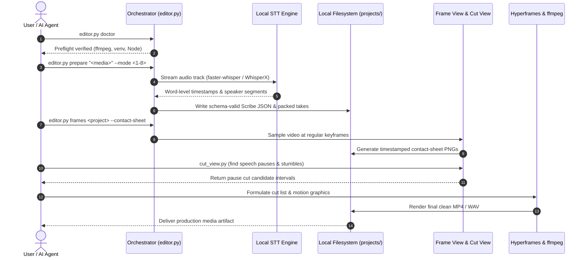

<p align="center"></p>

<p align="center">
  <a href="https://github.com/ellmos-ai/ai-media-editor"></a>
  <a href="https://github.com/ellmos-ai/ai-media-editor/actions/workflows/ci.yml"></a>
  <a href="https://github.com/ellmos-ai/ai-media-editor"></a>
  <a href="https://python.org"></a>
  <a href="https://github.com/ellmos-ai/ai-media-editor"></a>
  <a href="https://github.com/ellmos-ai/ai-media-editor"></a>
  <a href="https://github.com/ellmos-ai/ai-media-editor"></a>
  <a href="https://github.com/ellmos-ai/ai-media-editor/blob/main/SECURITY.md"></a>
  <a href="https://github.com/astral-sh/ruff"></a>
  <a href="https://github.com/ellmos-ai"></a>
  <a href="https://github.com/open-bricks"></a>
  <a href="llms.txt"></a>
  <a href="THIRD_PARTY_LICENSES.txt"></a>
  <a href="NOTICE"></a>
  <a href="https://github.com/ellmos-ai/ai-media-editor"></a>
  <a href="LICENSE"></a>
</p>

<p align="center"><a href="README.md">English</a> · <a href="README_de.md">Deutsch</a> · <a href="README_es.md">Español</a> · <a href="README_fr.md">Français</a> · <a href="README_zh.md">简体中文</a> · <a href="README_ja.md">日本語</a> · <a href="README_ru.md">Русский</a> · <a href="README_hi.md">हिन्दी</a> · <a href="README_ar.md">العربية</a> · <a href="README_pt.md">Português</a> · <strong>বাংলা</strong></p>

# ai-media-editor — স্থানীয় AI মিডিয়া সম্পাদক (ভিডিও · অডিও · পডকাস্ট)

> [!NOTE]
> **AI / এজেন্টের জন্য নেটিভ সমন্বয়:** `ai-media-editor` স্বয়ংক্রিয় কোডিং এজেন্টদের (Claude Code, Gemini/Antigravity, Codex) জন্য বিশেষভাবে তৈরি। এটি ডিটারমিনিস্টিক প্রকল্প প্রস্তুতি, Scribe JSON স্কিমা তৈরি এবং সময়চিহ্নযুক্ত ফ্রেম-থাম্বনেইল শিট দেয়, যাতে LLM-রা তৃতীয়-পক্ষ SaaS নির্ভরতা ছাড়াই স্থানীয়ভাবে মিডিয়া দেখে সম্পাদনা করতে পারে।

### দ্রুত নেভিগেশন

| # | বিভাগ | বিবরণ |
|---|---|---|
| 01 | [মূল সক্ষমতা](#key-capabilities) | মূল অর্কেস্ট্রেটর সক্ষমতা, স্থানীয় STT রাউটিং এবং এজেন্ট টুলসমূহ |
| 02 | [দৃশ্যমান স্থাপত্যের প্রবাহচিত্র](#architecture-flowchart) | কাঁচা মিডিয়া গ্রহণ থেকে ডিটারমিনিস্টিক রপ্তানি পর্যন্ত 5-স্তরীয় সিস্টেম বিন্যাসের চিত্র |
| 03 | [শুরু থেকে শেষ পর্যন্ত কার্যপ্রবাহের ক্রম](#end-to-end-execution-lifecycle-sequence) | প্রি-ফ্লাইট, STT, ফ্রেম-থাম্বনেইল শিট এবং কাট সম্পাদনের ক্রমচিত্র |
| 04 | [লক্ষ্য ব্যবহারকারী ও সহজে খুঁজে পাওয়া](#marketing--target-personas) | 4টি মূল ব্যবহারকারী-প্রোফাইল (`[PERSONA-01]`–`[PERSONA-04]`) এবং উচ্চ-অভিপ্রায়ের SEO অনুসন্ধান |
| 05 | [বিকল্পগুলোর সঙ্গে তুলনামূলক সারণি](#comparative-matrix-vs-alternatives) | ক্লাউড SaaS, পূর্ণাঙ্গ NLE, সরাসরি CLI ও হোস্টেড API-র সঙ্গে 10-মাত্রার বৈশিষ্ট্য তুলনা |
| 06 | [8টি উৎপাদন ব্যবহারের ধরন](#the-8-usecases) | অডিও, ভিডিও, ব্যাখ্যামূলক ভিডিও এবং বিজ্ঞাপনের কাজের পূর্ণ সারণি |
| 07 | [শুরু ও সেটআপ](#getting-started--setup) | পূর্বশর্ত, `<TOOLS_ROOT>` কনফিগারেশন এবং পরিবেশ প্রস্তুতি |
| 08 | [CLI নির্দেশিকা ও কমান্ড](#cli-reference--commands) | `doctor`, `modes`, `prepare` এবং `frames`-এর ধাপে ধাপে CLI কমান্ড |
| 09 | [মোশন গ্রাফিক্স ও সংগীত সংশ্লেষ](#motion-graphics--music-synthesis) | Hyperframes স্টাইলিং এবং NumPy ওয়েভফর্মের মাধ্যমে অফলাইন সংগীত রচনা |
| 10 | [শাসন ও রানটাইমের অপরিবর্তনীয় নিয়ম](#governance--runtime-invariants) | নির্বাচিত পরিচালন-পদ্ধতির আওতায় নথিভুক্ত 10টি রানটাইম নিয়ম (`INV-LOCAL-01` থেকে `INV-SLA-10`) |
| 11 | [নিরাপত্তা ও গোপনীয়তা SLA](#security--privacy-sla) | স্থানীয়-প্রথম ডিফল্ট, ঐচ্ছিক SSH STT, 48h প্রাথমিক সাড়া এবং 5 দিনের ট্রায়াজ SLA |
| 12 | [সহযোগী প্রকল্প ও ইকোসিস্টেম সারণি](#sibling-projects--ecosystem-matrix) | `ellmos-ai`, `dev-bricks`, `file-bricks` এবং `open-bricks` জুড়ে 16টি সংযুক্ত টুল |
| 13 | [গুণমান-গেট ও পরীক্ষা](#quality-gates--testing) | স্বয়ংক্রিয় পরীক্ষা-সমষ্টি, Ruff লিন্ট, compileall এবং কনসোল উইন্ডো দমন |
| 14 | [যন্ত্র-পাঠযোগ্য প্রেক্ষাপট (`llms.txt`)](#machine-readable-context-llmstxt) | LLM crawler manifest, অনুসন্ধান-সূচির কীওয়ার্ড এবং এজেন্ট ইনজেশন নিয়ম |
| 15 | [রিপোজিটরি কাঠামো](#repository-structure) | কোড, টুল, stt, পরীক্ষা এবং প্রকল্পের বিস্তারিত ফোল্ডার বিন্যাস |
| 16 | [পরিবর্তন-ইতিহাস ও রিলিজ](#changelog--releases) | রিলিজ ইতিহাস, সংস্করণ মাইলফলক এবং Pfad B-এর সহজে খুঁজে পাওয়ার উন্নতি |
| 17 | [লেভেল 1 SBOM ও তৃতীয়-পক্ষ লাইসেন্স](#third-party-licenses--transparency) | তৃতীয়-পক্ষ লাইসেন্স তালিকা, RunAsInvoker সাধারণ-ব্যবহারকারী চালনার নিশ্চয়তা এবং লেভেল 1 SBOM |
| 18 | [আইনি বিজ্ঞপ্তি ও দায়ের সীমা](#statutory-notice--liability-limitation) | MIT লাইসেন্স, § 521 BGB Gefälligkeitsrecht বিজ্ঞপ্তি এবং দায়ের সীমা |
| 19 | সহপ্রকল্প: [`clip-storyboard-director`](#19-sister-project-clip-storyboard-director) | পরিচালক/সম্পাদক জুটির পরিচালক অংশ, নির্দিষ্ট কমিটে পিন করা ঐচ্ছিক নির্ভরতা হিসেবে |

---

<a id="sec-01"></a><a id="key-capabilities"></a><a id="1-key-capabilities"></a><a id="hauptfunktionen"></a><a id="1-hauptfunktionen"></a>
## 1. মূল সক্ষমতা

AI কোডিং এজেন্ট (যেমন Claude Code, Gemini, Codex)-কে ভিডিও/পডকাস্ট সম্পাদক হিসেবে ব্যবহার করুন—**ElevenLabs Scribe-এর পরিবর্তে স্থানীয় ট্রান্সক্রিপশনসহ**। অর্কেস্ট্রেটর (`editor.py`) ডিটারমিনিস্টিক প্রস্তুতির কাজ করে (সেরা STT ইঞ্জিন/কম্পিউটে রাউট করা, স্কিমা-সম্মত Scribe JSON তৈরি করা এবং টেকগুলো প্যাক করা); সৃজনশীল কাট, অ্যানিমেশন ও সংযোজনের কাজ চালায় এজেন্ট।

তিন-টুলের সমষ্টি:
- **video-use** — শব্দ-স্তরের ট্রান্সক্রিপ্ট ধরে কাট তৈরি করে (বিরতি/জড়তা বাদ দেয়)।
- **Hyperframes** — HTML/CSS/JS → MP4 অ্যানিমেশন ও মোশন গ্রাফিক্স।
- **`frontend-design` skill** — মোশন গ্রাফিক্স/ব্র্যান্ডিং অ্যাসেট তৈরি করে।

…এর মাধ্যমে **ElevenLabs Scribe ট্রান্সক্রিপশনের বিকল্প** দেওয়া হয় স্থানীয় ইঞ্জিনে। ডিফল্ট হলো **faster-whisper** এবং কথোপকথনের জন্য পাঠ্য-ভিত্তিক LLM বক্তা-নির্ধারণ; **WhisperX** ঐচ্ছিক ধ্বনিগত বক্তা-বিভাজন ইঞ্জিন। ডিফল্টে কম্পিউট স্থানীয়, তবে ঐচ্ছিকভাবে **প্রথমে দূরবর্তী হোস্ট, ব্যর্থ হলে স্থানীয়** রাউটিং করা যায়। এই বিকল্পটি `video-use`-এ ব্যবহৃত একই Scribe ফিল্ড লেখে, তাই পরের সহায়কগুলো কোনো প্যাচ ছাড়াই চলে।

---

<a id="sec-02"></a><a id="visual-architecture-flowchart"></a><a id="architecture-flowchart"></a><a id="systemarchitektur-ablaufdiagramm"></a><a id="2-visual-architecture-flowchart"></a><a id="2-systemarchitektur-ablaufdiagramm"></a>
## 2. দৃশ্যমান স্থাপত্যের প্রবাহচিত্র

```mermaid
flowchart TB
    subgraph Intake ["Layer 1: Input Channels & Media Intake"]
        V["Raw Video Recording (.mp4/.mov)"]
        A["Raw Audio Recording (.wav/.m4a)"]
        S["Storyline JSON (Narrative & Emotion)"]
    end

    subgraph Preflight ["Layer 2: Orchestrator & Preflight Inspection"]
        DOC["editor.py doctor<br/>Environment & Tooling Verification"]
        MODES["editor.py modes<br/>8 Specialized Media Use Cases"]
        PREP["editor.py prepare<br/>Project Staging & Metadata Contract"]
    end

    subgraph Engines ["Layer 3: Processing & Synthesis Engines"]
        FW["faster-whisper / WhisperX<br/>100% Local STT & Word Alignment"]
        DIAR["ai_media_editor/stt/diarize_llm.py<br/>Text-based Multi-Speaker Diarization"]
        MUSIC["ai_media_editor/tools/compose_music.py<br/>Procedural NumPy Waveform Synthesis"]
        HF["Hyperframes & hide-windows.cjs<br/>HTML/CSS/JS -> MP4 Motion Graphics"]
    end

    subgraph Agentic ["Layer 4: Agentic Interaction Layer"]
        SCRIBE["Scribe JSON Schema<br/>Word-level Timing for video-use"]
        FRAMES["ai_media_editor/tools/frame_view.py<br/>Timestamped Contact-Sheets"]
        CUTS["ai_media_editor/tools/cut_view.py<br/>Pause & Inflection Cut Candidates"]
        LLM["AI Coding Agent<br/>(Claude Code / Gemini / Codex)"]
    end

    subgraph Export ["Layer 5: Deterministic Export & Artefacts"]
        OUT_V["Rendered Master Video (.mp4)"]
        OUT_A["Clean Speaker-Separated Audio (.wav)"]
        OUT_M["Standard MIDI File (.mid) & Score"]
    end

    Intake --> Preflight
    Preflight --> Engines
    Engines --> Agentic
    Agentic --> Export
```



---

<a id="sec-03"></a><a id="end-to-end-execution-lifecycle-sequence"></a><a id="end-to-end-ausführungs-sequenz"></a><a id="3-end-to-end-execution-lifecycle-sequence"></a>
## 3. শুরু থেকে শেষ পর্যন্ত কার্যপ্রবাহের ক্রম



---

<a id="sec-04"></a><a id="target-personas--discoverability"></a><a id="marketing--target-personas"></a><a id="zielgruppen--auffindbarkeit"></a><a id="marketing--zielgruppen"></a><a id="4-target-personas--discoverability"></a>
## 4. লক্ষ্য ব্যবহারকারী ও সহজে খুঁজে পাওয়া

`ai-media-editor` আধুনিক AI মিডিয়া স্বয়ংক্রিয়করণের চারটি ভিন্ন ব্যবহারকারী-প্রোফাইলের গুরুত্বপূর্ণ কার্যপ্রবাহের বাধা দূর করে:

### [PERSONA-01] স্বায়ত্তশাসিত AI কোডিং এজেন্ট বিকাশকারী ও Swarm স্থপতি
- **প্রোফাইল:** স্বয়ংক্রিয় মিডিয়া উৎপাদনের জন্য বহু-এজেন্ট কার্যপ্রবাহ (Claude Code, Gemini/Antigravity, Codex CLI, Kimi Code) নকশা করা সফটওয়্যার প্রকৌশলী।
- **সমস্যা:** মালিকানাধীন ক্লাউড STT পরিষেবাগুলো API-র অনুরোধ-সীমা আরোপ করে, ভঙ্গুর ব্রাউজার-স্বয়ংক্রিয়করণ দরকার হয় এবং গোপন অপ্রকাশিত মিডিয়া বাইরের বিক্রেতাদের কাছে পাঠাতে পারে।
- **সমাধান:** ডিটারমিনিস্টিক Scribe JSON স্কিমা তৈরি, বিরতি ছাঁটার প্রস্তাব এবং সময়চিহ্নযুক্ত ফ্রেম-থাম্বনেইল শিটসহ কেবল CLI-ভিত্তিক সমন্বয়; বহুমাধ্যম-সক্ষম LLM-এ এগুলো সরাসরি ব্যবহার করা যায়।
- **উচ্চ-অভিপ্রায়ের অনুসন্ধান:** `"agent driven video editor with local transcription"`

### [PERSONA-02] স্থানীয়-প্রথম পডকাস্টার ও কনটেন্ট নির্মাতা
- **প্রোফাইল:** সাপ্তাহিক অডিও/ভিডিও প্রকাশনা পরিচালনাকারী স্বাধীন পডকাস্টার, সাক্ষাৎকারগ্রহণকারী এবং নির্মাতা।
- **সমস্যা:** ক্লাউডে সম্পাদনার SaaS (Descript, Riverside)-এর অত্যধিক মাসিক খরচ এবং বহু-গিগাবাইট রেকর্ডিং আপলোডের ধীরগতি।
- **সমাধান:** স্থানীয়-মোড faster-whisper ট্রান্সক্রিপশন, আলাদা বক্তার অডিও ট্র্যাক, স্বয়ংক্রিয় বিরতি ছাঁটাই এবং প্রক্রিয়াগত অ্যানিমেটেড কভার ভিডিও তৈরি। মডেল লোডিংকে অফলাইন রাখতেই হবে—এমন বাধ্যবাধকতা কোডে নেই।
- **উচ্চ-অভিপ্রায়ের অনুসন্ধান:** `"local first podcast editing AI agent workflow"`

### [PERSONA-03] AI ভিডিও ও মোশন গ্রাফিক্স প্রকৌশলী
- **প্রোফাইল:** ব্র্যান্ডেড দৃশ্যমান ভিডিও অ্যাসেট স্বয়ংক্রিয় করা ফ্রন্ট-এন্ড বিকাশকারী ও মোশন ডিজাইনার।
- **সমস্যা:** প্রচলিত NLE (Premiere, After Effects)-এ পরিষ্কার প্রোগ্রাম্যাটিক ইন্টারফেস নেই, এবং CSS/HTML-এর ডিজাইন-টোকেন থেকে সরাসরি অ্যানিমেশন রেন্ডার করা যায় না।
- **সমাধান:** সরাসরি Hyperframes সংযোগের মাধ্যমে HTML/CSS/JavaScript কম্পোনেন্টকে 60fps MP4 মোশন গ্রাফিক্সে রূপান্তর, Windows-এ কনসোল উইন্ডোর ঝলক দমনসহ।
- **উচ্চ-অভিপ্রায়ের অনুসন্ধান:** `"Hyperframes motion graphics podcast editor"`

### [PERSONA-04] প্রতিষ্ঠানের মিডিয়া নিরাপত্তা ও নিয়মপালন কর্মকর্তা
- **প্রোফাইল:** স্বাস্থ্যসেবা, আইন ও ব্যাংকিংয়ের মতো নিয়ন্ত্রিত খাতে নিয়মপালন এবং তথ্য-নিরাপত্তা কর্মকর্তা।
- **সমস্যা:** প্রতিষ্ঠানের নীতি বা চুক্তির শর্তে নিজস্ব রেকর্ডিং হোস্টেড ট্রান্সক্রিপশন-সেবা প্রদানকারীর কাছে পাঠানো নিষিদ্ধ হতে পারে।
- **সমাধান:** ডিফল্টে স্থানীয় STT; `compute.prefer=mac` বেছে নিলে সম্পূর্ণ ইনপুট মিডিয়া ফাইলের কপি নির্ধারিত SSH হোস্টে পাঠানো হয়। নির্বাচিত মোড প্রতিষ্ঠানের ডেটা-ব্যবস্থাপনা নীতির সঙ্গে সামঞ্জস্যপূর্ণ হওয়া উচিত। সাধারণ ব্যবহারকারী হিসেবে `RunAsInvoker` চালনা (`INV-RUNAS-02`), লেভেল 1 SBOM এবং আনুষ্ঠানিক 48-ঘণ্টার দুর্বলতা-প্রতিক্রিয়া SLA-ও নথিভুক্ত।
- **উচ্চ-অভিপ্রায়ের অনুসন্ধান:** `"zero egress video transcription and cutting"`

---

<a id="sec-05"></a><a id="comparative-matrix-vs-alternatives"></a><a id="comparative-matrix--alternatives"></a><a id="vergleichsmatrix-gegenueber-alternativen"></a><a id="5-comparative-matrix-vs-alternatives"></a>
## 5. বিকল্পগুলোর সঙ্গে তুলনামূলক সারণি

নিচের 10-মাত্রার সারণিতে নির্বাচিত পরিচালন-পদ্ধতির আওতায় নথিভুক্ত রানটাইম নিয়ম ধরে `ai-media-editor`-কে পুরোনো ও প্রতিদ্বন্দ্বী পদ্ধতির সঙ্গে তুলনা করা হয়েছে:

| মাত্রা ও নিয়ম | ai-media-editor | ক্লাউড SaaS (Descript / ElevenLabs) | বাণিজ্যিক NLE (Premiere / DaVinci) | সরাসরি CLI / শেল (FFmpeg) | হোস্টেড API (Whisper API / Google STT) |
|---|:---:|:---:|:---:|:---:|:---:|
| **1. স্থানীয়-প্রথম ও মোড-নির্দিষ্ট ডেটা প্রবাহ (`INV-LOCAL-01`)** | :white_check_mark: ডিফল্টে স্থানীয়; ঐচ্ছিক SSH STT | :x: ক্লাউডে বাধ্যতামূলক আপলোড | :warning: স্থানীয় (মালিকানাধীন টেলিমেট্রি) | :white_check_mark: 100% অফলাইন স্থানীয় | :x: বাইরের ক্লাউডে প্রক্রিয়াকরণ |
| **2. সাধারণ ব্যবহারকারীর অধিকার (`INV-RUNAS-02`)** | :white_check_mark: `RunAsInvoker` সাধারণ ব্যবহারকারী | :warning: ব্রাউজার / সহায়ক অ্যাপ | :warning: প্রশাসনিক ইনস্টলার / ডেমন | :white_check_mark: ব্যবহারকারীর অধিকার | :white_check_mark: API ক্লায়েন্ট পর্যায় |
| **3. মূল ইনপুটের অক্ষততা (`INV-PREV-03`)** | :white_check_mark: `prepare` মূল ইনপুট অপরিবর্তিত রাখে | :warning: ক্লাউডে মিডিয়ার অনুলিপি | :white_check_mark: অ-ধ্বংসাত্মক প্রকল্প | :warning: অসাবধানতায় সহজে মুছে/ওভাররাইট হতে পারে | :white_check_mark: ইনপুট মিডিয়া অক্ষত |
| **4. ডিটারমিনিস্টিক সংশ্লেষ (`INV-DETERM-04`)** | :white_check_mark: Scribe JSON ও স্থির seed-সহ সংগীতের স্বরলিপি | :x: ক্লাউডে এলোমেলো পরিবর্তন | :warning: জটিল প্রকল্প-অবস্থা | :warning: অসংগঠিত আউটপুট | :x: অনির্ধারিত বিলম্ব |
| **5. প্রকল্প-নামের যাচাই (`INV-BOUNDARY-05`)** | :white_check_mark: নামের লেক্সিক্যাল পরীক্ষা; ফাইলসিস্টেম-স্তরের স্যান্ডবক্স নয় | :warning: হোস্ট করা ক্লাউড স্টোরেজ | :warning: নির্বিচার ফাইলসিস্টেম | :x: পাথ যাচাই নেই | :white_check_mark: ক্লাউড টেন্যান্টের সীমানা |
| **6. কনসোল উইন্ডোর ঝলক দমন (`INV-SUBPROC-06`)** | :white_check_mark: আগে থেকে লোড করা `windowsHide` | :heavy_minus_sign: প্রযোজ্য নয় (ওয়েব UI) | :heavy_minus_sign: প্রযোজ্য নয় (ডেস্কটপ GUI) | :x: বিরক্তিকর কনসোল ঝলক | :heavy_minus_sign: প্রযোজ্য নয় (HTTP অনুরোধ) |
| **7. বহু-OS সমর্থন (`INV-PARITY-07`)** | :white_check_mark: Windows, Linux, macOS—OS-নির্দিষ্ট পাথসহ | :warning: ব্রাউজার-নির্ভর | :x: OS-নির্দিষ্ট বৈশিষ্ট্য | :white_check_mark: POSIX / Windows | :white_check_mark: বহু-প্ল্যাটফর্ম HTTP |
| **8. বহু-এজেন্ট সমসাময়িক কাজ (`INV-SYNC-08`)** | :white_check_mark: লক শৃঙ্খলা ও পরিচ্ছন্ন Git | :x: একক-ব্যবহারকারী SaaS সেশন | :x: একক-সম্পাদকের প্রকল্প-লক | :warning: সমসাময়িক কাজের সংঘাত | :warning: অনুরোধ-সীমার বাধা |
| **9. এজেন্ট ও LLM পাঠযোগ্যতা (`INV-DOCS-09`)** | :white_check_mark: Scribe JSON, ফ্রেম-থাম্বনেইল শিট, `llms.txt` | :x: বন্ধ বাইনারি / HTML DOM | :x: জটিল বাইনারি প্রকল্প-ফাইল | :warning: কাঁচা টেক্সট stdout/stderr | :warning: কেবল পাঠ্য ট্রান্সক্রিপ্ট |
| **10. সমন্বিত নিরাপত্তা SLA (`INV-SLA-10`)** | :white_check_mark: 48h সাড়া / 5d ট্রায়াজ | :warning: প্রতিষ্ঠানের সহায়তা-সারি | :warning: ত্রৈমাসিক বাণিজ্যিক আপডেট | :heavy_minus_sign: রক্ষণাবেক্ষণহীন স্ক্রিপ্ট | :warning: সাধারণ ক্লাউড SLA |

বিস্তারিত বিপণন বিশ্লেষণ, অনুসন্ধান-কীওয়ার্ড এবং খুঁজে পাওয়ার লগ: [`MARKETING-LOG.txt`](MARKETING-LOG.txt)।

---

<a id="sec-06"></a><a id="the-8-production-usecases"></a><a id="the-8-usecases"></a><a id="die-8-anwendungsfälle"></a><a id="6-the-8-production-usecases"></a>
## 6. 8টি উৎপাদন ব্যবহারের ধরন

| # | ইনপুট | বক্তা | আউটপুট | সাধারণ কার্যপ্রবাহ |
|---|---|---|---|---|
| 1 | অডিও | 1 | অডিও পডকাস্ট, কাট করা | এক বক্তার কথার শব্দ পরিষ্কার করা ও বিরতি ছাঁটাই |
| 2 | অডিও | একাধিক | বক্তাভিত্তিক অডিও পডকাস্ট | একাধিক ট্র্যাকে ভাগ করা কথোপকথন পরিষ্কার করা |
| 3 | ভিডিও (A+V) | 1 | ভিডিও কাট + অ্যানিমেশন | স্বয়ংক্রিয় Hyperframes lower-third-সহ talking-head কাট |
| 4 | ভিডিও (A+V) | একাধিক | ভিডিও + অ্যানিমেশন + বক্তা অনুসরণ | গতিশীল বক্তা-কার্ডসহ বহু-বক্তার সাক্ষাৎকার ভিডিও |
| 5 | ভিডিও → কেবল অডিও | 1/একাধিক | অডিও পডকাস্ট (ভিডিও বাদ) | ভিডিও ফুটেজ থেকে পরিষ্কার অডিও পডকাস্ট বের করা |
| 6 | অডিও | 1/একাধিক | সম্পূর্ণ তৈরি ব্যাখ্যামূলক ভিডিও | AI-পরিচালিত মোশন গ্রাফিক্স দৃশ্যসহ কণ্ঠের ট্র্যাক |
| 7 | অডিও | 1 | অডিও + অ্যানিমেটেড কভার | অ্যানিমেটেড ভিনাইল/ওয়েভফর্ম লুপে মোড়ানো পডকাস্ট ট্র্যাক |
| 8 | অডিও/ব্রিফ | 1 | বিজ্ঞাপন ক্লিপ (15–60 s, 16:9 + 9:16) | Hyperframes-ভিত্তিক দ্রুত ছোট-ফরম্যাট ক্লিপ নির্মাণ |

প্রতিটি মোডের সম্পূর্ণ ধাপভিত্তিক নির্দেশিকার জন্য [`docs/USECASES.md`](docs/USECASES.md) দেখুন।

---

<a id="sec-07"></a><a id="getting-started--setup"></a><a id="erste-schritte--einrichtung"></a><a id="7-getting-started--setup"></a>
## 7. শুরু ও সেটআপ

1. **কনফিগ তৈরি করুন:** `config/settings.example.json` কপি করে `config/settings.json` তৈরি করুন এবং স্থানীয় কম্পিউটিং বিকল্প (`local`/`mac`), ইঞ্জিন ও `paths.*` কনফিগার করুন। `paths.venv_python`-এ এই অপারেটিং সিস্টেমের Python-এর চালনাযোগ্য ফাইল দিন; সেট করা মান সরাসরি ব্যবহার করা হয়। উদাহরণের `.venv/Scripts/python.exe` পাথ Windows-নির্দিষ্ট; POSIX-এ সাধারণত `.venv/bin/python` লাগে।
2. **টুল ডিরেক্টরি (`<TOOLS_ROOT>`):** `settings.json`-এর `paths.tools_root` ভারী টুলগুলোর মূল ফোল্ডার নির্ধারণ করে (`video-use`, ffmpeg, Node ≥ 22)। এটি ক্লাউড-সিঙ্ক করা ফোল্ডারের ভেতরে রাখবেন **না**।
3. **বাহ্যিক পূর্বশর্ত:**
   - **স্থানীয়:** `ffmpeg`, `Node.js >= 22` (Hyperframes-এর জন্য), Python 3.10–3.13 venv।
   - **ঐচ্ছিক দূরবর্তী হোস্ট:** SSH দিয়ে পৌঁছানো যায় এমন দূরবর্তী যন্ত্রে faster-whisper + WhisperX।
   - **HuggingFace token:** কেবল `engines.multi_speaker`-কে `whisperx` সেট করলে প্রয়োজন।
4. **ঐচ্ছিক: প্যাকেজ হিসেবে ইনস্টল করুন।** `pip install -e .` (অথবা `-e ".[storyboard]"`, যা
   [`clip-storyboard-director`](#19-sister-project-clip-storyboard-director)-ও ইনস্টল করে) `ai-media-editor` console script নিবন্ধন করে; এটি নিচের
   `python editor.py` চালানোর সমতুল্য।

---

<a id="sec-08"></a><a id="cli-reference--commands"></a><a id="cli-referenz--befehle"></a><a id="8-cli-reference--commands"></a>
## 8. CLI নির্দেশিকা ও কমান্ড

```bash
# Set Python venv path
VENV="<TOOLS_ROOT>/.venv/Scripts/python.exe"

# 1. Environment & toolchain verification
PYTHONIOENCODING=utf-8 "$VENV" editor.py doctor

# 2. Display supported operational use cases
PYTHONIOENCODING=utf-8 "$VENV" editor.py modes

# 3. Prepare a media project (deterministic transcription + take packing)
PYTHONIOENCODING=utf-8 "$VENV" editor.py prepare "/path/to/recording.mp4" --mode 3 --project my-video

# 4. Generate timestamped frame contact-sheets for visual LLM inspection
PYTHONIOENCODING=utf-8 "$VENV" editor.py frames my-video --contact-sheet

# 5. Extract detailed frame interval
PYTHONIOENCODING=utf-8 "$VENV" editor.py frames my-video --from 30 --to 45 --step 0.25
```

---

<a id="sec-09"></a><a id="motion-graphics--music-synthesis"></a><a id="motion-graphics--musiksynthese"></a><a id="9-motion-graphics--music-synthesis"></a>
## 9. মোশন গ্রাফিক্স ও সংগীত সংশ্লেষ

### অফলাইনে ভিডিও-সিঙ্ক করা সংগীত রচনা (`compose_music.py`)
`ai_media_editor.tools.compose_music` ভিডিওর কাহিনিরেখা অনুসারে পটভূমির সংগীত রচনা করে—100% স্থানীয়ভাবে, কোনো ক্লাউড পরিষেবা ছাড়াই।
ইনপুট হলো **storyline JSON**, যাতে নির্দিষ্ট সময়সীমা, আবেগ এবং তীব্রতার মাত্রাসহ বিভাগ নির্ধারিত থাকে:

```bash
# Compose music from storyline JSON
python -m ai_media_editor.tools.compose_music docs/examples/storyline-roshambo.json -o projects/<name>/assets/score

# Generate storyline template
python -m ai_media_editor.tools.compose_music --init

# Run deterministic synthesis selftest
python -m ai_media_editor.tools.compose_music --selftest
```

আউটপুট: Stereo WAV + MP3 + `<name>.notes.json` + `<name>.mid` (Standard MIDI File Type 1)।

### MIDI রপ্তানি ও উচ্চ-বিশ্বস্ততার রেন্ডারিং
MIDI রপ্তানি পেশাদার সাউন্ডফন্ট ব্যবহার করে ক্ষতিহীন রেন্ডারিং সম্ভব করে:
- **পথ A — SoundFont (স্থানীয়, বিনামূল্যে):** FluidSynth (`winget install FluidSynth`) + GeneralUser GS / MuseScore_General:
  `fluidsynth -ni soundfont.sf2 out.mid -F out.wav -r 44100`
- **পথ B — অর্কেস্ট্রাল লাইব্রেরি:** VSCO 2 Community Edition বা Salamander Grand Piano।

### একাধিক ক্লিপের লুপ সংযোজন, QA ও পরিবেশ-সংশ্লেষ (`make_loop.py`, `qa_clips.py`, `atmo.py`, `synth.py`, `fx.js`)
Halloween Window Projection উৎপাদন-পাইপলাইন (`T-20261025-256694132`) থেকে আনা `ai_media_editor.tools`-এ পুনর্ব্যবহারযোগ্য দৃশ্য-লুপ ও প্রক্রিয়াগত শব্দ-নকশার টুলও রয়েছে:
- **`ai_media_editor.tools.make_loop`**: নির্ধারিত কালো বিরতি (`loop.json` বা `--pause`) এবং ঐচ্ছিক AAC 48 kHz অডিও ট্র্যাক (`--audio`)সহ রেন্ডার করা দৃশ্য-ক্লিপ (`<sid>.mp4`) জোড়ে:
  `python -m ai_media_editor.tools.make_loop docs/examples/loop-halloween.json renders/ -o loop.mp4 [--pause 8] [--audio atmo.wav]`
- **`ai_media_editor.tools.qa_clips`**: `ffprobe` দিয়ে রেন্ডার করা ক্লিপ যাচাই করে, প্রথম/শেষ ফ্রেমের উজ্জ্বলতা মাপে (কালো স্তর যাচাই), শুরু/মাঝ/শেষ/শিখর ফ্রেম বের করে এবং `xstack` ফ্রেম-থাম্বনেইল শিট (`qa.json`, `VORSCHAU_kontaktbogen.jpg`) তৈরি করে:
  `python -m ai_media_editor.tools.qa_clips renders/ qa_out/`
- **`ai_media_editor.tools.synth` ও `ai_media_editor.tools.atmo`**: 48 kHz NumPy/SciPy দিয়ে প্রক্রিয়াগত বাদ্যযন্ত্র ও পরিবেশ-ধ্বনি সংশ্লেষ (`chip_pulse`, `marimba`, `glock`, `pizz`, `flute`, `fm_brass`, `fm_bell`, `make_ir`), এবং দৃশ্য-গ্রিড ধরে লুপযোগ্য ধ্বনি-পরিবেশ তৈরি; EBU R128 loudness (`-16 LUFS-I`) ও true-peak (`<= -3.5 dBTP`) অনুসারে ধাপে ধাপে অডিওর চূড়ান্ত মান-সমন্বয় (mastering):
  `python -m ai_media_editor.tools.atmo docs/examples/loop-halloween.json -o atmo.wav [--pause 8]`
- **`ai_media_editor/tools/fx.js` (`window.HFX`)**: HyperFrames দৃশ্যের ডিটারমিনিস্টিক, টাইমলাইনে যেকোনো অবস্থানে seek করলেও নিরাপদ সহায়ক; এতে আছে `HFX.ft` (GSAP `fromTo` wrapper, যা `immediateRender: false` বজায় রাখে যাতে tween শুরুর আগে effect লুকানো থাকে), `HFX.drive`, `HFX.rng` (mulberry32), `HFX.noise1`, `HFX.key`, `HFX.bump`, `HFX.path`, `HFX.spider` ও `HFX.bat`।

---

<a id="sec-10"></a><a id="governance--runtime-invariants"></a><a id="governance---laufzeit-invarianten"></a><a id="10-governance--runtime-invariants"></a>
## 10. শাসন ও রানটাইমের অপরিবর্তনীয় নিয়ম

স্থাপত্যে 10টি রানটাইম নিয়ম নথিভুক্ত; আচরণ নির্বাচিত পরিচালন-পদ্ধতির ওপর নির্ভর করে:

| নিয়মের ID | পরিচালনার ক্ষেত্র | গ্যারান্টি ও প্রয়োগের নিয়ম | যাচাই-পদ্ধতি |
|---|---|---|---|
| `INV-LOCAL-01` | গোপনীয়তা ও ডেটা বাইরে পাঠানো | **ডিফল্টে স্থানীয়-প্রথম**: `compute.prefer=local` হলে STT এই যন্ত্রে চলে; মডেল লোডিং অফলাইন হওয়া কোডে বাধ্যতামূলক নয়। `compute.prefer=mac` হলে সম্পূর্ণ ইনপুট মিডিয়া ফাইলের কপি নির্ধারিত SSH হোস্টে পাঠানো হয় এবং কনফিগার করা HF token-ও পাঠানো হয়। `finally` ব্লকে দূরবর্তী পরিষ্কারের চেষ্টা হয়, কিন্তু তা সফল হয়েছে কি না যাচাই করা হয় না। | `tests/test_core.py`, `editor.py`, `ai_media_editor/stt/mac_remote.py` |
| `INV-RUNAS-02` | অধিকার ও বিচ্ছিন্নতা | **সাধারণ ব্যবহারকারী মোড (`RunAsInvoker`)**: প্রশাসনিক বা root অধিকার বৃদ্ধি লাগে না। | সব স্ক্রিপ্ট সাধারণ ব্যবহারকারী হিসেবে চালানো |
| `INV-PREV-03` | সংরক্ষণ ও অপরিবর্তনীয়তা | **ইনপুট অক্ষত রেখে কাজ**: `prepare` মূল ইনপুট অপরিবর্তিত রাখে এবং `projects/<name>/`-এ কপি করে। সাময়িক অডিও OS-এর অস্থায়ী ফোল্ডার ব্যবহার করতে পারে; দূরবর্তী মোডে কনফিগার করা SSH কাজের ফোল্ডারও ব্যবহৃত হয়। | `tests/test_core.py`-এর বিচ্ছিন্নতা পরীক্ষা |
| `INV-DETERM-04` | পুনরুৎপাদনযোগ্যতা | **ডিটারমিনিস্টিক সংশ্লেষ ও স্কিমার স্থিতি**: প্রক্রিয়াগত অডিওতে স্থির seed এবং Scribe JSON schema কঠোরভাবে মানা হয়। | `tests/test_compose_music.py`, `ai_media_editor/stt/scribe_schema.py` |
| `INV-BOUNDARY-05` | প্রকল্প-নাম যাচাই | **নামের লেক্সিক্যাল পরীক্ষা**: প্রকল্পের নাম পাথের একক অংশ হিসেবে যাচাই হয়; এটি ফাইলসিস্টেম-স্তরের স্যান্ডবক্স নয়। | `test_project_names_cannot_escape_projects` |
| `INV-SUBPROC-06` | প্রক্রিয়া পরিচ্ছন্নতা | **পরিচ্ছন্ন জীবনচক্র ও উইন্ডো দমন**: আগে থেকে লোড করা wrapper Windows-এ কনসোল উইন্ডোর ঝলক দমন করে। | `ai_media_editor/tools/hf.cmd`, `ai_media_editor/tools/hide-windows.cjs` |
| `INV-PARITY-07` | বহু-OS সমর্থন | **বহু-প্ল্যাটফর্ম সমর্থন**: ব্যবহৃত অপারেটিং সিস্টেম অনুযায়ী পাথ ও চালনাযোগ্য ফাইল কনফিগার হয়; পরীক্ষিত OS-গুলোর জন্য CI সারণি দেখুন। | বহু-OS GitHub Actions CI সারণি |
| `INV-SYNC-08` | সমসাময়িক কাজ ও লক | **ক্লাউড-সিঙ্ক ও বহু-এজেন্ট লক শৃঙ্খলা**: ভারী টুল ও প্রকল্প ক্লাউড-সিঙ্কের সংঘাত এড়াতে বাদ রাখা হয়। | `.gitignore`-এর সংঘাত ও লক ফিল্টার নিয়ম |
| `INV-DOCS-09` | প্রবেশগম্যতা ও সহজে খুঁজে পাওয়া | **বহুমাধ্যম-সক্ষম LLM-এর জন্য প্রস্তুতি ও দ্বিভাষিক সামঞ্জস্য**: দৃশ্য বিশ্লেষণকারী LLM-এর জন্য ফ্রেম-থাম্বনেইল শিট; EN/DE নথির পূর্ণ সামঞ্জস্য। | `llms.txt`, `README.md`, `README_de.md`-এর কন্ট্রাক্ট পরীক্ষা |
| `INV-SLA-10` | নিরাপত্তা ও ঘটনা-প্রতিক্রিয়া | **48h নিরাপত্তা সাড়া ও 5 দিনের ট্রায়াজ SLA**: GitHub Security Advisory ও রক্ষণাবেক্ষণকারীদের ইমেইলে আনুষ্ঠানিক দুর্বলতা-রিপোর্ট। | `SECURITY.md`, `test_security_policy_bilingual_parity` |

---

<a id="sec-11"></a><a id="security--privacy-sla"></a><a id="sicherheit--datenschutz-sla"></a><a id="11-security--privacy-sla"></a>
## 11. নিরাপত্তা ও গোপনীয়তা SLA

- **স্থানীয়-প্রথম প্রক্রিয়াকরণ:** ডিফল্টে স্থানীয় STT চলে, তবে মডেল লোডিং অফলাইন হওয়া কোডে বাধ্যতামূলক নয়। `compute.prefer=mac` হলে সম্পূর্ণ ইনপুট মিডিয়া ফাইলের কপি নির্ধারিত SSH হোস্টে পাঠানো হয়; কনফিগার করা HF token-ও পাঠানো হয়।
- **সংবেদনশীল মিডিয়া সামলানো:** `prepare` মূল রেকর্ডিংকে তার ইনপুট পাথে অপরিবর্তিত রেখে `projects/<name>/`-এর নিচে কপি করে। সাময়িক অডিও OS-এর অস্থায়ী ফোল্ডার ব্যবহার করতে পারে। দূরবর্তী মোড কনফিগার করা SSH `workdir`-এ কাজের কপি রাখে; `finally` ব্লকে পরিষ্কারের চেষ্টা হয়, কিন্তু সফলতা যাচাই করা হয় না।
- **দুর্বলতা-প্রতিক্রিয়া অঙ্গীকার:**
  - **প্রাথমিক সাড়া SLA:** জমা দেওয়া দুর্বলতা-রিপোর্ট নিশ্চিত করতে 48 ঘণ্টার মধ্যে সাড়া।
  - **প্রযুক্তিগত ট্রায়াজ SLA:** গুরুত্ব মূল্যায়নসহ 5 কর্মদিবসের মধ্যে।
  - **রিপোর্টের মাধ্যম:** [GitHub Security Advisories](https://github.com/ellmos-ai/ai-media-editor/security/advisories) অথবা `security@open-bricks.org`, `security@ellmos.ai`, `support@lukasgeiger.com` এবং `lukas@open-bricks.org`-এ সরাসরি ইমেইল।
  - সম্পূর্ণ বিবরণের জন্য [`SECURITY.md`](SECURITY.md) দেখুন।

---

<a id="sec-12"></a><a id="sibling-projects--ecosystem-matrix"></a><a id="geschwisterprojekte--ökosystem-matrix"></a><a id="12-sibling-projects--ecosystem-matrix"></a>
## 12. সহযোগী প্রকল্প ও ইকোসিস্টেম সারণি

`ai-media-editor`, `open-bricks` ও `ellmos-ai` ইকোসিস্টেমের মধ্যে একটি বিশেষায়িত বহু-মাধ্যম সমন্বয়কারী ইঞ্জিন হিসেবে কাজ করে:

| রিপোজিটরি | সংস্থা | ক্ষেত্র / উদ্দেশ্য | ইকোসিস্টেমে আন্তঃকার্যক্ষমতা |
|---|---|---|---|
| [`clip-storyboard-director`](https://github.com/ellmos-ai/clip-storyboard-director) | `ellmos-ai` | জেনারেটিভ স্টোরিবোর্ড ও দৃশ্য-পরিচালনা | ভিডিওর দৃশ্যক্রম তৈরি |
| [`assistant-core`](https://github.com/ellmos-ai/assistant-core) | `ellmos-ai` | কথোপকথন তত্ত্বাবধান ও এজেন্ট রানটাইম | স্বয়ংক্রিয় মিডিয়া সম্পাদনার কাজ সমন্বয় করা |
| [`decision-clicker`](https://github.com/ellmos-ai/decision-clicker) | `ellmos-ai` | ইন্টারঅ্যাকটিভ ব্যবহারকারী-পর্যালোচনা প্রবেশদ্বার | সম্ভাব্য কাট ও সম্পাদনার সিদ্ধান্ত পর্যালোচনা |
| [`lock-master`](https://github.com/ellmos-ai/lock-master) | `ellmos-ai` | ব্যর্থ হলে প্রত্যাখ্যান করে এমন বহু-এজেন্ট লক কাঠামো | সমসাময়িক প্রকল্প ফাইল ও রেন্ডার-লক সুরক্ষা |
| [`clutch`](https://github.com/ellmos-ai/clutch) | `ellmos-ai` | প্রক্রিয়া তত্ত্বাবধায়ক ও কাজের সময়সূচি-নির্ধারক | দীর্ঘস্থায়ী রেন্ডারিং ও STT কাজ তত্ত্বাবধান |
| [`system-explorer`](https://github.com/ellmos-ai/system-explorer) | `ellmos-ai` | স্থানীয় হার্ডওয়্যার ও সক্ষমতা শনাক্তকরণ | GPU, CUDA ও হার্ডওয়্যার ত্বরণ শনাক্ত |
| [`roblox-studio-core`](https://github.com/ellmos-ai/roblox-studio-core) | `ellmos-ai` | হেডলেস 3D স্টুডিও ক্যাপচার ও স্বয়ংক্রিয়করণ | 3D দৃশ্যমান অ্যাসেট ও অ্যানিমেশন ফ্রেম |
| [`usb-podcast-studio`](https://github.com/entertain-and-more/usb-podcast-studio) | `entertain-and-more` | USB অডিও হার্ডওয়্যার থেকে ধারণ ও সম্প্রচার | পডকাস্ট মোডের জন্য উচ্চ-বিশ্বস্ততার রেকর্ডিং উৎস |
| [`BattleStage`](https://github.com/entertain-and-more/BattleStage) | `entertain-and-more` | সার্ভার-নিয়ন্ত্রিত পদার্থবিদ্যার সিমুলেশন | গেম ফুটেজ ও পুনরায়-খেলা ভিডিও প্রক্রিয়াকরণ |
| [`DevCenter`](https://github.com/dev-bricks/DevCenter) | `dev-bricks` | বিকাশ পরিবেশ ও কর্মক্ষেত্র ব্যবস্থাপক | স্থানীয় টুল ও ডেভেলপমেন্ট ভার্চুয়াল পরিবেশ পরিচালনা |
| [`MethodenAnalyser`](https://github.com/dev-bricks/MethodenAnalyser) | `dev-bricks` | Python কোডের স্থির মেট্রিক ও মেথড নিরীক্ষা | মিডিয়া সম্পাদক মডিউলের কোড-গুণ বিশ্লেষণ |
| [`ExplorerPro`](https://github.com/file-bricks/ExplorerPro) | `file-bricks` | উচ্চগতির ডেস্কটপ ফাইল ব্যবস্থাপক (PySide6) | প্রকল্প দেখা ও মিডিয়া ফাইল সংগঠিত করা |
| [`ProFiler`](https://github.com/file-bricks/ProFiler) | `file-bricks` | ডিরেক্টরির গভীর বিশ্লেষণ ও পরিদর্শন | মিডিয়া অ্যাসেট সূচিকরণ ও ক্যাশে বিশ্লেষণ |
| [`CloudLockFixer`](https://github.com/file-bricks/CloudLockFixer) | `file-bricks` | বহু-হোস্ট সিঙ্ক-সংঘাত সমাধানকারী | লক ফাইল ও ক্লাউড-সংঘাতের অনুলিপি পরিষ্কার করা |
| [`FormularErstellen`](https://github.com/doc-bricks/FormularErstellen) | `doc-bricks` | গতিশীল PDF ও নথির বিন্যাস-নির্মাতা | প্রকল্প প্রতিবেদন ও উৎপাদন সারাংশ তৈরি |
| [`open-bricks`](https://github.com/open-bricks/open-bricks) | `open-bricks` | উন্মুক্ত মানের ছাতাসংস্থা | ইকোসিস্টেমের কেন্দ্রীয় পরিচালনা ও লাইসেন্সের সামঞ্জস্য |

---

<a id="sec-13"></a><a id="quality-gates--testing"></a><a id="qualitätsprüfung--tests"></a><a id="13-quality-gates--testing"></a>
## 13. গুণমান-গেট ও পরীক্ষা

বাহ্যিক STT মডেল বা বড় মিডিয়া ফাইল ছাড়াই স্থানীয়ভাবে দ্রুত গুণমান-পরীক্ষা চালান:

```bash
# Run complete test suite
python -m pytest -ra -v

# Run lint checks
ruff check .

# Validate bytecode compilation
python -m compileall -q .

# Verify CLI modes
python editor.py modes
```

### Windows কনসোল উইন্ডো দমন
Hyperframes ও Node-এর অধীনস্থ প্রক্রিয়া, `ai_media_editor/tools/hf.cmd` এবং `ai_media_editor/tools/hide-windows.cjs` দিয়ে চলে; এতে `windowsHide: true` প্রয়োগ হয় এবং রেন্ডারিংয়ের সময় বিরক্তিকর কনসোল উইন্ডো ঝলক বন্ধ হয়। পটভূমির বিবরণ: [`docs/WINDOWS-KONSOLENFENSTER.md`](docs/WINDOWS-KONSOLENFENSTER.md)।

---

<a id="sec-14"></a><a id="machine-readable-context-llmstxt"></a><a id="maschinenlesbarer-kontext-llmstxt"></a><a id="14-machine-readable-context-llmstxt"></a>
## 14. যন্ত্র-পাঠযোগ্য প্রেক্ষাপট (`llms.txt`)

LLM crawler, কোড সহকারী এবং স্বয়ংক্রিয় সূচিকরণ এজেন্টরা [`llms.txt`](llms.txt)-এর মাধ্যমে সরাসরি রিপোজিটরির প্রেক্ষাপট পড়তে পারে।

অনুসন্ধানের মূল বাক্যাংশ:
```text
ellmos-ai/ai-media-editor
local AI media editor video podcast transcription
agent driven video editor with local transcription
Claude Code video podcast editor Hyperframes
faster-whisper WhisperX Scribe JSON video-use
transcript based video cutting local first
Hyperframes motion graphics podcast editor
offline procedural music synthesis storyline numpy
zero egress video transcription and cutting
```

---

<a id="sec-15"></a><a id="repository-structure"></a><a id="repository-struktur"></a><a id="15-repository-structure"></a>
## 15. রিপোজিটরি কাঠামো

```
ai-media-editor/                  (code/docs/projects)
├── CLAUDE.md                     ← agent guide (editor workflow, German)
├── README.md                     ← English overview & 18-point visual architecture
├── README_de.md                  ← German documentation (1:1 anchor parity)
├── editor.py                     ← compatibility shim for documented direct calls
├── ai_media_editor/editor.py     ← orchestrator (prepare / frames / modes / doctor)
├── ai_media_editor/tools/
│   ├── cut_view.py               ← pauses as explicit cut candidates
│   ├── frame_view.py             ← video → timestamped frames ("video-scatterer", UC3/4/8)
│   ├── compose_cover.py          ← UC7: loop a cover over audio
│   ├── compose_music.py          ← storyline JSON → video-synced score (NumPy waveform synthesis)
│   ├── synth.py / atmo.py        ← 48 kHz SciPy instrument synthesis & loopable EBU R128 atmo generator
│   ├── make_loop.py / qa_clips.py← multi-clip black-pause loop builder & ffprobe/luma QA contact sheet
│   ├── fx.js                     ← deterministic HyperFrames scene helpers (HFX.ft, HFX.drive, SVG rigs)
│   ├── hf.cmd / hf-hidden.vbs    ← Windows console window suppression wrappers
│   └── hide-windows.cjs          ← Node.js preload script enforcing windowsHide: true
├── ai_media_editor/stt/
│   ├── scribe_schema.py          ← Scribe-JSON format (contract with video-use)
│   ├── transcribe_local.py       ← faster-whisper + WhisperX → Scribe-JSON
│   ├── diarize_llm.py            ← token-free text-based speaker assignment
│   └── mac_remote.py             ← compute routing (remote primary, local fallback)
├── config/settings.example.json  ← template: compute, engines, models, paths, HF token
├── brand/design-tokens.css       ← branding tokens for generated animations
├── docs/USECASES.md              ← step-by-step per mode
├── production/                   ← optional generative workflows (cloud gates apply)
├── tests/
│   ├── test_core.py              ← dependency-free regression suite
│   ├── test_compose_music.py     ← storyline & waveform synthesis tests
│   └── test_metadata.py          ← automated contract tests for manifests & discoverability
├── SECURITY.md                   ← private vulnerability reporting and security scope
├── THIRD_PARTY_LICENSES.md       ← Level 1 SBOM and third-party license inventory
├── MARKETING-LOG.txt             ← discoverability, personas, matrix & architecture audit
└── projects/<name>/edit/         ← per project: transcripts/, takes_packed.md, … (gitignored)

<TOOLS_ROOT>/                     (NOT a cloud folder — venv/tools)
├── .venv/                        ← Python venv (faster-whisper, video-use, …)
└── video-use/                    ← cloned browser-use/video-use (unpatched)
```

---

<a id="sec-16"></a><a id="changelog--releases"></a><a id="changelog--veröffentlichungen"></a><a id="16-changelog--releases"></a>
## 16. পরিবর্তন-ইতিহাস ও রিলিজ

সম্পূর্ণ সংস্করণ-ইতিহাসের জন্য [`CHANGELOG.md`](CHANGELOG.md) দেখুন।
- **সংস্করণ 0.2.3 (2026-09-20)**: Pfad B-এর দৃশ্যমান স্থাপত্য ও সহজে খুঁজে পাওয়ার সুবিধার বড় হালনাগাদ, 18-পয়েন্ট দ্বিভাষিক নেভিগেশন সামঞ্জস্য, 4টি বিকল্পের সঙ্গে 10-মাত্রার তুলনামূলক সারণি, আনুষ্ঠানিকভাবে নির্ধারিত 4টি লক্ষ্য-ব্যক্তিত্ব (`[PERSONA-01]` থেকে `[PERSONA-04]`), `THIRD_PARTY_LICENSES.md`-এ লেভেল 1 SBOM নিয়ম-ক্রস-রেফারেন্স সারণি, `RunAsInvoker`-এ প্রশাসনিক অধিকার ছাড়া চালনার সনদ এবং § 521 BGB-র বিধিবদ্ধ বিজ্ঞপ্তি।
- **সংস্করণ 0.2.2 (2026-09-12)**: Pfad A-এর প্রযুক্তিগত পরিচ্ছন্নতা, CI runner-এর সময়সীমা-রক্ষাকবচ (`timeout-minutes: 15`), পুরোনো issue/PR-এর জীবনচক্র স্বয়ংক্রিয়ভাবে সামলানো, আরও দৃঢ় `.gitignore` এবং `pyproject.toml`-এ ঐচ্ছিক dependency group।
- **সংস্করণ 0.2.1 (2026-09-11)**: সহজে খুঁজে পাওয়ার সুবিধা উন্নত করা, পৃথক তৃতীয়-পক্ষ লাইসেন্স নিরীক্ষা, PEP 621-এর বর্ধিত URL এবং প্রাথমিক সফটওয়্যার-কন্ট্রাক্ট পরীক্ষা-সমষ্টি।
- **সংস্করণ 0.2.0 (2026-09-09)**: শক্তিশালী স্থানীয়-প্রথম পাইপলাইন, স্বয়ংক্রিয় কন্ট্রাক্ট পরীক্ষা, বহু-OS CI সারণি, দ্বিভাষিক সামঞ্জস্য, দুটি Mermaid চিত্র এবং 10টি পরিচালন-নিয়ম।

---

<a id="sec-17"></a><a id="level-1-sbom--third-party-licenses"></a><a id="third-party-licenses--transparency"></a><a id="drittanbieter-lizenzen--transparenz"></a><a id="17-level-1-sbom--third-party-licenses"></a>
## 17. লেভেল 1 SBOM ও তৃতীয়-পক্ষ লাইসেন্স

`ai-media-editor` তার উপাদানগুলোর লাইসেন্স নথিভুক্ত করে এবং সাধারণ ব্যবহারকারী হিসেবে চালানোর ওপর গুরুত্ব দেয়:

- **তৃতীয়-পক্ষ লাইসেন্স তালিকা:** তালিকাভুক্ত উপাদানগুলোর নথিভুক্ত লাইসেন্স [`THIRD_PARTY_LICENSES.md`](THIRD_PARTY_LICENSES.md)-এ দেখুন; ব্যবহারের আগে প্রযোজ্য লাইসেন্স পরীক্ষা করুন।
- **স্থানীয়-প্রথম STT (`INV-LOCAL-01`):** স্থানীয় ট্রান্সক্রিপশন ডিফল্ট। মডেল লোডিং অফলাইন হওয়া কোডে বাধ্যতামূলক নয়; `compute.prefer=mac` বেছে নিলে সম্পূর্ণ ইনপুট মিডিয়া ফাইলের কপি নির্ধারিত SSH হোস্টে পাঠানো হয় এবং কনফিগার করা HF token-ও পাঠানো হয়।
- **সাধারণ ব্যবহারকারী হিসেবে চালনা (`INV-RUNAS-02`):** সব উপাদান সাধারণ ব্যবহারকারী অ্যাকাউন্টে (`RunAsInvoker`) চলে; প্রশাসনিক বা root অধিকার বাড়ানোর প্রয়োজন হয় না।
- **লেভেল 1 SBOM ও পরিচালন-মানচিত্র:** মূল উৎস, রক্ষণাবেক্ষণকারী, লাইসেন্সের পাঠ্য এবং প্রযোজ্য নিয়ম [`THIRD_PARTY_LICENSES.md`](THIRD_PARTY_LICENSES.md)-এ তালিকাভুক্ত।
- **মূল প্রকল্পের লাইসেন্স:** [MIT License](LICENSE) © 2026 ellmos-ai / open-bricks।

---

<a id="sec-18"></a><a id="statutory-notice--liability-limitation"></a><a id="gesetzlicher-hinweis--haftungsbeschraenkung"></a><a id="18-statutory-notice--liability-limitation"></a>
## 18. আইনি বিজ্ঞপ্তি ও দায়ের সীমা

এই সফটওয়্যারটি MIT License-এর অধীনে বিনামূল্যে মুক্ত ও ওপেন-সোর্স সফটওয়্যার হিসেবে সরবরাহ করা হয়। জার্মান বিধিবদ্ধ আইন (§ 521 BGB — *Gefälligkeitsrecht* / বিনামূল্যে অনুগ্রহমূলক চুক্তি) অনুযায়ী, বিনামূল্যে সফটওয়্যার সরবরাহের ক্ষেত্রে দায় কেবল ইচ্ছাকৃত কাজ (*Vorsatz*) এবং গুরুতর অবহেলা (*grobe Fahrlässigkeit*) পর্যন্ত সীমিত। বিশেষভাবে, নির্দিষ্ট উদ্দেশ্যে উপযোগিতা, বাজারযোগ্যতা বা ত্রুটির অনুপস্থিতি সম্পর্কে কোনো ওয়ারেন্টি দেওয়া হয় না।

---

<a id="19-sister-project-clip-storyboard-director"></a>
## 19. সহপ্রকল্প: `clip-storyboard-director`

[`clip-storyboard-director`](https://github.com/ellmos-ai/clip-storyboard-director) দুই-এজেন্ট মিডিয়া উৎপাদন মডেলের **পরিচালক** অংশ;
ai-media-editor-এর ভূমিকা **সম্পাদক**। এটি প্রাক-উৎপাদনের কাজ সামলায়—স্ক্রিপ্ট বিশ্লেষণ, শটের সময় নির্ধারণ,
CDP-ভিত্তিক ব্রাউজার স্বয়ংক্রিয়করণের মাধ্যমে AI ভিডিও জেনারেটরের জন্য প্রম্পট তৈরি,
4D অবস্থা সংরক্ষণ ও ধারাবাহিকতা বজায় রাখার বাফার—তারপর একটি সাজানো প্রাথমিক কাট
`ai-media-editor`-এর হাতে দেয়, যাতে এটি শেষের কাজ করতে পারে: নন-লিনিয়ার সম্পাদনা, রঙ-সমন্বয়, দৃশ্যান্তর,
অডিওর স্বয়ংক্রিয় নিম্নীকরণ (ducking) এবং চূড়ান্ত রেন্ডারিং। দুটি টুল স্বতন্ত্র; একটির কাজ করতে অন্যটির প্রয়োজন হয় না।

এটি এই প্রকল্পের `pyproject.toml`-এ `storyboard` ঐচ্ছিক নির্ভরতা হিসেবে ঘোষিত এবং
পুনরুৎপাদনযোগ্যতার জন্য পর্যালোচিত নির্দিষ্ট কমিটে পিন করা। এক ধাপে
`ai-media-editor` কমান্ড-লাইন স্ক্রিপ্টসহ দুটিই ইনস্টল করুন:

```bash
pip install -e ".[storyboard]"
ai-media-editor modes
clip-director --version
```

`clip-storyboard-director`-এর লাইসেন্সও এই প্রকল্পের মতোই MIT। এর নিজস্ব
[`THIRD_PARTY_LICENSES.md`](https://github.com/ellmos-ai/clip-storyboard-director/blob/main/THIRD_PARTY_LICENSES.md)
উপাদান-তালিকা সেখানে দেখুন।
