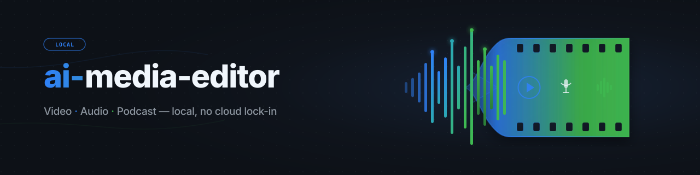
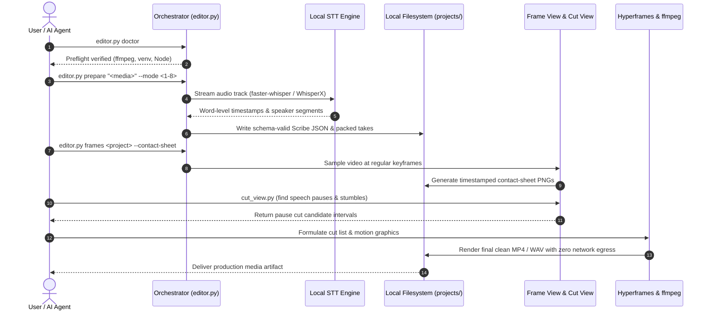

<p align="center"></p>

<p align="center">
  <a href="https://github.com/ellmos-ai/ai-media-editor"></a>
  <a href="https://github.com/ellmos-ai/ai-media-editor/actions/workflows/ci.yml"></a>
  <a href="https://github.com/ellmos-ai/ai-media-editor"></a>
  <a href="https://python.org"></a>
  <a href="https://github.com/ellmos-ai/ai-media-editor"></a>
  <a href="https://github.com/ellmos-ai/ai-media-editor"></a>
  <a href="https://github.com/ellmos-ai/ai-media-editor"></a>
  <a href="https://github.com/ellmos-ai/ai-media-editor/blob/main/SECURITY.md"></a>
  <a href="https://github.com/astral-sh/ruff"></a>
  <a href="https://github.com/ellmos-ai"></a>
  <a href="https://github.com/open-bricks"></a>
  <a href="llms.txt"></a>
  <a href="THIRD_PARTY_LICENSES.txt"></a>
  <a href="NOTICE"></a>
  <a href="https://github.com/ellmos-ai/ai-media-editor"></a>
  <a href="LICENSE"></a>
</p>

<p align="center"><a href="README.md">English</a> · <a href="README_de.md">Deutsch</a> · <strong>Español</strong></p>

# ai-media-editor — editor local de medios con IA (vídeo · audio · pódcast)

> [!NOTE]
> **Integración nativa para IA y agentes:** `ai-media-editor` se ha diseñado específicamente para agentes de programación autónomos (Claude Code, Gemini/Antigravity, Codex). Ofrece preparación determinista de proyectos, generación del esquema JSON de Scribe y hojas de contacto de fotogramas con marcas de tiempo, para que los LLM puedan inspeccionar y cortar medios visualmente en local, sin depender de servicios SaaS de terceros.

### Navegación rápida

| # | Sección | Descripción |
|---|---|---|
| 01 | [Funciones principales](#key-capabilities) | Funciones centrales del orquestador, enrutamiento local de STT y conjunto de herramientas para agentes |
| 02 | [Diagrama visual de arquitectura](#architecture-flowchart) | Diagrama de topología en 5 capas, desde la entrada de medios sin procesar hasta la exportación determinista |
| 03 | [Secuencia del ciclo de ejecución de extremo a extremo](#end-to-end-execution-lifecycle-sequence) | Diagrama de secuencia con el preflight, STT, las hojas de contacto de fotogramas y la ejecución de cortes |
| 04 | [Perfiles objetivo y visibilidad](#marketing--target-personas) | 4 perfiles de usuario principales (`[PERSONA-01]`–`[PERSONA-04]`) y búsquedas SEO de alta intención |
| 05 | [Matriz comparativa de alternativas](#comparative-matrix-vs-alternatives) | Matriz de funciones de 10 dimensiones frente a SaaS en la nube, NLE completos, CLI sin procesar y API alojadas |
| 06 | [Los 8 casos de uso de producción](#the-8-usecases) | Matriz completa de flujos de trabajo de audio, vídeo, vídeos explicativos y publicidad |
| 07 | [Primeros pasos y configuración](#getting-started--setup) | Requisitos previos, configuración de `<TOOLS_ROOT>` e inicialización del entorno |
| 08 | [Referencia y comandos de CLI](#cli-reference--commands) | Comandos de CLI paso a paso para `doctor`, `modes`, `prepare` y `frames` |
| 09 | [Gráficos en movimiento y síntesis musical](#motion-graphics--music-synthesis) | Estilos con Hyperframes y composición local de partituras basadas en formas de onda NumPy y tramas narrativas |
| 10 | [Gobernanza e invariantes de ejecución](#governance--runtime-invariants) | 10 garantías arquitectónicas obligatorias (`INV-LOCAL-01` a `INV-SLA-10`) |
| 11 | [SLA de seguridad y privacidad](#security--privacy-sla) | Procesamiento 100 % local y sin salida de datos, respuesta inicial en 48 h y SLA de triaje de 5 días |
| 12 | [Proyectos relacionados y matriz del ecosistema](#sibling-projects--ecosystem-matrix) | 16 herramientas federadas de `ellmos-ai`, `dev-bricks`, `file-bricks` y `open-bricks` |
| 13 | [Controles de calidad y pruebas](#quality-gates--testing) | Suite de pruebas automatizada, análisis con Ruff, compileall y supresión de ventanas de consola |
| 14 | [Contexto legible por máquinas (`llms.txt`)](#machine-readable-context-llmstxt) | Manifiesto para rastreadores LLM, palabras clave para indexación y reglas de incorporación para agentes |
| 15 | [Estructura del repositorio](#repository-structure) | Taxonomía detallada de carpetas de código, herramientas, STT, pruebas y proyectos |
| 16 | [Registro de cambios y versiones](#changelog--releases) | Historial de versiones, hitos y mejoras de visibilidad de Pfad B |
| 17 | [SBOM de nivel 1 y licencias de terceros](#third-party-licenses--transparency) | Inventario de licencias permisivas de código abierto, garantía de RunAsInvoker y SBOM de nivel 1 |
| 18 | [Aviso legal y limitación de responsabilidad](#statutory-notice--liability-limitation) | Licencia MIT, aviso sobre el régimen de liberalidad del § 521 BGB y límites de responsabilidad |
| 19 | [Proyecto hermano: `clip-storyboard-director`](#19-sister-project-clip-storyboard-director) | La parte de dirección del dúo Director/Cutter, incluida como dependencia opcional fijada a una versión |

---

<a id="sec-01"></a><a id="key-capabilities"></a><a id="1-key-capabilities"></a><a id="hauptfunktionen"></a><a id="1-hauptfunktionen"></a>
## 1. Funciones principales

Usa un agente de programación con IA (por ejemplo, Claude Code, Gemini o Codex) como editor de vídeo y pódcast, con **transcripción local en lugar de ElevenLabs Scribe**. El orquestador (`editor.py`) se ocupa de la preparación determinista (selección de la mejor configuración de motor STT y cómputo, generación de JSON de Scribe conforme al esquema y empaquetado de tomas); el agente dirige el montaje creativo, la animación y la composición.

Conjunto de tres herramientas:
- **video-use** — realiza cortes a partir de transcripciones palabra por palabra (elimina pausas y tropiezos).
- **Hyperframes** — animaciones y gráficos en movimiento de HTML/CSS/JS → MP4.
- **Skill `frontend-design`** — genera gráficos en movimiento y recursos de marca.

…con la transcripción de **ElevenLabs Scribe reemplazada** por motores locales. La opción predeterminada es **faster-whisper**, junto con la asignación de hablantes mediante LLM basada en texto para conversaciones; **WhisperX** es un motor opcional de diarización acústica. El cómputo se realiza localmente de forma predeterminada, con una opción de enrutamiento **host remoto principal y respaldo local**. El sustituto escribe exactamente los campos de Scribe que usa `video-use`, de modo que las herramientas posteriores funcionan sin modificaciones.

---

<a id="sec-02"></a><a id="visual-architecture-flowchart"></a><a id="architecture-flowchart"></a><a id="systemarchitektur-ablaufdiagramm"></a><a id="2-visual-architecture-flowchart"></a><a id="2-systemarchitektur-ablaufdiagramm"></a>
## 2. Diagrama visual de arquitectura

```mermaid
flowchart TB
    subgraph Intake ["Layer 1: Input Channels & Media Intake"]
        V["Raw Video Recording (.mp4/.mov)"]
        A["Raw Audio Recording (.wav/.m4a)"]
        S["Storyline JSON (Narrative & Emotion)"]
    end

    subgraph Preflight ["Layer 2: Orchestrator & Preflight Inspection"]
        DOC["editor.py doctor<br/>Environment & Tooling Verification"]
        MODES["editor.py modes<br/>8 Specialized Media Use Cases"]
        PREP["editor.py prepare<br/>Project Staging & Metadata Contract"]
    end

    subgraph Engines ["Layer 3: Processing & Synthesis Engines"]
        FW["faster-whisper / WhisperX<br/>100% Local STT & Word Alignment"]
        DIAR["ai_media_editor/stt/diarize_llm.py<br/>Text-based Multi-Speaker Diarization"]
        MUSIC["ai_media_editor/tools/compose_music.py<br/>Procedural NumPy Waveform Synthesis"]
        HF["Hyperframes & hide-windows.cjs<br/>HTML/CSS/JS -> MP4 Motion Graphics"]
    end

    subgraph Agentic ["Layer 4: Agentic Interaction Layer"]
        SCRIBE["Scribe JSON Schema<br/>Word-level Timing for video-use"]
        FRAMES["ai_media_editor/tools/frame_view.py<br/>Timestamped Contact-Sheets"]
        CUTS["ai_media_editor/tools/cut_view.py<br/>Pause & Inflection Cut Candidates"]
        LLM["AI Coding Agent<br/>(Claude Code / Gemini / Codex)"]
    end

    subgraph Export ["Layer 5: Deterministic Export & Artefacts"]
        OUT_V["Rendered Master Video (.mp4)"]
        OUT_A["Clean Speaker-Separated Audio (.wav)"]
        OUT_M["Standard MIDI File (.mid) & Score"]
    end

    Intake --> Preflight
    Preflight --> Engines
    Engines --> Agentic
    Agentic --> Export
```



---

<a id="sec-03"></a><a id="end-to-end-execution-lifecycle-sequence"></a><a id="end-to-end-ausführungs-sequenz"></a><a id="3-end-to-end-execution-lifecycle-sequence"></a>
## 3. Secuencia del ciclo de ejecución de extremo a extremo



---

<a id="sec-04"></a><a id="target-personas--discoverability"></a><a id="marketing--target-personas"></a><a id="zielgruppen--auffindbarkeit"></a><a id="marketing--zielgruppen"></a><a id="4-target-personas--discoverability"></a>
## 4. Perfiles objetivo y visibilidad

`ai-media-editor` resuelve los principales cuellos de botella de los flujos modernos de automatización de medios con IA para cuatro perfiles distintos:

### [PERSONA-01] Desarrolladores de agentes de programación autónomos y arquitectos de enjambres
- **Perfil:** Ingenieros de software que diseñan flujos de trabajo multiagente (Claude Code, Gemini/Antigravity, Codex CLI, Kimi Code) para producir medios de forma autónoma.
- **Problema:** Los servicios STT propietarios en la nube imponen límites de uso de API, requieren una automatización del navegador frágil y exponen a proveedores externos medios confidenciales aún no publicados.
- **Solución:** Orquestación íntegra por CLI con generación determinista de JSON según el esquema de Scribe, candidatos de corte en las pausas y hojas de contacto con marcas de tiempo que los LLM multimodales pueden incorporar directamente.
- **Búsqueda de alta intención:** `"agent driven video editor with local transcription"`

### [PERSONA-02] Podcasters y creadores de contenido con prioridad local
- **Perfil:** Podcasters independientes, entrevistadores y creadores que publican contenido de audio y vídeo cada semana.
- **Problema:** El elevado coste mensual de suscripciones a servicios SaaS de edición en la nube (Descript, Riverside) y la lentitud al subir grabaciones de varios gigabytes.
- **Solución:** Transcripción con faster-whisper 100 % sin conexión, pistas de audio separadas por hablante, recorte automático de pausas y generación procedural de vídeos animados de portada.
- **Búsqueda de alta intención:** `"local first podcast editing AI agent workflow"`

### [PERSONA-03] Ingenieros de vídeo con IA y gráficos en movimiento
- **Perfil:** Desarrolladores de front-end y diseñadores de movimiento que automatizan recursos de vídeo con identidad de marca.
- **Problema:** Los NLE tradicionales (Premiere, After Effects) carecen de interfaces programáticas limpias y no pueden renderizar animaciones directamente a partir de tokens de diseño CSS/HTML.
- **Solución:** Integración directa con Hyperframes para convertir componentes HTML/CSS/JavaScript en gráficos en movimiento MP4 a 60 fps, suprimiendo el destello de la consola de Windows.
- **Búsqueda de alta intención:** `"Hyperframes motion graphics podcast editor"`

### [PERSONA-04] Responsables empresariales de seguridad y cumplimiento de medios
- **Perfil:** Responsables de cumplimiento y seguridad de la información en sectores regulados (sanidad, derecho y banca).
- **Problema:** Prohibiciones legales (artículo 28 del GDPR, HIPAA y datos confidenciales de fusiones y adquisiciones) que impiden subir grabaciones empresariales propietarias a proveedores de transcripción alojados en la nube.
- **Solución:** Garantía verificable de cero salida de datos a la red (`INV-LOCAL-01`), ejecución sin privilegios ni elevación mediante `RunAsInvoker` (`INV-RUNAS-02`), SBOM de nivel 1 y SLA formal de respuesta a vulnerabilidades en 48 horas.
- **Búsqueda de alta intención:** `"zero egress video transcription and cutting"`

---

<a id="sec-05"></a><a id="comparative-matrix-vs-alternatives"></a><a id="comparative-matrix--alternatives"></a><a id="vergleichsmatrix-gegenueber-alternativen"></a><a id="5-comparative-matrix-vs-alternatives"></a>
## 5. Matriz comparativa de alternativas

La siguiente matriz de 10 dimensiones compara `ai-media-editor` con enfoques heredados y competidores según nuestras invariantes de ejecución obligatorias:

| Dimensión e invariante | ai-media-editor | SaaS en la nube (Descript / ElevenLabs) | NLE comerciales (Premiere / DaVinci) | CLI / Shell sin procesar (FFmpeg) | API alojadas (Whisper API / Google STT) |
|---|:---:|:---:|:---:|:---:|:---:|
| **1. Prioridad local y cero salida (`INV-LOCAL-01`)** | :white_check_mark: 100 % sin conexión en local | :x: Subida obligatoria a la nube | :warning: Local (telemetría propietaria) | :white_check_mark: 100 % sin conexión en local | :x: Procesamiento externo en la nube |
| **2. Modo de usuario sin privilegios (`INV-RUNAS-02`)** | :white_check_mark: `RunAsInvoker` estándar | :warning: Navegador / aplicación auxiliar | :warning: Instalador / daemon de administrador | :white_check_mark: Privilegios de usuario | :white_check_mark: Nivel de cliente de API |
| **3. Protección no destructiva del material de origen (`INV-PREV-03`)** | :white_check_mark: Entrada de medios de solo lectura | :warning: Duplicación de medios en la nube | :white_check_mark: Proyectos no destructivos | :warning: Riesgo de sobrescritura accidental | :white_check_mark: Se conserva el material de entrada |
| **4. Síntesis determinista (`INV-DETERM-04`)** | :white_check_mark: JSON de Scribe y partitura con semilla fija | :x: Variación estocástica en la nube | :warning: Estado de proyecto complejo | :warning: Salidas sin estructura | :x: Latencia no determinista |
| **5. Contención contra el recorrido de rutas (`INV-BOUNDARY-05`)** | :white_check_mark: Aislamiento estricto del proyecto | :warning: Bucket en la nube del proveedor | :warning: Sistema de archivos arbitrario | :x: Sin validación de rutas | :white_check_mark: Límite del espacio del cliente en la nube |
| **6. Supresión del destello de ventanas (`INV-SUBPROC-06`)** | :white_check_mark: `windowsHide` precargado | :heavy_minus_sign: No aplicable (interfaz web) | :heavy_minus_sign: No aplicable (interfaz de escritorio) | :x: Aperturas de consola molestas | :heavy_minus_sign: No aplicable (solicitudes HTTP) |
| **7. Paridad entre plataformas (`INV-PARITY-07`)** | :white_check_mark: Windows, Linux, macOS | :warning: Depende del navegador | :x: Funciones específicas del sistema operativo | :white_check_mark: POSIX / Windows | :white_check_mark: HTTP multiplataforma |
| **8. Concurrencia multiagente (`INV-SYNC-08`)** | :white_check_mark: Disciplina de bloqueo y Git limpio | :x: Sesión SaaS de un solo usuario | :x: Bloqueos de proyecto para un solo editor | :warning: Conflictos de concurrencia | :warning: Cuellos de botella por límites de uso |
| **9. Legibilidad para agentes y LLM (`INV-DOCS-09`)** | :white_check_mark: JSON de Scribe, hojas de contacto, `llms.txt` | :x: Binario cerrado / DOM HTML | :x: Archivos binarios de proyecto complejos | :warning: Texto sin procesar en stdout/stderr | :warning: Solo transcripciones de texto |
| **10. SLA coordinado de seguridad (`INV-SLA-10`)** | :white_check_mark: Respuesta en 48 h / triaje en 5 días | :warning: Cola de soporte empresarial | :warning: Actualizaciones comerciales trimestrales | :heavy_minus_sign: Scripts sin mantenimiento | :warning: SLA estándar en la nube |

Análisis de marketing detallado, palabras clave de búsqueda y registro de visibilidad: [`MARKETING-LOG.txt`](MARKETING-LOG.txt).

---

<a id="sec-06"></a><a id="the-8-production-usecases"></a><a id="the-8-usecases"></a><a id="die-8-anwendungsfälle"></a><a id="6-the-8-production-usecases"></a>
## 6. Los 8 casos de uso de producción

| # | Entrada | Hablantes | Salida | Flujo de trabajo habitual |
|---|---|---|---|---|
| 1 | Audio | 1 | Pódcast de audio editado | Limpieza de voz de un solo hablante y recorte de pausas |
| 2 | Audio | varios | Pódcast de audio con pistas separadas por hablante | Limpieza de diálogo diarizado en varias pistas |
| 3 | Vídeo (A+V) | 1 | Vídeo editado con animaciones | Edición de vídeo de una persona hablando con rótulos inferiores automatizados con Hyperframes |
| 4 | Vídeo (A+V) | varios | Vídeo con animaciones y seguimiento de hablantes | Vídeo de entrevista con varios hablantes y tarjetas dinámicas de identificación |
| 5 | Vídeo → solo audio | 1/varios | Pódcast de audio (se descarta el vídeo) | Extracción de audio limpio para un pódcast a partir de grabaciones de vídeo |
| 6 | Audio | 1/varios | Vídeo explicativo generado por completo | Pista de voz con elementos visuales de gráficos en movimiento coordinados por IA |
| 7 | Audio | 1 | Audio con portada animada | Pista de pódcast acompañada por un bucle animado de vinilo y forma de onda |
| 8 | Audio/resumen | 1 | Anuncio (15–60 s, 16:9 + 9:16) | Creación rápida de clips breves con Hyperframes |

Para consultar guías completas paso a paso de cada modo, véase [`docs/USECASES.md`](docs/USECASES.md).

---

<a id="sec-07"></a><a id="getting-started--setup"></a><a id="erste-schritte--einrichtung"></a><a id="7-getting-started--setup"></a>
## 7. Primeros pasos y configuración

1. **Crear la configuración:** Copia `config/settings.example.json` → `config/settings.json` y configura las opciones de cómputo local (`local`/`mac`, motores y `paths.*`).
2. **Directorio de herramientas (`<TOOLS_ROOT>`):** `paths.tools_root` en `settings.json` indica la raíz de las herramientas pesadas (`video-use`, ffmpeg, Node ≥ 22). **No** lo sitúes dentro de una carpeta sincronizada con la nube.
3. **Requisitos externos:**
   - **En local:** `ffmpeg`, `Node.js >= 22` (para Hyperframes) y un entorno virtual de Python 3.10–3.13.
   - **Host remoto opcional:** faster-whisper y WhisperX en una máquina remota accesible por SSH.
   - **Token de HuggingFace:** Solo es necesario cuando `engines.multi_speaker` está configurado como `whisperx`.
4. **Opcional: instalar como paquete.** `pip install -e .` (o `-e ".[storyboard]"` para instalar también
   [`clip-storyboard-director`](#19-sister-project-clip-storyboard-director)) registra el
   comando de consola `ai-media-editor`, equivalente a ejecutar `python editor.py` más abajo.

---

<a id="sec-08"></a><a id="cli-reference--commands"></a><a id="cli-referenz--befehle"></a><a id="8-cli-reference--commands"></a>
## 8. Referencia y comandos de CLI

```bash
# Set Python venv path
VENV="<TOOLS_ROOT>/.venv/Scripts/python.exe"

# 1. Environment & toolchain verification
PYTHONIOENCODING=utf-8 "$VENV" editor.py doctor

# 2. Display supported operational use cases
PYTHONIOENCODING=utf-8 "$VENV" editor.py modes

# 3. Prepare a media project (deterministic transcription + take packing)
PYTHONIOENCODING=utf-8 "$VENV" editor.py prepare "/path/to/recording.mp4" --mode 3 --project my-video

# 4. Generate timestamped frame contact-sheets for visual LLM inspection
PYTHONIOENCODING=utf-8 "$VENV" editor.py frames my-video --contact-sheet

# 5. Extract detailed frame interval
PYTHONIOENCODING=utf-8 "$VENV" editor.py frames my-video --from 30 --to 45 --step 0.25
```

---

<a id="sec-09"></a><a id="motion-graphics--music-synthesis"></a><a id="motion-graphics--musiksynthese"></a><a id="9-motion-graphics--music-synthesis"></a>
## 9. Gráficos en movimiento y síntesis musical

### Partitura sincronizada con el vídeo sin conexión (`compose_music.py`)
`ai_media_editor.tools.compose_music` compone música de fondo siguiendo la trama del vídeo: 100 % en local y sin servicios en la nube.
La entrada es un **JSON de trama narrativa** que define secciones con intervalos de tiempo exactos, emociones y niveles de intensidad:

```bash
# Compose music from storyline JSON
python -m ai_media_editor.tools.compose_music docs/examples/storyline-roshambo.json -o projects/<name>/assets/score

# Generate storyline template
python -m ai_media_editor.tools.compose_music --init

# Run deterministic synthesis selftest
python -m ai_media_editor.tools.compose_music --selftest
```

Salida: WAV estéreo + MP3 + `<name>.notes.json` + `<name>.mid` (archivo MIDI estándar de tipo 1).

### Exportación MIDI y renderizado de alta fidelidad
La exportación MIDI permite un renderizado sin pérdidas mediante soundfonts profesionales:
- **Ruta A — SoundFont (local y gratuito):** FluidSynth (`winget install FluidSynth`) + GeneralUser GS / MuseScore_General:
  `fluidsynth -ni soundfont.sf2 out.mid -F out.wav -r 44100`
- **Ruta B — Bibliotecas orquestales:** VSCO 2 Community Edition o Salamander Grand Piano.

---

<a id="sec-10"></a><a id="governance--runtime-invariants"></a><a id="governance---laufzeit-invarianten"></a><a id="10-governance--runtime-invariants"></a>
## 10. Gobernanza e invariantes de ejecución

La arquitectura impone 10 garantías estrictas de ejecución en todos los modos:

| ID de invariante | Dominio operativo | Garantía y regla de aplicación | Mecanismo de verificación |
|---|---|---|---|
| `INV-LOCAL-01` | Privacidad y salida de datos | **Ejecución 100 % local**: Los medios originales, las transcripciones y las representaciones vectoriales nunca salen de localhost. No se realizan llamadas a la nube de forma predeterminada. | `tests/test_core.py`, sin sockets de nube en el flujo principal |
| `INV-RUNAS-02` | Privilegios y aislamiento | **Modo de usuario sin privilegios (`RunAsInvoker`)**: No se requieren privilegios administrativos ni elevados. | Ejecución como usuario estándar en todos los scripts |
| `INV-PREV-03` | Almacenamiento e inmutabilidad | **Medios de origen seguros para previsualizar y no destructivos**: Los archivos de entrada son estrictamente de solo lectura; todos los artefactos se escriben en `projects/<name>/`. | Comprobaciones de aislamiento en `tests/test_core.py` |
| `INV-DETERM-04` | Reproducibilidad | **Síntesis determinista y estabilidad del esquema**: Semilla fija para el audio procedural y cumplimiento estricto del esquema JSON de Scribe. | `tests/test_compose_music.py`, `ai_media_editor/stt/scribe_schema.py` |
| `INV-BOUNDARY-05` | Seguridad frente al recorrido de archivos | **Protección contra recorridos de rutas y contención del proyecto**: Los nombres de archivo y las raíces de los proyectos no pueden salir de los límites del proyecto. | `test_project_names_cannot_escape_projects` |
| `INV-SUBPROC-06` | Limpieza de procesos | **Ciclo de vida limpio y supresión de ventanas**: Los wrappers precargados suprimen el destello de ventanas de consola en Windows. | `ai_media_editor/tools/hf.cmd`, `ai_media_editor/tools/hide-windows.cjs` |
| `INV-PARITY-07` | Compatibilidad con varios sistemas operativos | **Paridad entre sistemas operativos**: Ejecución y gestión de rutas idénticas en Windows, Linux y macOS. | Matriz de CI multiplataforma de GitHub Actions |
| `INV-SYNC-08` | Concurrencia y bloqueos | **Sincronización en la nube y disciplina de bloqueos multiagente**: Las herramientas pesadas y los proyectos se excluyen para evitar conflictos de sincronización en la nube. | Reglas de conflicto y filtros de bloqueos en `.gitignore` |
| `INV-DOCS-09` | Accesibilidad y visibilidad | **Preparación para LLM multimodales y paridad bilingüe**: Hojas de contacto de fotogramas para LLM visuales y paridad documental completa entre EN y DE. | Pruebas de contrato de `llms.txt`, `README.md` y `README_de.md` |
| `INV-SLA-10` | Seguridad y respuesta a incidentes | **Respuesta de seguridad en 48 h y triaje en 5 días**: Comunicación formal de vulnerabilidades mediante GitHub Advisories y correo electrónico a los mantenedores. | `SECURITY.md`, `test_security_policy_bilingual_parity` |

---

<a id="sec-11"></a><a id="security--privacy-sla"></a><a id="sicherheit--datenschutz-sla"></a><a id="11-security--privacy-sla"></a>
## 11. SLA de seguridad y privacidad

- **Privacidad con prioridad local:** La transcripción, la extracción de fotogramas y el cálculo de cortes se realizan íntegramente sin conexión en el hardware local.
- **Contención de medios sensibles:** Las grabaciones de origen y los resultados de los proyectos permanecen estrictamente dentro de `projects/` (excluido por Git).
- **Compromiso de respuesta ante vulnerabilidades:**
  - **SLA de respuesta inicial:** Confirmación de recepción de informes de vulnerabilidad en un plazo de 48 horas.
  - **SLA de triaje técnico:** Evaluación de la gravedad en un plazo de 5 días laborables.
  - **Canal de comunicación:** [GitHub Security Advisories](https://github.com/ellmos-ai/ai-media-editor/security/advisories) o correo directo a `security@open-bricks.org`, `security@ellmos.ai`, `support@lukasgeiger.com` y `lukas@open-bricks.org`.
  - Para más detalles, consulta [`SECURITY.md`](SECURITY.md).

---

<a id="sec-12"></a><a id="sibling-projects--ecosystem-matrix"></a><a id="geschwisterprojekte--ökosystem-matrix"></a><a id="12-sibling-projects--ecosystem-matrix"></a>
## 12. Proyectos relacionados y matriz del ecosistema

`ai-media-editor` funciona como un motor especializado de orquestación multimedia dentro del ecosistema `open-bricks` y `ellmos-ai`:

| Repositorio | Organización | Dominio / finalidad | Interoperabilidad del ecosistema |
|---|---|---|---|
| [`clip-storyboard-director`](https://github.com/ellmos-ai/clip-storyboard-director) | `ellmos-ai` | Generación de storyboards y dirección de escenas | Generación de secuencias de escenas para casos de uso de vídeo |
| [`assistant-core`](https://github.com/ellmos-ai/assistant-core) | `ellmos-ai` | Supervisión conversacional y entorno de ejecución de agentes | Orquestación de tareas autónomas de edición de medios |
| [`decision-clicker`](https://github.com/ellmos-ai/decision-clicker) | `ellmos-ai` | Pasarela interactiva de revisión por usuarios | Revisión de cortes candidatos y decisiones de edición |
| [`lock-master`](https://github.com/ellmos-ai/lock-master) | `ellmos-ai` | Framework de bloqueo multiagente con cierre seguro ante fallos | Protección de archivos de proyecto y bloqueos de renderizado concurrentes |
| [`clutch`](https://github.com/ellmos-ai/clutch) | `ellmos-ai` | Supervisor de procesos y planificador de tareas | Supervisión de tareas prolongadas de renderizado y STT |
| [`system-explorer`](https://github.com/ellmos-ai/system-explorer) | `ellmos-ai` | Detección local de hardware y capacidades | Detección de GPU, CUDA y aceleración por hardware |
| [`roblox-studio-core`](https://github.com/ellmos-ai/roblox-studio-core) | `ellmos-ai` | Captura y automatización sin interfaz de un estudio 3D | Recursos visuales 3D y fotogramas de animación |
| [`usb-podcast-studio`](https://github.com/entertain-and-more/usb-podcast-studio) | `entertain-and-more` | Captura y emisión con hardware de audio USB | Fuente de grabación de alta fidelidad para los modos de pódcast |
| [`BattleStage`](https://github.com/entertain-and-more/BattleStage) | `entertain-and-more` | Simulación física con autoridad del servidor | Procesamiento de grabaciones y repeticiones de juego |
| [`DevCenter`](https://github.com/dev-bricks/DevCenter) | `dev-bricks` | Gestor de entornos de desarrollo y espacios de trabajo | Gestión de herramientas locales y entornos virtuales de desarrollo |
| [`MethodenAnalyser`](https://github.com/dev-bricks/MethodenAnalyser) | `dev-bricks` | Métricas estáticas de código Python y auditoría de métodos | Análisis de calidad del código de los módulos del editor de medios |
| [`ExplorerPro`](https://github.com/file-bricks/ExplorerPro) | `file-bricks` | Gestor de archivos de escritorio de alta velocidad (PySide6) | Exploración visual de proyectos y organización de archivos multimedia |
| [`ProFiler`](https://github.com/file-bricks/ProFiler) | `file-bricks` | Análisis e inspección profunda de directorios | Indexación de recursos multimedia y análisis de caché |
| [`CloudLockFixer`](https://github.com/file-bricks/CloudLockFixer) | `file-bricks` | Resolución de conflictos de sincronización entre varios hosts | Limpieza de archivos de bloqueo y copias conflictivas de la nube |
| [`FormularErstellen`](https://github.com/doc-bricks/FormularErstellen) | `doc-bricks` | Generador dinámico de PDF y maquetación de documentos | Generación de informes de proyecto y resúmenes de producción |
| [`open-bricks`](https://github.com/open-bricks/open-bricks) | `open-bricks` | Organización paraguas de estándares de código abierto | Gobernanza canónica del ecosistema y paridad de licencias |

---

<a id="sec-13"></a><a id="quality-gates--testing"></a><a id="qualitätsprüfung--tests"></a><a id="13-quality-gates--testing"></a>
## 13. Controles de calidad y pruebas

Ejecuta comprobaciones de calidad rápidas en local, sin modelos STT externos ni archivos multimedia pesados:

```bash
# Run complete test suite
python -m pytest -ra -v

# Run lint checks
ruff check .

# Validate bytecode compilation
python -m compileall -q .

# Verify CLI modes
python editor.py modes
```

### Supresión de ventanas de consola en Windows
Los subprocesos de Hyperframes y Node se ejecutan a través de `ai_media_editor/tools/hf.cmd` y `ai_media_editor/tools/hide-windows.cjs`, que imponen `windowsHide: true` y eliminan el destello molesto de las ventanas de consola durante el renderizado. Más detalles: [`docs/WINDOWS-KONSOLENFENSTER.md`](docs/WINDOWS-KONSOLENFENSTER.md).

---

<a id="sec-14"></a><a id="machine-readable-context-llmstxt"></a><a id="maschinenlesbarer-kontext-llmstxt"></a><a id="14-machine-readable-context-llmstxt"></a>
## 14. Contexto legible por máquinas (`llms.txt`)

Los rastreadores LLM, asistentes de programación y agentes de indexación automatizada pueden analizar directamente el contexto del repositorio mediante [`llms.txt`](llms.txt).

Frases clave de búsqueda:
```text
ellmos-ai/ai-media-editor
local AI media editor video podcast transcription
agent driven video editor with local transcription
Claude Code video podcast editor Hyperframes
faster-whisper WhisperX Scribe JSON video-use
transcript based video cutting local first
Hyperframes motion graphics podcast editor
offline procedural music synthesis storyline numpy
zero egress video transcription and cutting
```

---

<a id="sec-15"></a><a id="repository-structure"></a><a id="repository-struktur"></a><a id="15-repository-structure"></a>
## 15. Estructura del repositorio

```
ai-media-editor/                  (code/docs/projects)
├── CLAUDE.md                     ← agent guide (editor workflow, German)
├── README.md                     ← English overview & 18-point visual architecture
├── README_de.md                  ← German documentation (1:1 anchor parity)
├── editor.py                     ← compatibility shim for documented direct calls
├── ai_media_editor/editor.py     ← orchestrator (prepare / frames / modes / doctor)
├── ai_media_editor/tools/
│   ├── cut_view.py               ← pauses as explicit cut candidates
│   ├── frame_view.py             ← video → timestamped frames ("video-scatterer", UC3/4/8)
│   ├── compose_cover.py          ← UC7: loop a cover over audio
│   ├── compose_music.py          ← storyline JSON → video-synced score (NumPy waveform synthesis)
│   ├── hf.cmd / hf-hidden.vbs    ← Windows console window suppression wrappers
│   └── hide-windows.cjs          ← Node.js preload script enforcing windowsHide: true
├── ai_media_editor/stt/
│   ├── scribe_schema.py          ← Scribe-JSON format (contract with video-use)
│   ├── transcribe_local.py       ← faster-whisper + WhisperX → Scribe-JSON
│   ├── diarize_llm.py            ← token-free text-based speaker assignment
│   └── mac_remote.py             ← compute routing (remote primary, local fallback)
├── config/settings.example.json  ← template: compute, engines, models, paths, HF token
├── brand/design-tokens.css       ← branding tokens for generated animations
├── docs/USECASES.md              ← step-by-step per mode
├── production/                   ← optional generative workflows (cloud gates apply)
├── tests/
│   ├── test_core.py              ← dependency-free regression suite
│   ├── test_compose_music.py     ← storyline & waveform synthesis tests
│   └── test_metadata.py          ← automated contract tests for manifests & discoverability
├── SECURITY.md                   ← private vulnerability reporting and security scope
├── THIRD_PARTY_LICENSES.md       ← Level 1 SBOM and third-party license inventory
├── MARKETING-LOG.txt             ← discoverability, personas, matrix & architecture audit
└── projects/<name>/edit/         ← per project: transcripts/, takes_packed.md, … (gitignored)

<TOOLS_ROOT>/                     (NOT a cloud folder — venv/tools)
├── .venv/                        ← Python venv (faster-whisper, video-use, …)
└── video-use/                    ← cloned browser-use/video-use (unpatched)
```

---

<a id="sec-16"></a><a id="changelog--releases"></a><a id="changelog--veröffentlichungen"></a><a id="16-changelog--releases"></a>
## 16. Registro de cambios y versiones

Consulta [`CHANGELOG.md`](CHANGELOG.md) para ver el historial completo de versiones.
- **Versión 0.2.3 (2026-09-20):** Revisión de la arquitectura visual y la visibilidad de Pfad B, paridad de navegación dual de 18 puntos, matriz comparativa de 10 dimensiones frente a 4 alternativas, 4 perfiles objetivo formalizados (`[PERSONA-01]` a `[PERSONA-04]`), tabla de referencias cruzadas entre invariantes y SBOM de nivel 1 en `THIRD_PARTY_LICENSES.md`, certificación de no elevación con `RunAsInvoker` y aviso legal del § 521 BGB.
- **Versión 0.2.2 (2026-09-12):** Revisión de higiene técnica de Pfad A, límites de tiempo para los runners de CI (`timeout-minutes: 15`), gestión automatizada del ciclo de vida de incidencias y PR obsoletos, `.gitignore` reforzado y grupos de dependencias opcionales en `pyproject.toml`.
- **Versión 0.2.1 (2026-09-11):** Mejora de visibilidad, auditoría específica de licencias de terceros, URL ampliadas según PEP 621 y primera suite de pruebas de contrato.
- **Versión 0.2.0 (2026-09-09):** Flujo local-first reforzado, pruebas de contrato automatizadas, matriz de CI para varios sistemas operativos, paridad bilingüe, diagramas Mermaid duales y 10 invariantes de gobernanza.

---

<a id="sec-17"></a><a id="level-1-sbom--third-party-licenses"></a><a id="third-party-licenses--transparency"></a><a id="drittanbieter-lizenzen--transparenz"></a><a id="17-level-1-sbom--third-party-licenses"></a>
## 17. SBOM de nivel 1 y licencias de terceros

`ai-media-editor` se ha desarrollado con un compromiso firme con la transparencia del código abierto, la ausencia de elevación de privilegios y la reproducibilidad sin conexión:

- **100 % de código abierto con licencias permisivas:** Todas las bibliotecas, motores y entornos de ejecución integrados usan licencias permisivas de código abierto (MIT, Apache-2.0, BSD, PSFL) o utilidades multimedia enlazadas dinámicamente (FFmpeg LGPL). No hay dependencias propietarias obligatorias en tiempo de ejecución ni software espía de telemetría cerrada.
- **Sin dependencias de la nube en tiempo de ejecución (`INV-LOCAL-01`):** La transcripción, la extracción de fotogramas, la detección de pausas y la síntesis procedural de música se ejecutan 100 % sin conexión en tu hardware.
- **Ejecución como usuario sin privilegios (`INV-RUNAS-02`):** Todos los componentes se ejecutan estrictamente con cuentas de usuario estándar sin privilegios (`RunAsInvoker`), sin necesidad de elevación administrativa ni de root.
- **SBOM de nivel 1 y correspondencia con la gobernanza:** Las fuentes originales, las personas responsables del mantenimiento, los textos de licencia y las invariantes aplicables se catalogan en [`THIRD_PARTY_LICENSES.md`](THIRD_PARTY_LICENSES.md).
- **Licencia principal del proyecto:** [Licencia MIT](LICENSE) © 2026 ellmos-ai / open-bricks.

---

<a id="sec-18"></a><a id="statutory-notice--liability-limitation"></a><a id="gesetzlicher-hinweis--haftungsbeschraenkung"></a><a id="18-statutory-notice--liability-limitation"></a>
## 18. Aviso legal y limitación de responsabilidad

Este software se ofrece gratuitamente bajo la Licencia MIT como software de código abierto. Conforme al derecho alemán (§ 521 BGB — *Gefälligkeitsrecht* / contratos gratuitos), la responsabilidad por la provisión gratuita de software se limita al dolo (*Vorsatz*) y a la negligencia grave (*grobe Fahrlässigkeit*). En particular, no se ofrecen garantías de idoneidad para un fin determinado, comerciabilidad ni ausencia de defectos.

---

<a id="19-sister-project-clip-storyboard-director"></a>
## 19. Proyecto hermano: `clip-storyboard-director`

[`clip-storyboard-director`](https://github.com/ellmos-ai/clip-storyboard-director) es el
**Director** de la función de **Cutter** de este editor en un modelo de producción multimedia
con dos agentes: se ocupa de la preproducción (desglose del guion, temporización de planos,
indicaciones para el generador de vídeo con IA mediante automatización de navegador CDP,
buffers de persistencia y continuidad 4D) y entrega un primer montaje ensamblado para que
`ai-media-editor` lo termine (edición no lineal, corrección de color, transiciones, atenuación
del audio y renderizado final). Cada herramienta funciona de forma independiente y no necesita
la otra.

Se declara como dependencia opcional `storyboard` en el `pyproject.toml` de este proyecto,
fijada a un commit revisado concreto para garantizar la reproducibilidad. Instala ambos junto
con el comando de consola `ai-media-editor` en un solo paso:

```bash
pip install -e ".[storyboard]"
ai-media-editor modes
clip-director --version
```

`clip-storyboard-director` usa la licencia MIT, al igual que este proyecto; consulta su propio
[`THIRD_PARTY_LICENSES.md`](https://github.com/ellmos-ai/clip-storyboard-director/blob/main/THIRD_PARTY_LICENSES.md)
para ver el inventario de componentes.
