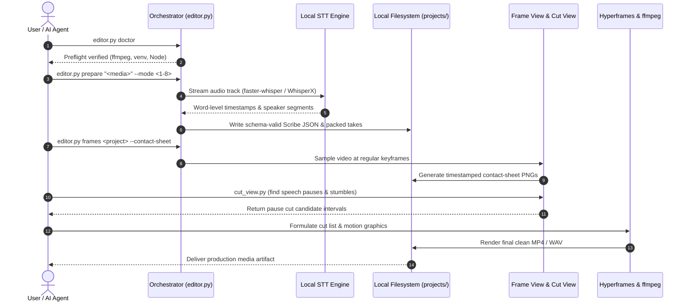

<p align="center"></p>

<p align="center">
  <a href="https://github.com/ellmos-ai/ai-media-editor"></a>
  <a href="https://github.com/ellmos-ai/ai-media-editor/actions/workflows/ci.yml"></a>
  <a href="https://github.com/ellmos-ai/ai-media-editor"></a>
  <a href="https://python.org"></a>
  <a href="https://github.com/ellmos-ai/ai-media-editor"></a>
  <a href="https://github.com/ellmos-ai/ai-media-editor"></a>
  <a href="https://github.com/ellmos-ai/ai-media-editor"></a>
  <a href="https://github.com/ellmos-ai/ai-media-editor/blob/main/SECURITY.md"></a>
  <a href="https://github.com/astral-sh/ruff"></a>
  <a href="https://github.com/ellmos-ai"></a>
  <a href="https://github.com/open-bricks"></a>
  <a href="llms.txt"></a>
  <a href="THIRD_PARTY_LICENSES.txt"></a>
  <a href="NOTICE"></a>
  <a href="https://github.com/ellmos-ai/ai-media-editor"></a>
  <a href="LICENSE"></a>
</p>

<p align="center"><a href="README.md">English</a> · <a href="README_de.md">Deutsch</a> · <a href="README_es.md">Español</a> · <strong>Français</strong> · <a href="README_zh.md">简体中文</a> · <a href="README_ja.md">日本語</a></p>

# ai-media-editor — éditeur de médias IA local (Vidéo · Audio · Podcast)

> [!NOTE]
> **Intégration native pour l’IA et les agents :** `ai-media-editor` est conçu spécifiquement pour les agents de programmation autonomes (Claude Code, Gemini/Antigravity, Codex). Il fournit une préparation déterministe des projets, la génération d’un schéma JSON Scribe et des planches-contact horodatées afin que les LLM puissent examiner visuellement et monter des médias en local, sans dépendre de services SaaS tiers.

### Navigation rapide

| # | Section | Description |
|---|---|---|
| 01 | [Fonctionnalités clés](#key-capabilities) | Fonctions principales de l’orchestrateur, routage STT local et pile d’outils pour agents |
| 02 | [Schéma du flux d’architecture](#architecture-flowchart) | Topologie système à 5 niveaux, de la réception des médias bruts à l’export déterministe |
| 03 | [Séquence du cycle d’exécution de bout en bout](#end-to-end-execution-lifecycle-sequence) | Diagramme de séquence du précontrôle, du STT, des planches-contact et de l’exécution des coupes |
| 04 | [Profils cibles et découvrabilité](#marketing--target-personas) | 4 profils d’utilisateurs principaux (`[PERSONA-01]`–`[PERSONA-04]`) et requêtes SEO à forte intention |
| 05 | [Matrice comparative avec les alternatives](#comparative-matrix-vs-alternatives) | Matrice de fonctionnalités à 10 dimensions face aux SaaS cloud, NLE lourds, CLI brutes et API hébergées |
| 06 | [Les 8 cas d’usage en production](#the-8-usecases) | Matrice complète des flux de travail audio, vidéo, explicatifs et publicitaires |
| 07 | [Premiers pas et configuration](#getting-started--setup) | Prérequis, configuration de `<TOOLS_ROOT>` et initialisation de l’environnement |
| 08 | [Référence CLI et commandes](#cli-reference--commands) | Commandes détaillées pour `doctor`, `modes`, `prepare` et `frames` |
| 09 | [Motion design et composition musicale](#motion-graphics--music-synthesis) | Styles Hyperframes et composition hors ligne de formes d’onde NumPy selon le scénario |
| 10 | [Gouvernance et invariants d’exécution](#governance--runtime-invariants) | 10 invariants d’exécution documentés, dont le périmètre dépend du mode sélectionné (`INV-LOCAL-01` à `INV-SLA-10`) |
| 11 | [SLA de sécurité et de confidentialité](#security--privacy-sla) | Fonctionnement local par défaut, STT SSH facultative, première réponse sous 48 h et SLA de triage de 5 jours |
| 12 | [Projets associés et matrice de l’écosystème](#sibling-projects--ecosystem-matrix) | 16 outils fédérés dans `ellmos-ai`, `dev-bricks`, `file-bricks` et `open-bricks` |
| 13 | [Contrôles qualité et tests](#quality-gates--testing) | Suite de tests automatisés, lint Ruff, compileall et suppression des fenêtres console |
| 14 | [Contexte lisible par machine (`llms.txt`)](#machine-readable-context-llmstxt) | Manifeste pour les robots d’indexation LLM, mots-clés de recherche et règles d’ingestion des agents |
| 15 | [Structure du dépôt](#repository-structure) | Taxonomie détaillée des dossiers de code, outils, STT, tests et projets |
| 16 | [Journal des modifications et versions](#changelog--releases) | Historique des versions, jalons et améliorations de découvrabilité Pfad B |
| 17 | [SBOM de niveau 1 et licences tierces](#third-party-licenses--transparency) | Inventaire des licences tierces, garantie RunAsInvoker et SBOM de niveau 1 |
| 18 | [Avis légal et limitation de responsabilité](#statutory-notice--liability-limitation) | Licence MIT, avis au titre du § 521 BGB relatif au *Gefälligkeitsrecht* et limites de responsabilité |
| 19 | [Projet associé : `clip-storyboard-director`](#19-sister-project-clip-storyboard-director) | La moitié Réalisateur du duo Réalisateur/Monteur, fournie comme dépendance facultative épinglée |

---

<a id="sec-01"></a><a id="key-capabilities"></a><a id="1-key-capabilities"></a><a id="hauptfunktionen"></a><a id="1-hauptfunktionen"></a>
## 1. Fonctionnalités clés

Utilisez un agent de programmation IA (p. ex. Claude Code, Gemini, Codex) comme monteur vidéo/podcast — avec **une transcription locale à la place d’ElevenLabs Scribe**. L’orchestrateur (`editor.py`) prend en charge la préparation déterministe (routage vers le moteur STT et le mode de calcul adaptés, production d’un JSON Scribe conforme au schéma et regroupement des prises) ; le montage créatif, l’animation et la composition sont pilotés par l’agent.

Une pile de trois outils :
- **video-use** — réalise les coupes à partir de transcriptions mot à mot (suppression des pauses et hésitations).
- **Hyperframes** — transforme HTML/CSS/JS en animations MP4 et motion design.
- La compétence **`frontend-design`** — génère des éléments de motion design et d’identité visuelle.

…avec la transcription **ElevenLabs Scribe remplacée** par des moteurs locaux. Par défaut, **faster-whisper** est associé à une attribution des locuteurs par LLM fondée sur le texte pour les conversations ; **WhisperX** est un moteur facultatif de diarisation acoustique. Le calcul est local par défaut, avec un routage facultatif donnant la priorité à l’hôte distant et un repli local. Le remplacement écrit exactement les champs Scribe utilisés par `video-use`, si bien que les outils en aval fonctionnent sans modification.

---

<a id="sec-02"></a><a id="visual-architecture-flowchart"></a><a id="architecture-flowchart"></a><a id="systemarchitektur-ablaufdiagramm"></a><a id="2-visual-architecture-flowchart"></a><a id="2-systemarchitektur-ablaufdiagramm"></a>
## 2. Schéma du flux d’architecture visuelle

```mermaid
flowchart TB
    subgraph Intake ["Layer 1: Input Channels & Media Intake"]
        V["Raw Video Recording (.mp4/.mov)"]
        A["Raw Audio Recording (.wav/.m4a)"]
        S["Storyline JSON (Narrative & Emotion)"]
    end

    subgraph Preflight ["Layer 2: Orchestrator & Preflight Inspection"]
        DOC["editor.py doctor<br/>Environment & Tooling Verification"]
        MODES["editor.py modes<br/>8 Specialized Media Use Cases"]
        PREP["editor.py prepare<br/>Project Staging & Metadata Contract"]
    end

    subgraph Engines ["Layer 3: Processing & Synthesis Engines"]
        FW["faster-whisper / WhisperX<br/>100% Local STT & Word Alignment"]
        DIAR["ai_media_editor/stt/diarize_llm.py<br/>Text-based Multi-Speaker Diarization"]
        MUSIC["ai_media_editor/tools/compose_music.py<br/>Procedural NumPy Waveform Synthesis"]
        HF["Hyperframes & hide-windows.cjs<br/>HTML/CSS/JS -> MP4 Motion Graphics"]
    end

    subgraph Agentic ["Layer 4: Agentic Interaction Layer"]
        SCRIBE["Scribe JSON Schema<br/>Word-level Timing for video-use"]
        FRAMES["ai_media_editor/tools/frame_view.py<br/>Timestamped Contact-Sheets"]
        CUTS["ai_media_editor/tools/cut_view.py<br/>Pause & Inflection Cut Candidates"]
        LLM["AI Coding Agent<br/>(Claude Code / Gemini / Codex)"]
    end

    subgraph Export ["Layer 5: Deterministic Export & Artefacts"]
        OUT_V["Rendered Master Video (.mp4)"]
        OUT_A["Clean Speaker-Separated Audio (.wav)"]
        OUT_M["Standard MIDI File (.mid) & Score"]
    end

    Intake --> Preflight
    Preflight --> Engines
    Engines --> Agentic
    Agentic --> Export
```



---

<a id="sec-03"></a><a id="end-to-end-execution-lifecycle-sequence"></a><a id="end-to-end-ausführungs-sequenz"></a><a id="3-end-to-end-execution-lifecycle-sequence"></a>
## 3. Séquence du cycle d’exécution de bout en bout



---

<a id="sec-04"></a><a id="target-personas--discoverability"></a><a id="marketing--target-personas"></a><a id="zielgruppen--auffindbarkeit"></a><a id="marketing--zielgruppen"></a><a id="4-target-personas--discoverability"></a>
## 4. Profils cibles et découvrabilité

`ai-media-editor` répond aux principaux blocages des flux de travail modernes d’automatisation des médias par IA, pour quatre profils distincts :

### [PERSONA-01] Développeurs d’agents de programmation IA autonomes et architectes d’essaims
- **Profil :** Ingénieurs logiciel qui conçoivent des flux de travail multi-agents (Claude Code, Gemini/Antigravity, Codex CLI, Kimi Code) pour la production média autonome.
- **Point de friction :** Les services STT propriétaires dans le cloud imposent des limites de débit API, nécessitent une automatisation fragile du navigateur et exposent des médias confidentiels non encore publiés à des fournisseurs externes.
- **Solution :** Orchestration CLI pure, avec génération déterministe du schéma JSON Scribe, candidats de coupe aux pauses et planches-contact horodatées directement exploitables par des LLM multimodaux.
- **Requête à forte intention :** `"agent driven video editor with local transcription"`

### [PERSONA-02] Podcasteurs et créateurs privilégiant le local
- **Profil :** Podcasteurs indépendants, intervieweurs et créateurs qui gèrent des publications audio/vidéo hebdomadaires.
- **Point de friction :** Coûts mensuels exorbitants des SaaS de montage cloud (Descript, Riverside) et téléversements lents pour les enregistrements de plusieurs gigaoctets.
- **Solution :** Transcription locale avec faster-whisper, pistes audio séparées par intervenant, suppression automatique des pauses et génération procédurale d’une vidéo de couverture animée. Le code n’impose pas que le chargement des modèles reste hors ligne.
- **Requête à forte intention :** `"local first podcast editing AI agent workflow"`

### [PERSONA-03] Ingénieurs vidéo IA et motion design
- **Profil :** Développeurs front-end et designers motion qui automatisent des éléments vidéo visuels à l’image de leur marque.
- **Point de friction :** Les logiciels de montage traditionnels (Premiere, After Effects) manquent d’interfaces programmatiques propres et ne peuvent pas rendre des animations directement à partir de jetons de conception CSS/HTML.
- **Solution :** Intégration directe d’Hyperframes qui convertit des composants HTML/CSS/JavaScript en animations MP4 à 60 images/s, tout en supprimant le clignotement des fenêtres console sous Windows.
- **Requête à forte intention :** `"Hyperframes motion graphics podcast editor"`

### [PERSONA-04] Responsables sécurité et conformité des médias en entreprise
- **Profil :** Responsables de la conformité et de la sécurité de l’information dans des secteurs réglementés (santé, droit, banque).
- **Point de friction :** Les politiques organisationnelles ou les exigences contractuelles peuvent interdire l’envoi d’enregistrements propriétaires à des fournisseurs de transcription hébergés.
- **Solution :** Le STT local est le mode par défaut ; lorsque `compute.prefer=mac` est sélectionné, la copie complète du fichier média d’entrée est envoyée à l’hôte SSH configuré. Le mode sélectionné doit correspondre aux exigences de traitement des données de l’organisation. L’exécution sans privilèges via `RunAsInvoker` (`INV-RUNAS-02`), la SBOM de niveau 1 et un SLA formel de réponse aux vulnérabilités sous 48 heures sont également documentés.
- **Requête à forte intention :** `"zero egress video transcription and cutting"`

---

<a id="sec-05"></a><a id="comparative-matrix-vs-alternatives"></a><a id="comparative-matrix--alternatives"></a><a id="vergleichsmatrix-gegenueber-alternativen"></a><a id="5-comparative-matrix-vs-alternatives"></a>
## 5. Matrice comparative avec les alternatives

La matrice à 10 dimensions ci-dessous compare `ai-media-editor` aux approches établies et concurrentes à l’aide d’invariants d’exécution documentés, dont le périmètre dépend du mode sélectionné :

| Dimension et invariant | ai-media-editor | SaaS cloud (Descript / ElevenLabs) | NLE commerciaux (Premiere / DaVinci) | CLI / shell brute (FFmpeg) | API hébergées (Whisper API / Google STT) |
|---|:---:|:---:|:---:|:---:|:---:|
| **1. Priorité au local et flux de données selon le mode (`INV-LOCAL-01`)** | :white_check_mark: Local par défaut ; STT SSH facultative | :x: Téléversement obligatoire vers le cloud | :warning: Local (télémétrie propriétaire) | :white_check_mark: 100 % local hors ligne | :x: Traitement externe dans le cloud |
| **2. Mode utilisateur sans privilèges (`INV-RUNAS-02`)** | :white_check_mark: `RunAsInvoker` standard | :warning: Navigateur / application auxiliaire | :warning: Installateur administrateur / service | :white_check_mark: Privilèges utilisateur | :white_check_mark: Niveau client API |
| **3. Préservation non destructive de la source (`INV-PREV-03`)** | :white_check_mark: `prepare` préserve l’entrée originale | :warning: Duplication des médias dans le cloud | :white_check_mark: Projets non destructifs | :warning: Risque d’écrasement accidentel | :white_check_mark: Médias d’entrée préservés |
| **4. Synthèse déterministe (`INV-DETERM-04`)** | :white_check_mark: JSON Scribe et partition à graine fixe | :x: Dérive stochastique dans le cloud | :warning: État de projet complexe | :warning: Sorties non structurées | :x: Latence non déterministe |
| **5. Validation du nom de projet (`INV-BOUNDARY-05`)** | :white_check_mark: Vérification lexicale du nom ; pas de bac à sable du système de fichiers | :warning: Stockage cloud hébergé | :warning: Système de fichiers arbitraire | :x: Aucune validation des chemins | :white_check_mark: Limite du tenant cloud |
| **6. Suppression du clignotement des fenêtres (`INV-SUBPROC-06`)** | :white_check_mark: `windowsHide` préchargé | :heavy_minus_sign: Sans objet (interface web) | :heavy_minus_sign: Sans objet (interface de bureau) | :x: Apparitions intempestives de consoles | :heavy_minus_sign: Sans objet (requêtes HTTP) |
| **7. Compatibilité multiplateforme (`INV-PARITY-07`)** | :white_check_mark: Windows, Linux et macOS avec chemins propres à chaque système | :warning: Dépend du navigateur | :x: Fonctionnalités propres au système | :white_check_mark: POSIX / Windows | :white_check_mark: HTTP multiplateforme |
| **8. Concurrence multi-agents (`INV-SYNC-08`)** | :white_check_mark: Discipline de verrouillage et Git propre | :x: Session SaaS mono-utilisateur | :x: Verrous de projet mono-éditeur | :warning: Conflits de concurrence | :warning: Goulots d’étranglement liés aux limites de débit |
| **9. Lisibilité pour les agents et LLM (`INV-DOCS-09`)** | :white_check_mark: JSON Scribe, planches-contact, `llms.txt` | :x: Binaire fermé / DOM HTML | :x: Fichiers de projet binaires complexes | :warning: stdout/stderr en texte brut | :warning: Transcriptions textuelles uniquement |
| **10. SLA de sécurité coordonné (`INV-SLA-10`)** | :white_check_mark: Réponse sous 48 h / triage sous 5 j | :warning: File d’attente du support entreprise | :warning: Mises à jour commerciales trimestrielles | :heavy_minus_sign: Scripts non maintenus | :warning: SLA cloud standard |

Analyse marketing détaillée, mots-clés de recherche et journal de découvrabilité : [`MARKETING-LOG.txt`](MARKETING-LOG.txt).

---

<a id="sec-06"></a><a id="the-8-production-usecases"></a><a id="the-8-usecases"></a><a id="die-8-anwendungsfälle"></a><a id="6-the-8-production-usecases"></a>
## 6. Les 8 cas d’usage en production

| # | Entrée | Intervenants | Sortie | Flux de travail type |
|---|---|---|---|---|
| 1 | Audio | 1 | Podcast audio monté | Nettoyage de la parole d’un seul intervenant et suppression des pauses |
| 2 | Audio | Plusieurs | Podcast audio avec pistes séparées par intervenant | Nettoyage d’un dialogue avec diarisation sur plusieurs pistes |
| 3 | Vidéo (A+V) | 1 | Vidéo montée + animations | Montage d’une vidéo face caméra avec bandeaux inférieurs Hyperframes automatisés |
| 4 | Vidéo (A+V) | Plusieurs | Vidéo + animations + suivi des intervenants | Interview vidéo multi-intervenants avec cartes de locuteur dynamiques |
| 5 | Vidéo → audio uniquement | 1 / plusieurs | Podcast audio (vidéo supprimée) | Extraction d’un podcast audio de haute qualité à partir d’images vidéo |
| 6 | Audio | 1 / plusieurs | Vidéo explicative entièrement générée | Piste vocale accompagnée de visuels en motion design orchestrés par IA |
| 7 | Audio | 1 | Audio + couverture animée | Piste de podcast intégrée dans une boucle animée de vinyle/forme d’onde |
| 8 | Audio/brief | 1 | Clip publicitaire (15–60 s, 16:9 + 9:16) | Fabrique rapide de clips courts via Hyperframes |

Pour les guides complets étape par étape de chaque mode, consultez [`docs/USECASES.md`](docs/USECASES.md).

---

<a id="sec-07"></a><a id="getting-started--setup"></a><a id="erste-schritte--einrichtung"></a><a id="7-getting-started--setup"></a>
## 7. Premiers pas et configuration

1. **Créer la configuration :** Copiez `config/settings.example.json` vers `config/settings.json` et configurez les options de calcul local (`local`/`mac`, moteurs, `paths.*`). Définissez `paths.venv_python` sur l’exécutable Python de ce système d’exploitation ; la valeur configurée est utilisée directement. Le chemin d’exemple `.venv/Scripts/python.exe` est propre à Windows ; sous POSIX, on utilise généralement `.venv/bin/python`.
2. **Répertoire des outils (`<TOOLS_ROOT>`) :** `paths.tools_root` dans votre `settings.json` indique la racine des outils volumineux (`video-use`, ffmpeg, Node ≥ 22). Ne le placez **pas** dans un dossier synchronisé avec le cloud.
3. **Prérequis externes :**
   - **Local :** `ffmpeg`, `Node.js >= 22` (pour Hyperframes), environnement virtuel Python 3.10–3.13.
   - **Hôte distant facultatif :** faster-whisper + WhisperX sur une machine distante accessible par SSH.
   - **Jeton Hugging Face :** requis uniquement lorsque `engines.multi_speaker` est défini sur `whisperx`.
4. **Facultatif : installer comme paquet.** `pip install -e .` (ou `-e ".[storyboard]"` pour installer aussi
   [`clip-storyboard-director`](#19-sister-project-clip-storyboard-director)) enregistre la commande console
   `ai-media-editor`, équivalente à l’exécution de `python editor.py` ci-dessous.

---

<a id="sec-08"></a><a id="cli-reference--commands"></a><a id="cli-referenz--befehle"></a><a id="8-cli-reference--commands"></a>
## 8. Référence CLI et commandes

```bash
# Set Python venv path
VENV="<TOOLS_ROOT>/.venv/Scripts/python.exe"

# 1. Environment & toolchain verification
PYTHONIOENCODING=utf-8 "$VENV" editor.py doctor

# 2. Display supported operational use cases
PYTHONIOENCODING=utf-8 "$VENV" editor.py modes

# 3. Prepare a media project (deterministic transcription + take packing)
PYTHONIOENCODING=utf-8 "$VENV" editor.py prepare "/path/to/recording.mp4" --mode 3 --project my-video

# 4. Generate timestamped frame contact-sheets for visual LLM inspection
PYTHONIOENCODING=utf-8 "$VENV" editor.py frames my-video --contact-sheet

# 5. Extract detailed frame interval
PYTHONIOENCODING=utf-8 "$VENV" editor.py frames my-video --from 30 --to 45 --step 0.25
```

---

<a id="sec-09"></a><a id="motion-graphics--music-synthesis"></a><a id="motion-graphics--musiksynthese"></a><a id="9-motion-graphics--music-synthesis"></a>
## 9. Motion design et composition musicale

### Partition synchronisée avec la vidéo, hors ligne (`compose_music.py`)
`ai_media_editor.tools.compose_music` compose une musique d’ambiance suivant le scénario d’une vidéo — 100 % en local, sans service cloud.
L’entrée est un **JSON de scénario** qui définit des sections avec des fenêtres temporelles exactes, des émotions et des niveaux d’intensité :

```bash
# Compose music from storyline JSON
python -m ai_media_editor.tools.compose_music docs/examples/storyline-roshambo.json -o projects/<name>/assets/score

# Generate storyline template
python -m ai_media_editor.tools.compose_music --init

# Run deterministic synthesis selftest
python -m ai_media_editor.tools.compose_music --selftest
```

Sortie : WAV stéréo + MP3 + `<name>.notes.json` + `<name>.mid` (fichier MIDI standard de type 1).

### Export MIDI et rendu haute fidélité
L’export MIDI permet un rendu sans perte à l’aide de banques de sons professionnelles :
- **Voie A — SoundFont (local, gratuit) :** FluidSynth (`winget install FluidSynth`) + GeneralUser GS / MuseScore_General :
  `fluidsynth -ni soundfont.sf2 out.mid -F out.wav -r 44100`
- **Voie B — Banques orchestrales :** VSCO 2 Community Edition ou Salamander Grand Piano.

### Assemblage de boucles multi-clips, contrôle qualité et synthèse d’ambiances (`make_loop.py`, `qa_clips.py`, `atmo.py`, `synth.py`, `fx.js`)
Portés depuis le pipeline de production Halloween Window Projection (`T-20261025-256694132`), les outils `ai_media_editor.tools` proposent aussi des utilitaires réutilisables pour assembler des boucles de scènes et concevoir des ambiances sonores par synthèse procédurale :
- **`ai_media_editor.tools.make_loop`** : concatène des clips de scènes rendus (`<sid>.mp4`) avec des intervalles configurables de pause noire (`loop.json` ou `--pause`) et une piste audio AAC facultative à 48 kHz (`--audio`) :
  `python -m ai_media_editor.tools.make_loop docs/examples/loop-halloween.json renders/ -o loop.mp4 [--pause 8] [--audio atmo.wav]`
- **`ai_media_editor.tools.qa_clips`** : vérifie les clips rendus avec `ffprobe`, mesure la luminance de la première et de la dernière image (vérification du niveau de noir), extrait les images du début, du milieu, de la fin et du pic, puis crée une planche-contact `xstack` (`qa.json`, `VORSCHAU_kontaktbogen.jpg`) :
  `python -m ai_media_editor.tools.qa_clips renders/ qa_out/`
- **`ai_media_editor.tools.synth` et `ai_media_editor.tools.atmo`** : synthèse procédurale d’instruments et d’ambiances à 48 kHz avec NumPy/SciPy (`chip_pulse`, `marimba`, `glock`, `pizz`, `flute`, `fm_brass`, `fm_bell`, `make_ir`), ainsi qu’un générateur de paysages sonores bouclables sur grille de scènes, avec mastering itératif du niveau sonore EBU R128 (`-16 LUFS-I`) et du true peak (`<= -3.5 dBTP`) :
  `python -m ai_media_editor.tools.atmo docs/examples/loop-halloween.json -o atmo.wav [--pause 8]`
- **`ai_media_editor/tools/fx.js` (`window.HFX`)** : utilitaires HyperFrames déterministes et sûrs lors des déplacements dans la timeline, notamment `HFX.ft` (wrapper GSAP `fromTo` imposant `immediateRender: false` pour que les effets restent masqués avant le début de l’animation), `HFX.drive`, `HFX.rng` (mulberry32), `HFX.noise1`, `HFX.key`, `HFX.bump`, `HFX.path`, `HFX.spider` et `HFX.bat`.

---

<a id="sec-10"></a><a id="governance--runtime-invariants"></a><a id="governance---laufzeit-invarianten"></a><a id="10-governance--runtime-invariants"></a>
## 10. Gouvernance et invariants d’exécution

L’architecture documente 10 invariants d’exécution ; le comportement dépend du mode sélectionné :

| ID de l’invariant | Domaine opérationnel | Garantie et règle d’application | Méthode de vérification |
|---|---|---|---|
| `INV-LOCAL-01` | Confidentialité et sortie de données | **Local par défaut** : avec `compute.prefer=local`, le STT s’exécute sur cette machine ; le chargement des modèles n’est pas forcé à rester hors ligne. Avec `compute.prefer=mac`, la copie complète du fichier média d’entrée est envoyée à l’hôte SSH configuré, et tout jeton HF configuré est également transmis. Le nettoyage distant est tenté dans un bloc `finally`, mais sa réussite n’est pas vérifiée. | `tests/test_core.py`, `editor.py`, `ai_media_editor/stt/mac_remote.py` |
| `INV-RUNAS-02` | Privilèges et bac à sable | **Mode utilisateur sans privilèges (`RunAsInvoker`)** : aucun privilège administratif ou élevé n’est requis. | Exécution de tous les scripts avec un compte utilisateur standard |
| `INV-PREV-03` | Stockage et immutabilité | **Traitement non destructif des données d’entrée** : `prepare` laisse l’entrée originale inchangée et la copie dans `projects/<name>/`. L’audio temporaire peut se trouver dans le répertoire temporaire du système d’exploitation ; le mode distant utilise également le répertoire de travail SSH configuré. | Contrôles d’isolation dans `tests/test_core.py` |
| `INV-DETERM-04` | Reproductibilité | **Synthèse déterministe et stabilité du schéma** : graine fixe pour la synthèse audio procédurale et respect strict du schéma JSON Scribe. | `tests/test_compose_music.py`, `ai_media_editor/stt/scribe_schema.py` |
| `INV-BOUNDARY-05` | Validation du nom de projet | **Contrôles lexicaux du nom de projet** : les noms de projet sont vérifiés comme composants de chemin uniques ; cela ne constitue pas un bac à sable du système de fichiers. | `test_project_names_cannot_escape_projects` |
| `INV-SUBPROC-06` | Assainissement des processus | **Cycle de vie propre et suppression des fenêtres** : des wrappers préchargés suppriment le clignotement des fenêtres console sous Windows. | `ai_media_editor/tools/hf.cmd`, `ai_media_editor/tools/hide-windows.cjs` |
| `INV-PARITY-07` | Compatibilité multi-OS | **Compatibilité multiplateforme** : chemins et exécutables sont configurés pour le système utilisé ; consultez la matrice CI pour les systèmes d’exploitation testés. | Matrice CI GitHub Actions multi-OS |
| `INV-SYNC-08` | Concurrence et verrous | **Discipline de synchronisation cloud et de verrouillage multi-agents** : les outils volumineux et les projets sont exclus des conflits de synchronisation cloud. | Règles de filtre des conflits et verrous dans `.gitignore` |
| `INV-DOCS-09` | Accessibilité et découvrabilité | **Prise en charge multimodale des LLM et parité bilingue** : planches-contact pour les LLM de vision ; parité documentaire complète EN/DE. | `llms.txt`, `README.md`, tests de contrat `README_de.md` |
| `INV-SLA-10` | Sécurité et réponse aux incidents | **Réponse de sécurité sous 48 h et triage sous 5 jours** : signalement formel des vulnérabilités via GitHub Advisories et les courriels des mainteneurs. | `SECURITY.md`, `test_security_policy_bilingual_parity` |

---

<a id="sec-11"></a><a id="security--privacy-sla"></a><a id="sicherheit--datenschutz-sla"></a><a id="11-security--privacy-sla"></a>
## 11. SLA de sécurité et de confidentialité

- **Traitement local par défaut :** le STT local est le mode par défaut, mais le chargement des modèles n’est pas forcé à rester hors ligne. Avec `compute.prefer=mac`, la copie complète du fichier média d’entrée est envoyée à l’hôte SSH configuré ; un jeton HF configuré est également transmis.
- **Traitement des médias sensibles :** `prepare` laisse l’enregistrement original à son chemin d’entrée et le copie dans `projects/<name>/`. L’audio temporaire peut se trouver dans le répertoire temporaire du système d’exploitation. En mode distant, une copie de travail est stockée dans le `workdir` SSH configuré ; son nettoyage est tenté dans un bloc `finally`, mais sa réussite n’est pas vérifiée.
- **Engagement de réponse aux vulnérabilités :**
  - **SLA de première réponse :** sous 48 heures pour confirmer la réception des rapports de vulnérabilité soumis.
  - **SLA de triage technique :** sous 5 jours ouvrables, avec évaluation de la gravité.
  - **Canal de signalement :** [Avis de sécurité GitHub](https://github.com/ellmos-ai/ai-media-editor/security/advisories) ou courriel direct à `security@open-bricks.org`, `security@ellmos.ai`, `support@lukasgeiger.com` et `lukas@open-bricks.org`.
  - Pour tous les détails, consultez [`SECURITY.md`](SECURITY.md).

---

<a id="sec-12"></a><a id="sibling-projects--ecosystem-matrix"></a><a id="geschwisterprojekte--ökosystem-matrix"></a><a id="12-sibling-projects--ecosystem-matrix"></a>
## 12. Projets associés et matrice de l’écosystème

`ai-media-editor` fonctionne comme moteur spécialisé d’orchestration multimédia dans l’écosystème `open-bricks` et `ellmos-ai` :

| Dépôt | Organisation | Domaine / fonction | Interopérabilité dans l’écosystème |
|---|---|---|---|
| [`clip-storyboard-director`](https://github.com/ellmos-ai/clip-storyboard-director) | `ellmos-ai` | Génération de storyboards et réalisation de scènes | Génération de séquences de scènes pour les cas d’usage vidéo |
| [`assistant-core`](https://github.com/ellmos-ai/assistant-core) | `ellmos-ai` | Supervision conversationnelle et environnement d’exécution d’agents | Orchestration de tâches autonomes de montage média |
| [`decision-clicker`](https://github.com/ellmos-ai/decision-clicker) | `ellmos-ai` | Passerelle interactive de validation par l’utilisateur | Révision des coupes candidates et des décisions de montage |
| [`lock-master`](https://github.com/ellmos-ai/lock-master) | `ellmos-ai` | Cadre de verrouillage multi-agents avec refus par défaut en cas d’échec | Protection des fichiers de projet et des verrous de rendu concurrents |
| [`clutch`](https://github.com/ellmos-ai/clutch) | `ellmos-ai` | Superviseur de processus et ordonnanceur de tâches | Supervision des travaux de rendu et de STT de longue durée |
| [`system-explorer`](https://github.com/ellmos-ai/system-explorer) | `ellmos-ai` | Découverte des capacités et du matériel local | Détection du GPU, de CUDA et de l’accélération matérielle |
| [`roblox-studio-core`](https://github.com/ellmos-ai/roblox-studio-core) | `ellmos-ai` | Capture et automatisation d’un studio 3D sans interface | Création d’éléments visuels 3D et de séquences d’animation |
| [`usb-podcast-studio`](https://github.com/entertain-and-more/usb-podcast-studio) | `entertain-and-more` | Capture et diffusion audio via matériel USB | Source d’enregistrement haute fidélité pour les modes podcast |
| [`BattleStage`](https://github.com/entertain-and-more/BattleStage) | `entertain-and-more` | Simulation physique faisant autorité côté serveur | Traitement d’images de jeu et de vidéos de relecture |
| [`DevCenter`](https://github.com/dev-bricks/DevCenter) | `dev-bricks` | Gestionnaire d’environnements et d’espaces de travail de développement | Gestion des outils locaux et environnements virtuels de développement |
| [`MethodenAnalyser`](https://github.com/dev-bricks/MethodenAnalyser) | `dev-bricks` | Mesures statiques de code Python et audit des méthodes | Analyse de la qualité du code des modules de l’éditeur média |
| [`ExplorerPro`](https://github.com/file-bricks/ExplorerPro) | `file-bricks` | Gestionnaire de fichiers de bureau rapide (PySide6) | Parcours visuel des projets et organisation des fichiers média |
| [`ProFiler`](https://github.com/file-bricks/ProFiler) | `file-bricks` | Analyse et inspection approfondies des répertoires | Indexation des ressources média et analyse des caches |
| [`CloudLockFixer`](https://github.com/file-bricks/CloudLockFixer) | `file-bricks` | Résolution des conflits de synchronisation multi-hôtes | Nettoyage des fichiers de verrouillage et copies conflictuelles du cloud |
| [`FormularErstellen`](https://github.com/doc-bricks/FormularErstellen) | `doc-bricks` | Générateur dynamique de mise en page PDF et documentaire | Génération de rapports de projet et de synthèses de production |
| [`open-bricks`](https://github.com/open-bricks/open-bricks) | `open-bricks` | Organisation faîtière de normes open source | Gouvernance canonique de l’écosystème et parité des licences |

---

<a id="sec-13"></a><a id="quality-gates--testing"></a><a id="qualitätsprüfung--tests"></a><a id="13-quality-gates--testing"></a>
## 13. Contrôles qualité et tests

Exécutez localement des contrôles qualité rapides, sans modèles STT externes ni fichiers média volumineux :

```bash
# Run complete test suite
python -m pytest -ra -v

# Run lint checks
ruff check .

# Validate bytecode compilation
python -m compileall -q .

# Verify CLI modes
python editor.py modes
```

### Suppression des fenêtres console sous Windows
Les sous-processus Hyperframes et Node passent par `ai_media_editor/tools/hf.cmd` et `ai_media_editor/tools/hide-windows.cjs` afin d’imposer `windowsHide: true` et d’éliminer le clignotement gênant des fenêtres console pendant le rendu. Informations complémentaires : [`docs/WINDOWS-KONSOLENFENSTER.md`](docs/WINDOWS-KONSOLENFENSTER.md).

---

<a id="sec-14"></a><a id="machine-readable-context-llmstxt"></a><a id="maschinenlesbarer-kontext-llmstxt"></a><a id="14-machine-readable-context-llmstxt"></a>
## 14. Contexte lisible par machine (`llms.txt`)

Les robots d’indexation LLM, assistants de code et agents d’indexation automatisée peuvent analyser directement le contexte du dépôt via [`llms.txt`](llms.txt).

Expressions clés de recherche :
```text
ellmos-ai/ai-media-editor
local AI media editor video podcast transcription
agent driven video editor with local transcription
Claude Code video podcast editor Hyperframes
faster-whisper WhisperX Scribe JSON video-use
transcript based video cutting local first
Hyperframes motion graphics podcast editor
offline procedural music synthesis storyline numpy
zero egress video transcription and cutting
```

---

<a id="sec-15"></a><a id="repository-structure"></a><a id="repository-struktur"></a><a id="15-repository-structure"></a>
## 15. Structure du dépôt

```
ai-media-editor/                  (code/docs/projects)
├── CLAUDE.md                     ← agent guide (editor workflow, German)
├── README.md                     ← English overview & 18-point visual architecture
├── README_de.md                  ← German documentation (1:1 anchor parity)
├── editor.py                     ← compatibility shim for documented direct calls
├── ai_media_editor/editor.py     ← orchestrator (prepare / frames / modes / doctor)
├── ai_media_editor/tools/
│   ├── cut_view.py               ← pauses as explicit cut candidates
│   ├── frame_view.py             ← video → timestamped frames ("video-scatterer", UC3/4/8)
│   ├── compose_cover.py          ← UC7: loop a cover over audio
│   ├── compose_music.py          ← storyline JSON → video-synced score (NumPy waveform synthesis)
│   ├── synth.py / atmo.py        ← 48 kHz SciPy instrument synthesis & loopable EBU R128 atmo generator
│   ├── make_loop.py / qa_clips.py← multi-clip black-pause loop builder & ffprobe/luma QA contact sheet
│   ├── fx.js                     ← deterministic HyperFrames scene helpers (HFX.ft, HFX.drive, SVG rigs)
│   ├── hf.cmd / hf-hidden.vbs    ← Windows console window suppression wrappers
│   └── hide-windows.cjs          ← Node.js preload script enforcing windowsHide: true
├── ai_media_editor/stt/
│   ├── scribe_schema.py          ← Scribe-JSON format (contract with video-use)
│   ├── transcribe_local.py       ← faster-whisper + WhisperX → Scribe-JSON
│   ├── diarize_llm.py            ← token-free text-based speaker assignment
│   └── mac_remote.py             ← compute routing (remote primary, local fallback)
├── config/settings.example.json  ← template: compute, engines, models, paths, HF token
├── brand/design-tokens.css       ← branding tokens for generated animations
├── docs/USECASES.md              ← step-by-step per mode
├── production/                   ← optional generative workflows (cloud gates apply)
├── tests/
│   ├── test_core.py              ← dependency-free regression suite
│   ├── test_compose_music.py     ← storyline & waveform synthesis tests
│   └── test_metadata.py          ← automated contract tests for manifests & discoverability
├── SECURITY.md                   ← private vulnerability reporting and security scope
├── THIRD_PARTY_LICENSES.md       ← Level 1 SBOM and third-party license inventory
├── MARKETING-LOG.txt             ← discoverability, personas, matrix & architecture audit
└── projects/<name>/edit/         ← per project: transcripts/, takes_packed.md, … (gitignored)

<TOOLS_ROOT>/                     (NOT a cloud folder — venv/tools)
├── .venv/                        ← Python venv (faster-whisper, video-use, …)
└── video-use/                    ← cloned browser-use/video-use (unpatched)
```

---

<a id="sec-16"></a><a id="changelog--releases"></a><a id="changelog--veröffentlichungen"></a><a id="16-changelog--releases"></a>
## 16. Journal des modifications et versions

Consultez [`CHANGELOG.md`](CHANGELOG.md) pour l’historique complet des versions.
- **Version 0.2.3 (2026-09-20) :** refonte de l’architecture visuelle et de la découvrabilité Pfad B, parité de navigation bilingue à 18 points, matrice comparative à 10 dimensions face à 4 alternatives, formalisation de 4 profils cibles (`[PERSONA-01]` à `[PERSONA-04]`), tableau de correspondance entre invariants et SBOM de niveau 1 dans `THIRD_PARTY_LICENSES.md`, certification de non-élévation `RunAsInvoker` et avis légal au titre du § 521 BGB.
- **Version 0.2.2 (2026-09-12) :** passe d’hygiène technique Pfad A, garde-fous contre les délais d’expiration des runners CI (`timeout-minutes: 15`), gestion automatisée du cycle de vie des issues/PR obsolètes, durcissement de `.gitignore` et groupes de dépendances facultatifs dans `pyproject.toml`.
- **Version 0.2.1 (2026-09-11) :** amélioration de la découvrabilité, audit dédié des licences tierces, URLs étendues PEP 621 et première suite de tests de contrat.
- **Version 0.2.0 (2026-09-09) :** renforcement du pipeline local-first, tests de contrat automatisés, matrice CI multi-OS, parité bilingue, doubles diagrammes Mermaid et 10 invariants de gouvernance.

---

<a id="sec-17"></a><a id="level-1-sbom--third-party-licenses"></a><a id="third-party-licenses--transparency"></a><a id="drittanbieter-lizenzen--transparenz"></a><a id="17-level-1-sbom--third-party-licenses"></a>
## 17. SBOM de niveau 1 et licences tierces

`ai-media-editor` documente les licences de ses composants et privilégie une exécution sans privilèges :

- **Inventaire des licences tierces :** consultez [`THIRD_PARTY_LICENSES.md`](THIRD_PARTY_LICENSES.md) pour connaître les licences consignées des composants répertoriés ; vérifiez la licence applicable avant utilisation.
- **STT local par défaut (`INV-LOCAL-01`) :** la transcription locale est le mode par défaut. Le chargement des modèles n’est pas forcé à rester hors ligne ; le choix de `compute.prefer=mac` envoie la copie complète du fichier média d’entrée à l’hôte SSH configuré, et tout jeton HF configuré est également transmis.
- **Exécution sans privilèges (`INV-RUNAS-02`) :** tous les composants s’exécutent strictement sous des comptes utilisateur standard sans privilèges (`RunAsInvoker`), sans nécessiter d’élévation administrative ou root.
- **SBOM de niveau 1 et correspondance de gouvernance :** les sources amont, mainteneurs, textes de licence et invariants applicables sont répertoriés dans [`THIRD_PARTY_LICENSES.md`](THIRD_PARTY_LICENSES.md).
- **Licence du projet :** [licence MIT](LICENSE) © 2026 ellmos-ai / open-bricks.

---

<a id="sec-18"></a><a id="statutory-notice--liability-limitation"></a><a id="gesetzlicher-hinweis--haftungsbeschraenkung"></a><a id="18-statutory-notice--liability-limitation"></a>
## 18. Avis légal et limitation de responsabilité

Ce logiciel est fourni gratuitement sous licence MIT en tant que logiciel open source. En vertu du droit allemand (§ 521 BGB — *Gefälligkeitsrecht* / contrats de complaisance), la responsabilité en cas de fourniture gratuite de logiciel est limitée à la faute intentionnelle (*Vorsatz*) et à la négligence grave (*grobe Fahrlässigkeit*). En particulier, aucune garantie n’est fournie quant à l’adéquation à un usage particulier, à la qualité marchande ou à l’absence de défauts.

---

<a id="19-sister-project-clip-storyboard-director"></a>
## 19. Projet associé : `clip-storyboard-director`

[`clip-storyboard-director`](https://github.com/ellmos-ai/clip-storyboard-director) joue le rôle de
**Réalisateur**, tandis que cet éditeur joue celui de **Monteur**, dans un modèle de production média à deux agents : il prend en charge
la préproduction (décomposition du scénario, minutage des plans, rédaction de prompts pour générateurs vidéo IA via l’automatisation du navigateur CDP,
tampons de persistance et de continuité 4D) et transmet un premier montage assemblé à
`ai-media-editor` pour la finition (montage non linéaire, étalonnage des couleurs, transitions, ducking audio,
rendu final). Chaque outil fonctionne de manière autonome et ne nécessite pas l’autre.

Il est déclaré comme dépendance facultative `storyboard` dans le `pyproject.toml` de ce projet,
épinglée à un commit révisé précis pour assurer la reproductibilité. Installez les deux avec la
commande console `ai-media-editor` en une seule étape :

```bash
pip install -e ".[storyboard]"
ai-media-editor modes
clip-director --version
```

`clip-storyboard-director` est sous licence MIT, comme ce projet ;
consultez son propre inventaire des composants dans
[`THIRD_PARTY_LICENSES.md`](https://github.com/ellmos-ai/clip-storyboard-director/blob/main/THIRD_PARTY_LICENSES.md).
