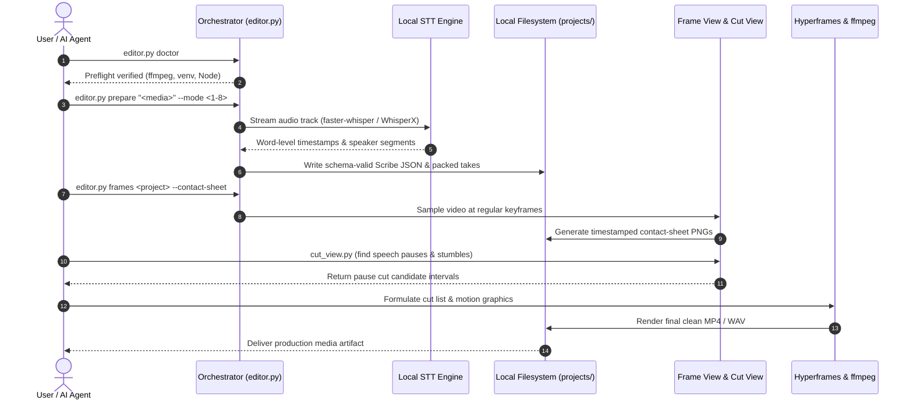

<p align="center"></p>

<p align="center">
  <a href="https://github.com/ellmos-ai/ai-media-editor"></a>
  <a href="https://github.com/ellmos-ai/ai-media-editor/actions/workflows/ci.yml"></a>
  <a href="https://github.com/ellmos-ai/ai-media-editor"></a>
  <a href="https://python.org"></a>
  <a href="https://github.com/ellmos-ai/ai-media-editor"></a>
  <a href="https://github.com/ellmos-ai/ai-media-editor"></a>
  <a href="https://github.com/ellmos-ai/ai-media-editor"></a>
  <a href="https://github.com/ellmos-ai/ai-media-editor/blob/main/SECURITY.md"></a>
  <a href="https://github.com/astral-sh/ruff"></a>
  <a href="https://github.com/ellmos-ai"></a>
  <a href="https://github.com/open-bricks"></a>
  <a href="llms.txt"></a>
  <a href="THIRD_PARTY_LICENSES.txt"></a>
  <a href="NOTICE"></a>
  <a href="https://github.com/ellmos-ai/ai-media-editor"></a>
  <a href="LICENSE"></a>
</p>

<p align="center"><a href="README.md">English</a> · <a href="README_de.md">Deutsch</a> · <a href="README_es.md">Español</a> · <a href="README_fr.md">Français</a> · <a href="README_zh.md">简体中文</a> · <a href="README_ja.md">日本語</a> · <a href="README_ru.md">Русский</a> · <strong>हिन्दी</strong></p>

# ai-media-editor — स्थानीय AI मीडिया संपादक (वीडियो · ऑडियो · पॉडकास्ट)

> [!NOTE]
> **AI / एजेंट के लिए मूल एकीकरण:** `ai-media-editor` को स्वायत्त कोडिंग एजेंटों (Claude Code, Gemini/Antigravity, Codex) के लिए विशेष रूप से बनाया गया है। यह परियोजना की नियतात्मक तैयारी, Scribe JSON स्कीमा निर्माण और समय-मुद्रित फ्रेम थंबनेल शीट उपलब्ध कराता है, ताकि LLM तृतीय-पक्ष SaaS निर्भरताओं के बिना स्थानीय रूप से मीडिया का दृश्य निरीक्षण और संपादन कर सकें।

### त्वरित नेविगेशन

| # | अनुभाग | विवरण |
|---|---|---|
| 01 | [मुख्य क्षमताएँ](#key-capabilities) | ऑर्केस्ट्रेटर की मुख्य क्षमताएँ, स्थानीय STT रूटिंग और एजेंट टूलिंग स्टैक |
| 02 | [दृश्य आर्किटेक्चर फ़्लोचार्ट](#architecture-flowchart) | कच्चे मीडिया के इनपुट से नियतात्मक निर्यात तक 5-स्तरीय सिस्टम संरचना का आरेख |
| 03 | [आरंभ से अंत तक निष्पादन जीवनचक्र क्रम](#end-to-end-execution-lifecycle-sequence) | प्रीफ़्लाइट, STT, फ्रेम थंबनेल शीट और कट निष्पादन का क्रम-आरेख |
| 04 | [लक्षित व्यक्तित्व और खोजयोग्यता](#marketing--target-personas) | 4 मुख्य उपयोगकर्ता प्रोफ़ाइल (`[PERSONA-01]`–`[PERSONA-04]`) और उच्च-इरादा SEO खोजें |
| 05 | [विकल्पों के मुकाबले तुलना मैट्रिक्स](#comparative-matrix-vs-alternatives) | क्लाउड SaaS, भारी NLE, सीधे CLI और होस्टेड API के मुकाबले 10-आयामी सुविधा मैट्रिक्स |
| 06 | [8 उत्पादन उपयोग-मामले](#the-8-usecases) | ऑडियो, वीडियो, व्याख्यात्मक वीडियो और विज्ञापन कार्यप्रवाहों का व्यापक मैट्रिक्स |
| 07 | [शुरुआत और सेटअप](#getting-started--setup) | पूर्वापेक्षाएँ, `<TOOLS_ROOT>` कॉन्फ़िगरेशन और वातावरण आरंभ करना |
| 08 | [CLI संदर्भ और कमांड](#cli-reference--commands) | `doctor`, `modes`, `prepare` और `frames` के लिए चरण-दर-चरण CLI कमांड |
| 09 | [मोशन ग्राफ़िक्स और संगीत संश्लेषण](#motion-graphics--music-synthesis) | Hyperframes स्टाइलिंग और NumPy तरंगरूपों से कथानक-अनुरूप ऑफ़लाइन संगीत रचना |
| 10 | [शासन और रनटाइम इनवेरिएंट](#governance--runtime-invariants) | चुने गए संचालन मोड के दायरे में 10 दस्तावेजीकृत रनटाइम इनवेरिएंट (`INV-LOCAL-01` से `INV-SLA-10`) |
| 11 | [सुरक्षा और गोपनीयता SLA](#security--privacy-sla) | डिफ़ॉल्ट रूप से स्थानीय प्रसंस्करण, वैकल्पिक SSH STT, 48 घंटे में प्रारंभिक उत्तर और 5-दिवसीय ट्रायेज SLA |
| 12 | [सहयोगी परियोजनाएँ और इकोसिस्टम मैट्रिक्स](#sibling-projects--ecosystem-matrix) | `ellmos-ai`, `dev-bricks`, `file-bricks` और `open-bricks` के 16 संयुक्त टूल |
| 13 | [गुणवत्ता गेट और परीक्षण](#quality-gates--testing) | स्वचालित परीक्षण सूट, Ruff linting, compileall और कंसोल विंडो दमन |
| 14 | [मशीन-पठनीय संदर्भ (`llms.txt`)](#machine-readable-context-llmstxt) | LLM क्रॉलर मैनिफ़ेस्ट, खोज-इंडेक्सिंग कीवर्ड और एजेंट संदर्भ-ग्रहण नियम |
| 15 | [रिपॉज़िटरी संरचना](#repository-structure) | कोड, टूल, STT, परीक्षण और परियोजनाओं के फ़ोल्डरों का विस्तृत वर्गीकरण |
| 16 | [परिवर्तन इतिहास और रिलीज़](#changelog--releases) | रिलीज़ इतिहास, संस्करण पड़ाव और Pfad B खोजयोग्यता अपडेट |
| 17 | [स्तर 1 SBOM और तृतीय-पक्ष लाइसेंस](#third-party-licenses--transparency) | तृतीय-पक्ष लाइसेंस सूची, RunAsInvoker गारंटी और स्तर 1 SBOM |
| 18 | [वैधानिक सूचना और दायित्व की सीमा](#statutory-notice--liability-limitation) | MIT लाइसेंस, § 521 BGB Gefälligkeitsrecht सूचना और दायित्व सीमाएँ |
| 19 | [संबद्ध परियोजना: `clip-storyboard-director`](#19-sister-project-clip-storyboard-director) | निर्देशक/मोंटाज संपादक जोड़ी का निर्देशक पक्ष, निश्चित संस्करण वाली वैकल्पिक निर्भरता के रूप में शामिल |

---

<a id="sec-01"></a><a id="key-capabilities"></a><a id="1-key-capabilities"></a><a id="hauptfunktionen"></a><a id="1-hauptfunktionen"></a>
## 1. मुख्य क्षमताएँ

AI कोडिंग एजेंट (जैसे Claude Code, Gemini, Codex) को वीडियो/पॉडकास्ट संपादक की तरह इस्तेमाल करें — **ElevenLabs Scribe के बजाय स्थानीय ट्रांसक्रिप्शन** के साथ। ऑर्केस्ट्रेटर (`editor.py`) नियतात्मक तैयारी संभालता है (उपयुक्त STT इंजन/कंप्यूट पर रूट करना, स्कीमा-अनुरूप Scribe JSON बनाना और takes को पैक करना); रचनात्मक कटिंग, एनीमेशन और मीडिया संयोजन एजेंट द्वारा संचालित होती है।

तीन टूल का स्टैक:
- **video-use** — शब्द-स्तरीय ट्रांसक्रिप्ट के आधार पर कट लगाता है (विराम और अटकन हटाता है)।
- **Hyperframes** — HTML/CSS/JS को MP4 एनीमेशन और मोशन ग्राफ़िक्स में बदलता है।
- **`frontend-design` skill** — मोशन ग्राफ़िक्स और ब्रांडिंग संपत्तियाँ बनाता है।

…और **ElevenLabs Scribe ट्रांसक्रिप्शन की जगह** स्थानीय इंजन इस्तेमाल होते हैं। डिफ़ॉल्ट रूप से बातचीत के लिए **faster-whisper** और टेक्स्ट-आधारित LLM द्वारा वक्ता-निर्धारण उपयोग होता है; **WhisperX** वैकल्पिक ध्वनि-आधारित वक्ता-विभाजन इंजन है। डिफ़ॉल्ट कंप्यूट स्थानीय है; वैकल्पिक रूप से **पहले दूरस्थ होस्ट, फिर स्थानीय फ़ॉलबैक** रूटिंग उपलब्ध है। यह विकल्प वही Scribe फ़ील्ड लिखता है जिनका उपयोग `video-use` करता है, इसलिए आगे के सहायक बिना पैच के चलते हैं।

---

<a id="sec-02"></a><a id="visual-architecture-flowchart"></a><a id="architecture-flowchart"></a><a id="systemarchitektur-ablaufdiagramm"></a><a id="2-visual-architecture-flowchart"></a><a id="2-systemarchitektur-ablaufdiagramm"></a>
## 2. दृश्य आर्किटेक्चर फ़्लोचार्ट

```mermaid
flowchart TB
    subgraph Intake ["Layer 1: Input Channels & Media Intake"]
        V["Raw Video Recording (.mp4/.mov)"]
        A["Raw Audio Recording (.wav/.m4a)"]
        S["Storyline JSON (Narrative & Emotion)"]
    end

    subgraph Preflight ["Layer 2: Orchestrator & Preflight Inspection"]
        DOC["editor.py doctor<br/>Environment & Tooling Verification"]
        MODES["editor.py modes<br/>8 Specialized Media Use Cases"]
        PREP["editor.py prepare<br/>Project Staging & Metadata Contract"]
    end

    subgraph Engines ["Layer 3: Processing & Synthesis Engines"]
        FW["faster-whisper / WhisperX<br/>100% Local STT & Word Alignment"]
        DIAR["ai_media_editor/stt/diarize_llm.py<br/>Text-based Multi-Speaker Diarization"]
        MUSIC["ai_media_editor/tools/compose_music.py<br/>Procedural NumPy Waveform Synthesis"]
        HF["Hyperframes & hide-windows.cjs<br/>HTML/CSS/JS -> MP4 Motion Graphics"]
    end

    subgraph Agentic ["Layer 4: Agentic Interaction Layer"]
        SCRIBE["Scribe JSON Schema<br/>Word-level Timing for video-use"]
        FRAMES["ai_media_editor/tools/frame_view.py<br/>Timestamped Contact-Sheets"]
        CUTS["ai_media_editor/tools/cut_view.py<br/>Pause & Inflection Cut Candidates"]
        LLM["AI Coding Agent<br/>(Claude Code / Gemini / Codex)"]
    end

    subgraph Export ["Layer 5: Deterministic Export & Artefacts"]
        OUT_V["Rendered Master Video (.mp4)"]
        OUT_A["Clean Speaker-Separated Audio (.wav)"]
        OUT_M["Standard MIDI File (.mid) & Score"]
    end

    Intake --> Preflight
    Preflight --> Engines
    Engines --> Agentic
    Agentic --> Export
```



---

<a id="sec-03"></a><a id="end-to-end-execution-lifecycle-sequence"></a><a id="end-to-end-ausführungs-sequenz"></a><a id="3-end-to-end-execution-lifecycle-sequence"></a>
## 3. आरंभ से अंत तक निष्पादन जीवनचक्र क्रम



---

<a id="sec-04"></a><a id="target-personas--discoverability"></a><a id="marketing--target-personas"></a><a id="zielgruppen--auffindbarkeit"></a><a id="marketing--zielgruppen"></a><a id="4-target-personas--discoverability"></a>
## 4. लक्षित व्यक्तित्व और खोजयोग्यता

`ai-media-editor` आधुनिक AI मीडिया स्वचालन के चार अलग-अलग उपयोगकर्ता समूहों के मुख्य कार्यप्रवाह अवरोधों को दूर करता है:

### [PERSONA-01] स्वायत्त AI कोडिंग एजेंट डेवलपर और स्वार्म आर्किटेक्ट
- **प्रोफ़ाइल:** स्वायत्त मीडिया उत्पादन के लिए बहु-एजेंट कार्यप्रवाह (Claude Code, Gemini/Antigravity, Codex CLI, Kimi Code) डिज़ाइन करने वाले सॉफ़्टवेयर इंजीनियर।
- **समस्या:** मालिकाना क्लाउड STT सेवाएँ API दर सीमाएँ लगाती हैं, नाज़ुक ब्राउज़र स्वचालन की आवश्यकता पैदा करती हैं और गोपनीय अप्रकाशित मीडिया को बाहरी विक्रेताओं तक पहुँचाती हैं।
- **समाधान:** केवल CLI से ऑर्केस्ट्रेशन, नियतात्मक Scribe JSON स्कीमा निर्माण, विराम-आधारित कट उम्मीदवार और समय-मुद्रित फ्रेम थंबनेल शीट, जिन्हें मल्टीमोडल LLM सीधे ग्रहण कर सकते हैं।
- **उच्च-इरादा खोज:** `"agent driven video editor with local transcription"`

### [PERSONA-02] स्थानीय-प्रथम पॉडकास्टर और सामग्री निर्माता
- **प्रोफ़ाइल:** स्वतंत्र पॉडकास्टर, साक्षात्कारकर्ता और निर्माता जो साप्ताहिक ऑडियो/वीडियो रिलीज़ संभालते हैं।
- **समस्या:** क्लाउड संपादन SaaS (Descript, Riverside) के अत्यधिक मासिक सदस्यता शुल्क और कई गीगाबाइट की रिकॉर्डिंग अपलोड करने में लगने वाला समय।
- **समाधान:** स्थानीय-मोड faster-whisper ट्रांसक्रिप्शन, वक्ता के अनुसार अलग ऑडियो ट्रैक, विरामों की स्वचालित कटौती और प्रक्रियात्मक एनिमेटेड कवर वीडियो निर्माण। कोड यह बाध्य नहीं करता कि मॉडल लोडिंग ऑफ़लाइन ही रहे।
- **उच्च-इरादा खोज:** `"local first podcast editing AI agent workflow"`

### [PERSONA-03] AI वीडियो और मोशन ग्राफ़िक्स इंजीनियर
- **प्रोफ़ाइल:** ब्रांडेड दृश्य वीडियो संपत्तियों को स्वचालित करने वाले फ़्रंट-एंड डेवलपर और मोशन डिज़ाइनर।
- **समस्या:** पारंपरिक NLE (Premiere, After Effects) में साफ़ प्रोग्रामेटिक इंटरफ़ेस नहीं होते और वे CSS/HTML डिज़ाइन टोकन से सीधे एनीमेशन रेंडर नहीं कर सकते।
- **समाधान:** Hyperframes का सीधा एकीकरण HTML/CSS/JavaScript घटकों को 60fps MP4 मोशन ग्राफ़िक्स में बदलता है और Windows कंसोल फ़्लैशिंग को दबाता है।
- **उच्च-इरादा खोज:** `"Hyperframes motion graphics podcast editor"`

### [PERSONA-04] उद्यम मीडिया सुरक्षा और अनुपालन अधिकारी
- **प्रोफ़ाइल:** विनियमित उद्योगों (स्वास्थ्य सेवा, क़ानून, बैंकिंग) में अनुपालन और सूचना-सुरक्षा अधिकारी।
- **समस्या:** संगठन की नीतियाँ या संविदात्मक आवश्यकताएँ मालिकाना रिकॉर्डिंग को होस्टेड ट्रांसक्रिप्शन प्रदाताओं को भेजने पर रोक लगा सकती हैं।
- **समाधान:** स्थानीय STT डिफ़ॉल्ट है; `compute.prefer=mac` चुनने पर इनपुट मीडिया फ़ाइल की पूरी प्रति कॉन्फ़िगर किए गए SSH होस्ट को भेजी जाती है। चुना गया मोड संगठन की डेटा-हैंडलिंग आवश्यकताओं से मेल खाना चाहिए। बिना विशेषाधिकार वाला `RunAsInvoker` निष्पादन (`INV-RUNAS-02`), स्तर 1 SBOM और 48 घंटे की औपचारिक भेद्यता-प्रतिक्रिया SLA भी दस्तावेजीकृत हैं।
- **उच्च-इरादा खोज:** `"zero egress video transcription and cutting"`

---

<a id="sec-05"></a><a id="comparative-matrix-vs-alternatives"></a><a id="comparative-matrix--alternatives"></a><a id="vergleichsmatrix-gegenueber-alternativen"></a><a id="5-comparative-matrix-vs-alternatives"></a>
## 5. विकल्पों के मुकाबले तुलना मैट्रिक्स

निम्न 10-आयामी मैट्रिक्स `ai-media-editor` की तुलना पुराने और प्रतिस्पर्धी तरीकों से करता है; इसमें चुने गए संचालन मोड के दायरे में दस्तावेजीकृत रनटाइम इनवेरिएंट शामिल हैं:

| आयाम और इनवेरिएंट | ai-media-editor | क्लाउड SaaS (Descript / ElevenLabs) | व्यावसायिक NLE (Premiere / DaVinci) | सीधे CLI / Shell (FFmpeg) | होस्टेड API (Whisper API / Google STT) |
|---|:---:|:---:|:---:|:---:|:---:|
| **1. स्थानीय-प्रथम और मोड-विशिष्ट डेटा प्रवाह (`INV-LOCAL-01`)** | :white_check_mark: डिफ़ॉल्ट स्थानीय-प्रथम; वैकल्पिक SSH STT | :x: अनिवार्य क्लाउड अपलोड | :warning: स्थानीय (मालिकाना टेलीमेट्री) | :white_check_mark: 100% ऑफ़लाइन स्थानीय | :x: बाहरी क्लाउड प्रसंस्करण |
| **2. बिना विशेषाधिकार वाला उपयोगकर्ता-मोड (`INV-RUNAS-02`)** | :white_check_mark: मानक `RunAsInvoker` | :warning: ब्राउज़र / सहायक ऐप | :warning: प्रशासनिक इंस्टॉलर / डेमन | :white_check_mark: उपयोगकर्ता-स्तर के विशेषाधिकार | :white_check_mark: API क्लाइंट स्तर |
| **3. स्रोत की गैर-विनाशकारी सुरक्षा (`INV-PREV-03`)** | :white_check_mark: `prepare` मूल इनपुट को सुरक्षित रखता है | :warning: क्लाउड मीडिया प्रतिलिपि | :white_check_mark: गैर-विनाशकारी परियोजनाएँ | :warning: अनजाने में ओवरराइट होना आसान | :white_check_mark: इनपुट मीडिया सुरक्षित |
| **4. नियतात्मक संश्लेषण (`INV-DETERM-04`)** | :white_check_mark: Scribe JSON और निश्चित seed से संगीत रचना | :x: क्लाउड के परिणामों में स्टोकेस्टिक बदलाव | :warning: परियोजना की जटिल स्थिति | :warning: असंरचित आउटपुट | :x: अनियतात्मक विलंब |
| **5. परियोजना-नाम सत्यापन (`INV-BOUNDARY-05`)** | :white_check_mark: केवल नाम की जाँच; फ़ाइल-सिस्टम सैंडबॉक्स नहीं | :warning: होस्टेड क्लाउड बकेट | :warning: मनमाना फ़ाइल सिस्टम | :x: पथ सत्यापन नहीं | :white_check_mark: क्लाउड टेनेंट सीमा |
| **6. विंडो फ़्लैशिंग दमन (`INV-SUBPROC-06`)** | :white_check_mark: पहले से लोड `windowsHide` | :heavy_minus_sign: लागू नहीं (वेब UI) | :heavy_minus_sign: लागू नहीं (डेस्कटॉप GUI) | :x: व्यवधानकारी कंसोल विंडो | :heavy_minus_sign: लागू नहीं (HTTP अनुरोध) |
| **7. क्रॉस-प्लेटफ़ॉर्म समर्थन (`INV-PARITY-07`)** | :white_check_mark: OS-विशिष्ट पथों के साथ Windows, Linux, macOS | :warning: ब्राउज़र पर निर्भर | :x: OS-विशिष्ट सुविधाएँ | :white_check_mark: POSIX / Windows | :white_check_mark: क्रॉस-प्लेटफ़ॉर्म HTTP |
| **8. बहु-एजेंट समवर्ती उपयोग (`INV-SYNC-08`)** | :white_check_mark: लॉक अनुशासन और साफ़ Git | :x: एकल-उपयोगकर्ता SaaS सत्र | :x: एकल-एडिटर परियोजना लॉक | :warning: समवर्ती उपयोग के टकराव | :warning: दर-सीमा के अवरोध |
| **9. एजेंट और LLM पठनीयता (`INV-DOCS-09`)** | :white_check_mark: Scribe JSON, फ्रेम थंबनेल शीट, `llms.txt` | :x: बंद बाइनरी / HTML DOM | :x: जटिल बाइनरी परियोजना फ़ाइलें | :warning: कच्चा टेक्स्ट stdout/stderr | :warning: केवल टेक्स्ट ट्रांसक्रिप्ट |
| **10. समन्वित सुरक्षा SLA (`INV-SLA-10`)** | :white_check_mark: 48 घंटे में उत्तर / 5 दिनों में ट्रायेज | :warning: एंटरप्राइज़ सहायता कतार | :warning: तिमाही व्यावसायिक अपडेट | :heavy_minus_sign: अनुरक्षण-विहीन स्क्रिप्ट | :warning: सामान्य क्लाउड SLA |

विस्तृत विपणन विश्लेषण, खोज कीवर्ड और खोजयोग्यता लॉग: [`MARKETING-LOG.txt`](MARKETING-LOG.txt)।

---

<a id="sec-06"></a><a id="the-8-production-usecases"></a><a id="the-8-usecases"></a><a id="die-8-anwendungsfälle"></a><a id="6-the-8-production-usecases"></a>
## 6. 8 उत्पादन उपयोग-मामले

| # | इनपुट | वक्ता | आउटपुट | सामान्य कार्यप्रवाह |
|---|---|---|---|---|
| 1 | ऑडियो | 1 | ऑडियो पॉडकास्ट, संपादित | एक वक्ता के भाषण को साफ़ करना और विराम काटना |
| 2 | ऑडियो | कई | अलग-अलग वक्ताओं वाला ऑडियो पॉडकास्ट | वक्ता-चिह्नित बहु-ट्रैक संवाद की सफ़ाई |
| 3 | वीडियो (A+V) | 1 | वीडियो कट + एनीमेशन | स्वचालित Hyperframes लोअर-थर्ड के साथ टॉकिंग-हेड कट |
| 4 | वीडियो (A+V) | कई | वीडियो + एनीमेशन + वक्ता ट्रैकिंग | गतिशील वक्ता कार्ड वाला बहु-वक्ता साक्षात्कार वीडियो |
| 5 | वीडियो → केवल ऑडियो | 1/कई | ऑडियो पॉडकास्ट (वीडियो हटाया गया) | वीडियो फ़ुटेज से बेहतरीन ऑडियो पॉडकास्ट निकालना |
| 6 | ऑडियो | 1/कई | पूरी तरह तैयार व्याख्यात्मक वीडियो | AI-ऑर्केस्ट्रेटेड मोशन ग्राफ़िक्स दृश्यों के साथ वॉइस ट्रैक |
| 7 | ऑडियो | 1 | ऑडियो + एनिमेटेड कवर | एनिमेटेड विनाइल/तरंगरूप लूप में लिपटा पॉडकास्ट ट्रैक |
| 8 | ऑडियो/ब्रीफ़ | 1 | विज्ञापन क्लिप (15–60 s, 16:9 + 9:16) | Hyperframes के ज़रिए तेज़ शॉर्ट-फ़ॉर्म क्लिप फ़ैक्टरी |

हर मोड की चरण-दर-चरण पूरी मार्गदर्शिका के लिए [`docs/USECASES.md`](docs/USECASES.md) देखें।

---

<a id="sec-07"></a><a id="getting-started--setup"></a><a id="erste-schritte--einrichtung"></a><a id="7-getting-started--setup"></a>
## 7. शुरुआत और सेटअप

1. **कॉन्फ़िगरेशन बनाएँ:** `config/settings.example.json` को कॉपी करके `config/settings.json` बनाएँ और स्थानीय कंप्यूट विकल्प (`local`/`mac`), इंजन तथा `paths.*` कॉन्फ़िगर करें। `paths.venv_python` को इस ऑपरेटिंग सिस्टम के Python की निष्पादन योग्य फ़ाइल पर सेट करें; कॉन्फ़िगर किया गया मान सीधे इस्तेमाल होता है। उदाहरण का `.venv/Scripts/python.exe` पथ केवल Windows के लिए है; POSIX वातावरण में आम तौर पर `.venv/bin/python` इस्तेमाल होता है।
2. **टूल डायरेक्टरी (`<TOOLS_ROOT>`):** आपके `settings.json` में `paths.tools_root` भारी टूल (`video-use`, ffmpeg, Node ≥ 22) के लिए मूल डायरेक्टरी तय करता है। इसे क्लाउड-सिंक होने वाले फ़ोल्डर के भीतर **न रखें**।
3. **बाहरी पूर्वापेक्षाएँ:**
   - **स्थानीय:** `ffmpeg`, `Node.js >= 22` (Hyperframes के लिए), Python 3.10–3.13 venv।
   - **वैकल्पिक दूरस्थ होस्ट:** SSH के ज़रिए पहुँच योग्य दूरस्थ मशीन पर faster-whisper + WhisperX।
   - **HuggingFace टोकन:** केवल तब आवश्यक जब `engines.multi_speaker` को `whisperx` पर सेट किया गया हो।
4. **वैकल्पिक: पैकेज के रूप में इंस्टॉल करें।** `pip install -e .` (या `-e ".[storyboard]"` से भी
    [`clip-storyboard-director`](#19-sister-project-clip-storyboard-director) इंस्टॉल होगा) और इससे
    `ai-media-editor` कंसोल स्क्रिप्ट पंजीकृत होती है, जो नीचे दिए `python editor.py` चलाने के बराबर है।

---

<a id="sec-08"></a><a id="cli-reference--commands"></a><a id="cli-referenz--befehle"></a><a id="8-cli-reference--commands"></a>
## 8. CLI संदर्भ और कमांड

```bash
# Set Python venv path
VENV="<TOOLS_ROOT>/.venv/Scripts/python.exe"

# 1. Environment & toolchain verification
PYTHONIOENCODING=utf-8 "$VENV" editor.py doctor

# 2. Display supported operational use cases
PYTHONIOENCODING=utf-8 "$VENV" editor.py modes

# 3. Prepare a media project (deterministic transcription + take packing)
PYTHONIOENCODING=utf-8 "$VENV" editor.py prepare "/path/to/recording.mp4" --mode 3 --project my-video

# 4. Generate timestamped frame contact-sheets for visual LLM inspection
PYTHONIOENCODING=utf-8 "$VENV" editor.py frames my-video --contact-sheet

# 5. Extract detailed frame interval
PYTHONIOENCODING=utf-8 "$VENV" editor.py frames my-video --from 30 --to 45 --step 0.25
```

---

<a id="sec-09"></a><a id="motion-graphics--music-synthesis"></a><a id="motion-graphics--musiksynthese"></a><a id="9-motion-graphics--music-synthesis"></a>
## 9. मोशन ग्राफ़िक्स और संगीत संश्लेषण

### ऑफ़लाइन वीडियो-सिंक संगीत रचना (`compose_music.py`)
`ai_media_editor.tools.compose_music` वीडियो की कथानक-रेखा के अनुरूप पृष्ठभूमि संगीत रचता है — पूरी तरह स्थानीय, बिना किसी क्लाउड सेवा के।
इनपुट एक **storyline JSON** है, जो सटीक समय-सीमाओं, भावनाओं और तीव्रता स्तरों वाले खंडों को परिभाषित करता है:

```bash
# Compose music from storyline JSON
python -m ai_media_editor.tools.compose_music docs/examples/storyline-roshambo.json -o projects/<name>/assets/score

# Generate storyline template
python -m ai_media_editor.tools.compose_music --init

# Run deterministic synthesis selftest
python -m ai_media_editor.tools.compose_music --selftest
```

आउटपुट: Stereo WAV + MP3 + `<name>.notes.json` + `<name>.mid` (Standard MIDI File Type 1)।

### MIDI निर्यात और उच्च-निष्ठा रेंडरिंग
MIDI निर्यात पेशेवर soundfont के ज़रिए lossless रेंडरिंग सक्षम करता है:
- **पथ A — SoundFont (स्थानीय, मुफ़्त):** FluidSynth (`winget install FluidSynth`) + GeneralUser GS / MuseScore_General:
  `fluidsynth -ni soundfont.sf2 out.mid -F out.wav -r 44100`
- **पथ B — ऑर्केस्ट्रल लाइब्रेरी:** VSCO 2 Community Edition या Salamander Grand Piano।

### मल्टी-क्लिप लूप संयोजन, QA और वातावरणीय संश्लेषण (`make_loop.py`, `qa_clips.py`, `atmo.py`, `synth.py`, `fx.js`)
Halloween Window Projection उत्पादन पाइपलाइन (`T-20261025-256694132`) से पोर्ट किए गए `ai_media_editor.tools` में पुनः उपयोग योग्य दृश्य-लूप और प्रक्रियात्मक ध्वनि-डिज़ाइन टूल भी हैं:
- **`ai_media_editor.tools.make_loop`**: रेंडर किए गए दृश्य क्लिप (`<sid>.mp4`) को कॉन्फ़िगर करने योग्य काले विरामों (`loop.json` या `--pause`) और वैकल्पिक AAC 48 kHz ऑडियो ट्रैक (`--audio`) के साथ जोड़ता है:
  `python -m ai_media_editor.tools.make_loop docs/examples/loop-halloween.json renders/ -o loop.mp4 [--pause 8] [--audio atmo.wav]`
- **`ai_media_editor.tools.qa_clips`**: `ffprobe` से रेंडर किए गए क्लिप की जाँच करता है, पहले/अंतिम फ़्रेम की luminance मापता है (काले स्तर का सत्यापन), शुरुआत/मध्य/अंत/पीक फ़्रेम निकालता है और `xstack` थंबनेल शीट (`qa.json`, `VORSCHAU_kontaktbogen.jpg`) बनाता है:
  `python -m ai_media_editor.tools.qa_clips renders/ qa_out/`
- **`ai_media_editor.tools.synth` और `ai_media_editor.tools.atmo`**: 48 kHz NumPy/SciPy प्रक्रियात्मक वाद्य और वातावरणीय ध्वनि संश्लेषण (`chip_pulse`, `marimba`, `glock`, `pizz`, `flute`, `fm_brass`, `fm_bell`, `make_ir`) तथा दृश्य-ग्रिड पर चलने वाला लूप योग्य soundscape जनरेटर, जिसमें EBU R128 loudness (`-16 LUFS-I`) और true-peak (`<= -3.5 dBTP`) का क्रमिक mastering शामिल है:
  `python -m ai_media_editor.tools.atmo docs/examples/loop-halloween.json -o atmo.wav [--pause 8]`
- **`ai_media_editor/tools/fx.js` (`window.HFX`)**: HyperFrames दृश्य के लिए नियतात्मक, टाइमलाइन में स्थान बदलने पर सुरक्षित सहायक, जिनमें `HFX.ft` (GSAP `fromTo` wrapper जो `immediateRender: false` लागू करता है ताकि tween शुरू होने से पहले प्रभाव छिपे रहें), `HFX.drive`, `HFX.rng` (mulberry32), `HFX.noise1`, `HFX.key`, `HFX.bump`, `HFX.path`, `HFX.spider` और `HFX.bat` शामिल हैं।

---

<a id="sec-10"></a><a id="governance--runtime-invariants"></a><a id="governance---laufzeit-invarianten"></a><a id="10-governance--runtime-invariants"></a>
## 10. शासन और रनटाइम इनवेरिएंट

आर्किटेक्चर 10 रनटाइम इनवेरिएंट दस्तावेजीकृत करता है; व्यवहार चुने गए संचालन मोड पर निर्भर करता है:

| इनवेरिएंट ID | संचालन क्षेत्र | गारंटी और प्रवर्तन नियम | सत्यापन का तरीका |
|---|---|---|---|
| `INV-LOCAL-01` | गोपनीयता और डेटा निर्गमन | **डिफ़ॉल्ट रूप से स्थानीय-प्रथम**: `compute.prefer=local` होने पर STT इसी मशीन पर चलता है; मॉडल लोडिंग को ऑफ़लाइन रहने के लिए बाध्य नहीं किया जाता। `compute.prefer=mac` होने पर इनपुट मीडिया फ़ाइल की पूरी प्रति कॉन्फ़िगर किए गए SSH होस्ट को भेजी जाती है और कॉन्फ़िगर किया गया HF टोकन भी भेजा जाता है। दूरस्थ सफ़ाई `finally` ब्लॉक में करने का प्रयास होता है, लेकिन उसकी सफलता सत्यापित नहीं होती। | `tests/test_core.py`, `editor.py`, `ai_media_editor/stt/mac_remote.py` |
| `INV-RUNAS-02` | विशेषाधिकार और सैंडबॉक्स | **बिना विशेषाधिकार वाला उपयोगकर्ता-मोड (`RunAsInvoker`)**: किसी प्रशासनिक या उन्नत विशेषाधिकार की आवश्यकता नहीं। | सभी स्क्रिप्ट में मानक उपयोगकर्ता के रूप में निष्पादन |
| `INV-PREV-03` | भंडारण और अपरिवर्तनीयता | **इनपुट का गैर-विनाशकारी प्रबंधन**: `prepare` मूल इनपुट को अपरिवर्तित छोड़ता है और उसकी प्रति `projects/<name>/` में रखता है। अस्थायी ऑडियो OS की temp डायरेक्टरी का उपयोग कर सकता है; दूरस्थ मोड में कॉन्फ़िगर की गई SSH कार्य-डायरेक्टरी भी उपयोग होती है। | `tests/test_core.py` में आइसोलेशन जाँच |
| `INV-DETERM-04` | पुनरुत्पादकता | **नियतात्मक संश्लेषण और स्कीमा स्थिरता**: प्रक्रियात्मक ऑडियो के लिए निश्चित seed और Scribe JSON स्कीमा का कठोर पालन। | `tests/test_compose_music.py`, `ai_media_editor/stt/scribe_schema.py` |
| `INV-BOUNDARY-05` | परियोजना-नाम सत्यापन | **परियोजना-नाम का पाठ-स्तरीय सत्यापन**: परियोजना नामों की जाँच पथ के एकल घटक के रूप में होती है; यह फ़ाइल-सिस्टम सैंडबॉक्स नहीं है। | `test_project_names_cannot_escape_projects` |
| `INV-SUBPROC-06` | प्रक्रिया स्वच्छता | **स्वच्छ जीवनचक्र और विंडो दमन**: पहले से लोड किए गए wrappers Windows पर कंसोल विंडो फ़्लैशिंग दबाते हैं। | `ai_media_editor/tools/hf.cmd`, `ai_media_editor/tools/hide-windows.cjs` |
| `INV-PARITY-07` | बहु-OS समर्थन | **क्रॉस-प्लेटफ़ॉर्म समर्थन**: पथ और executable वर्तमान OS के लिए कॉन्फ़िगर किए जाते हैं; परीक्षण किए गए ऑपरेटिंग सिस्टम के लिए CI मैट्रिक्स देखें। | बहु-OS GitHub Actions CI मैट्रिक्स |
| `INV-SYNC-08` | समवर्ती उपयोग और लॉक | **क्लाउड-सिंक और बहु-एजेंट लॉक अनुशासन**: भारी टूल और परियोजनाओं को क्लाउड-सिंक टकरावों से बाहर रखा गया है। | `.gitignore` के conflict और lock फ़िल्टर नियम |
| `INV-DOCS-09` | पहुँचयोग्यता और खोज | **मल्टीमोडल LLM तत्परता और द्विभाषी समानता**: दृश्य-इनपुट वाले LLM के लिए फ्रेम थंबनेल शीट; पूर्ण EN/DE दस्तावेज़-समानता। | `llms.txt`, `README.md`, `README_de.md` अनुबंध परीक्षण |
| `INV-SLA-10` | सुरक्षा और घटना प्रतिक्रिया | **48 घंटे में सुरक्षा उत्तर और 5-दिवसीय ट्रायेज SLA**: GitHub Advisories और maintainer ईमेल के ज़रिए औपचारिक भेद्यता रिपोर्टिंग। | `SECURITY.md`, `test_security_policy_bilingual_parity` |

---

<a id="sec-11"></a><a id="security--privacy-sla"></a><a id="sicherheit--datenschutz-sla"></a><a id="11-security--privacy-sla"></a>
## 11. सुरक्षा और गोपनीयता SLA

- **स्थानीय-प्रथम प्रसंस्करण**: स्थानीय STT डिफ़ॉल्ट है, लेकिन मॉडल लोडिंग को ऑफ़लाइन रहने के लिए बाध्य नहीं किया जाता। `compute.prefer=mac` होने पर इनपुट मीडिया फ़ाइल की पूरी प्रति कॉन्फ़िगर किए गए SSH होस्ट को भेजी जाती है; कॉन्फ़िगर किया गया HF टोकन भी भेजा जाता है।
- **संवेदनशील मीडिया प्रबंधन**: `prepare` मूल रिकॉर्डिंग को उसके इनपुट पथ पर अपरिवर्तित छोड़ता है और उसकी प्रति `projects/<name>/` में रखता है। अस्थायी ऑडियो OS temp डायरेक्टरी का उपयोग कर सकता है। दूरस्थ मोड कॉन्फ़िगर की गई SSH `workdir` में कार्य-प्रति रखता है; `finally` ब्लॉक में सफ़ाई का प्रयास किया जाता है, लेकिन सफलता सत्यापित नहीं होती।
- **भेद्यता प्रतिक्रिया प्रतिबद्धता:**
  - **प्रारंभिक उत्तर SLA:** जमा की गई भेद्यता रिपोर्ट की पुष्टि 48 घंटे के भीतर।
  - **तकनीकी ट्रायेज SLA:** गंभीरता आकलन के साथ 5 कार्य-दिवस के भीतर।
  - **रिपोर्टिंग माध्यम:** [GitHub Security Advisories](https://github.com/ellmos-ai/ai-media-editor/security/advisories) या सीधे `security@open-bricks.org`, `security@ellmos.ai`, `support@lukasgeiger.com` और `lukas@open-bricks.org` पर ईमेल करें।
  - पूरी जानकारी के लिए [`SECURITY.md`](SECURITY.md) देखें।

---

<a id="sec-12"></a><a id="sibling-projects--ecosystem-matrix"></a><a id="geschwisterprojekte--ökosystem-matrix"></a><a id="12-sibling-projects--ecosystem-matrix"></a>
## 12. सहयोगी परियोजनाएँ और इकोसिस्टम मैट्रिक्स

`ai-media-editor`, `open-bricks` और `ellmos-ai` इकोसिस्टम के भीतर एक विशेषीकृत मल्टीमीडिया ऑर्केस्ट्रेशन इंजन के रूप में काम करता है:

| रिपॉज़िटरी | संगठन | क्षेत्र / उद्देश्य | इकोसिस्टम में परस्पर उपयोग |
|---|---|---|---|
| [`clip-storyboard-director`](https://github.com/ellmos-ai/clip-storyboard-director) | `ellmos-ai` | जनरेटिव स्टोरीबोर्ड और दृश्य निर्देशन | वीडियो उपयोग-मामलों के लिए दृश्य-क्रम बनाना |
| [`assistant-core`](https://github.com/ellmos-ai/assistant-core) | `ellmos-ai` | संवादात्मक पर्यवेक्षण और एजेंट रनटाइम | स्वायत्त मीडिया संपादन कार्यों का ऑर्केस्ट्रेशन |
| [`decision-clicker`](https://github.com/ellmos-ai/decision-clicker) | `ellmos-ai` | इंटरैक्टिव उपयोगकर्ता समीक्षा गेटवे | कट उम्मीदवारों और संपादन निर्णयों की समीक्षा |
| [`lock-master`](https://github.com/ellmos-ai/lock-master) | `ellmos-ai` | त्रुटि होने पर डिफ़ॉल्ट रूप से अस्वीकार करने वाला बहु-एजेंट लॉकिंग फ़्रेमवर्क | परियोजना फ़ाइलों और रेंडर लॉक के समवर्ती उपयोग की रक्षा |
| [`clutch`](https://github.com/ellmos-ai/clutch) | `ellmos-ai` | प्रक्रिया पर्यवेक्षक और कार्य शेड्यूलर | लंबे समय तक चलने वाले रेंडरिंग और STT कार्यों का पर्यवेक्षण |
| [`system-explorer`](https://github.com/ellmos-ai/system-explorer) | `ellmos-ai` | स्थानीय हार्डवेयर और क्षमताओं की खोज | GPU, CUDA और हार्डवेयर त्वरण का पता लगाना |
| [`roblox-studio-core`](https://github.com/ellmos-ai/roblox-studio-core) | `ellmos-ai` | बिना GUI वाला 3D स्टूडियो कैप्चर और स्वचालन | 3D दृश्य संपत्तियाँ और एनीमेशन फ़्रेम |
| [`usb-podcast-studio`](https://github.com/entertain-and-more/usb-podcast-studio) | `entertain-and-more` | USB ऑडियो हार्डवेयर कैप्चर और प्रसारण | पॉडकास्ट मोड के लिए उच्च-निष्ठा रिकॉर्डिंग स्रोत |
| [`BattleStage`](https://github.com/entertain-and-more/BattleStage) | `entertain-and-more` | सर्वर-नियंत्रित भौतिकी सिमुलेशन | गेम फ़ुटेज और रीप्ले वीडियो का प्रसंस्करण |
| [`DevCenter`](https://github.com/dev-bricks/DevCenter) | `dev-bricks` | डेवलपर वातावरण और वर्कस्पेस प्रबंधक | स्थानीय टूल और विकास venv का प्रबंधन |
| [`MethodenAnalyser`](https://github.com/dev-bricks/MethodenAnalyser) | `dev-bricks` | स्थिर Python कोड मेट्रिक्स और मेथड ऑडिट | मीडिया एडिटर मॉड्यूल की कोड गुणवत्ता का विश्लेषण |
| [`ExplorerPro`](https://github.com/file-bricks/ExplorerPro) | `file-bricks` | तेज़ डेस्कटॉप फ़ाइल प्रबंधक (PySide6) | परियोजना ब्राउज़ करना और मीडिया फ़ाइलें व्यवस्थित करना |
| [`ProFiler`](https://github.com/file-bricks/ProFiler) | `file-bricks` | डायरेक्टरी का गहन विश्लेषण और निरीक्षण | मीडिया संपत्तियों की सूची बनाना और कैश का विश्लेषण |
| [`CloudLockFixer`](https://github.com/file-bricks/CloudLockFixer) | `file-bricks` | कई होस्ट के बीच सिंक्रनाइज़ेशन टकराव ठीक करने वाला टूल | लॉक फ़ाइलें और क्लाउड टकराव की प्रतियाँ साफ़ करना |
| [`FormularErstellen`](https://github.com/doc-bricks/FormularErstellen) | `doc-bricks` | गतिशील PDF और दस्तावेज़ लेआउट जनरेटर | परियोजना रिपोर्ट और उत्पादन सारांश बनाना |
| [`open-bricks`](https://github.com/open-bricks/open-bricks) | `open-bricks` | ओपन-सोर्स मानकों का अम्ब्रेला संगठन | इकोसिस्टम का केंद्रीय शासन और लाइसेंस समानता |

---

<a id="sec-13"></a><a id="quality-gates--testing"></a><a id="qualitätsprüfung--tests"></a><a id="13-quality-gates--testing"></a>
## 13. गुणवत्ता गेट और परीक्षण

बाहरी STT मॉडल या बड़ी मीडिया फ़ाइलों के बिना स्थानीय रूप से तेज़ गुणवत्ता जाँच चलाएँ:

```bash
# Run complete test suite
python -m pytest -ra -v

# Run lint checks
ruff check .

# Validate bytecode compilation
python -m compileall -q .

# Verify CLI modes
python editor.py modes
```

### Windows कंसोल विंडो दमन
Hyperframes और Node की अधीनस्थ प्रक्रियाएँ `ai_media_editor/tools/hf.cmd` तथा `ai_media_editor/tools/hide-windows.cjs` के माध्यम से चलती हैं, ताकि `windowsHide: true` लागू हो और रेंडरिंग के दौरान ध्यान भटकाने वाली कंसोल विंडो की फ़्लैशिंग समाप्त हो। पृष्ठभूमि विवरण: [`docs/WINDOWS-KONSOLENFENSTER.md`](docs/WINDOWS-KONSOLENFENSTER.md)।

---

<a id="sec-14"></a><a id="machine-readable-context-llmstxt"></a><a id="maschinenlesbarer-kontext-llmstxt"></a><a id="14-machine-readable-context-llmstxt"></a>
## 14. मशीन-पठनीय संदर्भ (`llms.txt`)

LLM क्रॉलर, कोड सहायक और स्वचालित इंडेक्सिंग एजेंट रिपॉज़िटरी का संदर्भ सीधे [`llms.txt`](llms.txt) से पढ़ सकते हैं।

मुख्य खोज वाक्यांश:
```text
ellmos-ai/ai-media-editor
local AI media editor video podcast transcription
agent driven video editor with local transcription
Claude Code video podcast editor Hyperframes
faster-whisper WhisperX Scribe JSON video-use
transcript based video cutting local first
Hyperframes motion graphics podcast editor
offline procedural music synthesis storyline numpy
zero egress video transcription and cutting
```

---

<a id="sec-15"></a><a id="repository-structure"></a><a id="repository-struktur"></a><a id="15-repository-structure"></a>
## 15. रिपॉज़िटरी संरचना

```
ai-media-editor/                  (code/docs/projects)
├── CLAUDE.md                     ← agent guide (editor workflow, German)
├── README.md                     ← English overview & 18-point visual architecture
├── README_de.md                  ← German documentation (1:1 anchor parity)
├── editor.py                     ← compatibility shim for documented direct calls
├── ai_media_editor/editor.py     ← orchestrator (prepare / frames / modes / doctor)
├── ai_media_editor/tools/
│   ├── cut_view.py               ← pauses as explicit cut candidates
│   ├── frame_view.py             ← video → timestamped frames ("video-scatterer", UC3/4/8)
│   ├── compose_cover.py          ← UC7: loop a cover over audio
│   ├── compose_music.py          ← storyline JSON → video-synced score (NumPy waveform synthesis)
│   ├── synth.py / atmo.py        ← 48 kHz SciPy instrument synthesis & loopable EBU R128 atmo generator
│   ├── make_loop.py / qa_clips.py← multi-clip black-pause loop builder & ffprobe/luma QA contact sheet
│   ├── fx.js                     ← deterministic HyperFrames scene helpers (HFX.ft, HFX.drive, SVG rigs)
│   ├── hf.cmd / hf-hidden.vbs    ← Windows console window suppression wrappers
│   └── hide-windows.cjs          ← Node.js preload script enforcing windowsHide: true
├── ai_media_editor/stt/
│   ├── scribe_schema.py          ← Scribe-JSON format (contract with video-use)
│   ├── transcribe_local.py       ← faster-whisper + WhisperX → Scribe-JSON
│   ├── diarize_llm.py            ← token-free text-based speaker assignment
│   └── mac_remote.py             ← compute routing (remote primary, local fallback)
├── config/settings.example.json  ← template: compute, engines, models, paths, HF token
├── brand/design-tokens.css       ← branding tokens for generated animations
├── docs/USECASES.md              ← step-by-step per mode
├── production/                   ← optional generative workflows (cloud gates apply)
├── tests/
│   ├── test_core.py              ← dependency-free regression suite
│   ├── test_compose_music.py     ← storyline & waveform synthesis tests
│   └── test_metadata.py          ← automated contract tests for manifests & discoverability
├── SECURITY.md                   ← private vulnerability reporting and security scope
├── THIRD_PARTY_LICENSES.md       ← Level 1 SBOM and third-party license inventory
├── MARKETING-LOG.txt             ← discoverability, personas, matrix & architecture audit
└── projects/<name>/edit/         ← per project: transcripts/, takes_packed.md, … (gitignored)

<TOOLS_ROOT>/                     (NOT a cloud folder — venv/tools)
├── .venv/                        ← Python venv (faster-whisper, video-use, …)
└── video-use/                    ← cloned browser-use/video-use (unpatched)
```

---

<a id="sec-16"></a><a id="changelog--releases"></a><a id="changelog--veröffentlichungen"></a><a id="16-changelog--releases"></a>
## 16. परिवर्तन इतिहास और रिलीज़

पूरा संस्करण इतिहास [`CHANGELOG.md`](CHANGELOG.md) में देखें।
- **संस्करण 0.2.3 (2026-09-20):** Pfad B दृश्य आर्किटेक्चर और खोजयोग्यता का व्यापक सुधार, 18-बिंदु द्विभाषी नेविगेशन समानता, 4 विकल्पों के मुकाबले 10-आयामी तुलना मैट्रिक्स, 4 औपचारिक लक्षित व्यक्तित्व (`[PERSONA-01]` से `[PERSONA-04]`), `THIRD_PARTY_LICENSES.md` में स्तर 1 SBOM इनवेरिएंट क्रॉस-रेफ़रेंस तालिका, `RunAsInvoker` बिना-विशेषाधिकार प्रमाणन और § 521 BGB वैधानिक सूचना।
- **संस्करण 0.2.2 (2026-09-12):** Pfad A तकनीकी स्वच्छता समीक्षा, CI runner timeout सुरक्षा सीमाएँ (`timeout-minutes: 15`), पुराने issues/PRs का स्वचालित जीवनचक्र प्रबंधन, मज़बूत `.gitignore` और `pyproject.toml` में वैकल्पिक निर्भरता समूह।
- **संस्करण 0.2.1 (2026-09-11):** खोजयोग्यता सुधार, तृतीय-पक्ष लाइसेंस का विशेष ऑडिट, PEP 621 के विस्तारित URLs और प्रारंभिक अनुबंध परीक्षण सूट।
- **संस्करण 0.2.0 (2026-09-09):** मज़बूत local-first पाइपलाइन, स्वचालित अनुबंध परीक्षण, बहु-OS CI मैट्रिक्स, द्विभाषी समानता, दो Mermaid आरेख और 10 शासन इनवेरिएंट।

---

<a id="sec-17"></a><a id="level-1-sbom--third-party-licenses"></a><a id="third-party-licenses--transparency"></a><a id="drittanbieter-lizenzen--transparenz"></a><a id="17-level-1-sbom--third-party-licenses"></a>
## 17. स्तर 1 SBOM और तृतीय-पक्ष लाइसेंस

`ai-media-editor` अपने घटकों के लाइसेंस दस्तावेजीकृत करता है और बिना विशेषाधिकार के निष्पादन पर ध्यान देता है:

- **तृतीय-पक्ष लाइसेंस सूची:** सूचीबद्ध घटकों के दर्ज लाइसेंस [`THIRD_PARTY_LICENSES.md`](THIRD_PARTY_LICENSES.md) में देखें; उपयोग से पहले लागू लाइसेंस जाँचें।
- **स्थानीय-प्रथम STT (`INV-LOCAL-01`)**: स्थानीय ट्रांसक्रिप्शन डिफ़ॉल्ट है। मॉडल लोडिंग को ऑफ़लाइन रहने के लिए बाध्य नहीं किया जाता; `compute.prefer=mac` चुनने पर इनपुट मीडिया फ़ाइल की पूरी प्रति कॉन्फ़िगर किए गए SSH होस्ट को भेजी जाती है और कॉन्फ़िगर किया गया HF टोकन भी भेजा जाता है।
- **बिना विशेषाधिकार वाले उपयोगकर्ता के रूप में निष्पादन (`INV-RUNAS-02`)**: सभी घटक मानक गैर-विशेषाधिकार प्राप्त उपयोगकर्ता खातों (`RunAsInvoker`) के अंतर्गत चलते हैं; प्रशासनिक या root elevation की आवश्यकता नहीं होती।
- **स्तर 1 SBOM और शासन मैपिंग**: upstream स्रोत, अनुरक्षक, लाइसेंस पाठ और लागू इनवेरिएंट [`THIRD_PARTY_LICENSES.md`](THIRD_PARTY_LICENSES.md) में सूचीबद्ध हैं।
- **मुख्य परियोजना लाइसेंस:** [MIT लाइसेंस](LICENSE) © 2026 ellmos-ai / open-bricks।

---

<a id="sec-18"></a><a id="statutory-notice--liability-limitation"></a><a id="gesetzlicher-hinweis--haftungsbeschraenkung"></a><a id="18-statutory-notice--liability-limitation"></a>
## 18. वैधानिक सूचना और दायित्व की सीमा

यह सॉफ़्टवेयर MIT लाइसेंस के अंतर्गत ओपन-सोर्स सॉफ़्टवेयर के रूप में निःशुल्क उपलब्ध कराया जाता है। जर्मन वैधानिक कानून (§ 521 BGB — *Gefälligkeitsrecht* / निःशुल्क अनुबंध) के तहत, सॉफ़्टवेयर निःशुल्क उपलब्ध कराने के मामले में दायित्व केवल जानबूझकर किए गए कृत्य (*Vorsatz*) और गंभीर लापरवाही (*grobe Fahrlässigkeit*) तक सीमित है। विशेष उद्देश्य के लिए उपयुक्तता, व्यापारिक गुणवत्ता या दोषों के अभाव की कोई वारंटी नहीं दी जाती।

---

<a id="19-sister-project-clip-storyboard-director"></a>
## 19. संबद्ध परियोजना: `clip-storyboard-director`

[`clip-storyboard-director`](https://github.com/ellmos-ai/clip-storyboard-director) इस संपादक के
**मोंटाज संपादक** के लिए दो-एजेंट मीडिया उत्पादन मॉडल में **निर्देशक** की भूमिका निभाता है: यह पूर्व-उत्पादन संभालता है—
स्क्रिप्ट को भागों में बाँटना, शॉट का समय-निर्धारण, CDP ब्राउज़र स्वचालन के माध्यम से AI वीडियो जनरेटर के लिए प्रॉम्प्ट तैयार करना,
और 4D स्थिति-संरक्षण तथा निरंतरता बफ़र—और तैयार प्रारंभिक कट को
`ai-media-editor` को सौंपता है ताकि वह उसे अंतिम रूप दे सके (नॉन-लीनियर संपादन, रंग सुधार, ट्रांज़िशन, ऑडियो डकिंग,
अंतिम रेंडर)। दोनों टूल स्वतंत्र रूप से काम करते हैं; किसी एक को चलाने के लिए दूसरे की आवश्यकता नहीं है।

इसे इस परियोजना के `pyproject.toml` में वैकल्पिक `storyboard` निर्भरता के रूप में घोषित किया गया है,
और पुनरुत्पादकता के लिए एक विशिष्ट समीक्षित कमिट पर पिन किया गया है। दोनों को
`ai-media-editor` कंसोल स्क्रिप्ट के साथ एक ही चरण में इंस्टॉल करें:

```bash
pip install -e ".[storyboard]"
ai-media-editor modes
clip-director --version
```

`clip-storyboard-director` पर भी इस परियोजना की तरह MIT लाइसेंस लागू है; इसके घटकों की सूची के लिए
[`THIRD_PARTY_LICENSES.md`](https://github.com/ellmos-ai/clip-storyboard-director/blob/main/THIRD_PARTY_LICENSES.md)
देखें।
