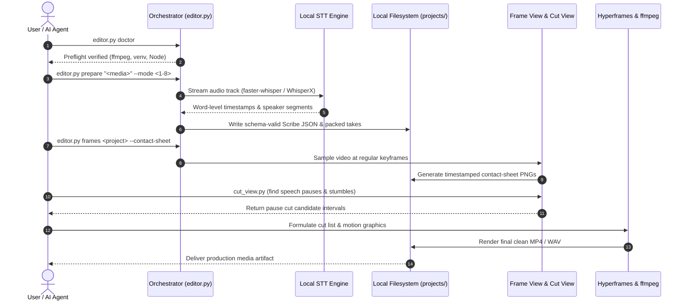

<p align="center"></p>

<p align="center">
  <a href="https://github.com/ellmos-ai/ai-media-editor"></a>
  <a href="https://github.com/ellmos-ai/ai-media-editor/actions/workflows/ci.yml"></a>
  <a href="https://github.com/ellmos-ai/ai-media-editor"></a>
  <a href="https://python.org"></a>
  <a href="https://github.com/ellmos-ai/ai-media-editor"></a>
  <a href="https://github.com/ellmos-ai/ai-media-editor"></a>
  <a href="https://github.com/ellmos-ai/ai-media-editor"></a>
  <a href="https://github.com/ellmos-ai/ai-media-editor/blob/main/SECURITY.md"></a>
  <a href="https://github.com/astral-sh/ruff"></a>
  <a href="https://github.com/ellmos-ai"></a>
  <a href="https://github.com/open-bricks"></a>
  <a href="llms.txt"></a>
  <a href="THIRD_PARTY_LICENSES.txt"></a>
  <a href="NOTICE"></a>
  <a href="https://github.com/ellmos-ai/ai-media-editor"></a>
  <a href="LICENSE"></a>
</p>

<p align="center"><a href="README.md">English</a> · <a href="README_de.md">Deutsch</a> · <a href="README_es.md">Español</a> · <a href="README_fr.md">Français</a> · <a href="README_zh.md">简体中文</a> · <strong>日本語</strong> · <a href="README_ru.md">Русский</a></p>

# ai-media-editor — ローカル AI メディア編集ツール（動画・音声・ポッドキャスト）

> [!NOTE]
> **AI／エージェント向けネイティブ統合：** `ai-media-editor` は自律型コーディングエージェント（Claude Code、Gemini/Antigravity、Codex）向けに設計されています。決定論的なプロジェクト準備、Scribe JSON スキーマの生成、タイムスタンプ付きフレームのサムネイル一覧を提供し、LLM がサードパーティ SaaS に依存せずローカルでメディアを視覚的に確認・カットできるようにします。

### クイックナビゲーション

| # | セクション | 説明 |
|---|---|---|
| 01 | [主な機能](#key-capabilities) | オーケストレーターの主要機能、ローカル STT ルーティング、エージェント用ツールスタック |
| 02 | [ビジュアルアーキテクチャのフローチャート](#architecture-flowchart) | 生メディアの受け入れから決定論的なエクスポートまでを示す5層のシステム構成図 |
| 03 | [エンドツーエンド実行ライフサイクルのシーケンス](#end-to-end-execution-lifecycle-sequence) | 事前チェック、STT、フレームのサムネイル一覧、カット実行を示すシーケンス図 |
| 04 | [対象ユーザー像と見つけやすさ](#marketing--target-personas) | 4つの主要ユーザープロファイル（`[PERSONA-01]`–`[PERSONA-04]`）と高意図 SEO 検索語 |
| 05 | [代替手段との比較マトリクス](#comparative-matrix-vs-alternatives) | クラウド SaaS、大規模 NLE、素の CLI、ホスト型 API を10項目で比較 |
| 06 | [本番向け8つのユースケース](#the-8-usecases) | 音声、動画、解説、広告ワークフローの包括的なマトリクス |
| 07 | [導入とセットアップ](#getting-started--setup) | 前提条件、`<TOOLS_ROOT>` の設定、環境の初期化 |
| 08 | [CLI リファレンスとコマンド](#cli-reference--commands) | `doctor`、`modes`、`prepare`、`frames` の手順付き CLI コマンド |
| 09 | [モーショングラフィックスと音楽合成](#motion-graphics--music-synthesis) | Hyperframes のスタイリングと、ストーリーラインに沿った NumPy 波形によるオフライン作曲 |
| 10 | [ガバナンスと実行時不変条件](#governance--runtime-invariants) | 選択したモードに応じた適用範囲を持つ、文書化された10項目の実行時不変条件（`INV-LOCAL-01`～`INV-SLA-10`） |
| 11 | [セキュリティとプライバシー SLA](#security--privacy-sla) | ローカル処理が既定、任意の SSH STT、初回応答48時間以内、トリアージ5日以内 |
| 12 | [関連プロジェクトとエコシステムマトリクス](#sibling-projects--ecosystem-matrix) | `ellmos-ai`、`dev-bricks`、`file-bricks`、`open-bricks` にまたがる16の連携ツール |
| 13 | [品質ゲートとテスト](#quality-gates--testing) | 自動テストスイート、Ruff lint、compileall、コンソールウィンドウ抑制 |
| 14 | [機械可読コンテキスト（`llms.txt`）](#machine-readable-context-llmstxt) | LLM クローラーマニフェスト、検索インデックス用キーワード、エージェント取り込み規則 |
| 15 | [リポジトリ構成](#repository-structure) | コード、ツール、STT、テスト、プロジェクトにまたがる詳細なフォルダー分類 |
| 16 | [変更履歴とリリース](#changelog--releases) | リリース履歴、バージョンの節目、Pfad B の見つけやすさの更新 |
| 17 | [レベル1 SBOM とサードパーティライセンス](#third-party-licenses--transparency) | サードパーティライセンス一覧、RunAsInvoker の保証、レベル1 SBOM |
| 18 | [法定告知と責任制限](#statutory-notice--liability-limitation) | MIT ライセンス、§ 521 BGB *Gefälligkeitsrecht* に関する免責告知、責任制限 |
| 19 | [関連プロジェクト：`clip-storyboard-director`](#19-sister-project-clip-storyboard-director) | Director/Cutter の二役モデルの Director 側。バージョンを固定した任意依存として同梱 |

---

<a id="sec-01"></a><a id="key-capabilities"></a><a id="1-key-capabilities"></a><a id="hauptfunktionen"></a><a id="1-hauptfunktionen"></a>
## 1. 主な機能

AI コーディングエージェント（例：Claude Code、Gemini、Codex）を動画／ポッドキャスト編集ツールとして使い、**ElevenLabs Scribe の代わりにローカルで文字起こし**できます。オーケストレーター（`editor.py`）は決定論的な準備（適切な STT エンジン／計算方式へのルーティング、スキーマに適合する Scribe JSON の生成、テイクの整理）を担当し、クリエイティブな編集、アニメーション、構成はエージェントが担います。

3つのツールで構成されます：
- **video-use** — 単語単位の文字起こしに基づいてカットします（ポーズや言いよどみを除去）。
- **Hyperframes** — HTML/CSS/JS から MP4 アニメーションやモーショングラフィックスを生成します。
- **`frontend-design` スキル** — モーショングラフィックスやブランド素材を生成します。

…ElevenLabs Scribe の文字起こしを**ローカルエンジンに置き換えます**。会話では、既定の **faster-whisper** とテキストベース LLM による話者割り当てを使います。**WhisperX** は任意の音響的話者ダイアライゼーションエンジンです。計算は既定でローカルですが、リモートホストを優先し、失敗時はローカルにフォールバックするルーティングも選べます。この置き換えは `video-use` が使うものと同じ Scribe フィールドを書き込むため、下流のヘルパーは変更なしで動作します。

---

<a id="sec-02"></a><a id="visual-architecture-flowchart"></a><a id="architecture-flowchart"></a><a id="systemarchitektur-ablaufdiagramm"></a><a id="2-visual-architecture-flowchart"></a><a id="2-systemarchitektur-ablaufdiagramm"></a>
## 2. ビジュアルアーキテクチャのフローチャート

```mermaid
flowchart TB
    subgraph Intake ["Layer 1: Input Channels & Media Intake"]
        V["Raw Video Recording (.mp4/.mov)"]
        A["Raw Audio Recording (.wav/.m4a)"]
        S["Storyline JSON (Narrative & Emotion)"]
    end

    subgraph Preflight ["Layer 2: Orchestrator & Preflight Inspection"]
        DOC["editor.py doctor<br/>Environment & Tooling Verification"]
        MODES["editor.py modes<br/>8 Specialized Media Use Cases"]
        PREP["editor.py prepare<br/>Project Staging & Metadata Contract"]
    end

    subgraph Engines ["Layer 3: Processing & Synthesis Engines"]
        FW["faster-whisper / WhisperX<br/>100% Local STT & Word Alignment"]
        DIAR["ai_media_editor/stt/diarize_llm.py<br/>Text-based Multi-Speaker Diarization"]
        MUSIC["ai_media_editor/tools/compose_music.py<br/>Procedural NumPy Waveform Synthesis"]
        HF["Hyperframes & hide-windows.cjs<br/>HTML/CSS/JS -> MP4 Motion Graphics"]
    end

    subgraph Agentic ["Layer 4: Agentic Interaction Layer"]
        SCRIBE["Scribe JSON Schema<br/>Word-level Timing for video-use"]
        FRAMES["ai_media_editor/tools/frame_view.py<br/>Timestamped Contact-Sheets"]
        CUTS["ai_media_editor/tools/cut_view.py<br/>Pause & Inflection Cut Candidates"]
        LLM["AI Coding Agent<br/>(Claude Code / Gemini / Codex)"]
    end

    subgraph Export ["Layer 5: Deterministic Export & Artefacts"]
        OUT_V["Rendered Master Video (.mp4)"]
        OUT_A["Clean Speaker-Separated Audio (.wav)"]
        OUT_M["Standard MIDI File (.mid) & Score"]
    end

    Intake --> Preflight
    Preflight --> Engines
    Engines --> Agentic
    Agentic --> Export
```



---

<a id="sec-03"></a><a id="end-to-end-execution-lifecycle-sequence"></a><a id="end-to-end-ausführungs-sequenz"></a><a id="3-end-to-end-execution-lifecycle-sequence"></a>
## 3. エンドツーエンド実行ライフサイクルのシーケンス



---

<a id="sec-04"></a><a id="target-personas--discoverability"></a><a id="marketing--target-personas"></a><a id="zielgruppen--auffindbarkeit"></a><a id="marketing--zielgruppen"></a><a id="4-target-personas--discoverability"></a>
## 4. 対象ユーザー像と見つけやすさ

`ai-media-editor` は、4種類のユーザーに向けた最新の AI メディア自動化ワークフローの主要なボトルネックを解消します：

### [PERSONA-01] 自律型 AI コーディングエージェント開発者とエージェント群の設計者
- **プロフィール：** 自律的なメディア制作に向けてマルチエージェントワークフロー（Claude Code、Gemini/Antigravity、Codex CLI、Kimi Code）を設計するソフトウェアエンジニア。
- **課題：** 独自仕様のクラウド STT サービスは API レート制限を課し、壊れやすいブラウザー自動化を必要とし、未公開の機密メディアを外部ベンダーに渡すことになります。
- **解決策：** 純粋な CLI オーケストレーションにより、Scribe JSON スキーマを決定論的に生成し、ポーズに基づくカット候補を提示し、マルチモーダル LLM が直接取り込めるタイムスタンプ付きフレームのサムネイル一覧を作成します。
- **高意図検索語：** `"agent driven video editor with local transcription"`

### [PERSONA-02] ローカル優先のポッドキャスターとコンテンツ制作者
- **プロフィール：** 毎週の音声／動画公開を管理する独立系ポッドキャスター、インタビュアー、クリエイター。
- **課題：** クラウド編集 SaaS（Descript、Riverside）の高額な月額料金と、数 GB の録音データのアップロードに時間がかかること。
- **解決策：** ローカルモードの faster-whisper による文字起こし、話者ごとに分離した音声トラック、自動ポーズ除去、手続き型のアニメーション付きカバー動画生成を利用します。コードは、モデルの読み込みをオフラインに限定するよう強制しません。
- **高意図検索語：** `"local first podcast editing AI agent workflow"`

### [PERSONA-03] AI 動画・モーショングラフィックスエンジニア
- **プロフィール：** ブランドに沿ったビジュアル動画素材を自動化するフロントエンド開発者やモーションデザイナー。
- **課題：** 従来の NLE（Premiere、After Effects）は扱いやすいプログラム用インターフェースがなく、CSS/HTML のデザイントークンから直接アニメーションをレンダリングできません。
- **解決策：** Hyperframes を直接統合して HTML/CSS/JavaScript コンポーネントを 60fps の MP4 モーショングラフィックスに変換し、Windows のコンソールウィンドウの点滅を抑制します。
- **高意図検索語：** `"Hyperframes motion graphics podcast editor"`

### [PERSONA-04] 企業のメディアセキュリティ／コンプライアンス責任者
- **プロフィール：** 医療、法律、銀行などの規制業界におけるコンプライアンスおよび情報セキュリティ担当者。
- **課題：** 組織の方針や契約上の要件により、独自の録音データをホスト型文字起こしプロバイダーへ送信できない場合があります。
- **解決策：** ローカル STT が既定です。`compute.prefer=mac` を選ぶと、入力メディアファイル全体のコピーが設定済み SSH ホストへ送信されます。選択したモードは組織のデータ取り扱い要件に合わせてください。非特権の `RunAsInvoker` 実行（`INV-RUNAS-02`）、レベル1 SBOM、正式な脆弱性報告への48時間応答 SLA も文書化されています。
- **高意図検索語：** `"zero egress video transcription and cutting"`

---

<a id="sec-05"></a><a id="comparative-matrix-vs-alternatives"></a><a id="comparative-matrix--alternatives"></a><a id="vergleichsmatrix-gegenueber-alternativen"></a><a id="5-comparative-matrix-vs-alternatives"></a>
## 5. 代替手段との比較マトリクス

次の10項目のマトリクスでは、選択した実行モードに応じた適用範囲を持つ、文書化済みの実行時不変条件に照らして、`ai-media-editor` と従来型・競合方式を比較します：

| 項目と不変条件 | ai-media-editor | クラウド SaaS（Descript / ElevenLabs） | 商用 NLE（Premiere / DaVinci） | 生の CLI / Shell（FFmpeg） | ホスト型 API（Whisper API / Google STT） |
|---|:---:|:---:|:---:|:---:|:---:|
| **1. ローカル優先とモード別データフロー（`INV-LOCAL-01`）** | :white_check_mark: ローカルが既定、SSH STT は任意 | :x: クラウドへのアップロード必須 | :warning: ローカル（独自テレメトリーあり） | :white_check_mark: 100% ローカル・オフライン | :x: 外部クラウド処理 |
| **2. 非特権ユーザーモード（`INV-RUNAS-02`）** | :white_check_mark: 標準の `RunAsInvoker` | :warning: ブラウザー／ヘルパーアプリ | :warning: 管理者インストーラー／デーモン | :white_check_mark: ユーザー権限 | :white_check_mark: API クライアントレベル |
| **3. 入力メディアの非破壊保護（`INV-PREV-03`）** | :white_check_mark: `prepare` は元の入力を保持 | :warning: クラウドでのメディア複製 | :white_check_mark: 非破壊的なプロジェクト | :warning: 誤上書きの危険 | :white_check_mark: 入力メディアを保持 |
| **4. 決定論的な合成（`INV-DETERM-04`）** | :white_check_mark: Scribe JSON と固定シードの楽譜 | :x: クラウド上の確率的な揺らぎ | :warning: 複雑なプロジェクト状態 | :warning: 非構造化出力 | :x: 非決定的なレイテンシ |
| **5. プロジェクト名の検証（`INV-BOUNDARY-05`）** | :white_check_mark: 名前の字句チェック。ファイルシステムの隔離境界ではありません | :warning: ホスト型クラウドバケット | :warning: 任意のファイルシステム | :x: パス検証なし | :white_check_mark: クラウドテナントの境界 |
| **6. ウィンドウ点滅の抑制（`INV-SUBPROC-06`）** | :white_check_mark: `windowsHide` を事前ロード | :heavy_minus_sign: 該当なし（Web UI） | :heavy_minus_sign: 該当なし（デスクトップ GUI） | :x: コンソールが頻繁に割り込む | :heavy_minus_sign: 該当なし（HTTP リクエスト） |
| **7. クロスプラットフォーム対応（`INV-PARITY-07`）** | :white_check_mark: Windows、Linux、macOS。パスは OS ごとに設定 | :warning: ブラウザー依存 | :x: OS 固有機能 | :white_check_mark: POSIX / Windows | :white_check_mark: クロスプラットフォーム HTTP |
| **8. マルチエージェントの同時実行（`INV-SYNC-08`）** | :white_check_mark: ロック規律とクリーンな Git 状態 | :x: 単一ユーザーの SaaS セッション | :x: 単一エディターのプロジェクトロック | :warning: 同時実行の競合 | :warning: レート制限によるボトルネック |
| **9. エージェントと LLM の可読性（`INV-DOCS-09`）** | :white_check_mark: Scribe JSON、フレームのサムネイル一覧、`llms.txt` | :x: クローズドなバイナリ／HTML DOM | :x: 複雑なバイナリプロジェクトファイル | :warning: 生テキストの stdout/stderr | :warning: テキストの文字起こしのみ |
| **10. 連携したセキュリティ SLA（`INV-SLA-10`）** | :white_check_mark: 48時間応答／5日トリアージ | :warning: エンタープライズサポート窓口 | :warning: 四半期ごとの商用アップデート | :heavy_minus_sign: 保守されていないスクリプト | :warning: 標準的なクラウド SLA |

詳細なマーケティング分析、検索キーワード、発見ログ：[`MARKETING-LOG.txt`](MARKETING-LOG.txt)。

---

<a id="sec-06"></a><a id="the-8-production-usecases"></a><a id="the-8-usecases"></a><a id="die-8-anwendungsfälle"></a><a id="6-the-8-production-usecases"></a>
## 6. 本番向け8つのユースケース

| # | 入力 | 話者 | 出力 | 一般的なワークフロー |
|---|---|---|---|---|
| 1 | 音声 | 1 | 編集済み音声ポッドキャスト | 1人の話者の音声をクリーニングし、ポーズを除去 |
| 2 | 音声 | 複数 | 話者ごとに分離した音声ポッドキャスト | 話者分離した複数トラックの会話をクリーニング |
| 3 | 動画（音声＋映像） | 1 | カット済み動画＋アニメーション | Hyperframes のローワーサードを自動生成するトーキングヘッド編集 |
| 4 | 動画（音声＋映像） | 複数 | 動画＋アニメーション＋話者追跡 | 話者カードが動的に切り替わる複数話者のインタビュー動画 |
| 5 | 動画 → 音声のみ | 1／複数 | 音声ポッドキャスト（動画は破棄） | 映像素材から高品質な音声ポッドキャストを抽出 |
| 6 | 音声 | 1／複数 | 全編生成の解説動画 | AI がモーショングラフィックス映像を構成する音声トラック |
| 7 | 音声 | 1 | 音声＋アニメーションカバー | アニメーションするレコード盤／波形ループにポッドキャストを載せる |
| 8 | 音声／ブリーフ | 1 | 広告クリップ（15–60 s、16:9 + 9:16） | Hyperframes による短尺クリップの迅速な制作 |

各モードの詳しい手順ガイドは [`docs/USECASES.md`](docs/USECASES.md) を参照してください。

---

<a id="sec-07"></a><a id="getting-started--setup"></a><a id="erste-schritte--einrichtung"></a><a id="7-getting-started--setup"></a>
## 7. 導入とセットアップ

1. **設定ファイルを作成：** `config/settings.example.json` を `config/settings.json` にコピーし、ローカル計算オプション（`local`／`mac`、エンジン、`paths.*`）を設定します。`paths.venv_python` には、この OS の Python 実行可能ファイルのパスを指定します。設定値はそのまま使われます。例の `.venv/Scripts/python.exe` は Windows 専用のパスです。POSIX 環境では通常 `.venv/bin/python` を使います。
2. **ツールディレクトリ（`<TOOLS_ROOT>`）：** `settings.json` の `paths.tools_root` は大型ツール（`video-use`、ffmpeg、Node ≥ 22）のルートを指定します。クラウド同期フォルダーの中には置かないでください。
3. **外部の前提条件：**
   - **ローカル：** `ffmpeg`、`Node.js >= 22`（Hyperframes 用）、Python 3.10–3.13 の仮想環境。
   - **任意のリモートホスト：** SSH で接続できるリモートマシン上の faster-whisper と WhisperX。
   - **Hugging Face トークン：** `engines.multi_speaker` を `whisperx` に設定した場合のみ必要です。
4. **任意：パッケージとしてインストール。** `pip install -e .`（または `-e ".[storyboard]"`。後者は [`clip-storyboard-director`](#19-sister-project-clip-storyboard-director) もインストールします）を実行すると、以下の `python editor.py` と同等の `ai-media-editor` コンソールコマンドが登録されます。

---

<a id="sec-08"></a><a id="cli-reference--commands"></a><a id="cli-referenz--befehle"></a><a id="8-cli-reference--commands"></a>
## 8. CLI リファレンスとコマンド

```bash
# Set Python venv path
VENV="<TOOLS_ROOT>/.venv/Scripts/python.exe"

# 1. Environment & toolchain verification
PYTHONIOENCODING=utf-8 "$VENV" editor.py doctor

# 2. Display supported operational use cases
PYTHONIOENCODING=utf-8 "$VENV" editor.py modes

# 3. Prepare a media project (deterministic transcription + take packing)
PYTHONIOENCODING=utf-8 "$VENV" editor.py prepare "/path/to/recording.mp4" --mode 3 --project my-video

# 4. Generate timestamped frame contact-sheets for visual LLM inspection
PYTHONIOENCODING=utf-8 "$VENV" editor.py frames my-video --contact-sheet

# 5. Extract detailed frame interval
PYTHONIOENCODING=utf-8 "$VENV" editor.py frames my-video --from 30 --to 45 --step 0.25
```

---

<a id="sec-09"></a><a id="motion-graphics--music-synthesis"></a><a id="motion-graphics--musiksynthese"></a><a id="9-motion-graphics--music-synthesis"></a>
## 9. モーショングラフィックスと音楽合成

### 動画に同期したオフライン作曲（`compose_music.py`）
`ai_media_editor.tools.compose_music` は動画のストーリーラインに沿ったBGMを作曲します。100% ローカルで動作し、クラウドサービスは使いません。
入力は、時間範囲、感情、強度レベルを正確に定義する **ストーリーライン JSON** です：

```bash
# Compose music from storyline JSON
python -m ai_media_editor.tools.compose_music docs/examples/storyline-roshambo.json -o projects/<name>/assets/score

# Generate storyline template
python -m ai_media_editor.tools.compose_music --init

# Run deterministic synthesis selftest
python -m ai_media_editor.tools.compose_music --selftest
```

出力：ステレオ WAV + MP3 + `<name>.notes.json` + `<name>.mid`（標準 MIDI ファイル Type 1）。

### MIDI エクスポートと高忠実度レンダリング
MIDI エクスポートを使うと、プロ品質のサウンドフォントでロスレスレンダリングできます：
- **パス A — SoundFont（ローカル、無料）：** FluidSynth（`winget install FluidSynth`）+ GeneralUser GS / MuseScore_General：
  `fluidsynth -ni soundfont.sf2 out.mid -F out.wav -r 44100`
- **パス B — オーケストラライブラリ：** VSCO 2 Community Edition または Salamander Grand Piano。

### マルチクリップのループ構成、QA、環境音合成（`make_loop.py`、`qa_clips.py`、`atmo.py`、`synth.py`、`fx.js`）
Halloween Window Projection の制作パイプライン（`T-20261025-256694132`）から移植され、`ai_media_editor.tools` は再利用可能なシーンループ構成と手続き型サウンドデザインのユーティリティも提供します：
- **`ai_media_editor.tools.make_loop`**：レンダリング済みシーンクリップ（`<sid>.mp4`）を連結し、設定可能な黒画面のポーズ間隔（`loop.json` または `--pause`）と、任意の AAC 48 kHz 音声トラック（`--audio`）を追加します：
  `python -m ai_media_editor.tools.make_loop docs/examples/loop-halloween.json renders/ -o loop.mp4 [--pause 8] [--audio atmo.wav]`
- **`ai_media_editor.tools.qa_clips`**：`ffprobe` でレンダリング済みクリップを検証し、最初と最後のフレームの輝度（黒レベル検証）を測定し、開始・中間・終了・ピークのフレームを抽出して、`xstack` のフレームサムネイル一覧（`qa.json`、`VORSCHAU_kontaktbogen.jpg`）を作成します：
  `python -m ai_media_editor.tools.qa_clips renders/ qa_out/`
- **`ai_media_editor.tools.synth` と `ai_media_editor.tools.atmo`**：NumPy/SciPy を使った 48 kHz の手続き型楽器・環境音合成（`chip_pulse`、`marimba`、`glock`、`pizz`、`flute`、`fm_brass`、`fm_bell`、`make_ir`）と、シーン単位のループ可能な音景生成を行います。EBU R128 のラウドネス（`-16 LUFS-I`）とトゥルーピーク（`<= -3.5 dBTP`）を反復調整してマスタリングします：
  `python -m ai_media_editor.tools.atmo docs/examples/loop-halloween.json -o atmo.wav [--pause 8]`
- **`ai_media_editor/tools/fx.js`（`window.HFX`）**：決定論的でタイムラインのシーク時にも安全な HyperFrames シーン用ヘルパーです。`HFX.ft`（GSAP `fromTo` ラッパー。`immediateRender: false` を強制し、トゥイーン開始前はエフェクトが非表示のままになるようにする）、`HFX.drive`、`HFX.rng`（mulberry32）、`HFX.noise1`、`HFX.key`、`HFX.bump`、`HFX.path`、`HFX.spider`、`HFX.bat` を含みます。

---

<a id="sec-10"></a><a id="governance--runtime-invariants"></a><a id="governance---laufzeit-invarianten"></a><a id="10-governance--runtime-invariants"></a>
## 10. ガバナンスと実行時不変条件

アーキテクチャでは10項目の実行時不変条件を文書化しています。動作は選択した実行モードによって異なります：

| 不変条件 ID | 運用領域 | 保証と適用ルール | 検証方法 |
|---|---|---|---|
| `INV-LOCAL-01` | プライバシーとデータ送信 | **ローカル優先が既定：** `compute.prefer=local` では STT をこのマシン上で実行しますが、コードはモデルの読み込みをオフラインに限定するよう強制しません。`compute.prefer=mac` では入力メディアファイル全体のコピーが設定済み SSH ホストへ送られ、設定済みの HF トークンも送信されます。リモートの後片付けは `finally` ブロックで試みますが、成功は確認されません。 | `tests/test_core.py`、`editor.py`、`ai_media_editor/stt/mac_remote.py` |
| `INV-RUNAS-02` | 権限とサンドボックス | **非特権ユーザーモード（`RunAsInvoker`）：** 管理者権限や権限昇格は不要です。 | すべてのスクリプトを標準ユーザーで実行 |
| `INV-PREV-03` | 保存と不変性 | **入力を非破壊的に扱う：** `prepare` は元の入力を変更せず、`projects/<name>/` にコピーします。一時音声は OS の一時ディレクトリに置かれる場合があります。リモートモードでは設定済み SSH 作業ディレクトリも使います。 | `tests/test_core.py` の隔離チェック |
| `INV-DETERM-04` | 再現性 | **決定論的合成とスキーマの安定性：** 手続き型音声には固定シードを使い、Scribe JSON スキーマに厳密に従います。 | `tests/test_compose_music.py`、`ai_media_editor/stt/scribe_schema.py` |
| `INV-BOUNDARY-05` | プロジェクト名の検証 | **プロジェクト名の字句チェック：** プロジェクト名は単一のパス要素として検証します。これはファイルシステムのサンドボックスではありません。 | `test_project_names_cannot_escape_projects` |
| `INV-SUBPROC-06` | プロセスのサニタイズ | **クリーンなライフサイクルとウィンドウ抑制：** 事前ロードされたラッパーが Windows でコンソールウィンドウの点滅を抑えます。 | `ai_media_editor/tools/hf.cmd`、`ai_media_editor/tools/hide-windows.cjs` |
| `INV-PARITY-07` | 複数 OS 対応 | **クロスプラットフォーム対応：** パスと実行可能ファイルは使用中の OS に合わせて設定します。テスト対象 OS は CI マトリクスを参照してください。 | 複数 OS の GitHub Actions CI マトリクス |
| `INV-SYNC-08` | 同時実行とロック | **クラウド同期とマルチエージェントのロック規律：** 大型ツールとプロジェクトはクラウド同期の競合対象から除外されています。 | `.gitignore` の競合・ロック用フィルタールール |
| `INV-DOCS-09` | アクセシビリティと発見しやすさ | **マルチモーダル LLM 対応と二言語の整合性：** 画像を扱う LLM 向けのフレームのサムネイル一覧、EN/DE 文書の完全な整合性。 | `llms.txt`、`README.md`、`README_de.md` の契約テスト |
| `INV-SLA-10` | セキュリティとインシデント対応 | **セキュリティ対応48時間以内、トリアージ5日以内：** GitHub Advisories とメンテナーのメールによる正式な脆弱性報告。 | `SECURITY.md`、`test_security_policy_bilingual_parity` |

---

<a id="sec-11"></a><a id="security--privacy-sla"></a><a id="sicherheit--datenschutz-sla"></a><a id="11-security--privacy-sla"></a>
## 11. セキュリティとプライバシー SLA

- **ローカル処理が既定：** ローカル STT が既定ですが、コードはモデルの読み込みをオフラインに限定するよう強制しません。`compute.prefer=mac` を選ぶと、入力メディアファイル全体のコピーが設定済み SSH ホストへ送られ、設定済みの HF トークンも送られます。
- **機密メディアの取り扱い：** `prepare` は元の録音を入力パスに残し、`projects/<name>/` にコピーします。一時音声は OS の一時ディレクトリに置かれる場合があります。リモートモードでは設定済み SSH `workdir` に作業用コピーを保存します。`finally` ブロックで削除を試みますが、成功は確認されません。
- **脆弱性対応のコミットメント：**
  - **初回応答 SLA：** 提出された脆弱性報告の受領確認を48時間以内に行います。
  - **技術トリアージ SLA：** 深刻度の評価を含め、5営業日以内に対応します。
  - **報告窓口：** [GitHub Security Advisories](https://github.com/ellmos-ai/ai-media-editor/security/advisories)、または `security@open-bricks.org`、`security@ellmos.ai`、`support@lukasgeiger.com`、`lukas@open-bricks.org` への直接メール。
  - 詳細は [`SECURITY.md`](SECURITY.md) を参照してください。

---

<a id="sec-12"></a><a id="sibling-projects--ecosystem-matrix"></a><a id="geschwisterprojekte--ökosystem-matrix"></a><a id="12-sibling-projects--ecosystem-matrix"></a>
## 12. 関連プロジェクトとエコシステムマトリクス

`ai-media-editor` は `open-bricks` と `ellmos-ai` のエコシステムに属する、メディアに特化したオーケストレーションエンジンです：

| リポジトリ | 組織 | 分野／目的 | エコシステム連携 |
|---|---|---|---|
| [`clip-storyboard-director`](https://github.com/ellmos-ai/clip-storyboard-director) | `ellmos-ai` | 生成型ストーリーボードとシーン演出 | 動画ユースケース向けシーンシーケンスの生成 |
| [`assistant-core`](https://github.com/ellmos-ai/assistant-core) | `ellmos-ai` | 会話型の監督とエージェントランタイム | 自律型メディア編集タスクのオーケストレーション |
| [`decision-clicker`](https://github.com/ellmos-ai/decision-clicker) | `ellmos-ai` | 対話型ユーザーレビューゲートウェイ | カット候補と編集判断のレビュー |
| [`lock-master`](https://github.com/ellmos-ai/lock-master) | `ellmos-ai` | 失敗時は既定で拒否するマルチエージェントロックフレームワーク | 競合するプロジェクトファイルとレンダーロックの保護 |
| [`clutch`](https://github.com/ellmos-ai/clutch) | `ellmos-ai` | プロセス監督とタスクスケジューラー | 長時間のレンダリング／STT ジョブの監督 |
| [`system-explorer`](https://github.com/ellmos-ai/system-explorer) | `ellmos-ai` | ローカルハードウェアと性能の検出 | GPU、CUDA、ハードウェアアクセラレーションの検出 |
| [`roblox-studio-core`](https://github.com/ellmos-ai/roblox-studio-core) | `ellmos-ai` | ヘッドレス 3D スタジオのキャプチャと自動化 | 3D ビジュアル素材とアニメーションフレームの作成 |
| [`usb-podcast-studio`](https://github.com/entertain-and-more/usb-podcast-studio) | `entertain-and-more` | USB オーディオ機器の収録と配信 | ポッドキャストモード向けの高音質な録音ソース |
| [`BattleStage`](https://github.com/entertain-and-more/BattleStage) | `entertain-and-more` | サーバー主導の物理シミュレーション | ゲーム映像やリプレイ動画の処理 |
| [`DevCenter`](https://github.com/dev-bricks/DevCenter) | `dev-bricks` | 開発環境とワークスペースの管理ツール | ローカルツールと開発用仮想環境の管理 |
| [`MethodenAnalyser`](https://github.com/dev-bricks/MethodenAnalyser) | `dev-bricks` | Python の静的コード指標とメソッド監査 | メディアエディター各モジュールのコード品質分析 |
| [`ExplorerPro`](https://github.com/file-bricks/ExplorerPro) | `file-bricks` | 高速デスクトップファイルマネージャー（PySide6） | プロジェクトの視覚的な閲覧とメディアファイルの整理 |
| [`ProFiler`](https://github.com/file-bricks/ProFiler) | `file-bricks` | ディレクトリの詳細な分析と検査 | メディア素材のインデックス作成とキャッシュ分析 |
| [`CloudLockFixer`](https://github.com/file-bricks/CloudLockFixer) | `file-bricks` | 複数ホスト間の同期競合修復ツール | ロックファイルとクラウド競合コピーの整理 |
| [`FormularErstellen`](https://github.com/doc-bricks/FormularErstellen) | `doc-bricks` | PDF と文書の動的レイアウト生成ツール | プロジェクトレポートと制作サマリーの生成 |
| [`open-bricks`](https://github.com/open-bricks/open-bricks) | `open-bricks` | オープンソース標準のアンブレラ組織 | エコシステムの正式なガバナンスとライセンス整合性 |

---

<a id="sec-13"></a><a id="quality-gates--testing"></a><a id="qualitätsprüfung--tests"></a><a id="13-quality-gates--testing"></a>
## 13. 品質ゲートとテスト

外部 STT モデルや大容量メディアファイルを使わず、ローカルで高速な品質チェックを実行できます：

```bash
# Run complete test suite
python -m pytest -ra -v

# Run lint checks
ruff check .

# Validate bytecode compilation
python -m compileall -q .

# Verify CLI modes
python editor.py modes
```

### Windows コンソールウィンドウの抑制
Hyperframes と Node の子プロセスは `ai_media_editor/tools/hf.cmd` と `ai_media_editor/tools/hide-windows.cjs` を通して実行され、`windowsHide: true` を適用します。これにより、レンダリング中に気が散るコンソールウィンドウの点滅をなくします。背景の説明：[`docs/WINDOWS-KONSOLENFENSTER.md`](docs/WINDOWS-KONSOLENFENSTER.md)。

---

<a id="sec-14"></a><a id="machine-readable-context-llmstxt"></a><a id="maschinenlesbarer-kontext-llmstxt"></a><a id="14-machine-readable-context-llmstxt"></a>
## 14. 機械可読コンテキスト（`llms.txt`）

LLM クローラー、コードアシスタント、自動インデックス作成エージェントは [`llms.txt`](llms.txt) からリポジトリのコンテキストを直接解析できます。

主要な検索フレーズ：
```text
ellmos-ai/ai-media-editor
local AI media editor video podcast transcription
agent driven video editor with local transcription
Claude Code video podcast editor Hyperframes
faster-whisper WhisperX Scribe JSON video-use
transcript based video cutting local first
Hyperframes motion graphics podcast editor
offline procedural music synthesis storyline numpy
zero egress video transcription and cutting
```

---

<a id="sec-15"></a><a id="repository-structure"></a><a id="repository-struktur"></a><a id="15-repository-structure"></a>
## 15. リポジトリ構成

```
ai-media-editor/                  (code/docs/projects)
├── CLAUDE.md                     ← agent guide (editor workflow, German)
├── README.md                     ← English overview & 18-point visual architecture
├── README_de.md                  ← German documentation (1:1 anchor parity)
├── editor.py                     ← compatibility shim for documented direct calls
├── ai_media_editor/editor.py     ← orchestrator (prepare / frames / modes / doctor)
├── ai_media_editor/tools/
│   ├── cut_view.py               ← pauses as explicit cut candidates
│   ├── frame_view.py             ← video → timestamped frames ("video-scatterer", UC3/4/8)
│   ├── compose_cover.py          ← UC7: loop a cover over audio
│   ├── compose_music.py          ← storyline JSON → video-synced score (NumPy waveform synthesis)
│   ├── synth.py / atmo.py        ← 48 kHz SciPy instrument synthesis & loopable EBU R128 atmo generator
│   ├── make_loop.py / qa_clips.py← multi-clip black-pause loop builder & ffprobe/luma QA contact sheet
│   ├── fx.js                     ← deterministic HyperFrames scene helpers (HFX.ft, HFX.drive, SVG rigs)
│   ├── hf.cmd / hf-hidden.vbs    ← Windows console window suppression wrappers
│   └── hide-windows.cjs          ← Node.js preload script enforcing windowsHide: true
├── ai_media_editor/stt/
│   ├── scribe_schema.py          ← Scribe-JSON format (contract with video-use)
│   ├── transcribe_local.py       ← faster-whisper + WhisperX → Scribe-JSON
│   ├── diarize_llm.py            ← token-free text-based speaker assignment
│   └── mac_remote.py             ← compute routing (remote primary, local fallback)
├── config/settings.example.json  ← template: compute, engines, models, paths, HF token
├── brand/design-tokens.css       ← branding tokens for generated animations
├── docs/USECASES.md              ← step-by-step per mode
├── production/                   ← optional generative workflows (cloud gates apply)
├── tests/
│   ├── test_core.py              ← dependency-free regression suite
│   ├── test_compose_music.py     ← storyline & waveform synthesis tests
│   └── test_metadata.py          ← automated contract tests for manifests & discoverability
├── SECURITY.md                   ← private vulnerability reporting and security scope
├── THIRD_PARTY_LICENSES.md       ← Level 1 SBOM and third-party license inventory
├── MARKETING-LOG.txt             ← discoverability, personas, matrix & architecture audit
└── projects/<name>/edit/         ← per project: transcripts/, takes_packed.md, … (gitignored)

<TOOLS_ROOT>/                     (NOT a cloud folder — venv/tools)
├── .venv/                        ← Python venv (faster-whisper, video-use, …)
└── video-use/                    ← cloned browser-use/video-use (unpatched)
```

---

<a id="sec-16"></a><a id="changelog--releases"></a><a id="changelog--veröffentlichungen"></a><a id="16-changelog--releases"></a>
## 16. 変更履歴とリリース

完全なバージョン履歴は [`CHANGELOG.md`](CHANGELOG.md) を参照してください。
- **バージョン 0.2.3（2026-09-20）：** Pfad B のビジュアルアーキテクチャと見つけやすさを刷新、18項目の二言語ナビゲーション整合性、4つの代替手段との10項目比較マトリクス、4つの対象ユーザープロファイル（`[PERSONA-01]`～`[PERSONA-04]`）を正式化、`THIRD_PARTY_LICENSES.md` のレベル1 SBOM 不変条件相互参照表、`RunAsInvoker` の非昇格認定、§ 521 BGB の法定告知。
- **バージョン 0.2.2（2026-09-12）：** Pfad A の技術的衛生改善、CI ランナーのタイムアウトガード（`timeout-minutes: 15`）、古い Issue/PR のライフサイクル管理を自動化、`.gitignore` を強化、`pyproject.toml` に任意依存グループを追加。
- **バージョン 0.2.1（2026-09-11）：** 見つけやすさの改善、サードパーティライセンスの個別監査、PEP 621 拡張 URL、最初の契約テストスイート。
- **バージョン 0.2.0（2026-09-09）：** ローカル優先パイプラインの強化、自動契約テスト、複数 OS の CI マトリクス、二言語の整合性、2つの Mermaid 図、10項目のガバナンス不変条件。

---

<a id="sec-17"></a><a id="level-1-sbom--third-party-licenses"></a><a id="third-party-licenses--transparency"></a><a id="drittanbieter-lizenzen--transparenz"></a><a id="17-level-1-sbom--third-party-licenses"></a>
## 17. レベル1 SBOM とサードパーティライセンス

`ai-media-editor` はコンポーネントのライセンスを文書化し、非特権実行を重視しています：

- **サードパーティライセンス一覧：** [`THIRD_PARTY_LICENSES.md`](THIRD_PARTY_LICENSES.md) に記載された各コンポーネントのライセンスを確認し、利用前に該当ライセンスを確認してください。
- **ローカル優先 STT（`INV-LOCAL-01`）：** 文字起こしはローカル実行が既定です。コードはモデルの読み込みをオフラインに限定するよう強制しません。`compute.prefer=mac` を選択すると、入力メディアファイル全体のコピーが設定済み SSH ホストへ送られ、設定済みの HF トークンも送信されます。
- **非特権ユーザー実行（`INV-RUNAS-02`）：** すべてのコンポーネントは標準の非特権ユーザーアカウント（`RunAsInvoker`）でのみ実行され、管理者や root への権限昇格は不要です。
- **レベル1 SBOM とガバナンス対応表：** 上流ソース、メンテナー、ライセンステキスト、適用する不変条件を [`THIRD_PARTY_LICENSES.md`](THIRD_PARTY_LICENSES.md) に掲載しています。
- **プロジェクト本体のライセンス：** [MIT License](LICENSE) © 2026 ellmos-ai / open-bricks。

---

<a id="sec-18"></a><a id="statutory-notice--liability-limitation"></a><a id="gesetzlicher-hinweis--haftungsbeschraenkung"></a><a id="18-statutory-notice--liability-limitation"></a>
## 18. 法定告知と責任制限

本ソフトウェアは MIT ライセンスのオープンソースソフトウェアとして無償で提供されます。ドイツ法（§ 521 BGB — *Gefälligkeitsrecht*／無償契約）では、ソフトウェアを無償提供した場合の責任は故意（*Vorsatz*）および重過失（*grobe Fahrlässigkeit*）に限られます。特に、特定目的への適合性、商品性、または欠陥がないことについて、いかなる保証もありません。

---

<a id="19-sister-project-clip-storyboard-director"></a>
## 19. 関連プロジェクト：`clip-storyboard-director`

[`clip-storyboard-director`](https://github.com/ellmos-ai/clip-storyboard-director) は、
2エージェントのメディア制作モデルで、本エディターの**Cutter（編集担当）**に対する**Director（ディレクター）**を担います。
プリプロダクション（脚本の分解、ショットのタイミング設定、CDP ブラウザー自動化による AI 動画生成プロンプト作成、
4D の永続性／連続性バッファ）を処理し、組み立てたラフカットを
`ai-media-editor` に渡して仕上げます（ノンリニア編集、カラーグレーディング、トランジション、音声ダッキング、
最終レンダリング）。各ツールは単体で動作し、互いに依存しません。

このプロジェクトの `pyproject.toml` では、レビュー済みの特定コミットに固定した
`storyboard` 任意依存として宣言されています。再現性を保つための固定です。両方のツールと
`ai-media-editor` コンソールコマンドを一度にインストールできます：

```bash
pip install -e ".[storyboard]"
ai-media-editor modes
clip-director --version
```

`clip-storyboard-director` は本プロジェクトと同じ MIT ライセンスです。コンポーネント一覧については、
[`THIRD_PARTY_LICENSES.md`](https://github.com/ellmos-ai/clip-storyboard-director/blob/main/THIRD_PARTY_LICENSES.md) を参照してください。
