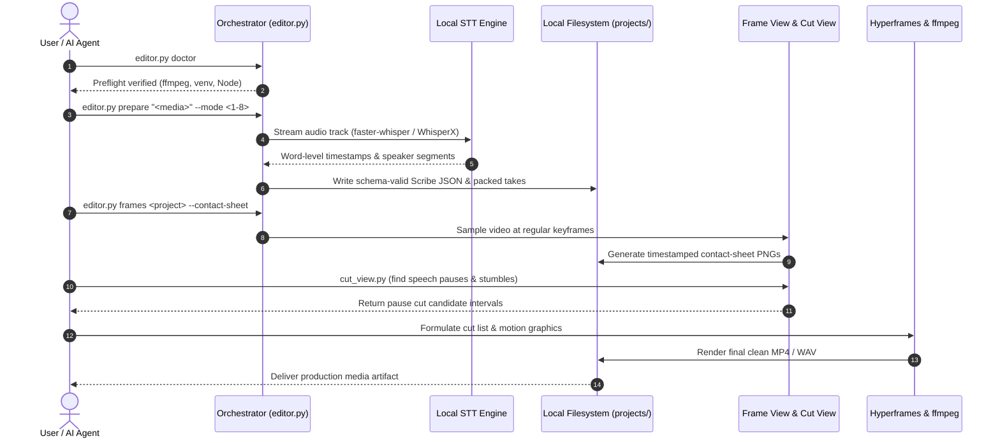

<p align="center"></p>

<p align="center">
  <a href="https://github.com/ellmos-ai/ai-media-editor"></a>
  <a href="https://github.com/ellmos-ai/ai-media-editor/actions/workflows/ci.yml"></a>
  <a href="https://github.com/ellmos-ai/ai-media-editor"></a>
  <a href="https://python.org"></a>
  <a href="https://github.com/ellmos-ai/ai-media-editor"></a>
  <a href="https://github.com/ellmos-ai/ai-media-editor"></a>
  <a href="https://github.com/ellmos-ai/ai-media-editor"></a>
  <a href="https://github.com/ellmos-ai/ai-media-editor/blob/main/SECURITY.md"></a>
  <a href="https://github.com/astral-sh/ruff"></a>
  <a href="https://github.com/ellmos-ai"></a>
  <a href="https://github.com/open-bricks"></a>
  <a href="llms.txt"></a>
  <a href="THIRD_PARTY_LICENSES.txt"></a>
  <a href="NOTICE"></a>
  <a href="https://github.com/ellmos-ai/ai-media-editor"></a>
  <a href="LICENSE"></a>
</p>

<p align="center"><a href="README.md">English</a> · <a href="README_de.md">Deutsch</a> · <a href="README_es.md">Español</a> · <a href="README_fr.md">Français</a> · <a href="README_zh.md">简体中文</a> · <a href="README_ja.md">日本語</a> · <a href="README_ru.md">Русский</a> · <a href="README_hi.md">हिन्दी</a> · <a href="README_ar.md">العربية</a> · <a href="README_bn.md">বাংলা</a> · <strong>Português</strong></p>

# ai-media-editor — editor local de mídia com IA (vídeo · áudio · podcast)

> [!NOTE]
> **Integração nativa com IA e agentes:** `ai-media-editor` foi desenvolvido especificamente para agentes de programação autônomos (Claude Code, Gemini/Antigravity, Codex). Ele oferece preparação determinística de projetos, geração do esquema Scribe JSON e pranchas de miniaturas de quadros com marcação de tempo, para que LLMs possam inspecionar e editar mídia localmente sem depender de SaaS de terceiros.

### Navegação rápida

| # | Seção | Descrição |
|---|---|---|
| 01 | [Principais recursos](#key-capabilities) | Recursos centrais do orquestrador, roteamento de STT local e conjunto de ferramentas para agentes |
| 02 | [Fluxograma da arquitetura visual](#architecture-flowchart) | Diagrama da topologia em 5 camadas, da entrada de mídia bruta à exportação determinística |
| 03 | [Sequência do ciclo completo de execução](#end-to-end-execution-lifecycle-sequence) | Diagrama de sequência do pré-voo, STT, pranchas de quadros e execução dos cortes |
| 04 | [Personas-alvo e descoberta](#marketing--target-personas) | 4 perfis centrais de usuários (`[PERSONA-01]`–`[PERSONA-04]`) e consultas SEO de alta intenção |
| 05 | [Matriz comparativa com alternativas](#comparative-matrix-vs-alternatives) | Matriz de recursos em 10 dimensões frente a SaaS em nuvem, NLEs completos, CLI direta e APIs hospedadas |
| 06 | [Os 8 casos de uso em produção](#the-8-usecases) | Matriz abrangente de fluxos de trabalho de áudio, vídeo, explicativos e publicidade |
| 07 | [Primeiros passos e configuração](#getting-started--setup) | Pré-requisitos, configuração de `<TOOLS_ROOT>` e inicialização do ambiente |
| 08 | [Referência de CLI e comandos](#cli-reference--commands) | Comandos de CLI passo a passo para `doctor`, `modes`, `prepare` e `frames` |
| 09 | [Gráficos em movimento e síntese musical](#motion-graphics--music-synthesis) | Estilização com Hyperframes e composição musical offline a partir de formas de onda NumPy |
| 10 | [Governança e invariantes de execução](#governance--runtime-invariants) | 10 invariantes de execução documentadas, no escopo do modo selecionado (`INV-LOCAL-01` a `INV-SLA-10`) |
| 11 | [SLA de segurança e privacidade](#security--privacy-sla) | Padrão local, STT SSH opcional, resposta inicial em 48h e SLA de triagem em 5 dias |
| 12 | [Projetos relacionados e matriz do ecossistema](#sibling-projects--ecosystem-matrix) | 16 ferramentas federadas em `ellmos-ai`, `dev-bricks`, `file-bricks` e `open-bricks` |
| 13 | [Critérios de qualidade e testes](#quality-gates--testing) | Suíte automatizada, lint do Ruff, compileall e supressão de janelas do console |
| 14 | [Contexto legível por máquina (`llms.txt`)](#machine-readable-context-llmstxt) | Manifesto para crawlers de LLM, palavras-chave de indexação e regras de ingestão por agentes |
| 15 | [Estrutura do repositório](#repository-structure) | Taxonomia detalhada de pastas para código, ferramentas, STT, testes e projetos |
| 16 | [Histórico de alterações e releases](#changelog--releases) | Histórico de releases, marcos de versão e melhorias de descoberta do Pfad B |
| 17 | [SBOM nível 1 e licenças de terceiros](#third-party-licenses--transparency) | Inventário de licenças de terceiros, garantia RunAsInvoker e SBOM nível 1 |
| 18 | [Aviso legal e limitação de responsabilidade](#statutory-notice--liability-limitation) | Licença MIT, aviso sobre § 521 BGB (*Gefälligkeitsrecht*) e limites de responsabilidade |
| 19 | Projeto relacionado: [`clip-storyboard-director`](#19-sister-project-clip-storyboard-director) | A função de Diretor da dupla Diretor/Montador, como dependência opcional fixada em um commit específico |

---

<a id="sec-01"></a><a id="key-capabilities"></a><a id="1-key-capabilities"></a><a id="hauptfunktionen"></a><a id="1-hauptfunktionen"></a>
## 1. Principais recursos

Use um agente de programação com IA (por exemplo, Claude Code, Gemini, Codex) como editor de vídeo/podcast — com **transcrição local em vez do ElevenLabs Scribe**. O orquestrador (`editor.py`) cuida da preparação determinística (roteia para o melhor mecanismo STT/compute, gera JSON Scribe conforme o esquema e empacota as tomadas); o agente conduz o trabalho criativo de corte, animação e composição de mídia.

Conjunto de três ferramentas:
- **video-use** — faz cortes com base em transcrições no nível de palavra (remove pausas e hesitações).
- **Hyperframes** — animações e gráficos em movimento de HTML/CSS/JS para MP4.
- **skill `frontend-design`** — gera recursos de gráficos em movimento e identidade visual.

…substituindo a **transcrição do ElevenLabs Scribe** por mecanismos locais. O padrão é **faster-whisper** mais atribuição de falantes por LLM baseada em texto para conversas; **WhisperX** é um mecanismo opcional de diarização acústica. O processamento é local por padrão, com roteamento opcional de **host remoto primário e fallback local**. A substituição grava os mesmos campos Scribe usados pelo `video-use`, para que os auxiliares seguintes funcionem sem modificações.

---

<a id="sec-02"></a><a id="visual-architecture-flowchart"></a><a id="architecture-flowchart"></a><a id="systemarchitektur-ablaufdiagramm"></a><a id="2-visual-architecture-flowchart"></a><a id="2-systemarchitektur-ablaufdiagramm"></a>
## 2. Fluxograma da arquitetura visual

```mermaid
flowchart TB
    subgraph Intake ["Layer 1: Input Channels & Media Intake"]
        V["Raw Video Recording (.mp4/.mov)"]
        A["Raw Audio Recording (.wav/.m4a)"]
        S["Storyline JSON (Narrative & Emotion)"]
    end

    subgraph Preflight ["Layer 2: Orchestrator & Preflight Inspection"]
        DOC["editor.py doctor<br/>Environment & Tooling Verification"]
        MODES["editor.py modes<br/>8 Specialized Media Use Cases"]
        PREP["editor.py prepare<br/>Project Staging & Metadata Contract"]
    end

    subgraph Engines ["Layer 3: Processing & Synthesis Engines"]
        FW["faster-whisper / WhisperX<br/>100% Local STT & Word Alignment"]
        DIAR["ai_media_editor/stt/diarize_llm.py<br/>Text-based Multi-Speaker Diarization"]
        MUSIC["ai_media_editor/tools/compose_music.py<br/>Procedural NumPy Waveform Synthesis"]
        HF["Hyperframes & hide-windows.cjs<br/>HTML/CSS/JS -> MP4 Motion Graphics"]
    end

    subgraph Agentic ["Layer 4: Agentic Interaction Layer"]
        SCRIBE["Scribe JSON Schema<br/>Word-level Timing for video-use"]
        FRAMES["ai_media_editor/tools/frame_view.py<br/>Timestamped Contact-Sheets"]
        CUTS["ai_media_editor/tools/cut_view.py<br/>Pause & Inflection Cut Candidates"]
        LLM["AI Coding Agent<br/>(Claude Code / Gemini / Codex)"]
    end

    subgraph Export ["Layer 5: Deterministic Export & Artefacts"]
        OUT_V["Rendered Master Video (.mp4)"]
        OUT_A["Clean Speaker-Separated Audio (.wav)"]
        OUT_M["Standard MIDI File (.mid) & Score"]
    end

    Intake --> Preflight
    Preflight --> Engines
    Engines --> Agentic
    Agentic --> Export
```



---

<a id="sec-03"></a><a id="end-to-end-execution-lifecycle-sequence"></a><a id="end-to-end-ausführungs-sequenz"></a><a id="3-end-to-end-execution-lifecycle-sequence"></a>
## 3. Sequência do ciclo completo de execução



---

<a id="sec-04"></a><a id="target-personas--discoverability"></a><a id="marketing--target-personas"></a><a id="zielgruppen--auffindbarkeit"></a><a id="marketing--zielgruppen"></a><a id="4-target-personas--discoverability"></a>
## 4. Personas-alvo e descoberta

`ai-media-editor` resolve gargalos centrais de fluxo de trabalho para automação moderna de mídia com IA em quatro perfis distintos:

### [PERSONA-01] Desenvolvedores de agentes autônomos de programação com IA e arquitetos de enxames
- **Perfil:** engenheiros de software que projetam fluxos multiagente (Claude Code, Gemini/Antigravity, Codex CLI, Kimi Code) para produção autônoma de mídia.
- **Problema:** serviços proprietários de STT em nuvem impõem limites de requisições de API, exigem automação de navegador frágil e podem enviar mídia confidencial ainda não publicada a fornecedores externos.
- **Solução:** orquestração somente por CLI, com geração determinística do esquema Scribe JSON, sugestões de cortes em pausas e pranchas de miniaturas de quadros com marcação de tempo, diretamente utilizáveis por LLMs multimodais.
- **Consulta de alta intenção:** `"agent driven video editor with local transcription"`

### [PERSONA-02] Podcasters e criadores de conteúdo com prioridade local
- **Perfil:** podcasters independentes, entrevistadores e criadores que gerenciam lançamentos semanais de áudio/vídeo.
- **Problema:** custos mensais exorbitantes de SaaS de edição em nuvem (Descript, Riverside) e demora para enviar gravações com vários gigabytes.
- **Solução:** transcrição faster-whisper no modo local, faixas de áudio separadas por falante, corte automático de pausas e geração procedural de vídeo de capa animado. O código não força o carregamento dos modelos a permanecer offline.
- **Consulta de alta intenção:** `"local first podcast editing AI agent workflow"`

### [PERSONA-03] Engenheiros de vídeo com IA e motion graphics
- **Perfil:** desenvolvedores front-end e designers de motion que automatizam recursos visuais de vídeo com identidade de marca.
- **Problema:** NLEs tradicionais (Premiere, After Effects) não oferecem interfaces programáticas claras e não conseguem renderizar animações diretamente a partir de tokens de design CSS/HTML.
- **Solução:** integração direta com Hyperframes para converter componentes HTML/CSS/JavaScript em gráficos em movimento MP4 a 60fps, com supressão da janela de console no Windows.
- **Consulta de alta intenção:** `"Hyperframes motion graphics podcast editor"`

### [PERSONA-04] Responsáveis por segurança e conformidade de mídia empresarial
- **Perfil:** responsáveis por conformidade e segurança da informação em setores regulados (saúde, jurídico, bancos).
- **Problema:** políticas organizacionais ou obrigações contratuais podem proibir o envio de gravações proprietárias a provedores de transcrição hospedados.
- **Solução:** STT local por padrão; ao selecionar `compute.prefer=mac`, uma cópia do arquivo de mídia de entrada completo é enviada ao host SSH configurado. O modo selecionado deve corresponder aos requisitos organizacionais de tratamento de dados. Também estão documentados a execução `RunAsInvoker` como usuário comum, sem elevação (`INV-RUNAS-02`), o SBOM nível 1 e um SLA formal de resposta a vulnerabilidades em 48 horas.
- **Consulta de alta intenção:** `"zero egress video transcription and cutting"`

---

<a id="sec-05"></a><a id="comparative-matrix-vs-alternatives"></a><a id="comparative-matrix--alternatives"></a><a id="vergleichsmatrix-gegenueber-alternativen"></a><a id="5-comparative-matrix-vs-alternatives"></a>
## 5. Matriz comparativa com alternativas

A matriz de 10 dimensões abaixo compara `ai-media-editor` com abordagens legadas e concorrentes, usando invariantes de execução documentados e limitados ao modo operacional selecionado:

| Dimensão e invariante | ai-media-editor | SaaS em nuvem (Descript / ElevenLabs) | NLEs comerciais (Premiere / DaVinci) | CLI / Shell direto (FFmpeg) | APIs hospedadas (Whisper API / Google STT) |
|---|:---:|:---:|:---:|:---:|:---:|
| **1. Fluxo de dados local e específico por modo (`INV-LOCAL-01`)** | :white_check_mark: Padrão local; STT SSH opcional | :x: Upload obrigatório para a nuvem | :warning: Local (telemetria proprietária) | :white_check_mark: 100% local e offline | :x: Processamento externo na nuvem |
| **2. Execução como usuário comum (`INV-RUNAS-02`)** | :white_check_mark: `RunAsInvoker`, usuário padrão | :warning: Navegador / aplicativo auxiliar | :warning: Instalador administrativo / daemon | :white_check_mark: Privilégios do usuário | :white_check_mark: Nível do cliente de API |
| **3. Preservação da mídia de origem (`INV-PREV-03`)** | :white_check_mark: `prepare` preserva a entrada original | :warning: Duplicação de mídia na nuvem | :white_check_mark: Projetos não destrutivos | :warning: Fácil sobrescrever por acidente | :white_check_mark: Mídia de entrada preservada |
| **4. Síntese determinística (`INV-DETERM-04`)** | :white_check_mark: JSON Scribe e composição com seed fixa | :x: Variação aleatória na nuvem | :warning: Estado complexo do projeto | :warning: Saídas sem estrutura | :x: Latência não determinística |
| **5. Validação do nome do projeto (`INV-BOUNDARY-05`)** | :white_check_mark: Verificações lexicais do nome; não é uma sandbox do sistema de arquivos | :warning: Bucket de nuvem hospedado | :warning: Sistema de arquivos arbitrário | :x: Sem validação de caminho | :white_check_mark: Limite do tenant na nuvem |
| **6. Supressão de janelas piscando (`INV-SUBPROC-06`)** | :white_check_mark: `windowsHide` pré-carregado | :heavy_minus_sign: N/A (interface web) | :heavy_minus_sign: N/A (interface desktop) | :x: Rajadas de janelas de console | :heavy_minus_sign: N/A (requisições HTTP) |
| **7. Suporte multiplataforma (`INV-PARITY-07`)** | :white_check_mark: Windows, Linux, macOS com caminhos específicos do SO | :warning: Dependente do navegador | :x: Recursos específicos do SO | :white_check_mark: POSIX / Windows | :white_check_mark: HTTP multiplataforma |
| **8. Concorrência multiagente (`INV-SYNC-08`)** | :white_check_mark: Disciplina de locks e Git limpo | :x: Sessão SaaS de usuário único | :x: Locks de projeto para um editor | :warning: Conflitos de concorrência | :warning: Gargalos por limites de requisição |
| **9. Legibilidade para agentes e LLMs (`INV-DOCS-09`)** | :white_check_mark: JSON Scribe, pranchas de miniaturas, `llms.txt` | :x: Binário fechado / DOM HTML | :x: Arquivos de projeto binários complexos | :warning: stdout/stderr de texto bruto | :warning: Apenas transcrições de texto |
| **10. SLA de segurança coordenado (`INV-SLA-10`)** | :white_check_mark: Resposta em 48h / triagem em 5d | :warning: Fila de suporte empresarial | :warning: Atualizações comerciais trimestrais | :heavy_minus_sign: Scripts sem manutenção | :warning: SLA padrão de nuvem |

Análise detalhada de marketing, palavras-chave de busca e registro de descoberta: [`MARKETING-LOG.txt`](MARKETING-LOG.txt).

---

<a id="sec-06"></a><a id="the-8-production-usecases"></a><a id="the-8-usecases"></a><a id="die-8-anwendungsfälle"></a><a id="6-the-8-production-usecases"></a>
## 6. Os 8 casos de uso em produção

| # | Entrada | Falantes | Saída | Fluxo de trabalho típico |
|---|---|---|---|---|
| 1 | Áudio | 1 | Podcast de áudio, editado | Limpeza de fala de um único falante e corte de pausas |
| 2 | Áudio | vários | Podcast de áudio separado por falante | Limpeza diarizada de diálogo em várias faixas |
| 3 | Vídeo (A+V) | 1 | Corte de vídeo + animações | Corte de uma pessoa falando diante da câmera, com tarjas inferiores Hyperframes automatizadas |
| 4 | Vídeo (A+V) | vários | Vídeo + animações + rastreamento de falantes | Vídeo de entrevista multi-falante com cartões dinâmicos para cada falante |
| 5 | Vídeo → somente áudio | 1/vários | Podcast de áudio (vídeo descartado) | Extração de podcast de áudio limpo a partir de imagens de vídeo |
| 6 | Áudio | 1/vários | Vídeo explicativo totalmente gerado | Faixa de voz com elementos visuais de gráficos em movimento orquestrados por IA |
| 7 | Áudio | 1 | Áudio + capa animada | Faixa de podcast envolvida por um loop animado de disco de vinil/forma de onda |
| 8 | Áudio/resumo | 1 | Clipe publicitário (15–60 s, 16:9 + 9:16) | Fábrica rápida de clipes curtos com Hyperframes |

Para guias completos, passo a passo, de cada modo, consulte [`docs/USECASES.md`](docs/USECASES.md).

---

<a id="sec-07"></a><a id="getting-started--setup"></a><a id="erste-schritte--einrichtung"></a><a id="7-getting-started--setup"></a>
## 7. Primeiros passos e configuração

1. **Crie a configuração:** copie `config/settings.example.json` para `config/settings.json` e configure as opções locais de computação (`local`/`mac`), mecanismos e `paths.*`. Defina `paths.venv_python` como o executável Python deste sistema operacional; o valor configurado é usado diretamente. O caminho `.venv/Scripts/python.exe` do exemplo é específico do Windows; em ambientes POSIX, normalmente se usa `.venv/bin/python`.
2. **Diretório de ferramentas (`<TOOLS_ROOT>`):** `paths.tools_root` em `settings.json` define a pasta raiz das ferramentas pesadas (`video-use`, ffmpeg, Node ≥ 22). **Não** coloque essa pasta dentro de um diretório sincronizado na nuvem.
3. **Pré-requisitos externos:**
   - **Local:** `ffmpeg`, `Node.js >= 22` (para Hyperframes), ambiente virtual Python 3.10–3.13.
   - **Host remoto opcional:** faster-whisper + WhisperX em uma máquina remota acessível por SSH.
   - **Token HuggingFace:** necessário somente quando `engines.multi_speaker` estiver definido como `whisperx`.
4. **Opcional: instalar como pacote.** `pip install -e .` (ou `-e ".[storyboard]"` para também instalar
   [`clip-storyboard-director`](#19-sister-project-clip-storyboard-director)) registra o comando de console
   `ai-media-editor`, equivalente a executar `python editor.py` abaixo.

---

<a id="sec-08"></a><a id="cli-reference--commands"></a><a id="cli-referenz--befehle"></a><a id="8-cli-reference--commands"></a>
## 8. Referência de CLI e comandos

```bash
# Set Python venv path
VENV="<TOOLS_ROOT>/.venv/Scripts/python.exe"

# 1. Environment & toolchain verification
PYTHONIOENCODING=utf-8 "$VENV" editor.py doctor

# 2. Display supported operational use cases
PYTHONIOENCODING=utf-8 "$VENV" editor.py modes

# 3. Prepare a media project (deterministic transcription + take packing)
PYTHONIOENCODING=utf-8 "$VENV" editor.py prepare "/path/to/recording.mp4" --mode 3 --project my-video

# 4. Generate timestamped frame contact-sheets for visual LLM inspection
PYTHONIOENCODING=utf-8 "$VENV" editor.py frames my-video --contact-sheet

# 5. Extract detailed frame interval
PYTHONIOENCODING=utf-8 "$VENV" editor.py frames my-video --from 30 --to 45 --step 0.25
```

---

<a id="sec-09"></a><a id="motion-graphics--music-synthesis"></a><a id="motion-graphics--musiksynthese"></a><a id="9-motion-graphics--music-synthesis"></a>
## 9. Gráficos em movimento e síntese musical

### Composição musical sincronizada ao vídeo offline (`compose_music.py`)
`ai_media_editor.tools.compose_music` compõe música de fundo seguindo a narrativa do vídeo — 100% local, sem serviços em nuvem.
A entrada é um **JSON de narrativa** que define seções com janelas de tempo exatas, emoções e níveis de intensidade:

```bash
# Compose music from storyline JSON
python -m ai_media_editor.tools.compose_music docs/examples/storyline-roshambo.json -o projects/<name>/assets/score

# Generate storyline template
python -m ai_media_editor.tools.compose_music --init

# Run deterministic synthesis selftest
python -m ai_media_editor.tools.compose_music --selftest
```

Saída: Stereo WAV + MP3 + `<name>.notes.json` + `<name>.mid` (Standard MIDI File Type 1).

### Exportação MIDI e renderização de alta fidelidade
A exportação MIDI permite renderização sem perdas com soundfonts profissionais:
- **Caminho A — SoundFont (local, gratuito):** FluidSynth (`winget install FluidSynth`) + GeneralUser GS / MuseScore_General:
  `fluidsynth -ni soundfont.sf2 out.mid -F out.wav -r 44100`
- **Caminho B — Bibliotecas orquestrais:** VSCO 2 Community Edition ou Salamander Grand Piano.

### Montagem de loop multi-clipe, QA e síntese atmosférica (`make_loop.py`, `qa_clips.py`, `atmo.py`, `synth.py`, `fx.js`)
Portadas do pipeline de produção Halloween Window Projection (`T-20261025-256694132`), `ai_media_editor.tools` também oferece utilitários reutilizáveis para loops de cenas e design procedural de som:
- **`ai_media_editor.tools.make_loop`**: concatena clipes de cena renderizados (`<sid>.mp4`) com intervalos configuráveis de pausa preta (`loop.json` ou `--pause`) e faixa de áudio AAC opcional de 48 kHz (`--audio`):
  `python -m ai_media_editor.tools.make_loop docs/examples/loop-halloween.json renders/ -o loop.mp4 [--pause 8] [--audio atmo.wav]`
- **`ai_media_editor.tools.qa_clips`**: verifica clipes renderizados com `ffprobe`, mede a luminância do primeiro e do último quadro (verificação do nível de preto), extrai quadros do início/meio/fim/pico e cria uma prancha de miniaturas `xstack` (`qa.json`, `VORSCHAU_kontaktbogen.jpg`):
  `python -m ai_media_editor.tools.qa_clips renders/ qa_out/`
- **`ai_media_editor.tools.synth` e `ai_media_editor.tools.atmo`**: síntese procedural de instrumentos e atmosferas em NumPy/SciPy a 48 kHz (`chip_pulse`, `marimba`, `glock`, `pizz`, `flute`, `fm_brass`, `fm_bell`, `make_ir`), além de gerador de paisagens sonoras em loop por grade de cenas e masterização iterativa de áudio EBU R128 (`-16 LUFS-I`) e true-peak (`<= -3.5 dBTP`):
  `python -m ai_media_editor.tools.atmo docs/examples/loop-halloween.json -o atmo.wav [--pause 8]`
- **`ai_media_editor/tools/fx.js` (`window.HFX`)**: auxiliares determinísticos e seguros para busca temporal em cenas HyperFrames, incluindo `HFX.ft` (wrapper GSAP `fromTo` que impõe `immediateRender: false` para manter os efeitos ocultos antes do início da interpolação), `HFX.drive`, `HFX.rng` (mulberry32), `HFX.noise1`, `HFX.key`, `HFX.bump`, `HFX.path`, `HFX.spider` e `HFX.bat`.

---

<a id="sec-10"></a><a id="governance--runtime-invariants"></a><a id="governance---laufzeit-invarianten"></a><a id="10-governance--runtime-invariants"></a>
## 10. Governança e invariantes de execução

A arquitetura documenta 10 invariantes de execução; o comportamento depende do modo operacional selecionado:

| ID do invariante | Domínio operacional | Garantia e regra de aplicação | Mecanismo de verificação |
|---|---|---|---|
| `INV-LOCAL-01` | Privacidade e saída de dados | **Local por padrão**: com `compute.prefer=local`, o STT é executado nesta máquina; o carregamento de modelos não é forçado a permanecer offline. Com `compute.prefer=mac`, uma cópia do arquivo de mídia de entrada completo é enviada ao host SSH configurado, e um token HF configurado também é enviado. A limpeza remota é tentada em um bloco `finally`, mas o sucesso não é verificado. | `tests/test_core.py`, `editor.py`, `ai_media_editor/stt/mac_remote.py` |
| `INV-RUNAS-02` | Privilégios e isolamento | **Modo de usuário comum (`RunAsInvoker`)**: não são necessários privilégios administrativos ou elevados. | Execução padrão de usuário em todos os scripts |
| `INV-PREV-03` | Armazenamento e imutabilidade | **Tratamento não destrutivo da entrada**: `prepare` deixa a entrada original intacta e a copia para `projects/<name>/`. Áudio temporário pode usar o diretório temporário do SO; o modo remoto também usa o diretório de trabalho SSH configurado. | Verificações de isolamento em `tests/test_core.py` |
| `INV-DETERM-04` | Reprodutibilidade | **Síntese determinística e estabilidade do esquema**: seed fixa para áudio procedural e adesão rigorosa ao esquema JSON Scribe. | `tests/test_compose_music.py`, `ai_media_editor/stt/scribe_schema.py` |
| `INV-BOUNDARY-05` | Validação do nome do projeto | **Verificações lexicais do nome**: os nomes dos projetos são verificados como componentes únicos de caminho; isso não é uma sandbox do sistema de arquivos. | `test_project_names_cannot_escape_projects` |
| `INV-SUBPROC-06` | Higiene de processos | **Ciclo de vida limpo e supressão de janelas**: wrappers pré-carregados suprimem janelas de console piscando no Windows. | `ai_media_editor/tools/hf.cmd`, `ai_media_editor/tools/hide-windows.cjs` |
| `INV-PARITY-07` | Suporte a vários SOs | **Suporte multiplataforma**: caminhos e executáveis são configurados para o sistema operacional em uso; consulte a matriz de CI para os sistemas testados. | Matriz de CI do GitHub Actions para vários SOs |
| `INV-SYNC-08` | Concorrência e locks | **Disciplina de sincronização em nuvem e locks multiagente**: ferramentas pesadas e projetos são excluídos para evitar conflitos de sincronização em nuvem. | Regras de filtros de conflito e lock do `.gitignore` |
| `INV-DOCS-09` | Acessibilidade e descoberta | **Prontidão multimodal para LLM e paridade bilíngue**: pranchas de miniaturas de quadros para LLMs de visão; paridade completa entre a documentação EN/DE. | Testes de contrato de `llms.txt`, `README.md`, `README_de.md` |
| `INV-SLA-10` | Segurança e resposta a incidentes | **Resposta de segurança em 48h e SLA de triagem em 5 dias**: comunicação formal de vulnerabilidades por GitHub Advisories e e-mails aos mantenedores. | `SECURITY.md`, `test_security_policy_bilingual_parity` |

---

<a id="sec-11"></a><a id="security--privacy-sla"></a><a id="sicherheit--datenschutz-sla"></a><a id="11-security--privacy-sla"></a>
## 11. SLA de segurança e privacidade

- **Processamento local por padrão:** o STT local é o padrão, mas o carregamento dos modelos não é forçado a permanecer offline. Com `compute.prefer=mac`, uma cópia do arquivo de mídia de entrada completo é enviada ao host SSH configurado; um token HF configurado também é enviado.
- **Tratamento de mídia sensível:** `prepare` mantém a gravação original em seu caminho de entrada e a copia para `projects/<name>/`. Áudio temporário pode usar o diretório temporário do SO. O modo remoto mantém uma cópia de trabalho no `workdir` SSH configurado; a limpeza é tentada em um bloco `finally`, mas o sucesso não é verificado.
- **Compromisso de resposta a vulnerabilidades:**
  - **SLA de resposta inicial:** confirmação de recebimento de relatórios de vulnerabilidade enviados em até 48 horas.
  - **SLA de triagem técnica:** em até 5 dias úteis, com avaliação de severidade.
  - **Canal de reporte:** [GitHub Security Advisories](https://github.com/ellmos-ai/ai-media-editor/security/advisories) ou e-mail direto para `security@open-bricks.org`, `security@ellmos.ai`, `support@lukasgeiger.com` e `lukas@open-bricks.org`.
  - Para detalhes completos, consulte [`SECURITY.md`](SECURITY.md).

---

<a id="sec-12"></a><a id="sibling-projects--ecosystem-matrix"></a><a id="geschwisterprojekte--ökosystem-matrix"></a><a id="12-sibling-projects--ecosystem-matrix"></a>
## 12. Projetos relacionados e matriz do ecossistema

`ai-media-editor` funciona como um mecanismo especializado de orquestração multimídia dentro do ecossistema `open-bricks` e `ellmos-ai`:

| Repositório | Organização | Domínio / finalidade | Interoperabilidade no ecossistema |
|---|---|---|---|
| [`clip-storyboard-director`](https://github.com/ellmos-ai/clip-storyboard-director) | `ellmos-ai` | Criação generativa de storyboard e direção de cenas | Geração da sequência de cenas para casos de uso de vídeo |
| [`assistant-core`](https://github.com/ellmos-ai/assistant-core) | `ellmos-ai` | Supervisão conversacional e runtime de agentes | Orquestração de tarefas autônomas de edição de mídia |
| [`decision-clicker`](https://github.com/ellmos-ai/decision-clicker) | `ellmos-ai` | Gateway interativo para revisão do usuário | Revisão de cortes candidatos e decisões de edição |
| [`lock-master`](https://github.com/ellmos-ai/lock-master) | `ellmos-ai` | Framework de locks multiagente que nega por padrão em caso de falha | Proteção de arquivos de projeto concorrentes e locks de renderização |
| [`clutch`](https://github.com/ellmos-ai/clutch) | `ellmos-ai` | Supervisor de processos e agendador de tarefas | Supervisão de tarefas longas de renderização e STT |
| [`system-explorer`](https://github.com/ellmos-ai/system-explorer) | `ellmos-ai` | Descoberta de hardware local e capacidades | Detecção de GPU, CUDA e aceleração de hardware |
| [`roblox-studio-core`](https://github.com/ellmos-ai/roblox-studio-core) | `ellmos-ai` | Captura e automação headless de estúdio 3D | Recursos visuais 3D e quadros de animação |
| [`usb-podcast-studio`](https://github.com/entertain-and-more/usb-podcast-studio) | `entertain-and-more` | Captura e transmissão com hardware de áudio USB | Fonte de gravação de alta fidelidade para modos de podcast |
| [`BattleStage`](https://github.com/entertain-and-more/BattleStage) | `entertain-and-more` | Simulação física com autoridade do servidor | Processamento de imagens de jogos e vídeos de replay |
| [`DevCenter`](https://github.com/dev-bricks/DevCenter) | `dev-bricks` | Gerenciador de ambiente de desenvolvimento e workspace | Gerenciamento de ferramentas locais e ambientes virtuais de desenvolvimento |
| [`MethodenAnalyser`](https://github.com/dev-bricks/MethodenAnalyser) | `dev-bricks` | Métricas estáticas de código Python e auditoria de métodos | Análise de qualidade de código dos módulos do editor de mídia |
| [`ExplorerPro`](https://github.com/file-bricks/ExplorerPro) | `file-bricks` | Gerenciador de arquivos de desktop de alta velocidade (PySide6) | Navegação visual de projetos e organização de arquivos de mídia |
| [`ProFiler`](https://github.com/file-bricks/ProFiler) | `file-bricks` | Análise e inspeção profunda de diretórios | Indexação de recursos de mídia e análise de cache |
| [`CloudLockFixer`](https://github.com/file-bricks/CloudLockFixer) | `file-bricks` | Solucionador de conflitos de sincronização entre hosts | Limpeza de arquivos de lock e cópias de conflito na nuvem |
| [`FormularErstellen`](https://github.com/doc-bricks/FormularErstellen) | `doc-bricks` | Gerador dinâmico de layout para PDFs e documentos | Geração de relatórios de projeto e resumos de produção |
| [`open-bricks`](https://github.com/open-bricks/open-bricks) | `open-bricks` | Organização guarda-chuva de padrões open source | Governança canônica do ecossistema e paridade de licenças |

---

<a id="sec-13"></a><a id="quality-gates--testing"></a><a id="qualitätsprüfung--tests"></a><a id="13-quality-gates--testing"></a>
## 13. Critérios de qualidade e testes

Execute verificações rápidas de qualidade localmente, sem modelos STT externos nem arquivos de mídia pesados:

```bash
# Run complete test suite
python -m pytest -ra -v

# Run lint checks
ruff check .

# Validate bytecode compilation
python -m compileall -q .

# Verify CLI modes
python editor.py modes
```

### Supressão de janelas do console no Windows
Os subprocessos de Hyperframes e Node passam por `ai_media_editor/tools/hf.cmd` e `ai_media_editor/tools/hide-windows.cjs` para impor `windowsHide: true`, eliminando flashes incômodos de janelas do console durante a renderização. Detalhes: [`docs/WINDOWS-KONSOLENFENSTER.md`](docs/WINDOWS-KONSOLENFENSTER.md).

---

<a id="sec-14"></a><a id="machine-readable-context-llmstxt"></a><a id="maschinenlesbarer-kontext-llmstxt"></a><a id="14-machine-readable-context-llmstxt"></a>
## 14. Contexto legível por máquina (`llms.txt`)

Crawlers de LLM, assistentes de código e agentes de indexação automatizada podem ler diretamente o contexto do repositório por meio de [`llms.txt`](llms.txt).

Principais frases de busca:
```text
ellmos-ai/ai-media-editor
local AI media editor video podcast transcription
agent driven video editor with local transcription
Claude Code video podcast editor Hyperframes
faster-whisper WhisperX Scribe JSON video-use
transcript based video cutting local first
Hyperframes motion graphics podcast editor
offline procedural music synthesis storyline numpy
zero egress video transcription and cutting
```

---

<a id="sec-15"></a><a id="repository-structure"></a><a id="repository-struktur"></a><a id="15-repository-structure"></a>
## 15. Estrutura do repositório

```
ai-media-editor/                  (code/docs/projects)
├── CLAUDE.md                     ← agent guide (editor workflow, German)
├── README.md                     ← English overview & 18-point visual architecture
├── README_de.md                  ← German documentation (1:1 anchor parity)
├── editor.py                     ← compatibility shim for documented direct calls
├── ai_media_editor/editor.py     ← orchestrator (prepare / frames / modes / doctor)
├── ai_media_editor/tools/
│   ├── cut_view.py               ← pauses as explicit cut candidates
│   ├── frame_view.py             ← video → timestamped frames ("video-scatterer", UC3/4/8)
│   ├── compose_cover.py          ← UC7: loop a cover over audio
│   ├── compose_music.py          ← storyline JSON → video-synced score (NumPy waveform synthesis)
│   ├── synth.py / atmo.py        ← 48 kHz SciPy instrument synthesis & loopable EBU R128 atmo generator
│   ├── make_loop.py / qa_clips.py← multi-clip black-pause loop builder & ffprobe/luma QA contact sheet
│   ├── fx.js                     ← deterministic HyperFrames scene helpers (HFX.ft, HFX.drive, SVG rigs)
│   ├── hf.cmd / hf-hidden.vbs    ← Windows console window suppression wrappers
│   └── hide-windows.cjs          ← Node.js preload script enforcing windowsHide: true
├── ai_media_editor/stt/
│   ├── scribe_schema.py          ← Scribe-JSON format (contract with video-use)
│   ├── transcribe_local.py       ← faster-whisper + WhisperX → Scribe-JSON
│   ├── diarize_llm.py            ← token-free text-based speaker assignment
│   └── mac_remote.py             ← compute routing (remote primary, local fallback)
├── config/settings.example.json  ← template: compute, engines, models, paths, HF token
├── brand/design-tokens.css       ← branding tokens for generated animations
├── docs/USECASES.md              ← step-by-step per mode
├── production/                   ← optional generative workflows (cloud gates apply)
├── tests/
│   ├── test_core.py              ← dependency-free regression suite
│   ├── test_compose_music.py     ← storyline & waveform synthesis tests
│   └── test_metadata.py          ← automated contract tests for manifests & discoverability
├── SECURITY.md                   ← private vulnerability reporting and security scope
├── THIRD_PARTY_LICENSES.md       ← Level 1 SBOM and third-party license inventory
├── MARKETING-LOG.txt             ← discoverability, personas, matrix & architecture audit
└── projects/<name>/edit/         ← per project: transcripts/, takes_packed.md, … (gitignored)

<TOOLS_ROOT>/                     (NOT a cloud folder — venv/tools)
├── .venv/                        ← Python venv (faster-whisper, video-use, …)
└── video-use/                    ← cloned browser-use/video-use (unpatched)
```

---

<a id="sec-16"></a><a id="changelog--releases"></a><a id="changelog--veröffentlichungen"></a><a id="16-changelog--releases"></a>
## 16. Histórico de alterações e releases

Consulte [`CHANGELOG.md`](CHANGELOG.md) para o histórico completo de versões.
- **Versão 0.2.3 (2026-09-20)**: revisão da arquitetura visual e descoberta do Pfad B, paridade de navegação bilíngue em 18 pontos, matriz comparativa em 10 dimensões frente a 4 alternativas, 4 personas-alvo formalizadas (`[PERSONA-01]` a `[PERSONA-04]`), tabela de referência cruzada de invariantes do SBOM nível 1 em `THIRD_PARTY_LICENSES.md`, certificação de execução `RunAsInvoker` sem elevação e aviso legal do § 521 BGB.
- **Versão 0.2.2 (2026-09-12)**: revisão de higiene técnica do Pfad A, limites de tempo do runner de CI (`timeout-minutes: 15`), gerenciamento automatizado do ciclo de vida de issues/PRs obsoletos, `.gitignore` reforçado e grupos de dependências opcionais em `pyproject.toml`.
- **Versão 0.2.1 (2026-09-11)**: melhorias de descoberta, auditoria dedicada de licenças de terceiros, URLs estendidas do PEP 621 e suíte inicial de testes de contrato.
- **Versão 0.2.0 (2026-09-09)**: pipeline local reforçado, testes de contrato automatizados, matriz de CI para vários SOs, paridade bilíngue, diagramas Mermaid duplos e 10 invariantes de governança.

---

<a id="sec-17"></a><a id="level-1-sbom--third-party-licenses"></a><a id="third-party-licenses--transparency"></a><a id="drittanbieter-lizenzen--transparenz"></a><a id="17-level-1-sbom--third-party-licenses"></a>
## 17. SBOM nível 1 e licenças de terceiros

`ai-media-editor` documenta as licenças de seus componentes e enfatiza a execução como usuário comum, sem elevação:

- **Inventário de licenças de terceiros:** consulte [`THIRD_PARTY_LICENSES.md`](THIRD_PARTY_LICENSES.md) para ver as licenças registradas dos componentes listados; verifique a licença aplicável antes do uso.
- **STT local por padrão (`INV-LOCAL-01`):** transcrição local é o padrão. O carregamento dos modelos não é forçado a permanecer offline; ao selecionar `compute.prefer=mac`, uma cópia do arquivo de mídia de entrada completo é enviada ao host SSH configurado, e um token HF configurado também é enviado.
- **Execução como usuário comum (`INV-RUNAS-02`):** todos os componentes são executados em contas comuns sem elevação (`RunAsInvoker`); não são necessários privilégios administrativos ou de root.
- **Mapeamento de SBOM nível 1 e governança:** fontes upstream, mantenedores, textos de licença e invariantes aplicáveis estão catalogados em [`THIRD_PARTY_LICENSES.md`](THIRD_PARTY_LICENSES.md).
- **Licença do projeto principal:** [Licença MIT](LICENSE) © 2026 ellmos-ai / open-bricks.

---

<a id="sec-18"></a><a id="statutory-notice--liability-limitation"></a><a id="gesetzlicher-hinweis--haftungsbeschraenkung"></a><a id="18-statutory-notice--liability-limitation"></a>
## 18. Aviso legal e limitação de responsabilidade

Este software é fornecido gratuitamente sob a licença de código aberto MIT. De acordo com a legislação alemã (§ 521 BGB — *Gefälligkeitsrecht* / contratos gratuitos), a responsabilidade pela disponibilização gratuita de software é limitada a dolo (*Vorsatz*) e negligência grave (*grobe Fahrlässigkeit*). Em particular, não há garantias de adequação a uma finalidade específica, comerciabilidade ou ausência de defeitos.

---

<a id="19-sister-project-clip-storyboard-director"></a>
## 19. Projeto relacionado: `clip-storyboard-director`

[`clip-storyboard-director`](https://github.com/ellmos-ai/clip-storyboard-director) é o
**Diretor** do **Montador** deste editor em um modelo de produção de mídia com dois agentes: ele cuida da
pré-produção (análise do roteiro, temporização dos planos, criação de prompts para geradores de vídeo com IA por
automação de navegador via CDP, buffers 4D de persistência/continuidade) e entrega um primeiro corte montado
para o `ai-media-editor` finalizar (edição não linear, correção de cor, transições, redução automática do áudio
de fundo, renderização final). Cada ferramenta é independente e não precisa da outra para funcionar.

Ela é declarada como dependência opcional `storyboard` em `pyproject.toml` deste projeto e
fixada em um commit revisado para reprodutibilidade. Instale ambas junto com o comando de console
`ai-media-editor` em uma única etapa:

```bash
pip install -e ".[storyboard]"
ai-media-editor modes
clip-director --version
```

`clip-storyboard-director` também usa a licença MIT, como este projeto.
Consulte o inventário de componentes em seu próprio
[`THIRD_PARTY_LICENSES.md`](https://github.com/ellmos-ai/clip-storyboard-director/blob/main/THIRD_PARTY_LICENSES.md).
