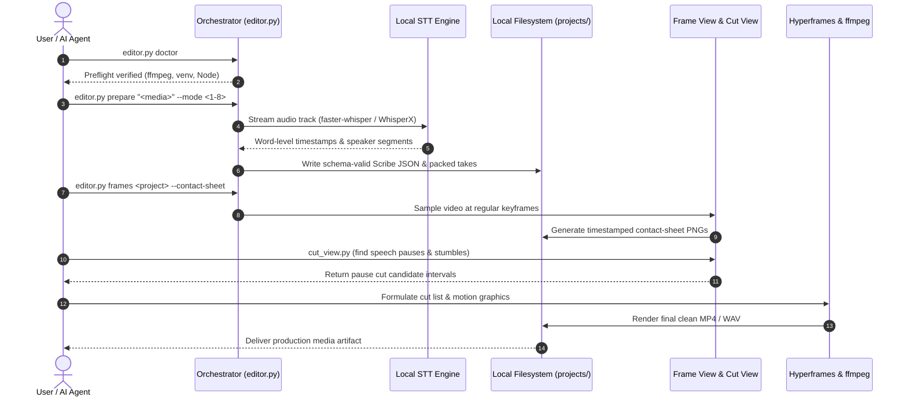

<p align="center"></p>

<p align="center">
  <a href="https://github.com/ellmos-ai/ai-media-editor"></a>
  <a href="https://github.com/ellmos-ai/ai-media-editor/actions/workflows/ci.yml"></a>
  <a href="https://github.com/ellmos-ai/ai-media-editor"></a>
  <a href="https://python.org"></a>
  <a href="https://github.com/ellmos-ai/ai-media-editor"></a>
  <a href="https://github.com/ellmos-ai/ai-media-editor"></a>
  <a href="https://github.com/ellmos-ai/ai-media-editor"></a>
  <a href="https://github.com/ellmos-ai/ai-media-editor/blob/main/SECURITY.md"></a>
  <a href="https://github.com/astral-sh/ruff"></a>
  <a href="https://github.com/ellmos-ai"></a>
  <a href="https://github.com/open-bricks"></a>
  <a href="llms.txt"></a>
  <a href="THIRD_PARTY_LICENSES.txt"></a>
  <a href="NOTICE"></a>
  <a href="https://github.com/ellmos-ai/ai-media-editor"></a>
  <a href="LICENSE"></a>
</p>

<p align="center"><a href="README.md">English</a> · <a href="README_de.md">Deutsch</a> · <a href="README_es.md">Español</a> · <a href="README_fr.md">Français</a> · <a href="README_zh.md">简体中文</a> · <a href="README_ja.md">日本語</a> · <strong>Русский</strong> · <a href="README_hi.md">हिन्दी</a></p>

# ai-media-editor — локальный AI-редактор медиа (видео · аудио · подкасты)

> [!NOTE]
> **Нативная интеграция для ИИ и агентов:** `ai-media-editor` специально разработан для автономных AI-агентов программирования (Claude Code, Gemini/Antigravity, Codex). Он обеспечивает детерминированную подготовку проектов, создание схемы Scribe JSON и листов миниатюр кадров с временными метками, чтобы LLM могли визуально проверять и монтировать медиа локально, не полагаясь на сторонние SaaS-сервисы.

### Быстрая навигация

| № | Раздел | Описание |
|---|---|---|
| 01 | [Основные возможности](#key-capabilities) | Основные функции оркестратора, маршрутизация локального STT и стек инструментов для агентов |
| 02 | [Блок-схема визуальной архитектуры](#architecture-flowchart) | Пятиуровневая топология системы: от приёма исходных медиа до детерминированного экспорта |
| 03 | [Последовательность жизненного цикла сквозного выполнения](#end-to-end-execution-lifecycle-sequence) | Диаграмма последовательности: предварительная проверка, STT, листы миниатюр кадров и выполнение монтажа |
| 04 | [Целевые аудитории и обнаруживаемость](#marketing--target-personas) | 4 основных профиля пользователей (`[PERSONA-01]`–`[PERSONA-04]`) и SEO-запросы с высоким намерением |
| 05 | [Сравнительная матрица альтернатив](#comparative-matrix-vs-alternatives) | Матрица из 10 параметров для облачных SaaS, тяжёлых NLE, обычных CLI и размещённых API |
| 06 | [8 производственных сценариев](#the-8-usecases) | Полная матрица рабочих процессов с аудио, видео, объясняющими роликами и рекламой |
| 07 | [Начало работы и настройка](#getting-started--setup) | Предварительные требования, настройка `<TOOLS_ROOT>` и инициализация окружения |
| 08 | [Справочник CLI и команды](#cli-reference--commands) | Пошаговые команды CLI для `doctor`, `modes`, `prepare` и `frames` |
| 09 | [Моушн-графика и музыкальная композиция](#motion-graphics--music-synthesis) | Оформление Hyperframes и создание музыкального сопровождения путём синтеза звуковых волн в NumPy по сюжетной линии в автономном режиме |
| 10 | [Управление и инварианты времени выполнения](#governance--runtime-invariants) | 10 документированных инвариантов времени выполнения с областью действия, зависящей от выбранного режима (`INV-LOCAL-01`–`INV-SLA-10`) |
| 11 | [SLA безопасности и конфиденциальности](#security--privacy-sla) | Локальная обработка по умолчанию, необязательный SSH STT, первичный ответ за 48 ч и SLA триажа 5 дней |
| 12 | [Связанные проекты и матрица экосистемы](#sibling-projects--ecosystem-matrix) | 16 объединённых инструментов из `ellmos-ai`, `dev-bricks`, `file-bricks` и `open-bricks` |
| 13 | [Контроль качества и тестирование](#quality-gates--testing) | Автоматический набор тестов, линтинг Ruff, compileall и подавление окон консоли |
| 14 | [Контекст в машиночитаемом формате (`llms.txt`)](#machine-readable-context-llmstxt) | Манифест для краулеров LLM, ключевые слова для поисковой индексации и правила загрузки контекста агентами |
| 15 | [Структура репозитория](#repository-structure) | Подробная классификация папок с кодом, инструментами, STT, тестами и проектами |
| 16 | [Журнал изменений и релизы](#changelog--releases) | История релизов, этапы версий и обновления обнаруживаемости Pfad B |
| 17 | [SBOM уровня 1 и сторонние лицензии](#third-party-licenses--transparency) | Реестр сторонних лицензий, гарантия RunAsInvoker и SBOM уровня 1 |
| 18 | [Законодательное уведомление и ограничение ответственности](#statutory-notice--liability-limitation) | Лицензия MIT, уведомление по § 521 BGB (*Gefälligkeitsrecht*) и ограничения ответственности |
| 19 | [Связанный проект: `clip-storyboard-director`](#19-sister-project-clip-storyboard-director) | Режиссёрская часть пары «Режиссёр/Монтажёр», включённая как необязательная зависимость с фиксированной версией |

---

<a id="sec-01"></a><a id="key-capabilities"></a><a id="1-key-capabilities"></a><a id="hauptfunktionen"></a><a id="1-hauptfunktionen"></a>
## 1. Основные возможности

Используйте AI-агента программирования (например, Claude Code, Gemini, Codex) как инструмент для монтажа видео и подкастов — **с локальной расшифровкой вместо ElevenLabs Scribe**. Оркестратор (`editor.py`) выполняет детерминированную подготовку (маршрутизирует задачи к подходящему движку STT и вычислительной среде, создаёт соответствующий схеме Scribe JSON и объединяет дубли); творческий монтаж, анимацию и композицию выполняет агент.

Стек из трёх инструментов:
- **video-use** — выполняет монтаж по транскриптам с разбивкой по словам (удаляет паузы и запинки).
- **Hyperframes** — преобразует HTML/CSS/JS в анимацию MP4 и моушн-графику.
- Навык **`frontend-design`** — создаёт моушн-графику и материалы для брендинга.

…при этом расшифровка **ElevenLabs Scribe заменена** локальными движками. По умолчанию для разговоров используется **faster-whisper** и распределение говорящих с помощью текстовой LLM; **WhisperX** — необязательный движок акустической диаризации. Вычисления по умолчанию выполняются локально; также доступна маршрутизация с приоритетом удалённого хоста и локальным резервным вариантом. Замена записывает те же поля Scribe, что использует `video-use`, поэтому нижестоящие вспомогательные инструменты работают без изменений.

---

<a id="sec-02"></a><a id="visual-architecture-flowchart"></a><a id="architecture-flowchart"></a><a id="systemarchitektur-ablaufdiagramm"></a><a id="2-visual-architecture-flowchart"></a><a id="2-systemarchitektur-ablaufdiagramm"></a>
## 2. Блок-схема визуальной архитектуры

```mermaid
flowchart TB
    subgraph Intake ["Layer 1: Input Channels & Media Intake"]
        V["Raw Video Recording (.mp4/.mov)"]
        A["Raw Audio Recording (.wav/.m4a)"]
        S["Storyline JSON (Narrative & Emotion)"]
    end

    subgraph Preflight ["Layer 2: Orchestrator & Preflight Inspection"]
        DOC["editor.py doctor<br/>Environment & Tooling Verification"]
        MODES["editor.py modes<br/>8 Specialized Media Use Cases"]
        PREP["editor.py prepare<br/>Project Staging & Metadata Contract"]
    end

    subgraph Engines ["Layer 3: Processing & Synthesis Engines"]
        FW["faster-whisper / WhisperX<br/>100% Local STT & Word Alignment"]
        DIAR["ai_media_editor/stt/diarize_llm.py<br/>Text-based Multi-Speaker Diarization"]
        MUSIC["ai_media_editor/tools/compose_music.py<br/>Procedural NumPy Waveform Synthesis"]
        HF["Hyperframes & hide-windows.cjs<br/>HTML/CSS/JS -> MP4 Motion Graphics"]
    end

    subgraph Agentic ["Layer 4: Agentic Interaction Layer"]
        SCRIBE["Scribe JSON Schema<br/>Word-level Timing for video-use"]
        FRAMES["ai_media_editor/tools/frame_view.py<br/>Timestamped Contact-Sheets"]
        CUTS["ai_media_editor/tools/cut_view.py<br/>Pause & Inflection Cut Candidates"]
        LLM["AI Coding Agent<br/>(Claude Code / Gemini / Codex)"]
    end

    subgraph Export ["Layer 5: Deterministic Export & Artefacts"]
        OUT_V["Rendered Master Video (.mp4)"]
        OUT_A["Clean Speaker-Separated Audio (.wav)"]
        OUT_M["Standard MIDI File (.mid) & Score"]
    end

    Intake --> Preflight
    Preflight --> Engines
    Engines --> Agentic
    Agentic --> Export
```



---

<a id="sec-03"></a><a id="end-to-end-execution-lifecycle-sequence"></a><a id="end-to-end-ausführungs-sequenz"></a><a id="3-end-to-end-execution-lifecycle-sequence"></a>
## 3. Последовательность жизненного цикла сквозного выполнения



---

<a id="sec-04"></a><a id="target-personas--discoverability"></a><a id="marketing--target-personas"></a><a id="zielgruppen--auffindbarkeit"></a><a id="marketing--zielgruppen"></a><a id="4-target-personas--discoverability"></a>
## 4. Целевые аудитории и обнаруживаемость

`ai-media-editor` устраняет основные узкие места современных рабочих процессов автоматизации медиа с помощью ИИ для четырёх отдельных профилей пользователей:

### [PERSONA-01] Разработчики автономных AI-агентов программирования и архитекторы агентных роёв
- **Профиль:** Инженеры-программисты, проектирующие многоагентные рабочие процессы (Claude Code, Gemini/Antigravity, Codex CLI, Kimi Code) для автономного производства медиа.
- **Проблема:** Проприетарные облачные сервисы STT ограничивают частоту запросов API, требуют хрупкой автоматизации браузера и приводят к передаче конфиденциальных неопубликованных медиа внешним поставщикам.
- **Решение:** Оркестрация только через CLI, детерминированное создание схемы Scribe JSON, кандидаты на монтаж по паузам и листы миниатюр кадров с временными метками, которые мультимодальные LLM могут загружать напрямую.
- **Поисковый запрос с высоким намерением:** `"agent driven video editor with local transcription"`

### [PERSONA-02] Подкастеры и авторы контента с локальной обработкой
- **Профиль:** Независимые подкастеры, интервьюеры и авторы, регулярно выпускающие аудио- и видеоматериалы.
- **Проблема:** Непомерная ежемесячная стоимость облачных SaaS для монтажа (Descript, Riverside) и медленная загрузка записей размером в несколько гигабайт.
- **Решение:** Локальная расшифровка через faster-whisper, отдельные аудиодорожки для каждого говорящего, автоматическая обрезка пауз и процедурная генерация анимированной обложки видео. Код не требует, чтобы загрузка моделей выполнялась только офлайн.
- **Поисковый запрос с высоким намерением:** `"local first podcast editing AI agent workflow"`

### [PERSONA-03] Инженеры AI-видео и моушн-графики
- **Профиль:** Фронтенд-разработчики и моушн-дизайнеры, автоматизирующие фирменные визуальные видеоактивы.
- **Проблема:** В традиционных NLE (Premiere, After Effects) нет удобных программных интерфейсов, и они не умеют рендерить анимацию напрямую из CSS/HTML-токенов дизайна.
- **Решение:** Прямая интеграция Hyperframes преобразует компоненты HTML/CSS/JavaScript в моушн-графику MP4 с частотой 60 кадров/с и подавляет мигание окон консоли в Windows.
- **Поисковый запрос с высоким намерением:** `"Hyperframes motion graphics podcast editor"`

### [PERSONA-04] Специалисты по безопасности и соответствию требованиям для корпоративных медиа
- **Профиль:** Специалисты по соответствию требованиям и информационной безопасности в регулируемых отраслях (здравоохранение, право, банковское дело).
- **Проблема:** Политики организации или договорные требования могут запрещать отправку собственных записей поставщикам размещённых сервисов расшифровки.
- **Решение:** По умолчанию используется локальный STT; при выборе `compute.prefer=mac` полная копия входного медиафайла отправляется на настроенный SSH-хост. Выбранный режим должен соответствовать требованиям организации к обработке данных. Также документированы запуск без привилегий через `RunAsInvoker` (`INV-RUNAS-02`), SBOM уровня 1 и формальный SLA ответа на сообщения об уязвимостях в течение 48 часов.
- **Поисковый запрос с высоким намерением:** `"zero egress video transcription and cutting"`

---

<a id="sec-05"></a><a id="comparative-matrix-vs-alternatives"></a><a id="comparative-matrix--alternatives"></a><a id="vergleichsmatrix-gegenueber-alternativen"></a><a id="5-comparative-matrix-vs-alternatives"></a>
## 5. Сравнительная матрица альтернатив

Следующая матрица из 10 параметров сопоставляет `ai-media-editor` с традиционными и конкурирующими подходами по документированным инвариантам времени выполнения, область действия которых зависит от выбранного режима:

| Параметр и инвариант | ai-media-editor | Облачный SaaS (Descript / ElevenLabs) | Коммерческие NLE (Premiere / DaVinci) | Обычный CLI / Shell (FFmpeg) | Размещённые API (Whisper API / Google STT) |
|---|:---:|:---:|:---:|:---:|:---:|
| **1. Локальная обработка и потоки данных по режимам (`INV-LOCAL-01`)** | :white_check_mark: Локально по умолчанию; SSH STT необязателен | :x: Обязательная загрузка в облако | :warning: Локально (собственная телеметрия) | :white_check_mark: 100% офлайн локально | :x: Обработка во внешнем облаке |
| **2. Режим пользователя без привилегий (`INV-RUNAS-02`)** | :white_check_mark: Стандартный `RunAsInvoker` | :warning: Браузер / вспомогательное приложение | :warning: Установщик с правами администратора / демон | :white_check_mark: Права пользователя | :white_check_mark: Уровень API-клиента |
| **3. Защита исходных медиа от изменений (`INV-PREV-03`)** | :white_check_mark: `prepare` сохраняет исходный ввод | :warning: Дублирование медиа в облаке | :white_check_mark: Неразрушающие проекты | :warning: Риск случайной перезаписи | :white_check_mark: Входные медиа сохраняются |
| **4. Детерминированный синтез (`INV-DETERM-04`)** | :white_check_mark: Scribe JSON и партитура с фиксированным seed | :x: Стохастический дрейф облака | :warning: Сложное состояние проекта | :warning: Неструктурированные выходные данные | :x: Недетерминированная задержка |
| **5. Проверка имени проекта (`INV-BOUNDARY-05`)** | :white_check_mark: Лексическая проверка имени; это не изоляция файловой системы | :warning: Размещённое облачное хранилище | :warning: Произвольная файловая система | :x: Проверки путей нет | :white_check_mark: Граница облачного арендатора |
| **6. Подавление мигания окон (`INV-SUBPROC-06`)** | :white_check_mark: Предварительно загруженный `windowsHide` | :heavy_minus_sign: Не применимо (Web UI) | :heavy_minus_sign: Не применимо (GUI рабочего стола) | :x: Мешающие всплески окон консоли | :heavy_minus_sign: Не применимо (HTTP-запросы) |
| **7. Кроссплатформенная поддержка (`INV-PARITY-07`)** | :white_check_mark: Windows, Linux, macOS с путями для каждой ОС | :warning: Зависимость от браузера | :x: Функции для конкретных ОС | :white_check_mark: POSIX / Windows | :white_check_mark: Кроссплатформенный HTTP |
| **8. Параллельная работа нескольких агентов (`INV-SYNC-08`)** | :white_check_mark: Дисциплина блокировок и чистое состояние Git | :x: Сеанс SaaS для одного пользователя | :x: Блокировка проекта для одного редактора | :warning: Конфликты параллельной работы | :warning: Узкие места из-за ограничения частоты запросов |
| **9. Читаемость для агентов и LLM (`INV-DOCS-09`)** | :white_check_mark: Scribe JSON, листы миниатюр кадров, `llms.txt` | :x: Закрытый бинарный формат / HTML DOM | :x: Сложные бинарные файлы проектов | :warning: Необработанный текст stdout/stderr | :warning: Только текстовые транскрипты |
| **10. Согласованный SLA безопасности (`INV-SLA-10`)** | :white_check_mark: Ответ за 48 ч / триаж за 5 дней | :warning: Очередь корпоративной поддержки | :warning: Ежеквартальные коммерческие обновления | :heavy_minus_sign: Скрипты без сопровождения | :warning: Стандартный облачный SLA |

Подробный маркетинговый анализ, поисковые ключевые слова и журнал обнаруживаемости: [`MARKETING-LOG.txt`](MARKETING-LOG.txt).

---

<a id="sec-06"></a><a id="the-8-production-usecases"></a><a id="the-8-usecases"></a><a id="die-8-anwendungsfälle"></a><a id="6-the-8-production-usecases"></a>
## 6. 8 производственных сценариев

| № | Вход | Говорящие | Результат | Типичный рабочий процесс |
|---|---|---|---|---|
| 1 | Аудио | 1 | Смонтированный аудиоподкаст | Очистка речи одного говорящего и удаление пауз |
| 2 | Аудио | несколько | Аудиоподкаст с отдельными дорожками для говорящих | Очистка многодорожечного диаризированного диалога |
| 3 | Видео (аудио + видео) | 1 | Смонтированное видео + анимация | Монтаж видео с говорящим в кадре и автоматическими титрами Hyperframes в нижней трети экрана |
| 4 | Видео (аудио + видео) | несколько | Видео + анимация + отслеживание говорящих | Видеоинтервью с несколькими участниками и динамическими карточками говорящих |
| 5 | Видео → только аудио | 1/несколько | Аудиоподкаст (видео отбрасывается) | Извлечение чистого аудиоподкаста из видеозаписи |
| 6 | Аудио | 1/несколько | Полностью сгенерированный объясняющий ролик | Голосовая дорожка с визуальными элементами моушн-графики, созданными ИИ-оркестратором |
| 7 | Аудио | 1 | Аудио + анимированная обложка | Подкастовая дорожка в циклической анимации винила/волны |
| 8 | Аудио/бриф | 1 | Рекламный ролик (15–60 с, 16:9 + 9:16) | Быстрое создание коротких клипов с помощью Hyperframes |

Полные пошаговые руководства для каждого режима см. в [`docs/USECASES.md`](docs/USECASES.md).

---

<a id="sec-07"></a><a id="getting-started--setup"></a><a id="erste-schritte--einrichtung"></a><a id="7-getting-started--setup"></a>
## 7. Начало работы и настройка

1. **Создайте конфигурацию:** скопируйте `config/settings.example.json` в `config/settings.json` и задайте локальные вычислительные параметры (`local`/`mac`, движки, `paths.*`). В `paths.venv_python` укажите путь к исполняемому файлу Python для этой ОС; заданное значение используется напрямую. Пример `.venv/Scripts/python.exe` предназначен для Windows; в POSIX-системах обычно используется `.venv/bin/python`.
2. **Каталог инструментов (`<TOOLS_ROOT>`):** `paths.tools_root` в `settings.json` задаёт корень для тяжёлых инструментов (`video-use`, ffmpeg, Node ≥ 22). Не размещайте его в папке, синхронизируемой с облаком.
3. **Внешние предварительные требования:**
   - **Локально:** `ffmpeg`, `Node.js >= 22` (для Hyperframes), виртуальное окружение Python 3.10–3.13.
   - **Необязательный удалённый хост:** faster-whisper + WhisperX на удалённой машине, доступной по SSH.
   - **Токен Hugging Face:** требуется только если `engines.multi_speaker` задан как `whisperx`.
4. **Необязательно: установить как пакет.** `pip install -e .` (или `-e ".[storyboard]"`, чтобы также установить
   [`clip-storyboard-director`](#19-sister-project-clip-storyboard-director)) регистрирует консольную команду
   `ai-media-editor`, эквивалентную запуску `python editor.py` ниже.

---

<a id="sec-08"></a><a id="cli-reference--commands"></a><a id="cli-referenz--befehle"></a><a id="8-cli-reference--commands"></a>
## 8. Справочник CLI и команды

```bash
# Set Python venv path
VENV="<TOOLS_ROOT>/.venv/Scripts/python.exe"

# 1. Environment & toolchain verification
PYTHONIOENCODING=utf-8 "$VENV" editor.py doctor

# 2. Display supported operational use cases
PYTHONIOENCODING=utf-8 "$VENV" editor.py modes

# 3. Prepare a media project (deterministic transcription + take packing)
PYTHONIOENCODING=utf-8 "$VENV" editor.py prepare "/path/to/recording.mp4" --mode 3 --project my-video

# 4. Generate timestamped frame contact-sheets for visual LLM inspection
PYTHONIOENCODING=utf-8 "$VENV" editor.py frames my-video --contact-sheet

# 5. Extract detailed frame interval
PYTHONIOENCODING=utf-8 "$VENV" editor.py frames my-video --from 30 --to 45 --step 0.25
```

---

<a id="sec-09"></a><a id="motion-graphics--music-synthesis"></a><a id="motion-graphics--musiksynthese"></a><a id="9-motion-graphics--music-synthesis"></a>
## 9. Моушн-графика и музыкальная композиция

### Автономное создание музыки, синхронизированной с видео (`compose_music.py`)
`ai_media_editor.tools.compose_music` сочиняет фоновую музыку по сюжетной линии видео — полностью локально, без облачных сервисов.
На вход подаётся **JSON сюжетной линии** с точно заданными временными интервалами, эмоциями и уровнями интенсивности:

```bash
# Compose music from storyline JSON
python -m ai_media_editor.tools.compose_music docs/examples/storyline-roshambo.json -o projects/<name>/assets/score

# Generate storyline template
python -m ai_media_editor.tools.compose_music --init

# Run deterministic synthesis selftest
python -m ai_media_editor.tools.compose_music --selftest
```

Результат: стерео WAV + MP3 + `<name>.notes.json` + `<name>.mid` (стандартный MIDI-файл типа 1).

### Экспорт MIDI и высококачественный рендеринг
Экспорт MIDI позволяет выполнять рендеринг без потерь с помощью профессиональных звуковых библиотек:
- **Способ A — SoundFont (локально, бесплатно):** FluidSynth (`winget install FluidSynth`) + GeneralUser GS / MuseScore_General:
  `fluidsynth -ni soundfont.sf2 out.mid -F out.wav -r 44100`
- **Способ B — оркестровые библиотеки:** VSCO 2 Community Edition или Salamander Grand Piano.

### Сборка циклов из нескольких клипов, QA и синтез атмосферных звуков (`make_loop.py`, `qa_clips.py`, `atmo.py`, `synth.py`, `fx.js`)
Перенесённые из производственного конвейера Halloween Window Projection (`T-20261025-256694132`), инструменты `ai_media_editor.tools` также предоставляют повторно используемые утилиты для сборки циклов сцен и процедурного звукового дизайна:
- **`ai_media_editor.tools.make_loop`**: объединяет отрендеренные клипы сцен (`<sid>.mp4`) с настраиваемыми интервалами чёрной паузы (`loop.json` или `--pause`) и необязательной аудиодорожкой AAC 48 кГц (`--audio`):
  `python -m ai_media_editor.tools.make_loop docs/examples/loop-halloween.json renders/ -o loop.mp4 [--pause 8] [--audio atmo.wav]`
- **`ai_media_editor.tools.qa_clips`**: проверяет отрендеренные клипы через `ffprobe`, измеряет яркость первого и последнего кадра (проверка уровня чёрного), извлекает начальный, средний, конечный кадры и кадр пикового уровня, а также создаёт лист миниатюр кадров `xstack` (`qa.json`, `VORSCHAU_kontaktbogen.jpg`):
  `python -m ai_media_editor.tools.qa_clips renders/ qa_out/`
- **`ai_media_editor.tools.synth` и `ai_media_editor.tools.atmo`**: процедурный синтез инструментов и атмосферных звуков с частотой 48 кГц с помощью NumPy/SciPy (`chip_pulse`, `marimba`, `glock`, `pizz`, `flute`, `fm_brass`, `fm_bell`, `make_ir`), а также генератор зацикливаемых звуковых ландшафтов по сетке сцен с итеративным мастерингом по громкости EBU R128 (`-16 LUFS-I`) и истинному пиковому уровню (`<= -3.5 dBTP`):
  `python -m ai_media_editor.tools.atmo docs/examples/loop-halloween.json -o atmo.wav [--pause 8]`
- **`ai_media_editor/tools/fx.js` (`window.HFX`)**: детерминированные вспомогательные функции сцен HyperFrames, безопасные при перемещении по таймлайну, включая `HFX.ft` (обёртку GSAP `fromTo`, задающую `immediateRender: false`, чтобы эффекты оставались скрытыми до начала твина), `HFX.drive`, `HFX.rng` (mulberry32), `HFX.noise1`, `HFX.key`, `HFX.bump`, `HFX.path`, `HFX.spider` и `HFX.bat`.

---

<a id="sec-10"></a><a id="governance--runtime-invariants"></a><a id="governance---laufzeit-invarianten"></a><a id="10-governance--runtime-invariants"></a>
## 10. Управление и инварианты времени выполнения

В архитектуре задокументированы 10 инвариантов времени выполнения; поведение зависит от выбранного режима:

| ID инварианта | Операционная область | Гарантия и правило применения | Способ проверки |
|---|---|---|---|
| `INV-LOCAL-01` | Конфиденциальность и передача данных | **Локальная обработка по умолчанию:** при `compute.prefer=local` STT выполняется на этой машине; загрузка моделей не ограничивается офлайн-режимом. При `compute.prefer=mac` полная копия входного медиафайла отправляется на настроенный SSH-хост, и настроенный HF-токен также передаётся. Очистка на удалённой стороне предпринимается в блоке `finally`, но её успешность не проверяется. | `tests/test_core.py`, `editor.py`, `ai_media_editor/stt/mac_remote.py` |
| `INV-RUNAS-02` | Привилегии и песочница | **Режим пользователя без привилегий (`RunAsInvoker`):** административные привилегии и повышение прав не требуются. | Все скрипты запускаются от имени обычного пользователя |
| `INV-PREV-03` | Хранение и неизменность | **Неразрушающая обработка входных данных:** `prepare` не изменяет исходный ввод и копирует его в `projects/<name>/`. Временное аудио может находиться во временной папке ОС; удалённый режим также использует настроенный рабочий каталог SSH. | Проверки изоляции в `tests/test_core.py` |
| `INV-DETERM-04` | Воспроизводимость | **Детерминированный синтез и стабильность схемы:** фиксированный seed для процедурного аудио и строгое соблюдение схемы Scribe JSON. | `tests/test_compose_music.py`, `ai_media_editor/stt/scribe_schema.py` |
| `INV-BOUNDARY-05` | Проверка имени проекта | **Лексическая проверка имени проекта:** имена проектов проверяются как отдельные компоненты пути; это не песочница файловой системы. | `test_project_names_cannot_escape_projects` |
| `INV-SUBPROC-06` | Санитизация процессов | **Чистый жизненный цикл и подавление окон:** предварительно загруженные обёртки подавляют мигание окон консоли в Windows. | `ai_media_editor/tools/hf.cmd`, `ai_media_editor/tools/hide-windows.cjs` |
| `INV-PARITY-07` | Поддержка нескольких ОС | **Кроссплатформенная поддержка:** пути и исполняемые файлы настраиваются для используемой ОС; протестированные ОС перечислены в матрице CI. | Матрица CI GitHub Actions для нескольких ОС |
| `INV-SYNC-08` | Параллельная работа и блокировки | **Правила облачной синхронизации и блокировок для нескольких агентов:** тяжёлые инструменты и проекты исключены из конфликтов облачной синхронизации. | Правила фильтрации конфликтов и блокировок в `.gitignore` |
| `INV-DOCS-09` | Доступность и обнаруживаемость | **Готовность к мультимодальным LLM и двуязычное соответствие:** листы миниатюр кадров для визуальных LLM; полное соответствие документации EN/DE. | Контрактные тесты `llms.txt`, `README.md`, `README_de.md` |
| `INV-SLA-10` | Безопасность и реагирование на инциденты | **Ответ по безопасности за 48 ч и триаж за 5 дней:** формальная передача сведений об уязвимостях через GitHub Advisories и электронную почту сопровождающих. | `SECURITY.md`, `test_security_policy_bilingual_parity` |

---

<a id="sec-11"></a><a id="security--privacy-sla"></a><a id="sicherheit--datenschutz-sla"></a><a id="11-security--privacy-sla"></a>
## 11. SLA безопасности и конфиденциальности

- **Локальная обработка по умолчанию:** локальный STT используется по умолчанию, однако загрузка моделей не ограничивается офлайн-режимом. При выборе `compute.prefer=mac` полная копия входного медиафайла отправляется на настроенный SSH-хост; настроенный HF-токен также передаётся.
- **Обработка чувствительных медиа:** `prepare` оставляет исходную запись по исходному пути и копирует её в `projects/<name>/`. Временное аудио может находиться во временной папке ОС. В удалённом режиме рабочая копия хранится в настроенном SSH `workdir`; очистка предпринимается в блоке `finally`, но её успешность не проверяется.
- **Обязательства по реагированию на уязвимости:**
  - **SLA первичного ответа:** подтверждение получения сообщения об уязвимости в течение 48 часов.
  - **SLA технического триажа:** в течение 5 рабочих дней с оценкой серьёзности.
  - **Канал для сообщений:** [GitHub Security Advisories](https://github.com/ellmos-ai/ai-media-editor/security/advisories) или напрямую по адресам `security@open-bricks.org`, `security@ellmos.ai`, `support@lukasgeiger.com` и `lukas@open-bricks.org`.
  - Полные сведения см. в [`SECURITY.md`](SECURITY.md).

---

<a id="sec-12"></a><a id="sibling-projects--ecosystem-matrix"></a><a id="geschwisterprojekte--ökosystem-matrix"></a><a id="12-sibling-projects--ecosystem-matrix"></a>
## 12. Связанные проекты и матрица экосистемы

`ai-media-editor` — специализированный движок оркестрации мультимедиа в экосистеме `open-bricks` и `ellmos-ai`:

| Репозиторий | Организация | Область / назначение | Взаимодействие в экосистеме |
|---|---|---|---|
| [`clip-storyboard-director`](https://github.com/ellmos-ai/clip-storyboard-director) | `ellmos-ai` | Генерация раскадровок и режиссура сцен | Создание последовательностей сцен для видеосценариев |
| [`assistant-core`](https://github.com/ellmos-ai/assistant-core) | `ellmos-ai` | Разговорное управление и среда выполнения агентов | Оркестрация задач автономного монтажа медиа |
| [`decision-clicker`](https://github.com/ellmos-ai/decision-clicker) | `ellmos-ai` | Интерактивный шлюз проверки пользователем | Проверка кандидатов на монтаж и решений об изменениях |
| [`lock-master`](https://github.com/ellmos-ai/lock-master) | `ellmos-ai` | Фреймворк блокировок для нескольких агентов с отказом при ошибке | Защита файлов проекта и блокировок рендеринга от конфликтов |
| [`clutch`](https://github.com/ellmos-ai/clutch) | `ellmos-ai` | Супервизор процессов и планировщик задач | Управление длительными задачами рендеринга и STT |
| [`system-explorer`](https://github.com/ellmos-ai/system-explorer) | `ellmos-ai` | Обнаружение локального оборудования и возможностей | Обнаружение GPU, CUDA и аппаратного ускорения |
| [`roblox-studio-core`](https://github.com/ellmos-ai/roblox-studio-core) | `ellmos-ai` | Захват и автоматизация 3D-студии без графического интерфейса | Создание визуальных 3D-материалов и кадров анимации |
| [`usb-podcast-studio`](https://github.com/entertain-and-more/usb-podcast-studio) | `entertain-and-more` | Захват и трансляция звука с USB-оборудования | Источник высококачественной записи для режимов подкастинга |
| [`BattleStage`](https://github.com/entertain-and-more/BattleStage) | `entertain-and-more` | Физическая симуляция под управлением сервера | Обработка игровых видеозаписей и повторов |
| [`DevCenter`](https://github.com/dev-bricks/DevCenter) | `dev-bricks` | Менеджер среды разработки и рабочего пространства | Управление локальными инструментами и виртуальными окружениями разработки |
| [`MethodenAnalyser`](https://github.com/dev-bricks/MethodenAnalyser) | `dev-bricks` | Статические метрики кода Python и аудит методов | Анализ качества кода модулей редактора медиа |
| [`ExplorerPro`](https://github.com/file-bricks/ExplorerPro) | `file-bricks` | Высокоскоростной файловый менеджер для рабочего стола (PySide6) | Визуальный просмотр проектов и организация медиафайлов |
| [`ProFiler`](https://github.com/file-bricks/ProFiler) | `file-bricks` | Глубокий анализ и проверка каталогов | Индексация медиаактивов и анализ кэша |
| [`CloudLockFixer`](https://github.com/file-bricks/CloudLockFixer) | `file-bricks` | Средство устранения конфликтов синхронизации между хостами | Очистка файлов блокировок и конфликтных облачных копий |
| [`FormularErstellen`](https://github.com/doc-bricks/FormularErstellen) | `doc-bricks` | Генератор динамической компоновки PDF и документов | Создание отчётов о проектах и сводок по производству |
| [`open-bricks`](https://github.com/open-bricks/open-bricks) | `open-bricks` | Объединяющая организация стандартов с открытым исходным кодом | Основное управление экосистемой и согласованность лицензий |

---

<a id="sec-13"></a><a id="quality-gates--testing"></a><a id="qualitätsprüfung--tests"></a><a id="13-quality-gates--testing"></a>
## 13. Контроль качества и тестирование

Выполняйте быстрые проверки качества локально, без внешних моделей STT и больших медиафайлов:

```bash
# Run complete test suite
python -m pytest -ra -v

# Run lint checks
ruff check .

# Validate bytecode compilation
python -m compileall -q .

# Verify CLI modes
python editor.py modes
```

### Подавление окон консоли в Windows
Дочерние процессы Hyperframes и Node запускаются через `ai_media_editor/tools/hf.cmd` и `ai_media_editor/tools/hide-windows.cjs`, чтобы применять `windowsHide: true` и устранять отвлекающее мигание окон консоли во время рендеринга. Дополнительные сведения: [`docs/WINDOWS-KONSOLENFENSTER.md`](docs/WINDOWS-KONSOLENFENSTER.md).

---

<a id="sec-14"></a><a id="machine-readable-context-llmstxt"></a><a id="maschinenlesbarer-kontext-llmstxt"></a><a id="14-machine-readable-context-llmstxt"></a>
## 14. Контекст в машиночитаемом формате (`llms.txt`)

Краулеры LLM, помощники по коду и агенты автоматической индексации могут напрямую анализировать контекст репозитория через [`llms.txt`](llms.txt).

Ключевые поисковые фразы:
```text
ellmos-ai/ai-media-editor
local AI media editor video podcast transcription
agent driven video editor with local transcription
Claude Code video podcast editor Hyperframes
faster-whisper WhisperX Scribe JSON video-use
transcript based video cutting local first
Hyperframes motion graphics podcast editor
offline procedural music synthesis storyline numpy
zero egress video transcription and cutting
```

---

<a id="sec-15"></a><a id="repository-structure"></a><a id="repository-struktur"></a><a id="15-repository-structure"></a>
## 15. Структура репозитория

```
ai-media-editor/                  (code/docs/projects)
├── CLAUDE.md                     ← agent guide (editor workflow, German)
├── README.md                     ← English overview & 18-point visual architecture
├── README_de.md                  ← German documentation (1:1 anchor parity)
├── editor.py                     ← compatibility shim for documented direct calls
├── ai_media_editor/editor.py     ← orchestrator (prepare / frames / modes / doctor)
├── ai_media_editor/tools/
│   ├── cut_view.py               ← pauses as explicit cut candidates
│   ├── frame_view.py             ← video → timestamped frames ("video-scatterer", UC3/4/8)
│   ├── compose_cover.py          ← UC7: loop a cover over audio
│   ├── compose_music.py          ← storyline JSON → video-synced score (NumPy waveform synthesis)
│   ├── synth.py / atmo.py        ← 48 kHz SciPy instrument synthesis & loopable EBU R128 atmo generator
│   ├── make_loop.py / qa_clips.py← multi-clip black-pause loop builder & ffprobe/luma QA contact sheet
│   ├── fx.js                     ← deterministic HyperFrames scene helpers (HFX.ft, HFX.drive, SVG rigs)
│   ├── hf.cmd / hf-hidden.vbs    ← Windows console window suppression wrappers
│   └── hide-windows.cjs          ← Node.js preload script enforcing windowsHide: true
├── ai_media_editor/stt/
│   ├── scribe_schema.py          ← Scribe-JSON format (contract with video-use)
│   ├── transcribe_local.py       ← faster-whisper + WhisperX → Scribe-JSON
│   ├── diarize_llm.py            ← token-free text-based speaker assignment
│   └── mac_remote.py             ← compute routing (remote primary, local fallback)
├── config/settings.example.json  ← template: compute, engines, models, paths, HF token
├── brand/design-tokens.css       ← branding tokens for generated animations
├── docs/USECASES.md              ← step-by-step per mode
├── production/                   ← optional generative workflows (cloud gates apply)
├── tests/
│   ├── test_core.py              ← dependency-free regression suite
│   ├── test_compose_music.py     ← storyline & waveform synthesis tests
│   └── test_metadata.py          ← automated contract tests for manifests & discoverability
├── SECURITY.md                   ← private vulnerability reporting and security scope
├── THIRD_PARTY_LICENSES.md       ← Level 1 SBOM and third-party license inventory
├── MARKETING-LOG.txt             ← discoverability, personas, matrix & architecture audit
└── projects/<name>/edit/         ← per project: transcripts/, takes_packed.md, … (gitignored)

<TOOLS_ROOT>/                     (NOT a cloud folder — venv/tools)
├── .venv/                        ← Python venv (faster-whisper, video-use, …)
└── video-use/                    ← cloned browser-use/video-use (unpatched)
```

---

<a id="sec-16"></a><a id="changelog--releases"></a><a id="changelog--veröffentlichungen"></a><a id="16-changelog--releases"></a>
## 16. Журнал изменений и релизы

Полную историю версий см. в [`CHANGELOG.md`](CHANGELOG.md).
- **Версия 0.2.3 (2026-09-20):** переработка визуальной архитектуры Pfad B и обнаруживаемости, соответствие двухъязычной навигации по 18 пунктам, матрица сравнения из 10 параметров и 4 альтернатив, формализация 4 целевых профилей (`[PERSONA-01]`–`[PERSONA-04]`), таблица соответствия инвариантов SBOM уровня 1 в `THIRD_PARTY_LICENSES.md`, сертификация отсутствия повышения привилегий через `RunAsInvoker` и законодательное уведомление по § 521 BGB.
- **Версия 0.2.2 (2026-09-12):** техническая очистка Pfad A, защитные ограничения тайм-аута CI-раннеров (`timeout-minutes: 15`), автоматизированное управление жизненным циклом устаревших issues/PR, усиление `.gitignore` и необязательные группы зависимостей в `pyproject.toml`.
- **Версия 0.2.1 (2026-09-11):** улучшение обнаруживаемости, отдельный аудит сторонних лицензий, расширенные URL PEP 621 и начальный набор контрактных тестов.
- **Версия 0.2.0 (2026-09-09):** усиленный локальный конвейер, автоматические контрактные тесты, матрица CI для нескольких ОС, соответствие двуязычной документации, две диаграммы Mermaid и 10 инвариантов управления.

---

<a id="sec-17"></a><a id="level-1-sbom--third-party-licenses"></a><a id="third-party-licenses--transparency"></a><a id="drittanbieter-lizenzen--transparenz"></a><a id="17-level-1-sbom--third-party-licenses"></a>
## 17. SBOM уровня 1 и сторонние лицензии

`ai-media-editor` документирует лицензии своих компонентов и ориентирован на запуск без привилегий:

- **Реестр сторонних лицензий:** в [`THIRD_PARTY_LICENSES.md`](THIRD_PARTY_LICENSES.md) указаны зафиксированные лицензии перечисленных компонентов; перед использованием проверьте применимую лицензию.
- **Локальный STT по умолчанию (`INV-LOCAL-01`):** локальная расшифровка используется по умолчанию. Код не требует, чтобы загрузка моделей выполнялась только офлайн; при выборе `compute.prefer=mac` полная копия входного медиафайла отправляется на настроенный SSH-хост, и настроенный HF-токен также передаётся.
- **Запуск от имени непривилегированного пользователя (`INV-RUNAS-02`):** все компоненты выполняются только под стандартными непривилегированными учётными записями (`RunAsInvoker`), без необходимости в административных правах или правах root.
- **SBOM уровня 1 и сопоставление с правилами управления:** исходные материалы, сопровождающие, тексты лицензий и применимые инварианты внесены в [`THIRD_PARTY_LICENSES.md`](THIRD_PARTY_LICENSES.md).
- **Лицензия основного проекта:** [лицензия MIT](LICENSE) © 2026 ellmos-ai / open-bricks.

---

<a id="sec-18"></a><a id="statutory-notice--liability-limitation"></a><a id="gesetzlicher-hinweis--haftungsbeschraenkung"></a><a id="18-statutory-notice--liability-limitation"></a>
## 18. Законодательное уведомление и ограничение ответственности

Это программное обеспечение бесплатно предоставляется как ПО с открытым исходным кодом по лицензии MIT. Согласно законодательству Германии (§ 521 BGB — *Gefälligkeitsrecht* / безвозмездные договоры), ответственность при безвозмездном предоставлении программного обеспечения ограничивается умыслом (*Vorsatz*) и грубой неосторожностью (*grobe Fahrlässigkeit*). В частности, не предоставляются гарантии пригодности для конкретной цели, товарного качества или отсутствия дефектов.

---

<a id="19-sister-project-clip-storyboard-director"></a>
## 19. Связанный проект: `clip-storyboard-director`

[`clip-storyboard-director`](https://github.com/ellmos-ai/clip-storyboard-director) — это
**Режиссёр** для **Монтажёра** этого редактора в двухагентной модели производства медиа: проект отвечает за
подготовку производства (разбор сценария, тайминг планов, создание запросов к генератору AI-видео с помощью автоматизации браузера CDP,
буферы сохранения состояния 4D и непрерывности) и передаёт собранную черновую версию для
завершения в `ai-media-editor` (нелинейный монтаж, цветокоррекция, переходы, автоматическое приглушение звука,
финальный рендеринг). Каждый инструмент работает самостоятельно и не требует другого.

В этом проекте он объявлен необязательной зависимостью `storyboard` в `pyproject.toml`,
закреплённой за конкретным проверенным коммитом для воспроизводимости. Установите оба инструмента вместе с
консольной командой `ai-media-editor` за один шаг:

```bash
pip install -e ".[storyboard]"
ai-media-editor modes
clip-director --version
```

`clip-storyboard-director` распространяется по лицензии MIT, как и этот проект; список его компонентов приведён в
[`THIRD_PARTY_LICENSES.md`](https://github.com/ellmos-ai/clip-storyboard-director/blob/main/THIRD_PARTY_LICENSES.md).
