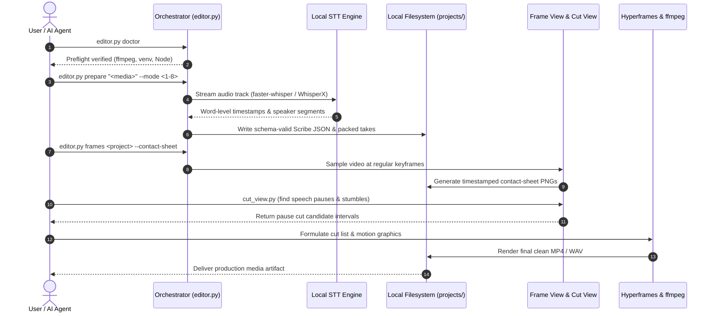

<p align="center"></p>

<p align="center">
  <a href="https://github.com/ellmos-ai/ai-media-editor"></a>
  <a href="https://github.com/ellmos-ai/ai-media-editor/actions/workflows/ci.yml"></a>
  <a href="https://github.com/ellmos-ai/ai-media-editor"></a>
  <a href="https://python.org"></a>
  <a href="https://github.com/ellmos-ai/ai-media-editor"></a>
  <a href="https://github.com/ellmos-ai/ai-media-editor"></a>
  <a href="https://github.com/ellmos-ai/ai-media-editor"></a>
  <a href="https://github.com/ellmos-ai/ai-media-editor/blob/main/SECURITY.md"></a>
  <a href="https://github.com/astral-sh/ruff"></a>
  <a href="https://github.com/ellmos-ai"></a>
  <a href="https://github.com/open-bricks"></a>
  <a href="llms.txt"></a>
  <a href="THIRD_PARTY_LICENSES.txt"></a>
  <a href="NOTICE"></a>
  <a href="https://github.com/ellmos-ai/ai-media-editor"></a>
  <a href="LICENSE"></a>
</p>

<p align="center"><a href="README.md">English</a> · <a href="README_de.md">Deutsch</a> · <a href="README_es.md">Español</a> · <a href="README_fr.md">Français</a> · <strong>简体中文</strong> · <a href="README_ja.md">日本語</a> · <a href="README_ru.md">Русский</a> · <a href="README_hi.md">हिन्दी</a> · <a href="README_ar.md">العربية</a> · <a href="README_bn.md">বাংলা</a> · <a href="README_pt.md">Português</a></p>

# ai-media-editor — 本地 AI 媒体编辑器（视频 · 音频 · 播客）

> [!NOTE]
> **AI / 智能体原生集成：** `ai-media-editor` 专为自主编程智能体（Claude Code、Gemini/Antigravity、Codex）设计。它提供确定性的项目准备、Scribe JSON 模式生成和带时间戳的帧缩略图总览，使 LLM 能够在本地直观检查并剪辑媒体，无需依赖第三方 SaaS 服务。

### 快速导航

| # | 章节 | 描述 |
|---|---|---|
| 01 | [核心能力](#key-capabilities) | 编排器的核心能力、本地 STT 路由和智能体工具栈 |
| 02 | [可视化架构流程图](#architecture-flowchart) | 从原始媒体接收至确定性导出的五层系统拓扑图 |
| 03 | [端到端执行生命周期时序](#end-to-end-execution-lifecycle-sequence) | 展示预检、STT、帧缩略图总览和剪辑执行的时序图 |
| 04 | [目标用户画像与可发现性](#marketing--target-personas) | 4 个核心用户画像（`[PERSONA-01]`–`[PERSONA-04]`）及高意图 SEO 搜索词 |
| 05 | [与替代方案的对比矩阵](#comparative-matrix-vs-alternatives) | 从 10 个维度对比云端 SaaS、重型 NLE、原始 CLI 和托管 API |
| 06 | [8 个生产用例](#the-8-usecases) | 音频、视频、讲解视频和广告工作流的完整矩阵 |
| 07 | [入门与设置](#getting-started--setup) | 前置条件、`<TOOLS_ROOT>` 配置和环境初始化 |
| 08 | [CLI 参考与命令](#cli-reference--commands) | `doctor`、`modes`、`prepare` 和 `frames` 的分步 CLI 命令 |
| 09 | [动态图形与音乐合成](#motion-graphics--music-synthesis) | Hyperframes 样式设计，以及根据故事线离线合成 NumPy 波形配乐 |
| 10 | [治理与运行时不变量](#governance--runtime-invariants) | 10 项运行时不变量，适用范围取决于所选模式（`INV-LOCAL-01` 至 `INV-SLA-10`） |
| 11 | [安全与隐私 SLA](#security--privacy-sla) | 默认本地处理、可选 SSH STT、48 小时初步响应和 5 天分级处置 SLA |
| 12 | [关联项目与生态矩阵](#sibling-projects--ecosystem-matrix) | `ellmos-ai`、`dev-bricks`、`file-bricks` 和 `open-bricks` 中的 16 个协作工具 |
| 13 | [质量门禁与测试](#quality-gates--testing) | 自动化测试套件、Ruff 检查、compileall 和控制台窗口抑制 |
| 14 | [机器可读上下文（`llms.txt`）](#machine-readable-context-llmstxt) | LLM 爬虫清单、搜索索引关键词和智能体摄取规则 |
| 15 | [仓库结构](#repository-structure) | 代码、工具、STT、测试和项目目录的详细分类 |
| 16 | [变更日志与发布](#changelog--releases) | 发布历史、版本里程碑和 Pfad B 可发现性更新 |
| 17 | [一级 SBOM 与第三方许可证](#third-party-licenses--transparency) | 第三方许可证清单、RunAsInvoker 保证和一级 SBOM |
| 18 | [法定声明与责任限制](#statutory-notice--liability-limitation) | MIT 许可证、§ 521 BGB *Gefälligkeitsrecht*（无偿合同）声明及责任限制 |
| 19 | [关联项目：`clip-storyboard-director`](#19-sister-project-clip-storyboard-director) | 导演/剪辑双角色中的导演端，作为固定版本的可选依赖随附 |

---

<a id="sec-01"></a><a id="key-capabilities"></a><a id="1-key-capabilities"></a><a id="hauptfunktionen"></a><a id="1-hauptfunktionen"></a>
## 1. 核心能力

使用 AI 编程智能体（如 Claude Code、Gemini、Codex）作为视频/播客剪辑器，**以本地转写取代 ElevenLabs Scribe**。编排器（`editor.py`）负责确定性准备（路由至合适的 STT 引擎和计算模式、生成符合模式的 Scribe JSON，并整理素材片段）；创意剪辑、动画和合成由智能体驱动。

由三个工具组成的工具栈：
- **video-use** — 根据逐词转写进行剪辑（移除停顿和口误）。
- **Hyperframes** — 将 HTML/CSS/JS 转换为 MP4 动画和动态图形。
- **`frontend-design` 技能** — 生成动态图形和品牌视觉素材。

……本地引擎**取代 ElevenLabs Scribe 转写**。默认使用 **faster-whisper**，并通过基于文本的 LLM 为对话分配说话人；**WhisperX** 是可选的声学说话人分离引擎。默认在本地计算，也可选择远程主机优先、本地回退的路由。替代实现会写入 `video-use` 所使用的精确 Scribe 字段，因此下游辅助工具无需修改即可运行。

---

<a id="sec-02"></a><a id="visual-architecture-flowchart"></a><a id="architecture-flowchart"></a><a id="systemarchitektur-ablaufdiagramm"></a><a id="2-visual-architecture-flowchart"></a><a id="2-systemarchitektur-ablaufdiagramm"></a>
## 2. 可视化架构流程图

```mermaid
flowchart TB
    subgraph Intake ["Layer 1: Input Channels & Media Intake"]
        V["Raw Video Recording (.mp4/.mov)"]
        A["Raw Audio Recording (.wav/.m4a)"]
        S["Storyline JSON (Narrative & Emotion)"]
    end

    subgraph Preflight ["Layer 2: Orchestrator & Preflight Inspection"]
        DOC["editor.py doctor<br/>Environment & Tooling Verification"]
        MODES["editor.py modes<br/>8 Specialized Media Use Cases"]
        PREP["editor.py prepare<br/>Project Staging & Metadata Contract"]
    end

    subgraph Engines ["Layer 3: Processing & Synthesis Engines"]
        FW["faster-whisper / WhisperX<br/>100% Local STT & Word Alignment"]
        DIAR["ai_media_editor/stt/diarize_llm.py<br/>Text-based Multi-Speaker Diarization"]
        MUSIC["ai_media_editor/tools/compose_music.py<br/>Procedural NumPy Waveform Synthesis"]
        HF["Hyperframes & hide-windows.cjs<br/>HTML/CSS/JS -> MP4 Motion Graphics"]
    end

    subgraph Agentic ["Layer 4: Agentic Interaction Layer"]
        SCRIBE["Scribe JSON Schema<br/>Word-level Timing for video-use"]
        FRAMES["ai_media_editor/tools/frame_view.py<br/>Timestamped Contact-Sheets"]
        CUTS["ai_media_editor/tools/cut_view.py<br/>Pause & Inflection Cut Candidates"]
        LLM["AI Coding Agent<br/>(Claude Code / Gemini / Codex)"]
    end

    subgraph Export ["Layer 5: Deterministic Export & Artefacts"]
        OUT_V["Rendered Master Video (.mp4)"]
        OUT_A["Clean Speaker-Separated Audio (.wav)"]
        OUT_M["Standard MIDI File (.mid) & Score"]
    end

    Intake --> Preflight
    Preflight --> Engines
    Engines --> Agentic
    Agentic --> Export
```



---

<a id="sec-03"></a><a id="end-to-end-execution-lifecycle-sequence"></a><a id="end-to-end-ausführungs-sequenz"></a><a id="3-end-to-end-execution-lifecycle-sequence"></a>
## 3. 端到端执行生命周期时序



---

<a id="sec-04"></a><a id="target-personas--discoverability"></a><a id="marketing--target-personas"></a><a id="zielgruppen--auffindbarkeit"></a><a id="marketing--zielgruppen"></a><a id="4-target-personas--discoverability"></a>
## 4. 目标用户画像与可发现性

`ai-media-editor` 针对现代 AI 媒体自动化的四类用户，解决其关键工作流瓶颈：

### [PERSONA-01] 自主 AI 编码智能体开发者与智能体集群架构师
- **画像：** 设计多智能体工作流（Claude Code、Gemini/Antigravity、Codex CLI、Kimi Code）以实现自主媒体制作的软件工程师。
- **痛点：** 专有云端 STT 服务会施加 API 速率限制、需要脆弱的浏览器自动化，并将尚未发布的机密媒体暴露给外部供应商。
- **方案：** 纯 CLI 编排，确定性生成 Scribe JSON 模式、提供停顿剪辑候选，并生成多模态 LLM 可直接读取的带时间戳的帧缩略图总览。
- **高意图搜索词：** `"agent driven video editor with local transcription"`

### [PERSONA-02] 本地优先的播客创作者
- **画像：** 独立播客制作人、采访者和创作者，负责每周发布音频/视频内容。
- **痛点：** 云端剪辑 SaaS（Descript、Riverside）的月订阅费用高昂，数 GB 录音的上传速度也很慢。
- **方案：** 使用 faster-whisper 在本地模式下转写、按说话人分离音轨、自动裁掉停顿，并以程序方式生成动态封面视频。代码不会强制模型加载必须保持离线。
- **高意图搜索词：** `"local first podcast editing AI agent workflow"`

### [PERSONA-03] AI 视频与动态图形工程师
- **画像：** 自动化品牌视觉视频素材的前端开发者和动态图形设计师。
- **痛点：** 传统 NLE（Premiere、After Effects）缺少简洁的程序化接口，无法直接根据 CSS/HTML 设计令牌渲染动画。
- **方案：** 直接集成 Hyperframes，将 HTML/CSS/JavaScript 组件转换为 60 fps MP4 动态图形，并抑制 Windows 控制台窗口闪烁。
- **高意图搜索词：** `"Hyperframes motion graphics podcast editor"`

### [PERSONA-04] 企业媒体安全与合规负责人
- **画像：** 医疗、法律、银行等受监管行业的合规与信息安全负责人。
- **痛点：** 组织政策或合同要求可能禁止将专有录音发送给托管式转写服务商。
- **方案：** 默认使用本地 STT；选择 `compute.prefer=mac` 时，会将完整的输入媒体文件副本发送至配置的 SSH 主机。所选模式应符合组织的数据处理要求。此外，文档还说明了通过 `RunAsInvoker` 实现的非特权运行（`INV-RUNAS-02`）、一级 SBOM，以及正式的 48 小时漏洞响应 SLA。
- **高意图搜索词：** `"zero egress video transcription and cutting"`

---

<a id="sec-05"></a><a id="comparative-matrix-vs-alternatives"></a><a id="comparative-matrix--alternatives"></a><a id="vergleichsmatrix-gegenueber-alternativen"></a><a id="5-comparative-matrix-vs-alternatives"></a>
## 5. 与替代方案的对比矩阵

以下 10 维矩阵根据有文档记录、且适用范围取决于所选运行模式的不变量，对比 `ai-media-editor` 与旧式及竞争方案：

| 维度与不变量 | ai-media-editor | 云端 SaaS（Descript / ElevenLabs） | 商业 NLE（Premiere / DaVinci） | 原始 CLI / Shell（FFmpeg） | 托管 API（Whisper API / Google STT） |
|---|:---:|:---:|:---:|:---:|:---:|
| **1. 本地优先与按模式划分的数据流（`INV-LOCAL-01`）** | :white_check_mark: 默认本地；可选 SSH STT | :x: 强制上传至云端 | :warning: 本地（专有遥测） | :white_check_mark: 100% 离线本地 | :x: 外部云端处理 |
| **2. 非特权用户模式（`INV-RUNAS-02`）** | :white_check_mark: 标准 `RunAsInvoker` | :warning: 浏览器 / 辅助应用 | :warning: 管理员安装器 / 守护进程 | :white_check_mark: 用户权限 | :white_check_mark: API 客户端级别 |
| **3. 非破坏性源媒体保护（`INV-PREV-03`）** | :white_check_mark: `prepare` 保留原始输入 | :warning: 云端媒体复制 | :white_check_mark: 非破坏性项目 | :warning: 容易意外覆盖 | :white_check_mark: 输入媒体保留 |
| **4. 确定性合成（`INV-DETERM-04`）** | :white_check_mark: Scribe JSON 与固定随机种子的乐谱 | :x: 云端随机漂移 | :warning: 复杂的项目状态 | :warning: 无结构输出 | :x: 延迟不确定 |
| **5. 项目名称校验（`INV-BOUNDARY-05`）** | :white_check_mark: 名称词法检查；不是文件系统沙箱 | :warning: 托管云存储桶 | :warning: 任意文件系统 | :x: 不校验路径 | :white_check_mark: 云端租户边界 |
| **6. 抑制窗口闪烁（`INV-SUBPROC-06`）** | :white_check_mark: 预加载 `windowsHide` | :heavy_minus_sign: 不适用（Web UI） | :heavy_minus_sign: 不适用（桌面 GUI） | :x: 控制台窗口频繁闪现 | :heavy_minus_sign: 不适用（HTTP 请求） |
| **7. 跨平台支持（`INV-PARITY-07`）** | :white_check_mark: Windows、Linux、macOS，使用各操作系统对应的路径 | :warning: 取决于浏览器 | :x: 操作系统专属功能 | :white_check_mark: POSIX / Windows | :white_check_mark: 跨平台 HTTP |
| **8. 多智能体并发（`INV-SYNC-08`）** | :white_check_mark: 锁纪律与干净的 Git 状态 | :x: 单用户 SaaS 会话 | :x: 单编辑器项目锁 | :warning: 并发冲突 | :warning: 速率限制瓶颈 |
| **9. 智能体与 LLM 可读性（`INV-DOCS-09`）** | :white_check_mark: Scribe JSON、帧缩略图总览、`llms.txt` | :x: 封闭二进制 / HTML DOM | :x: 复杂二进制项目文件 | :warning: 原始 stdout/stderr 文本 | :warning: 仅有文本转写 |
| **10. 协调式安全 SLA（`INV-SLA-10`）** | :white_check_mark: 48 小时响应 / 5 天分级处置 | :warning: 企业支持队列 | :warning: 季度商业更新 | :heavy_minus_sign: 无人维护的脚本 | :warning: 标准云端 SLA |

详细的营销分析、搜索关键词和发现日志：[`MARKETING-LOG.txt`](MARKETING-LOG.txt)。

---

<a id="sec-06"></a><a id="the-8-production-usecases"></a><a id="the-8-usecases"></a><a id="die-8-anwendungsfälle"></a><a id="6-the-8-production-usecases"></a>
## 6. 8 个生产用例

| # | 输入 | 说话人数 | 输出 | 典型工作流 |
|---|---|---|---|---|
| 1 | 音频 | 1 | 剪辑后的音频播客 | 单人语音清理并裁掉停顿 |
| 2 | 音频 | 多人 | 按说话人分轨的音频播客 | 对话说话人分离后进行多轨清理 |
| 3 | 视频（音频+视频） | 1 | 视频剪辑 + 动画 | 带自动 Hyperframes 下三分之一字幕的真人讲话剪辑 |
| 4 | 视频（音频+视频） | 多人 | 视频 + 动画 + 说话人追踪 | 带动态说话人卡片的多人采访视频 |
| 5 | 视频 → 仅音频 | 1 / 多人 | 音频播客（丢弃视频） | 从视频素材中提取纯净音频播客 |
| 6 | 音频 | 1 / 多人 | 完整生成的讲解视频 | 由 AI 编排动态图形视觉效果的配音轨 |
| 7 | 音频 | 1 | 音频 + 动态封面 | 在动态黑胶唱片/波形循环画面中呈现播客音轨 |
| 8 | 音频/简报 | 1 | 广告短片（15–60 s，16:9 + 9:16） | 通过 Hyperframes 快速批量制作短视频 |

各模式的完整分步指南请参阅 [`docs/USECASES.md`](docs/USECASES.md)。

---

<a id="sec-07"></a><a id="getting-started--setup"></a><a id="erste-schritte--einrichtung"></a><a id="7-getting-started--setup"></a>
## 7. 入门与设置

1. **创建配置：** 将 `config/settings.example.json` 复制为 `config/settings.json`，并配置本地计算选项（`local`/`mac`、引擎、`paths.*`）。将 `paths.venv_python` 设置为此操作系统的 Python 可执行文件路径；程序会直接使用该配置值。示例中的 `.venv/Scripts/python.exe` 路径仅适用于 Windows；POSIX 环境通常使用 `.venv/bin/python`。
2. **工具目录（`<TOOLS_ROOT>`）：** `settings.json` 中的 `paths.tools_root` 指定大型工具（`video-use`、ffmpeg、Node ≥ 22）的根目录。**不要**将其放在云同步文件夹中。
3. **外部前置条件：**
   - **本地：** `ffmpeg`、`Node.js >= 22`（用于 Hyperframes）、Python 3.10–3.13 虚拟环境。
   - **可选远程主机：** 在可通过 SSH 访问的远程计算机上安装 faster-whisper + WhisperX。
   - **Hugging Face Token：** 仅当 `engines.multi_speaker` 设置为 `whisperx` 时才需要。
4. **可选：安装为软件包。** `pip install -e .`（或 `-e ".[storyboard]"`，以同时安装
   [`clip-storyboard-director`](#19-sister-project-clip-storyboard-director)）会注册
   `ai-media-editor` 控制台命令，与下文运行 `python editor.py` 等效。

---

<a id="sec-08"></a><a id="cli-reference--commands"></a><a id="cli-referenz--befehle"></a><a id="8-cli-reference--commands"></a>
## 8. CLI 参考与命令

```bash
# Set Python venv path
VENV="<TOOLS_ROOT>/.venv/Scripts/python.exe"

# 1. Environment & toolchain verification
PYTHONIOENCODING=utf-8 "$VENV" editor.py doctor

# 2. Display supported operational use cases
PYTHONIOENCODING=utf-8 "$VENV" editor.py modes

# 3. Prepare a media project (deterministic transcription + take packing)
PYTHONIOENCODING=utf-8 "$VENV" editor.py prepare "/path/to/recording.mp4" --mode 3 --project my-video

# 4. Generate timestamped frame contact-sheets for visual LLM inspection
PYTHONIOENCODING=utf-8 "$VENV" editor.py frames my-video --contact-sheet

# 5. Extract detailed frame interval
PYTHONIOENCODING=utf-8 "$VENV" editor.py frames my-video --from 30 --to 45 --step 0.25
```

---

<a id="sec-09"></a><a id="motion-graphics--music-synthesis"></a><a id="motion-graphics--musiksynthese"></a><a id="9-motion-graphics--music-synthesis"></a>
## 9. 动态图形与音乐合成

### 离线视频同步配乐（`compose_music.py`）
`ai_media_editor.tools.compose_music` 根据视频故事线创作背景音乐 — 100% 在本地运行，不使用云服务。
输入是一个 **故事线 JSON**，其中定义了各段落的精确时间窗口、情绪和强度级别：

```bash
# Compose music from storyline JSON
python -m ai_media_editor.tools.compose_music docs/examples/storyline-roshambo.json -o projects/<name>/assets/score

# Generate storyline template
python -m ai_media_editor.tools.compose_music --init

# Run deterministic synthesis selftest
python -m ai_media_editor.tools.compose_music --selftest
```

输出：立体声 WAV + MP3 + `<name>.notes.json` + `<name>.mid`（标准 MIDI 文件类型 1）。

### MIDI 导出与高保真渲染
MIDI 导出可使用专业音源进行无损渲染：
- **路径 A — SoundFont（本地，免费）：** FluidSynth（`winget install FluidSynth`）+ GeneralUser GS / MuseScore_General：
  `fluidsynth -ni soundfont.sf2 out.mid -F out.wav -r 44100`
- **路径 B — 管弦乐音源库：** VSCO 2 Community Edition 或 Salamander Grand Piano。

### 多片段循环组装、QA 与氛围合成（`make_loop.py`、`qa_clips.py`、`atmo.py`、`synth.py`、`fx.js`）
这些工具移植自 Halloween Window Projection 制作流水线（`T-20261025-256694132`）。`ai_media_editor.tools` 还提供可复用的场景循环组装和程序化声音设计工具：
- **`ai_media_editor.tools.make_loop`**：将渲染的场景片段（`<sid>.mp4`）串接起来，加入可配置的黑场暂停间隔（`loop.json` 或 `--pause`），并可选添加 AAC 48 kHz 音轨（`--audio`）：
  `python -m ai_media_editor.tools.make_loop docs/examples/loop-halloween.json renders/ -o loop.mp4 [--pause 8] [--audio atmo.wav]`
- **`ai_media_editor.tools.qa_clips`**：通过 `ffprobe` 验证已渲染片段，测量首帧/末帧亮度（黑电平验证），提取开始/中间/结束/峰值帧，并生成 `xstack` 帧缩略图总览（`qa.json`、`VORSCHAU_kontaktbogen.jpg`）：
  `python -m ai_media_editor.tools.qa_clips renders/ qa_out/`
- **`ai_media_editor.tools.synth` 和 `ai_media_editor.tools.atmo`**：使用 NumPy/SciPy 以 48 kHz 进行程序化乐器与氛围合成（`chip_pulse`、`marimba`、`glock`、`pizz`、`flute`、`fm_brass`、`fm_bell`、`make_ir`），并生成按场景网格循环的音景，迭代进行 EBU R128 响度（`-16 LUFS-I`）和真峰值（`<= -3.5 dBTP`）母带处理：
  `python -m ai_media_editor.tools.atmo docs/examples/loop-halloween.json -o atmo.wav [--pause 8]`
- **`ai_media_editor/tools/fx.js`（`window.HFX`）**：确定性且支持安全时间轴跳转的 HyperFrames 场景辅助函数，包括 `HFX.ft`（GSAP `fromTo` 包装器，强制 `immediateRender: false`，确保动画开始前效果保持隐藏）、`HFX.drive`、`HFX.rng`（mulberry32）、`HFX.noise1`、`HFX.key`、`HFX.bump`、`HFX.path`、`HFX.spider` 和 `HFX.bat`。

---

<a id="sec-10"></a><a id="governance--runtime-invariants"></a><a id="governance---laufzeit-invarianten"></a><a id="10-governance--runtime-invariants"></a>
## 10. 治理与运行时不变量

架构文档记录了 10 项运行时不变量；其行为取决于所选运行模式：

| 不变量 ID | 运行领域 | 保证与执行规则 | 验证机制 |
|---|---|---|---|
| `INV-LOCAL-01` | 隐私与数据外传 | **默认本地优先：** 当 `compute.prefer=local` 时，STT 在此计算机上运行；模型加载并未被强制限制为离线。当 `compute.prefer=mac` 时，会将完整的输入媒体文件副本发送至配置的 SSH 主机，任何已配置的 HF Token 也会一并发送。会在 `finally` 块中尝试清理远程作业，但不验证是否清理成功。 | `tests/test_core.py`、`editor.py`、`ai_media_editor/stt/mac_remote.py` |
| `INV-RUNAS-02` | 权限与沙箱 | **非特权用户模式（`RunAsInvoker`）：** 无需管理员权限或提权。 | 所有脚本均以标准用户身份运行 |
| `INV-PREV-03` | 存储与不可变性 | **非破坏性输入处理：** `prepare` 保持原始输入不变，并将其复制到 `projects/<name>/`。临时音频可能存储在操作系统临时目录；远程模式也会使用配置的 SSH 工作目录。 | `tests/test_core.py` 中的隔离检查 |
| `INV-DETERM-04` | 可复现性 | **确定性合成与模式稳定性：** 程序化音频使用固定随机种子，并严格遵循 Scribe JSON 模式。 | `tests/test_compose_music.py`、`ai_media_editor/stt/scribe_schema.py` |
| `INV-BOUNDARY-05` | 项目名称校验 | **项目名称词法检查：** 项目名称会作为单一路径组件进行检查；这不是文件系统沙箱。 | `test_project_names_cannot_escape_projects` |
| `INV-SUBPROC-06` | 运行进程清理 | **清洁生命周期与窗口抑制：** 预加载的包装器会抑制 Windows 上控制台窗口闪烁。 | `ai_media_editor/tools/hf.cmd`、`ai_media_editor/tools/hide-windows.cjs` |
| `INV-PARITY-07` | 多操作系统支持 | **跨平台支持：** 路径和可执行文件按所用操作系统进行配置；经过测试的操作系统请参见 CI 矩阵。 | 多操作系统 GitHub Actions CI 矩阵 |
| `INV-SYNC-08` | 并发与锁 | **云同步与多智能体锁纪律：** 大型工具和项目已排除在云同步冲突之外。 | `.gitignore` 中的冲突与锁定过滤规则 |
| `INV-DOCS-09` | 可访问性与发现 | **多模态 LLM 就绪与双语一致性：** 为视觉 LLM 提供帧缩略图总览；EN/DE 文档完全一致。 | `llms.txt`、`README.md`、`README_de.md` 契约测试 |
| `INV-SLA-10` | 安全与事件响应 | **48 小时安全响应与 5 天分级处置 SLA：** 通过 GitHub Advisories 和维护者电子邮件正式报告漏洞。 | `SECURITY.md`、`test_security_policy_bilingual_parity` |

---

<a id="sec-11"></a><a id="security--privacy-sla"></a><a id="sicherheit--datenschutz-sla"></a><a id="11-security--privacy-sla"></a>
## 11. 安全与隐私 SLA

- **默认本地处理：** 本地 STT 是默认方式，但模型加载并未被强制限制为离线。选择 `compute.prefer=mac` 时，会将完整的输入媒体文件副本发送到配置的 SSH 主机；任何已配置的 HF Token 也会一并发送。
- **敏感媒体处理：** `prepare` 会保留输入路径中的原始录音，并将副本放入 `projects/<name>/`。临时音频可能位于操作系统临时目录。远程模式会在配置的 SSH `workdir` 中存放工作副本；会在 `finally` 块中尝试清理，但不验证是否成功。
- **漏洞响应承诺：**
  - **初步响应 SLA：** 在 48 小时内确认收到已提交的漏洞报告。
  - **技术分诊 SLA：** 在 5 个工作日内进行严重性评估。
  - **报告渠道：** [GitHub 安全公告](https://github.com/ellmos-ai/ai-media-editor/security/advisories)或直接发送邮件至 `security@open-bricks.org`、`security@ellmos.ai`、`support@lukasgeiger.com` 和 `lukas@open-bricks.org`。
  - 完整详情请参阅 [`SECURITY.md`](SECURITY.md)。

---

<a id="sec-12"></a><a id="sibling-projects--ecosystem-matrix"></a><a id="geschwisterprojekte--ökosystem-matrix"></a><a id="12-sibling-projects--ecosystem-matrix"></a>
## 12. 关联项目与生态矩阵

`ai-media-editor` 是 `open-bricks` 和 `ellmos-ai` 生态中的专业多媒体编排引擎：

| 仓库 | 组织 | 领域 / 用途 | 生态互操作性 |
|---|---|---|---|
| [`clip-storyboard-director`](https://github.com/ellmos-ai/clip-storyboard-director) | `ellmos-ai` | 生成式分镜与场景导演 | 为视频用例生成场景序列 |
| [`assistant-core`](https://github.com/ellmos-ai/assistant-core) | `ellmos-ai` | 对话监管与智能体运行时 | 编排自主媒体编辑任务 |
| [`decision-clicker`](https://github.com/ellmos-ai/decision-clicker) | `ellmos-ai` | 交互式用户审核入口 | 审核候选剪辑与编辑决策 |
| [`lock-master`](https://github.com/ellmos-ai/lock-master) | `ellmos-ai` | 故障时默认拒绝执行的多智能体锁定框架 | 保护并发项目文件和渲染锁 |
| [`clutch`](https://github.com/ellmos-ai/clutch) | `ellmos-ai` | 进程监督器与任务调度器 | 监督长时间运行的渲染与 STT 作业 |
| [`system-explorer`](https://github.com/ellmos-ai/system-explorer) | `ellmos-ai` | 本地硬件与能力发现 | 检测 GPU、CUDA 和硬件加速 |
| [`roblox-studio-core`](https://github.com/ellmos-ai/roblox-studio-core) | `ellmos-ai` | 无头 3D 工作室捕获与自动化 | 创建 3D 视觉素材和动画帧 |
| [`usb-podcast-studio`](https://github.com/entertain-and-more/usb-podcast-studio) | `entertain-and-more` | USB 音频硬件采集与广播 | 播客模式的高保真录音来源 |
| [`BattleStage`](https://github.com/entertain-and-more/BattleStage) | `entertain-and-more` | 服务器权威物理模拟 | 处理游戏画面和回放视频 |
| [`DevCenter`](https://github.com/dev-bricks/DevCenter) | `dev-bricks` | 开发环境与工作区管理器 | 管理本地工具和开发虚拟环境 |
| [`MethodenAnalyser`](https://github.com/dev-bricks/MethodenAnalyser) | `dev-bricks` | Python 静态代码指标与方法审计 | 分析媒体编辑器模块的代码质量 |
| [`ExplorerPro`](https://github.com/file-bricks/ExplorerPro) | `file-bricks` | 高速桌面文件管理器（PySide6） | 可视化浏览项目并整理媒体文件 |
| [`ProFiler`](https://github.com/file-bricks/ProFiler) | `file-bricks` | 深度目录分析与检查 | 媒体资源索引与缓存分析 |
| [`CloudLockFixer`](https://github.com/file-bricks/CloudLockFixer) | `file-bricks` | 多主机同步冲突修复器 | 清理锁定文件和云端冲突副本 |
| [`FormularErstellen`](https://github.com/doc-bricks/FormularErstellen) | `doc-bricks` | 动态 PDF 与文档版式生成器 | 生成项目报告和制作摘要 |
| [`open-bricks`](https://github.com/open-bricks/open-bricks) | `open-bricks` | 开源标准伞形组织 | 生态系统的规范治理与许可证一致性 |

---

<a id="sec-13"></a><a id="quality-gates--testing"></a><a id="qualitätsprüfung--tests"></a><a id="13-quality-gates--testing"></a>
## 13. 质量门禁与测试

在本地快速执行质量检查，无需外部 STT 模型或大型媒体文件：

```bash
# Run complete test suite
python -m pytest -ra -v

# Run lint checks
ruff check .

# Validate bytecode compilation
python -m compileall -q .

# Verify CLI modes
python editor.py modes
```

### Windows 控制台窗口抑制
Hyperframes 和 Node 子进程通过 `ai_media_editor/tools/hf.cmd` 与 `ai_media_editor/tools/hide-windows.cjs` 运行，以强制启用 `windowsHide: true`，从而消除渲染期间令人分心的控制台窗口闪烁。背景说明：[`docs/WINDOWS-KONSOLENFENSTER.md`](docs/WINDOWS-KONSOLENFENSTER.md)。

---

<a id="sec-14"></a><a id="machine-readable-context-llmstxt"></a><a id="maschinenlesbarer-kontext-llmstxt"></a><a id="14-machine-readable-context-llmstxt"></a>
## 14. 机器可读上下文（`llms.txt`）

LLM 爬虫、代码助手和自动索引智能体可直接通过 [`llms.txt`](llms.txt) 解析仓库上下文。

关键搜索短语：
```text
ellmos-ai/ai-media-editor
local AI media editor video podcast transcription
agent driven video editor with local transcription
Claude Code video podcast editor Hyperframes
faster-whisper WhisperX Scribe JSON video-use
transcript based video cutting local first
Hyperframes motion graphics podcast editor
offline procedural music synthesis storyline numpy
zero egress video transcription and cutting
```

---

<a id="sec-15"></a><a id="repository-structure"></a><a id="repository-struktur"></a><a id="15-repository-structure"></a>
## 15. 仓库结构

```
ai-media-editor/                  (code/docs/projects)
├── CLAUDE.md                     ← agent guide (editor workflow, German)
├── README.md                     ← English overview & 18-point visual architecture
├── README_de.md                  ← German documentation (1:1 anchor parity)
├── editor.py                     ← compatibility shim for documented direct calls
├── ai_media_editor/editor.py     ← orchestrator (prepare / frames / modes / doctor)
├── ai_media_editor/tools/
│   ├── cut_view.py               ← pauses as explicit cut candidates
│   ├── frame_view.py             ← video → timestamped frames ("video-scatterer", UC3/4/8)
│   ├── compose_cover.py          ← UC7: loop a cover over audio
│   ├── compose_music.py          ← storyline JSON → video-synced score (NumPy waveform synthesis)
│   ├── synth.py / atmo.py        ← 48 kHz SciPy instrument synthesis & loopable EBU R128 atmo generator
│   ├── make_loop.py / qa_clips.py← multi-clip black-pause loop builder & ffprobe/luma QA contact sheet
│   ├── fx.js                     ← deterministic HyperFrames scene helpers (HFX.ft, HFX.drive, SVG rigs)
│   ├── hf.cmd / hf-hidden.vbs    ← Windows console window suppression wrappers
│   └── hide-windows.cjs          ← Node.js preload script enforcing windowsHide: true
├── ai_media_editor/stt/
│   ├── scribe_schema.py          ← Scribe-JSON format (contract with video-use)
│   ├── transcribe_local.py       ← faster-whisper + WhisperX → Scribe-JSON
│   ├── diarize_llm.py            ← token-free text-based speaker assignment
│   └── mac_remote.py             ← compute routing (remote primary, local fallback)
├── config/settings.example.json  ← template: compute, engines, models, paths, HF token
├── brand/design-tokens.css       ← branding tokens for generated animations
├── docs/USECASES.md              ← step-by-step per mode
├── production/                   ← optional generative workflows (cloud gates apply)
├── tests/
│   ├── test_core.py              ← dependency-free regression suite
│   ├── test_compose_music.py     ← storyline & waveform synthesis tests
│   └── test_metadata.py          ← automated contract tests for manifests & discoverability
├── SECURITY.md                   ← private vulnerability reporting and security scope
├── THIRD_PARTY_LICENSES.md       ← Level 1 SBOM and third-party license inventory
├── MARKETING-LOG.txt             ← discoverability, personas, matrix & architecture audit
└── projects/<name>/edit/         ← per project: transcripts/, takes_packed.md, … (gitignored)

<TOOLS_ROOT>/                     (NOT a cloud folder — venv/tools)
├── .venv/                        ← Python venv (faster-whisper, video-use, …)
└── video-use/                    ← cloned browser-use/video-use (unpatched)
```

---

<a id="sec-16"></a><a id="changelog--releases"></a><a id="changelog--veröffentlichungen"></a><a id="16-changelog--releases"></a>
## 16. 变更日志与发布

完整版本历史请参阅 [`CHANGELOG.md`](CHANGELOG.md)。
- **版本 0.2.3（2026-09-20）：** Pfad B 可视化架构与可发现性改版、18 项双语导航一致性、与 4 种替代方案的 10 维对比矩阵、正式定义的 4 个目标用户画像（`[PERSONA-01]` 至 `[PERSONA-04]`）、`THIRD_PARTY_LICENSES.md` 中的一级 SBOM 不变量交叉索引表、`RunAsInvoker` 不提权认证，以及 § 521 BGB 法定声明。
- **版本 0.2.2（2026-09-12）：** Pfad A 技术卫生更新、CI 运行器超时防护（`timeout-minutes: 15`）、过期 issue/PR 生命周期自动管理、强化的 `.gitignore`，以及 `pyproject.toml` 中的可选依赖组。
- **版本 0.2.1（2026-09-11）：** 可发现性改进、专项第三方许可证审计、PEP 621 扩展 URL，以及初始契约测试套件。
- **版本 0.2.0（2026-09-09）：** 加固本地优先流水线、自动化契约测试、多操作系统 CI 矩阵、双语一致性、双 Mermaid 图表，以及 10 项治理不变量。

---

<a id="sec-17"></a><a id="level-1-sbom--third-party-licenses"></a><a id="third-party-licenses--transparency"></a><a id="drittanbieter-lizenzen--transparenz"></a><a id="17-level-1-sbom--third-party-licenses"></a>
## 17. 一级 SBOM 与第三方许可证

`ai-media-editor` 记录其组件许可证，并侧重于非特权运行：

- **第三方许可证清单：** 请查看 [`THIRD_PARTY_LICENSES.md`](THIRD_PARTY_LICENSES.md) 中所列组件的记录许可证，并在使用前核实适用许可证。
- **本地优先 STT（`INV-LOCAL-01`）：** 默认使用本地转写。模型加载并未被强制限制为离线；选择 `compute.prefer=mac` 时，会将完整的输入媒体文件副本发送到配置的 SSH 主机，任何已配置的 HF Token 也会一并发送。
- **非特权用户运行（`INV-RUNAS-02`）：** 所有组件均严格在标准非特权用户账户下运行（`RunAsInvoker`），无需管理员或 root 提权。
- **一级 SBOM 与治理映射：** 上游来源、维护者、许可证文本和适用不变量均收录在 [`THIRD_PARTY_LICENSES.md`](THIRD_PARTY_LICENSES.md) 中。
- **项目主体许可证：** [MIT 许可证](LICENSE) © 2026 ellmos-ai / open-bricks。

---

<a id="sec-18"></a><a id="statutory-notice--liability-limitation"></a><a id="gesetzlicher-hinweis--haftungsbeschraenkung"></a><a id="18-statutory-notice--liability-limitation"></a>
## 18. 法定声明与责任限制

本软件作为开源软件依据 MIT 许可证免费提供。根据德国成文法（§ 521 BGB — *Gefälligkeitsrecht* / 无偿合同），免费提供软件时的责任限于故意（*Vorsatz*）和重大过失（*grobe Fahrlässigkeit*）。特别是，不对特定用途适用性、适销性或无缺陷作出任何保证。

---

<a id="19-sister-project-clip-storyboard-director"></a>
## 19. 关联项目：`clip-storyboard-director`

[`clip-storyboard-director`](https://github.com/ellmos-ai/clip-storyboard-director) 在
双智能体媒体制作模式中担任**导演**，与本编辑器的**剪辑器**角色相配合：它负责
前期制作（剧本拆解、镜头时序、通过 CDP 浏览器自动化向 AI 视频生成器编写提示词、
4D 持续性/连续性缓冲），并将组装好的粗剪交给
`ai-media-editor` 完成后期（非线性剪辑、调色、转场、音频自动压低（ducking）、
最终渲染）。每个工具都能独立运行，无需依赖另一个工具。

它在本项目的 `pyproject.toml` 中声明为 `storyboard` 可选依赖，
并固定在一个经过审查的特定提交，以确保可复现性。可一步安装这两个工具和
`ai-media-editor` 控制台命令：

```bash
pip install -e ".[storyboard]"
ai-media-editor modes
clip-director --version
```

`clip-storyboard-director` 与本项目一样采用 MIT 许可证；其组件清单请参阅
[`THIRD_PARTY_LICENSES.md`](https://github.com/ellmos-ai/clip-storyboard-director/blob/main/THIRD_PARTY_LICENSES.md)。
